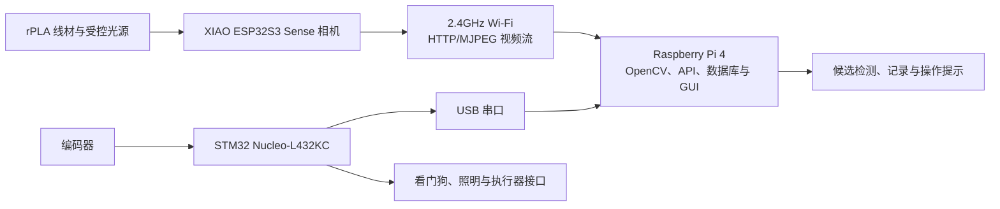
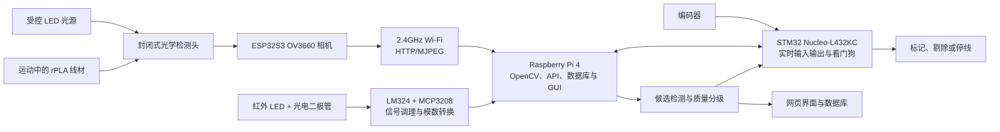

# ENG5105 电气工程概念设计方案

## 基于树莓派的 rPLA 线材表面质量检测系统

本文件依据项目简报、课程器件清单、电气专业概念设计报告要求，以及官方第 1-12 周安排编制。当前团队共六人。

本文中的性能指标属于拟议设计目标。在团队完成并记录利益相关者咨询及实验验证之前，不能将这些指标描述为已经确认或已经实现的结果。

---

## 1. 执行摘要

本项目将开发一套实验室规模的机器视觉系统，用于检测运动中再生聚乳酸线材的可见表面缺陷。XIAO ESP32S3 Sense 的 OV3660 相机将在封闭式受控光照检测通道内采集图像，并通过受控 Wi-Fi 网络将 MJPEG 视频发送给 Raspberry Pi 4；树莓派运行 OpenCV 检测、常驻 API/WebSocket 服务、数据库和网页界面，用于识别气泡或凹坑、裂纹或划痕、污染或夹杂物，以及异常表面纹理。

课程提供的 STM32 Nucleo-L432KC 将负责编码器计数、树莓派心跳监控、照明控制，以及下游标记或剔除装置的触发。检测结果将通过网页界面显示，并与线材位置、时间戳、置信度和批次号一起保存。

项目比较过两套方案。学校已批准自行采购，方案 A 所需的全局快门相机与镜头因而可得，**方案 A 成为选定方案**：全局快门相机经 CSI 直连 Raspberry Pi 4，消除卷帘快门畸变与无线压缩伪影。该硬件尚未到手，因此在到货之前由**方案 B 作为过渡实现**运行：ESP32S3 OV3660 负责图像采集，Raspberry Pi 4 负责图像处理、服务和界面，STM32 负责实时传感、看门狗与执行器接口。两套方案的下游链路完全相同，迁移只替换采集前端，具体步骤见第 11 节第 7-10 周安排。

---

## 2. 项目范围

### 2.1 选定质量参数

本项目选择电气专业项目简报中的“表面质量”作为唯一核心质量参数，主要检测：

- 气泡或凹坑；
- 裂纹或划痕；
- 污染或夹杂物；
- 异常表面纹理。

本系统输出的是视觉纹理异常指标。除非能够使用经过标定的轮廓仪或经过验证的结构光参考设备，否则不能声称测量了工程粗糙度参数 Ra。

### 2.2 研究问题

一套低成本的树莓派机器视觉系统，能否在具有代表性的实验室工况下，可靠地检测、定位并分级运动中 rPLA 线材的可见表面缺陷？

### 2.3 质量控制动作

表面缺陷无法安全地对应到一个简单的 PID 执行器。因此，原型将提供：

1. 实时检测与报警；
2. 基于长度位置的缺陷标记；
3. 合格、警告和拒收三级质量判断；
4. 可供 PLC 使用的停线或剔除请求。

未来的工业系统可以将重复出现的缺陷模式与水分、挤出温度、过滤、冷却和材料混炼条件进行关联分析。

---

## 3. 利益相关者与需求

### 3.1 需要咨询的利益相关者

- BioLoop 或客户代表；
- 项目导师与实验室技术人员；
- 生产线操作员；
- 质量保证人员；
- 维护与电气人员；
- 3D 打印终端用户。

团队应记录咨询日期、参与人员、提问内容、对方反馈，以及咨询结果引起的需求变更。

### 3.2 拟议可量化需求

| 编号 | 拟议需求 |
|---|---|
| R1 | 至少检测三类可见表面缺陷。 |
| R2 | 目标检测特征尺寸不小于 0.20 毫米的缺陷。 |
| R3 | 对满足 R2 的缺陷，查准率和召回率均达到至少 90%。 |
| R4 | 在线材速度为 0-5 米/分钟时，每秒至少处理 20 帧。 |
| R5 | 缺陷确认后 500 毫秒内产生报警。 |
| R6 | 线材长度方向的缺陷定位误差不超过正负 10 毫米。 |
| R7 | 保存缺陷类型、尺寸、置信度、图像、位置、时间和批次号。 |
| R8 | 连续运行 30 分钟，记录丢失率低于 1%。 |
| R9 | 相机、光源、编码器或处理器故障后进入安全保持或故障状态。 |
| R10 | 只拍摄封闭检测区域内的线材，并默认在本地保存数据。 |

以上数值是提案阶段的设计目标，并非已经测得的结果。团队必须通过利益相关者咨询和实验验证确认或修订这些指标。

---

## 4. 概念方案与选择

### 4.1 方案 A：选定方案（待硬件到货后迁移）

方案 A 使用 Raspberry Pi 4、直接连接的全局快门相机、受控光源，以及基于 STM32 的实时输入输出。该方案在技术比较中具有运动成像优势，但学校不提供所需相机与配套材料，因此本项目不实施方案 A，也不生成或引用方案 A 的实测性能结果。

优点：

- 通过 CSI 接口直接连接，在本地处理图像；
- 与滚动快门相机相比，可减少运动形变；
- 支持可调节的 C/CS 接口镜头；
- 延迟较低，便于后续工业集成。

局限：

- 相机、镜头、光源和编码器需要额外采购；
- Raspberry Pi 4 只有一个 CSI 相机接口，多视角覆盖需要反射镜或机械运动；
- 光学对准和照明需要认真标定。

### 4.2 方案 B：过渡实现方案（到货前承担构建）

方案 B 使用课程提供的 ESP32S3 Sense 作为相机节点，并将图像发送给 Raspberry Pi 4 进行处理和显示。

优点：

- 使用学校提供的 ESP32S3 Sense、Raspberry Pi 4 和 STM32，不需要额外购买主相机；
- 可支持第 6 周演示所需的快速开发；
- 软件、数据库、图形界面和嵌入式接口可以继续扩展至最终原型。

局限：

- 图像质量较低且可控性较差；
- 可能出现滚动快门、压缩和通信造成的伪影；
- 不适合对运动线材上的微小缺陷进行高可信度验证。

#### 4.2.1 实施目标与适用边界

方案 B 是本项目的最终测量链：

> ESP32S3 OV3660 采集图像 → 2.4GHz Wi-Fi MJPEG 传输 → Raspberry Pi 4 OpenCV 检测、API/WebSocket、数据库与 GUI → STM32 编码器、看门狗、照明和执行器接口

第 6 周的初步演示目标暂定为：

- 在固定的 SVGA 800×600 分辨率下稳定提供实时图像；
- 在固定光源和封闭背景下达到至少每秒 10 帧；
- 在线材速度不高于 1 米/分钟时，检测至少三类高对比度人工缺陷；
- 初步演示缺陷的目标尺寸不小于 1.0 毫米；
- 从接收图像到界面报警的延迟不超过 1 秒；
- 保存缺陷图像、接收时间、类别、置信度和批次号。

上述指标只作为第 6 周系统集成验收目标，不等同于最终缺陷检测性能。最小可检测缺陷、尺寸精度、位置精度、准确率、精确率、召回率和适用线速必须在第 7 周以后使用已标注的真实 rPLA 线材重新标定和验证；在完成这些测试前，GUI 不得把普通场景候选描述为已经验证的 rPLA 缺陷。

#### 4.2.2 硬件连接

方案 B 使用以下连接：



具体实施要求：

1. 将 ESP32S3 Sense 相机固定在最终的封闭检测通道上，配合固定光源、支架和线材导向结构；
2. 相机通过 USB 供电，初步演示阶段可以使用树莓派 USB 口，但正式测试应使用稳定的独立 5V USB 电源；
3. Raspberry Pi 4、ESP32S3 Sense 和演示电脑连接到同一个受控 2.4GHz 网络；
4. 为避免校园网络登录、隔离或掉线问题，优先使用专用便携路由器，或将 ESP32S3 Sense 配置为带密码的接入点；
5. STM32、编码器和执行器链路保持不变，继续通过 USB 串口与树莓派通信。

实物 CameraWebServer 页面已根据传感器 PID 显示 `OV3660 settings`，因此课程提供的 XIAO ESP32S3 Sense 已确认使用 OV3660 相机，最高分辨率为 2048×1536。官方 XIAO ESP32S3 相机引脚配置保持不变；方案 B 的配置、测试记录和性能证据统一标记为 OV3660。

#### 4.2.3 ESP32S3 Sense 固件

建议使用 Arduino IDE 或 PlatformIO，选择 XIAO ESP32S3 开发板并启用 PSRAM，然后以官方相机网页服务器示例为基础完成固件。

最低固件功能：

- 使用 `CAMERA_MODEL_XIAO_ESP32S3` 引脚配置初始化相机；
- 提供实时 MJPEG 视频流和单帧抓拍接口；
- 启动时输出设备地址和检测到的相机型号；
- 固定帧尺寸、压缩质量和相机参数，避免演示期间自动变化；
- 每一帧增加递增编号，便于发现丢帧或重复帧；
- 提供状态接口，返回运行时间、帧计数、Wi-Fi 信号、可用内存和相机状态；
- 网络断开后自动重新连接，连续失败时重启相机服务；
- 不在源代码或报告中保存真实 Wi-Fi 密码，使用单独配置文件或编译参数。

最终实时视频配置固定为 SVGA 800×600。该分辨率已从当前相机支持档位中选定；后续只复测持续帧率、端到端延迟、清晰度和真实线材检测效果，不再进行分辨率选型。

#### 4.2.4 Raspberry Pi 端软件

树莓派端将最终的 ESP32S3 OV3660 网络视频封装为统一相机源接口，以便独立测试采集、故障恢复和后续算法：

```text
读取最新帧
获取相机健康状态
返回帧编号与接收时间
断线重连
关闭相机源
```

最终硬件相机源为：

```text
相机源：OpenCV + ESP32S3 OV3660 MJPEG 网络视频
```

树莓派程序需要：

1. 使用独立采集线程持续读取网络视频；
2. 始终处理最新帧，主动丢弃已经积压的旧帧；
3. 为收到的帧添加树莓派本地时间戳和相机来源标识；
4. 读取 STM32 的编码器计数，并与距离最近的图像时间戳配对；
5. 在两秒内没有收到新帧时进入“相机断线”状态；
6. 自动尝试重连，同时禁止自动标记或剔除动作；
7. 网络恢复后先连续收到若干有效帧，再恢复检测；
8. 使用最终统一的候选结果、数据库字段和网页界面。

建议统一缺陷记录格式：

```json
{
  "camera_source": "esp32_ov3660",
  "frame_id": 1258,
  "received_time_ms": 428560,
  "position_mm": 3650,
  "defect_type": "scratch",
  "size_mm": 1.4,
  "confidence": 0.91,
  "quality_grade": "reject",
  "image_path": "batch01/defect_0017.jpg"
}
```

#### 4.2.5 最终算法与用户界面

最终系统使用可解释的 OpenCV 基线结构，并针对 OV3660 的 MJPEG 网络压缩图像进行专用标定：

1. 固定感兴趣区域；
2. 进行亮度归一化和轻度去噪；
3. 使用颜色、亮度、梯度或纹理阈值寻找候选缺陷；
4. 通过连通域面积和形状过滤压缩噪声；
5. 连续多帧检测到同一异常后再触发报警；
6. 保存报警前后少量图像，不连续保存全部视频。

用户界面明确显示当前相机来源为“ESP32S3 OV3660 检测相机”，同时显示连接状态、实时帧率、候选事件和端到端延迟。技术诊断信息保留在系统健康页，主检测页只展示操作所需信息。真实线材验证完成前，候选事件保持“候选”表述，不显示未经验证的精度或质量结论。

#### 4.2.6 第 2-6 周实施步骤

| 周次 | 方案 B 实施任务 | 主要负责人 |
|---|---|---|
| 第 2 周 | 确认相机型号，烧录官方视频流示例，记录可用分辨率、帧率和温升 | M4、M5 |
| 第 3 周 | 冻结网络方式、视频地址、相机源接口和数据库字段 | M1、M4、M5 |
| 第 4 周 | 完成树莓派网络采集、断线重连、感兴趣区域和初始缺陷检测 | M4 |
| 第 4 周 | 完成相机支架、封闭背景和基础照明 | M2、M6 |
| 第 5 周 | 将实时画面、缺陷框、帧率、延迟和数据记录接入图形界面 | M4 |
| 第 5 周 | 完成 Wi-Fi、相机和软件故障注入测试，并录制离线演示样本 | M5、M6 |
| 第 6 周 | 现场演示实时视频、三类大缺陷检测、报警和数据库记录 | 全组 |

#### 4.2.7 故障处理与演示降级

| 故障 | 检测方法 | 安全动作 |
|---|---|---|
| Wi-Fi 断开 | 视频帧超时、状态接口失联 | 停止自动判定，界面显示相机断线并尝试重连 |
| 帧率过低 | 滑动窗口帧率低于阈值 | 降低分辨率或压缩质量，禁止高速测试 |
| 图像积压 | 接收时间与处理时间差持续增加 | 丢弃旧帧，只保留最新帧 |
| 相机过热 | 运行时间、板温或异常重启趋势 | 增加散热和间歇运行，必要时停止演示 |
| 演示网络不可用 | 无法建立受控局域网 | 切换到 ESP32 接入点，最后才使用预录视频演示软件链 |
| 网络恢复后误触发 | 恢复时收到旧帧或不稳定帧 | 连续确认有效帧后才恢复检测，不自动恢复执行器 |

如果现场只能使用预录视频，团队必须明确说明这是软件与界面的离线演示，不能把它表述为在线传感器演示。

#### 4.2.8 最终软件架构与硬件分工

最终架构保持模块化，但不安排向方案 A 迁移。Raspberry Pi 4 承载 Python 常驻检测服务、API/WebSocket、SQLite 数据库和网页 GUI；STM32 承载编码器计数、树莓派心跳看门狗、照明控制和安全执行器接口。系统保留以下模块边界：

- OpenCV 缺陷检测流程；
- STM32 编码器和执行器通信；
- 缺陷记录格式；
- 数据库；
- 网页界面；
- 报警与故障状态机；
- 性能评价脚本。

所有标定文件和性能结果必须明确标记为方案 B / OV3660。方案 A 没有实物测试数据，不得用推测数值或其他相机数据替代。正式报告只报告方案 B 的实测分辨率、帧率、延迟、适用速度和最小可检测缺陷。

### 4.3 辅助光学传感器

课程提供的 SFH4555 红外 LED、BPW46 光电二极管、LM324N、MCP3208、电位器和电阻将组成线材存在与光学检测头健康监测通道。该通道可以支持故障检测，但不能替代相机进行具有空间信息的缺陷分类。

### 4.4 决策矩阵

评分范围为 1-5 分，5 分最好。

| 评价指标 | 权重 | 方案 A | 方案 B | 仅红外传感 |
|---|---:|---:|---:|---:|
| 缺陷分类能力 | 25% | 5 | 3 | 1 |
| 运动性能 | 20% | 5 | 2 | 5 |
| 空间细节 | 20% | 4 | 3 | 1 |
| 树莓派集成 | 15% | 5 | 4 | 5 |
| 成本 | 10% | 3 | 5 | 5 |
| 到货风险 | 10% | 3 | 5 | 5 |
| **加权总分** | 100% | **4.40** | **3.35** | **3.20** |

技术评分显示方案 A 在运动成像方面更有潜力。学校批准自行采购后，材料可用性不再是硬约束，方案 A 因而成为选定方案。仍然制约进度的是交付周期：相机在查询当日缺货，到货时间尚未确认。因此方案 B 作为过渡实现先行承担构建，在硬件到货后按第 11 节的迁移安排切换到方案 A；若届时仍未到货，则按 RSK-13 以过渡链路交付，并如实记录迁移未执行。

---

## 5. 功能系统设计



### 5.1 视觉传感

最终视觉传感器使用 XIAO ESP32S3 Sense 上的 OV3660 相机，以固定的 SVGA 800×600 配置输出 MJPEG 视频，并在哑光黑色封闭结构内观察线材。目标持续帧率、曝光和 JPEG 质量需在真实线材测试中共同确定；不得用相机空载帧率代替检测系统性能。

漫射明场照明用于显示污染和凹坑，低角度暗场照明用于突出裂纹、划痕和异常纹理。系统完成设置后将关闭自动曝光和自动白平衡。

最小可行原型使用一个直接视角。最终原型测试一个直接视角加两块反射镜，以减少圆柱线材周围的检测盲区。团队必须实际测量角度覆盖范围，不能在没有证据的情况下声称实现完整 360 度检测。

### 5.2 信号调理

BPW46 光电二极管接收 SFH4555 LED 发出的红外光束。LM324 提供跨阻放大和低通滤波，MCP3208 对调理后的信号进行数字化。

该通道用于检测线材缺失、光路遮挡、线材明显偏移或 LED/传感器性能下降。最终电阻值和增益需要在测量光电二极管电流后计算确定。

### 5.3 图像处理

最低处理流程：

1. 采集图像并裁剪固定感兴趣区域；
2. 进行暗场和白场参考校正；
3. 归一化圆柱表面的光照分布；
4. 计算亮度、梯度和纹理图；
5. 分割候选缺陷区域；
6. 提取尺寸、形状、对比度和纹理特征；
7. 使用规则或轻量模型对候选区域分类；
8. 合并重叠帧中重复出现的同一缺陷；
9. 附加编码器位置、置信度和质量等级。

在引入机器学习功能之前，必须先完成可运行的传统 OpenCV 基线算法。这样可以降低数据集风险，并保留一个可解释、可复测的检测基线。

### 5.4 用户界面

网页界面将显示：

- 实时图像和候选框；
- 候选类别、像素边界框、分数和记录状态；
- 当前线材位置；
- 每米缺陷数量和批次状态；
- 相机、光源、编码器、温度和存储健康状态；
- 报警历史和 CSV 导出。

完成真实线材标定与独立验证后，界面才把像素尺寸转换为毫米、显示编码器位置，并将“候选”升级为有证据支持的缺陷类别和质量等级。

课程提供的 I2C LCD 用于显示就绪、合格、警告或故障等本地系统状态。

### 5.5 通信

| 连接 | 接口 |
|---|---|
| ESP32S3 OV3660 相机到树莓派 | 2.4GHz Wi-Fi，HTTP/MJPEG |
| 树莓派到 STM32 | USB 串口 |
| MCP3208 到处理器 | SPI |
| 液晶屏 | I2C |
| 网页界面 | 以太网或 Wi-Fi |
| 未来工厂连接 | MQTT 或 Modbus TCP/RTU |

由于 Raspberry Pi 已具备网络连接能力，课程提供的 HC-06 不是必需器件，可以保留为备用维护接口。

---

## 6. 器件与材料清单

### 6.1 课程提供的器件

| 现有器件 | 计划用途 |
|---|---|
| Raspberry Pi 4 4GB、电源、32GB SD 卡 | 机器视觉主计算机 |
| STM32 Nucleo-L432KC | 编码器、看门狗、光源和执行器控制 |
| ESP32S3 Sense（OV3660） | 最终系统的图像采集节点 |
| SFH4555 和 BPW46 | 红外线材存在与光路健康通道 |
| LM324N 和 MCP3208 | 信号调理和模数转换 |
| 电位器和电阻套件 | 增益、阈值和 LED 电流设置 |
| 白色 LED | 早期照明测试和状态指示 |
| I2C LCD | 本地系统状态显示 |
| 面包板、洞洞板、导线和排针 | 原型与最终电路装配 |

### 6.2 第 3 周追加采购清单

下列价格是 2026 年 7 月 29 日查询到的规划参考价，在提交材料清单前必须重新核实。

| 追加器件 | 数量 | 参考价格（澳元） | 用途 |
|---|---:|---:|---|
| 360/400 脉冲光学编码器 | 1 | 约 41-43 | 线材位置跟踪 |
| 漫射与低角度 LED 照明 | 1 套 | 预留 30-60 | 稳定表面照明 |
| 12V 电源、5V 降压模块、MOSFET、保险丝和连接器 | 1 套 | 预留 30-50 | 安全辅助供电 |
| 反射镜、外壳、支架和导向轮 | 1 套 | 预留 30-70 | 检测头与多视角结构 |
| 标记器或舵机机构 | 1 | 预留 10-25 | 基于位置的标记演示 |
| **预计追加总额** |  | **约 140-250** | 不含运费，提交前重新核价 |

全局快门相机和 C/CS 镜头不再列入实施采购清单。若其余追加预算受限，优先保障受控照明、稳定供电、支架与线材导向，再根据实际演示范围决定编码器和标记机构。

---

## 7. 功率预算与保护

以下数值是保守的设计分配值，必须在第 7 周通过实测确认或替换。

| 负载 | 电源轨 | 正常功率 | 峰值功率 |
|---|---:|---:|---:|
| Raspberry Pi 4 | 5V | 7.5W | 12.5W |
| ESP32S3 Sense 与 OV3660 | 独立 5V USB | 1.5W | 2.5W |
| STM32 开发板 | 5V | 0.5W | 0.75W |
| LCD 与红外传感电路 | 5V | 0.5W | 0.8W |
| 检测光源 | 12V | 6W | 7.2W |
| 标记器或舵机 | 辅助 5V | 1W | 5W |
| **总计** |  | **17.0W** | **28.75W** |

课程提供的 Raspberry Pi 电源只为树莓派供电。ESP32S3 相机节点使用稳定的独立 5V USB 电源；LED、STM32、模拟电路、LCD 和执行器由独立的 12V 电源及 5V 降压模块供电。表中数值是设计分配值，不是实测功耗。

保护措施：

- 为 12V 输入和执行器支路配置保险丝；
- 增加反接保护和本地去耦；
- 为感性负载增加续流二极管；
- 不得从 Raspberry Pi 的 5V 引脚为电机或舵机供电；
- 利用 STM32 看门狗在树莓派故障后将输出置于安全状态。

---

## 8. 标定与验证

### 8.1 标定

- 使用放置在线材平面的标定板标定图像比例；
- 记录暗场和均匀照明参考图像；
- 使用实测编码器轮周长标定计数；
- 记录正常、无线材和光路遮挡状态下的红外参考值；
- 在独立最终测试前锁定分类阈值。

### 8.2 测试样本

团队将制作可重复的污染点、划痕、凹坑、粗糙区和小型附着凸起。缺陷真实尺寸使用显微镜或带标尺的参考图像测量。

### 8.3 需要报告的性能

- 混淆矩阵、查准率、召回率和 F1 分数；
- 检出概率与缺陷尺寸的关系；
- 每米误报警次数；
- 位置误差、处理帧率和延迟；
- 连续运行时的数据丢失率；
- 在 0、1、3 和 5 米/分钟下的测试结果；
- 对光照、振动、线材摆动和镜头污染的鲁棒性。

训练数据和测试数据必须按完整线卷或批次划分，不能把同一视频中的相邻帧随机分配到训练集和测试集。

---

## 9. 可持续发展与伦理

### 9.1 联合国可持续发展目标 12

项目主要对应“负责任消费和生产”。及早发现缺陷可以避免不合格线材继续被加工、包装、运输或用于失败的打印。

### 9.2 相机隐私

- 封闭相机，使其正常情况下无法拍摄人员；
- 只处理和保存线材感兴趣区域；
- 默认本地处理，不上传云端；
- 保存缺陷图像，而不是连续视频；
- 规定访问、保留和删除规则；
- 测试期间显示相机正在使用的提示。

---

## 10. 六人职责与工作量平衡

主负责人对本模块的技术决策、接口、质量和最终交付负责，但不代表该负责人必须独自完成所有实施任务。为防止视觉、界面、数据、系统集成和嵌入式调试过度集中，团队采用“一个主负责人加一至两个协作成员”的执行方式。

| 成员 | 核心主责 | 固定协作与支援任务 | 报告主责 |
|---|---|---|---|
| **M1：系统与项目负责人** | 需求、利益相关者咨询、系统架构、进度、接口控制、风险和系统集成 | 与 M4 确定界面需求、报警逻辑和验收标准；整合各成员提交的证据。会议记录、看板更新和报告互审不由 M1 独自承担，而是全组轮换 | 执行摘要、利益相关者、系统架构、建议和项目计划 |
| **M2：光学与相机负责人** | 相机、镜头、照明、光学外壳、多视角设计、图像质量和光学校准 | 支援 M4 完成图像采集、文件整理、相机标定、感兴趣区域、初步标注和界面可用性测试；支援 M6 完成光学条件下的重复试验 | 文献综述、概念比较、光学设计和视觉传感器规格 |
| **M3：传感电路与电源负责人** | 光电二极管电路、LM324、MCP3208、功率预算、保护、洞洞板和电气安全 | 支援 M5 完成 STM32 外围接线、供电、执行器接口和电气故障注入；支援 M4 完成辅助传感器数据记录及电源、故障日志整理 | 信号调理、电源、保护、电气计算和材料清单 |
| **M4：视觉、界面与数据负责人** | OpenCV 或机器学习核心算法、软件架构、图形界面集成、数据库结构、缺陷跟踪、评价脚本和结果分析 | 负责统一软件接口和最终集成，但图像采集与初步标注由 M2 支援，真实参考值、数据集划分和测试执行由 M6 支援，辅助传感器日志由 M3 支援 | 图像处理方法、用户界面、数据管理和性能结果 |
| **M5：嵌入式、通信与执行器负责人** | STM32 固件、编码器、时间同步、看门狗、Pi-STM32 通信、标记或剔除输出和故障状态 | 与 M3 共同完成接线、电源和故障测试；与 M6 共同完成执行器机械对准、重复性和安全测试；向 M4 提供稳定且有版本控制的数据接口 | 嵌入式控制、通信、执行器逻辑、接口和故障处理 |
| **M6：验证、机械与质量负责人** | 测试台、导向轮、缺陷样本、真实参考值、标定协调、验证、不确定度、安全检查和质量保证 | 支援 M4 建立真实标签、训练或验证或独立测试集、性能验证和不确定度证据；支援 M5 完成执行器和机械可靠性测试 | 标定、验证方法、不确定度、风险证据和测试结果 |

### 10.1 工作量目标

| 成员 | 计划工作量占比 | 说明 |
|---|---:|---|
| M1 | 17% | 架构和集成主责，将会议记录、格式整理和互审任务轮换 |
| M2 | 16% | 在完成光学任务后，承担图像数据和界面测试支援 |
| M3 | 16% | 在电路稳定后，承担嵌入式接线、故障测试和辅助数据记录 |
| **M4** | **18%** | 工作量最高的技术角色，但只保留核心算法、界面与数据集成主责 |
| M5 | 17% | 固件和通信主责，由 M3 与 M6 分担硬件及验证工作 |
| M6 | 16% | 前期支援样本和测试台，后期主导验证并向 M4 提供可直接分析的测试数据 |

上述比例只用于项目管理和资源平衡，不用于直接分配个人成绩。每项任务必须在看板中写明主负责人、协作成员、内部截止日期和贡献证据。

六名成员都要参与系统集成、测试、互审、展示和最终演示。每名成员都应保留代码提交、测试记录、图纸、会议纪要或报告修订等个人贡献证据。

---

## 11. 官方第 1-12 周任务计划

### 11.1 阶段性支援原则

- **第 1-3 周：**M2 向 M4 提供相机样本和成像条件，M3 与 M5 共同冻结电源、通信和执行器接口，M6 同时支援 M2 搭建光学与机械测试结构。
- **第 4-6 周：**M2 负责为 M4 准备图像、标定和初步标签，M3 支援 M5 完成接线与状态日志，M6 提供受控缺陷样本和真实参考值，从而避免 M4 同时承担算法、界面、数据采集和验证。
- **第 7-10 周：**本阶段包含向选定方案（Plan A 全局快门 CSI 相机）的迁移，因此顺序作了调整：第 7 周完成迁移准备与过渡标定，第 8 周执行迁移，第 9 周才在选定链路上采集真实数据。M6 主导真实参考值、数据集划分、测试执行和不确定度；M2 继续负责成像条件与补充数据；M3 支援 M5 完成故障注入，并向 M4 提供辅助传感器日志。**若第 8 周结束仍未到货，则转入回退分支：继续以过渡链路（Plan B）完成第 9-10 周工作并据此交付，按 RSK-13 如实记录迁移未执行，不得把过渡链路的数据当作选定方案的结果。**
- **第 11-12 周：**每名成员完成自己的报告章节、图表和展示页；M1 只负责整合，M2、M3、M5 和 M6 必须向 M4 提供已经检查的图像、日志、真实标签和测试结果，不能把所有结果整理工作集中给 M4。

| 周次 | 六人任务分配 |
|---|---|
| **第 1 周：团队与培训** | **M1：**建立项目章程、分配角色并规划利益相关者咨询。<br>**M2：**调研相机、照明和光学概念。<br>**M3：**核对电气器件并完成电气与原型培训。<br>**M4：**规划软件工具链并绘制界面草图。<br>**M5：**阅读 Pi/STM32 资料并起草嵌入式接口计划。<br>**M6：**起草测试台概念、安全检查表和验证策略。<br>**里程碑：**形成两套概念、完成六人分工、阅读项目简报并完成测验。 |
| **第 2 周：初步设计** | **M1：**阅读评分标准、起草需求并建立看板和风险表。<br>**M2：**比较相机、镜头、照明和多视角方案。<br>**M3：**起草光电二极管电路、功率预算、保护和电气材料清单。<br>**M4：**配置 OpenCV 并测试最终的 ESP32S3 OV3660 相机链路。<br>**M5：**配置 Pi 4 和 STM32 并测试 USB 串口通信。<br>**M6：**完善机械测试台概念、缺陷样本和验证指标。<br>**里程碑：**形成传感器候选清单和材料清单草稿。 |
| **第 3 周：传感器与电路设计** | **M1：**完成决策矩阵、需求追踪和材料清单汇总。<br>**M2：**确定相机、镜头、照明和光学布局。<br>**M3：**完成模拟、电源和保护原理图。<br>**M4：**完成软件架构、数据结构和合成数据流程。<br>**M5：**完成编码器、通信、看门狗和执行器原理图。<br>**M6：**完成测试台图纸、缺陷标准和验证计划。<br>**里程碑：**提交追加材料清单并冻结选定方案。 |
| **第 4 周：传感器接口** | **M1：**冻结系统接口并维护集成计划。<br>**M2：**搭建相机与照明平台，评估图像质量，并向 M4 提供固定感兴趣区域和标定样本。<br>**M3：**搭建光路健康电路和模数转换接口，并协助 M5 完成供电和接线。<br>**M4：**实现相机采集、感兴趣区域处理、核心检测流程和初始图形界面。<br>**M5：**调通 Pi-STM32 通信和编码器计数。<br>**M6：**搭建机械测试台并提供带真实标签的受控缺陷样本。<br>**里程碑：**首次打通端到端数据链路。 |
| **第 5 周：图形界面与概念报告** | **M1：**整合报告、执行摘要、需求和结论。<br>**M2：**完成文献、概念、传感和光学设计章节，并提供演示图像及界面可用性检查。<br>**M3：**完成信号调理、电源、保护和材料清单章节，并协助整理通信和传感器日志。<br>**M4：**完成假数据图形界面、核心软件设计、数据库结构和功能图。<br>**M5：**完成通信、嵌入式控制、执行器和故障状态章节。<br>**M6：**完成标定、验证、机械、安全和风险章节，并冻结演示样本的真实标签。<br>**里程碑：**提交概念设计报告并冻结初步演示版本。 |
| **第 6 周：初步展示与演示** | **M1：**讲解背景、需求和系统架构。<br>**M2：**展示光学检测头和样本可见性。<br>**M3：**展示传感电路、电源和健康信号。<br>**M4：**展示实时图形界面、图像流程和数据记录。<br>**M5：**展示 STM32 通信、编码器和故障响应。<br>**M6：**展示测试台、样本方法、安全和验证计划。<br>**里程碑：**完成初步演示，其中演示部分占 4%。 |
| **第 7 周：迁移准备与过渡标定** | **M1：**负责标定流程、可追溯性和需求关联，并冻结迁移验收清单。<br>**M2：**在过渡链路上走通一次完整标定（比例、焦点、照明、视角对准），该结果只用于验证流程，不作为最终标定；同时核算选定相机的 C-CS 后截距、工作距离与视场，确认镜头兼容性。<br>**M3：**标定光电二极管电路、模数转换、功率读数和阈值（该链路不受迁移影响）。<br>**M4：**在 `capture_factory` 之后准备 CSI 采集适配器，并以注入方式补齐单元测试。<br>**M5：**标定编码器比例、时间戳和相机到执行器的偏移；准备 CSI 排线走线与 Pi 侧接口。<br>**M6：**建立真实参考值与数据集划分规则，冻结迁移前后可比的测量协议。<br>**里程碑：**过渡标定流程跑通，迁移准备就绪，选定相机的光学参数完成核算。 |
| **第 8 周：迁移至选定方案** | **M1：**主持来料检查与迁移决策，若未到货则启动回退分支并记录 RSK-13。<br>**M2：**完成相机与镜头的来料检查、安装与后截距调定，执行**新的版本化光学标定**并签发新的 `calibration_id`。<br>**M3：**复核供电与接地，确认 CSI 接入未影响模拟链路。<br>**M4：**切换到 CSI 采集适配器，重跑线程化单元测试；旧 `calibration_id` 退役，物理量字段回到 `null` 直至新标定生效。<br>**M5：**重建时间戳与编码器对齐关系，因为采集时延特性已改变。<br>**M6：**审核迁移前后协议一致性，确认哪些既有证据作废。<br>**里程碑：**完成迁移并形成新标定；**未到货则转入回退分支，本周改为按原计划推进界面与过渡数据采集**。 |
| **第 9 周：真实数据采集与系统集成** | **M1：**管理集成故障、接口和需求检查。<br>**M2：**在选定链路上采集受控明场、暗场与多视角样本，完成文件整理与初步标注；增加多视角反射镜并测试光学鲁棒性。<br>**M3：**将传感与电源电路转移到洞洞板、验证保护，并协助 M5 完成电气故障测试。<br>**M4：**实现真实数据图形界面、数据库、图像与 CSV 导出；集成缺陷跟踪、分类、置信度与分级。<br>**M5：**集成看门狗、标记器、编码器位置触发与恢复状态。<br>**M6：**审核标签，按线卷或批次划分数据集，完成测试台并开展机械与测量鲁棒性测试。<br>**里程碑：**在选定链路上完成真实数据记录与集成原型；数据来源链路须在记录中明确标注。 |
| **第 10 周：鲁棒性与安全放行** | **M1：**开始最终报告与展示并管理系统冻结。<br>**M2：**与 M6 完成速度、角度、焦点和照明测试。<br>**M3：**完成电源、电气安全和电路故障注入测试。<br>**M4：**完成独立测试集评估并生成结果图表。<br>**M5：**完成通信丢失、执行器、看门狗和恢复测试；**迁移后采集侧故障类别已改变，须按新故障类别（排线接触、CSI 带宽、采集停顿）重做 G5 故障注入**。<br>**M6：**协调全系统验证、不确定度和统计分析。<br>**里程碑：**冻结系统并形成完整结果集，G5 安全输出放行关口重新通过。 |
| **第 11 周：报告与最终演示准备** | **M1：**整合最终报告、需求证据和演示检查表，不替代成员完成其主责章节。<br>**M2：**完成光学、标定和代表性图像图表，并向 M4 提供已检查的图像材料。<br>**M3：**完成电路、电源、保护、材料清单和辅助传感器日志证据。<br>**M4：**完成软件、界面、数据库和性能分析章节，并整合其他成员提交的已验证结果。<br>**M5：**完成嵌入式、通信、执行器和故障证据。<br>**M6：**完成真实参考值、数据集划分、标定、验证、不确定度、安全和质量证据，并向 M4 提交最终测试表。<br>**里程碑：**完成报告、提交一份小组展示文件并准备最终演示。 |
| **第 12 周：最终展示与演示** | **M1：**讲解背景、需求、架构和建议。<br>**M2：**讲解光学、照明和相机选择。<br>**M3：**讲解传感电路、电源和保护。<br>**M4：**展示实时检测、图形界面、数据和性能结果。<br>**M5：**讲解嵌入式控制、通信和执行器。<br>**M6：**讲解标定、验证、安全和质量证据。<br>**里程碑：**完成最终展示和演示，其中演示部分占 6%。 |

---

## 12. 风险登记表

| 风险 | 可能性 | 严重度 | 等级 | 缓解措施 |
|---|---|---|---|---|
| OV3660 的滚动快门或压缩伪影影响检测 | 可能 | 严重 | 高 | 使用受控照明、固定曝光、较低线速和真实线材标定，并如实限定最终适用范围 |
| ESP32S3 网络视频掉线或延迟过高 | 可能 | 严重 | 高 | 使用专用 2.4GHz 网络、最新帧缓冲、自动重连和预录软件演示 |
| 反光造成误检 | 很可能 | 严重 | 高 | 使用封闭检测通道、明暗场测试和固定曝光 |
| 单视角漏检 | 很可能 | 严重 | 高 | 测量角度覆盖并增加反射镜 |
| 真实缺陷样本不足以训练模型 | 很可能 | 严重 | 高 | 保留传统算法基线并制作可重复样本 |
| 相邻帧泄漏到测试集 | 可能 | 严重 | 高 | 按线卷或批次划分数据 |
| 电源噪声导致树莓派重启 | 可能 | 严重 | 高 | 使用独立电源、保险丝、去耦和 STM32 看门狗 |
| 滚轮或标记器造成伤害 | 可能 | 严重 | 高 | 增加防护罩、低能量执行器、急停和监督 |
| 相机拍摄到人员 | 不太可能 | 严重 | 中 | 封闭相机，仅保存线材区域并进行访问控制 |
| 团队模块无法集成 | 可能 | 严重 | 高 | 第 3 周冻结接口并每周集成 |

---

## 13. 最终建议

选定方案为方案 A：全局快门相机经 CSI 直连 Raspberry Pi 4，配受控照明、编码器和辅助红外健康传感器。在该相机到货之前，由方案 B 作为过渡实现承担构建：ESP32S3 OV3660 负责采集和传输图像。两种配置下，树莓派都承担实时检测、常驻服务、数据库与 GUI，STM32 都承担编码器、看门狗、照明和安全执行器接口——迁移只替换采集前端。

第 6 周先展示过渡链路的稳定成像、可解释候选检测、数据记录、图形界面和安全故障处理；第 8 周执行向选定方案的迁移并重新标定；随后在选定链路上采集真实线材数据，再增加基于编码器的位置跟踪、经验证的质量分级和必要的机器学习功能。迁移会使既有的光学与时序证据失效，必须在新链路上重测，过渡期数值不得沿用为选定方案的结果。

项目应展示一条完整且可论证的测量链：

> 受控图像 → 缺陷检测 → 经验证的类别和尺寸 → 编码器位置 → 安全的用户或机器响应

---

## 14. 依据文件

- `ENG5105-ENG5106 S2 2026 - Project Briefs_Rev0.pdf`：项目背景与电气专业要求；
- `ENG5105 Components - With pictures 2026.pdf`：课程提供的器件清单；
- `Concept design_ Discipline specific content.docx.pdf`：概念设计必须包含的内容；
- 用户提供的官方第 1-12 周安排截图；
- [Raspberry Pi 全局快门相机官方资料](https://www.raspberrypi.com/products/raspberry-pi-global-shutter-camera/)；
- [澳大利亚全局快门相机采购参考](https://core-electronics.com.au/catalog/product/view/sku/CE09593)；
- [澳大利亚相机与镜头采购参考](https://core-electronics.com.au/raspberry-pi/camera/official-camera-modules.html)；
- [澳大利亚编码器采购参考](https://core-electronics.com.au/components/rotary-encoders.html)；
- [Seeed Studio XIAO ESP32S3 Sense 相机使用说明](https://wiki.seeedstudio.com/xiao_esp32s3_camera_usage/)；
- [Seeed Studio XIAO ESP32S3 入门与相机型号说明](https://wiki.seeedstudio.com/xiao_esp32s3_getting_started/)。
