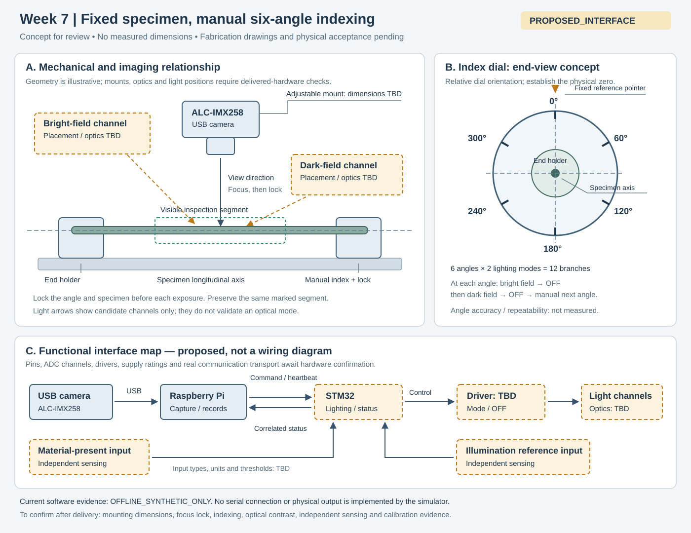

# Week 7 硬件准备包

**证据标记：`PROPOSED_INTERFACE`。状态：概念与记录表已准备；实物尺寸核对、制作、接线、标定和到货验收均待执行。**

本包用于把 Week 7 软件闭环对应到可检查的硬件任务。已确认的路线是固定样本、人工分度的六个角度 `0° / 60° / 120° / 180° / 240° / 300°`，每角分别采集 `bright_field` 与 `dark_field`。ALC-IMX258 经 USB 接入 Raspberry Pi；STM32 拟负责照明控制，并读取相互独立的材料存在输入与照明参考输入。单件样本预期形成 12 个角度/照明分支，分支数是采集配置，不表示表面覆盖率或检出率已被验证。

## 1. 夹具概念与实物核对

[打开可缩放 SVG](week7_fixture_concept.svg)。图仅表达安装关系、人工分度和功能信号；不含实测尺寸，也不作为制作图或接线图。明场/暗场位置和光路均需到货实验确定；图中的照明通道名称不把某种背光或侧光布置直接认定为有效明场/暗场。

拟采用两端夹持的样本架，让中间观察区保持可见；分度标记与固定基准指针配合，记录每次人工转角。夹具是否能保持同一段样本、转角后是否偏心、夹紧后是否变形，都必须由实物观察验证。每次转角后先锁定样本，停止运动，再进入照明准备和新帧采集。

| 核对项 | 到货后要记录的内容 | 影响的接口/判断 | 负责人 | 当前状态 |
|---|---|---|---|---|
| 相机外形与安装点 | 实际外形、安装孔位置/孔径/螺纹、镜头伸出范围；附照片或测量记录 | 相机支架与相机避让空间 | M2/M6 | 待实物核对 |
| 镜头与焦点锁定 | 实际镜头标识、对焦方式、锁定方法、锁定前后清晰度样片 | `lens`、工作距离与焦点复核记录 | M2/M6 | 待实物核对 |
| USB 接头与线缆 | 插头方向、线缆走向、连接器避让空间、固定位置 | Pi 接入和分度操作空间 | M2/M6，M4配合 | 待实物核对 |
| 样本与夹持区 | 样本实际外形、可夹持长度、观察段标记及夹紧后外观 | 观察 ROI 和样本身份连续性 | M2/M6 | 待实物核对 |
| 转轴与分度机构 | 转轴方向、基准指针、六个标记的可读性、锁定方式及旋转后样本位置 | `fixture`、`axis`、`angle_deg` | M2/M6 | 待实物核对 |
| 观察距离与行程 | 能清晰成像的距离、可调范围、转角后重新对焦的需求 | `working_distance_mm` 与标定有效条件 | M2/M6 | 待实物核对 |
| 成像窗口 | 实际分辨率、样本位置、遮挡、可用 ROI 和端部夹持避让 | `image_size_px`、`roi_px` | M2/M6，M4配合 | 待实物核对 |
| 两种照明方式 | 光源实际位置/方向、遮光或漫射需求、两模式样片及切换稳定性 | `lighting_modes` 与逐模式标定条件 | M2/M6，M3/M5配合 | 待到货实验 |
| 材料存在检测位置 | 实际安装位置、装样/空夹具/移除样本时的独立读数 | `material_present` | M3/M5，M2/M6配合 | 待实物核对 |
| 照明参考检测位置 | 参考对象、安装位置、两种模式与 OFF 的读数、读数对应条件 | `reference_reading`、`reference_ok` | M3/M5，M2/M6配合 | 待实物核对 |

制作图/CAD、材料选择、实际尺寸、装配公差和重复定位判据，需在上述核对后形成独立版本并由 M1 组织接口评审。这里不预填测量值或公差。

## 2. 功能接线与消息接口

此表仅定义“谁与谁交换什么”。引脚、ADC 通道、连接器、驱动电路、供电额定值、电流和器件型号均待实物及对应资料确认；表格不能直接用于接线。材料存在与照明参考是不同的输入，不用一个输入同时充当两项证明。

| 功能起点 → 终点 | 拟交换的内容 | 软件字段/动作 | 到货后待确认 | 负责人 |
|---|---|---|---|---|
| ALC-IMX258 → Raspberry Pi | USB 图像与帧信息 | `source_name`、`frame_id`、图像大小、采集时间 | 实际 USB 接口、可用视频模式、镜头配置、稳定连接 | M2/M6，M4配合 |
| Raspberry Pi ⇄ STM32 | 分支命令、状态和心跳；物理通信方式待确认 | `session_id`、`request_id`、单调 `seq`、模式、角度、`heartbeat` | 通信接口、引脚、消息收发和断连恢复 | M3/M5，M4配合 |
| STM32 → 待确认照明驱动 → 照明通道 | 模式选择与 OFF；驱动读回/记录方式待确认 | `lighting_mode`、`driver_value`、`ready`、`fault` | 驱动器件、电路、控制接口、供电与额定值 | M3/M5 |
| 独立材料存在输入 → STM32 | 装样状态 | `material_present` | 传感方式、器件、安装位置、输入类型/引脚及判定规则 | M3/M5，M2/M6配合 |
| 独立照明参考输入 → STM32 | 与当前模式关联的参考读数 | `reference_reading`、`reference_ok` | 参考器件、模拟/数字接口、ADC 通道（若需要）及判定规则 | M3/M5，M2/M6配合 |
| 待确认供电方案 → 各模块 | 各模块所需的供电接口 | 实物连接和版本记录 | 实际模块额定要求、供电接口与分配图 | M3/M5 |
| 操作者 → 夹具与软件 | 样本编号、人工分度、锁定确认和采集触发 | 样本/批次、`angle_deg`、分支完成状态 | 角度读法、零位基准、操作记录 | M2/M6，M4配合 |

当前 Python 协议仅为 `OFFLINE_SYNTHETIC_ONLY` 模拟；没有真实串口驱动或固件输出。`driver_value` 是模拟的无量纲数值，不代表已经测得的 PWM、电流或照度。硬件接口实现必须重新确认实际单位和字段含义，不能直接继承模拟数值作为额定设置。

每个角度的拟定操作顺序：确认角度与样本固定 → 明场准备/材料存在/参考输入检查 → 新帧采集 → OFF 确认 → 暗场准备/材料存在/参考输入检查 → 新帧采集 → OFF 确认 → 人工转到下一角度。旧帧、错分支、故障、准备超时或心跳失效都应阻止该分支完成；异常原因和恢复后的新请求必须留痕。

## 3. 标定靶、样本和批次记录准备

下表是待填写的准备清单。编号规则可以先确定，样本和标定靶的实际存在、来源或测量能力由领取/制作记录确认。

| 准备对象 | 拟定记录字段 | 完成前必须补齐的记录 | 负责人 | 当前状态 |
|---|---|---|---|---|
| 标定靶 | `target_id`、类型、来源、标称尺寸与对应依据、状态 | 实物照片、可用尺寸依据、安装方式、原始靶图；精度/溯源信息未知时写“未确认” | M2/M6 | 待确认/领取 |
| 样本唯一编号 | `sample_id`、来源、材料描述、领取日期、观察段标记 | 标签与实物同框照片、观察段/装夹方向记录 | M2/M6 | 待准备 |
| 批次编号 | `batch_id`、批次来源、批内样本列表、操作者、日期 | 批次清单与样本编号对应关系；未知来源保持未知 | M2/M6，M4配合 | 待准备 |
| 零位与观察段 | `sample_id`、零位标记、沿轴方向、观察段起止标记 | 零位/方向照片、六角度的观察段一致性记录 | M2/M6 | 待准备 |
| 装夹与照明配置 | `fixture`、`axis`、镜头、工作距离、两模式配置版本 | 配置照片、变更原因、复核日期 | M2/M6，M3/M5配合 | 待实物核对 |
| 12 分支采集索引 | 样本、角度、模式、`session_id`、`request_id`、帧/文件路径、时间 | 每个分支的状态、原始图、OFF 记录及失败原因 | M4 | 软件索引已准备，实物采集待执行 |
| 缺陷/对照说明 | 标注人、标注日期、候选位置、依据与不确定项 | 保留原始图；未经独立确认的候选不写为真实缺陷 | M2/M6，M4配合 | 待真实样本 |
| 标定档案 | ID、版本、证据、验证日期、失效日期、revoked 状态及采集配置 | 原始标定图、计算/验证记录、适用范围和复核签名 | M2/M6，M4配合 | 模板 unvalidated |

可复制的批次登记行：

| batch_id | sample_id | 来源/材料 | 观察段/零位 | fixture/version | operator | 日期 | 原始照片路径 | 备注 |
|---|---|---|---|---|---|---|---|---|
| 待填 | 待填 | 待填 | 待填 | 待填 | 待填 | 待填 | 待填 | 待填 |

标定模板为 [`../config/week7_calibration.template.json`](../config/week7_calibration.template.json)。相机源、分辨率、ROI、镜头、工作距离、照明模式、夹具或转轴条件变更后，应重新核对档案。模板目前 `unvalidated`，无物理尺寸或比例值；Week 7 模拟流程即便使用测试用 validated 档案，也不输出物理毫米。

## 4. 已确认分工与交接产物

| 成员 | Week 7 责任 | 交接给下一环节的可检查产物 |
|---|---|---|
| M1 | 协调接口及每周验收 | 更新后的责任/阻塞清单、接口决定、逐项验收记录 |
| M2 | 与 M6 主抓成像、夹具和样本 | 相机/镜头/安装实物记录、成像样片、夹具核对结果、样本清单 |
| M3 | 与 M5 主抓供电、传感、照明控制与通信 | 模块实际接口记录、功能连接表修订、状态字段与故障记录 |
| M4 | 主抓软件与数据 | 12 分支记录、JSON 协议示例、原图/状态关联、标定失效核对结果 |
| M5 | 与 M3 主抓供电、传感、照明控制与通信 | 输入/照明/通信测试记录、OFF 与异常恢复验证记录 |
| M6 | 与 M2 主抓成像、夹具和样本 | 人工分度/锁定记录、观察段一致性样片、标定靶与样本登记 |

M2/M6、M3/M5 的内部具体分项由对应成员协调；本包不代替组员确认实际完成者。上表沿用已确认的团队职责层级。

## 5. 到货验收清单

全部项目当前均为 **待执行**。执行后填写日期、操作者、结果和证据路径；软件测试通过不填入这些硬件结果栏。

| 验收项 | 可检查的完成证据 | 负责人 | 日期/操作者 | 结果/证据路径 |
|---|---|---|---|---|
| 到货身份与附件 | 相机、镜头、控制板和实际附件的照片/标识与清单一致 | M1，M2/M6 | 待填 | 待执行 |
| 安装接口核对 | 第 1 节各尺寸/安装项目有实物记录；制作图需要的信息已补齐 | M2/M6 | 待填 | 待执行 |
| 相机至 Pi 接入 | 实际相机源与配置、日期、日志和原始图；记录遇到的问题 | M2/M6，M4 | 待填 | 待执行 |
| 对焦与锁定 | 锁定前后以及六角度的原始图；记录观察段位置/清晰度变化 | M2/M6 | 待填 | 待执行 |
| 六角度人工分度 | 零位定义、六标记、样本锁定及重复装夹观察记录 | M2/M6 | 待填 | 待执行 |
| 明场/暗场配置 | 两模式的实物布置照片、同样本对照图及选择依据 | M2/M6，M3/M5 | 待填 | 待执行 |
| 独立材料存在输入 | 有样本/空夹具/移除样本三种状态的输入记录 | M3/M5 | 待填 | 待执行 |
| 独立照明参考输入 | 两模式及 OFF 的参考读数、单位/采集方式与配置记录 | M3/M5 | 待填 | 待执行 |
| 消息关联与 OFF | 实际端到端命令/状态日志；可对应到样本、角度、模式与每次 OFF | M3/M5，M4 | 待填 | 待执行 |
| 异常与恢复 | 未就绪、错误关联、通信超时/心跳失效时停止采集；OFF 后重新请求的记录 | M3/M5，M4 | 待填 | 待执行 |
| 标定靶与档案 | 原始靶图、适用采集条件、验证记录与可追溯档案版本 | M2/M6，M4 | 待填 | 待执行 |
| 单样本完整采集 | 12 个互不混淆分支、原始图、状态及缺失/失败清单 | M4，M2/M6 | 待填 | 待执行 |
| 周验收与问题关闭 | M1 汇总已完成/未完成项，明确下一步责任和证据缺口 | M1 | 待填 | 待执行 |

验收记录应区分 `LIVE_INTEGRATION_ONLY` 的连接/收发观察与经过有效标定的物理测量。若夹具、光路或接口需要修改，先更新本概念版本及对应配置，再记录复验范围；历史原始图与失败记录保留。
