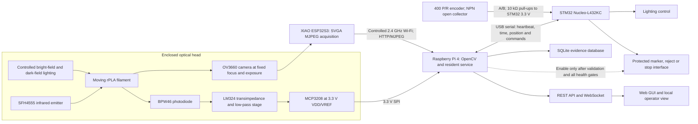
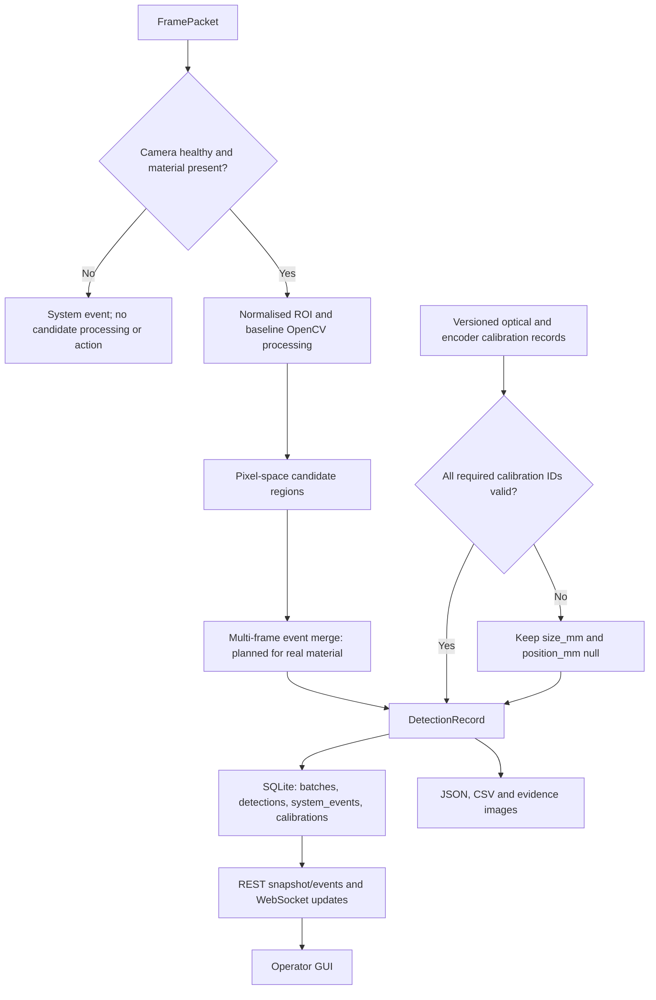

# Proposal Design Report

## Evidence-Traceable Surface Quality Monitoring for Recycled PLA Filament

| Document field | Status |
|---|---|
| Client context | BioLoop Manufacturing Pty Ltd |
| Discipline | ENG5105 Electrical Engineering |
| Deliverable | Proposal design report |
| Selected quality parameter | Visible rPLA filament surface quality |
| Selected concept | Plan B: ESP32S3 OV3660 acquisition, Raspberry Pi 4 processing and services, STM32 supervision and safe I/O |
| Concept status | Plan A is retained only as a rubric-required comparator; Plan B is the sole conditionally feasible implementation and validation path, subject to the stated gates |
| Evidence cut-off | 15 August 2026 |
| Evidence status | Proposal with bounded integration evidence; real-material calibration and defect-performance validation remain pending |

## Executive Summary

BioLoop requires a laboratory-scale system that can monitor visible surface anomalies while recycled polylactic acid (rPLA) filament is moving through a manufacturing process. The client brief identifies bubbles, roughness, contamination, cracks and inclusions as relevant surface-quality concerns, and asks electrical teams to address real-time acquisition, communication, visualisation, fault detection and eventual industrial integration [1]. This report recommends Plan B: an ESP32S3 Sense node with an OV3660 camera will transmit MJPEG over a controlled 2.4 GHz network; the Raspberry Pi 4 is allocated OpenCV processing, data storage, API/WebSocket services and the operator interface; the STM32 Nucleo-L432KC is allocated encoder input, lighting control, watchdog supervision and inhibited downstream I/O. These three computing platforms are within the university-supplied baseline [2]. The current service/API/GUI evidence comes from the Windows development host; it does not establish deployment on the Pi or physical STM32 I/O.

Plan A provides the technically stronger camera option, but it is not deliverable within the selected semester path. The concept couples the Raspberry Pi to a global-shutter camera and C/CS-mount lens. Simultaneous pixel exposure is attractive for rapid-motion imaging [3], yet the camera and lens are not in the university-supplied equipment. Their verified Plan-A-only subtotal is A$136.15 before shipping, comprising an A$92.55 camera and A$43.60 lens; the camera was also out of stock when checked on 15 August 2026 [4], [5]. That extra cost and procurement uncertainty fail the mandatory gates. Shared items such as the Raspberry Pi, STM32, lighting, encoder, enclosure and protection hardware are deliberately excluded from the Plan A subtotal. Plan A therefore remains a fair comparator, but it will not be purchased, built, tested or treated as a future migration path.

Plan B is conditionally feasible, not yet validated as an rPLA defect detector. A recorded 30 s SVGA integration test observed 10.77 processed frames/s under its stated conditions [6]. The displayed drop field remained zero, but that run carried no drop instrumentation, so it establishes frame transport and processing continuity only, not zero loss. The service has since been rebuilt around a one-slot frame buffer that discards and counts backlog, although that is development-host software evidence and does not revisit the recorded result. It contained no rPLA in the region of interest. The present software gates candidate processing during the tested network recovery and preserves uncalibrated physical fields as null, but neither behaviour establishes defect accuracy, minimum detectable size, millimetre position accuracy, usable line speed or industrial readiness. All numerical requirements in Section 3 are marked `PROPOSED_REQUIREMENT`. Physical acceptance depends on controlled optics, optical and encoder calibration, labelled real-material specimens, independent validation groups and documented requirement review after the scheduled Week 5 Thursday material arrival.

## Acknowledgement of Country

We acknowledge the Traditional Owners and Custodians of the unceded lands on which Monash University operates, including the people of the Kulin Nations, and pay respect to their Elders past and present [7]. This project concerns circular use of materials, but circularity alone does not make an engineering system responsible. Our work should conserve resources, avoid preventable waste, and account for the energy, electronics and decisions introduced by the monitoring device. We recognise that care for Country carries responsibilities extending beyond the technical boundary of this proposal.

# 1. Background and Purpose

## 1.1 Client and manufacturing context

BioLoop's proposed manufacturing hub is intended to produce rPLA and rPLA-composite filament for Australian education, engineering, manufacturing and consumer markets. Product monitoring sits inside a wider circular-manufacturing system alongside automation, resource efficiency, safety and economic viability [1]. A filament may reach the customer only after extrusion, cooling, handling and spooling, so a visible anomaly found late can imply rework, rejected product or loss of confidence in the batch. Online observation offers an earlier decision point.

Recycled PLA is not one uniform input. Published comparisons report that feedstock origin, recycling history and processing conditions can affect the properties of recycled filament and printed products [8], [9]. Moisture can also influence morphology and tensile behaviour in PLA-containing fused-filament material [10]. These findings justify monitoring, but they do not let a camera diagnose moisture, degradation or extrusion settings from appearance alone. A pit or colour patch is evidence of a visible condition. Its process cause remains a hypothesis until it is checked against independent process and material data.

The circular-economy rationale needs the same restraint. Life-cycle studies of distributed filament production and closed-loop PLA recycling show why recovered material deserves serious consideration, while also showing that benefits depend on system boundaries, energy and process choices [11], [12]. This proposal does not claim a completed life-cycle assessment. Its narrower purpose is to make surface-quality evidence available soon enough for a person, quality system or later plant controller to act.

## 1.2 Purpose, question and boundary

The report asks:

> Can a low-cost, supplied-hardware machine-vision system detect, locate and grade visible anomalies on moving rPLA filament under representative laboratory conditions, while withholding unsafe or uncalibrated outputs?

The system must make useful detections whose validity is independently established. A stream that looks live can still be stale, poorly illuminated or geometrically uncalibrated, which is why acquisition health and evidence status are design functions rather than interface decoration.

Table 1 fixes the investigation boundary before concepts are compared.

**Table 1. Proposed project scope.**

| In scope | Outside the present claim boundary |
|---|---|
| Visible bubbles or pits, cracks or scratches, contamination or inclusions, and abnormal surface texture identified from controlled images | Engineering roughness parameters such as Ra without a validated profilometric or structured-light reference |
| Laboratory-scale online acquisition, candidate detection, event recording, alarm presentation and safe-output requests | Internal void metrology, polymer chemistry identification, or proof of a defect's process cause |
| Optical and encoder calibration followed by labelled real-rPLA testing | Uncalibrated millimetre dimensions or positions |
| Basic fault detection and integration with a larger automated process, as required by the brief [1] | Safety certification, autonomous production release, or industrial deployment claims |

The intended output is thus a traceable candidate record and an operator-facing decision aid. Automatic rejection is not yet authorised.

# 2. Literature Review and Design Implications

## 2.1 What surface images can establish

Research on rPLA establishes a reason to inspect but not a visual ground truth. Material source, repeated processing and moisture can change performance [8]–[10]; the brief separately lists bubbles, roughness, contamination, cracks and inclusions as surface conditions that may indicate process or material problems [1]. The word *may* matters. We use the literature to define defect families and challenge conditions, then require labelled specimens before assigning a class. Visual evidence cannot by itself distinguish a moisture-driven bubble from a cavity produced by another mechanism, so causal labels require independent process evidence.

Industrial anomaly-detection research also warns against treating a tidy laboratory image as the operating domain. Recent datasets include advanced operating scenarios, real industrial imagery and multi-view observations [13]–[15]. Their reported model results cannot be transferred to rPLA, because the objects, labels, optics and prevalence differ. The transferable lesson is experimental: camera geometry, background, illumination, viewpoint and dataset split must be controlled and documented.

## 2.2 Motion, optics and acquisition

A moving cylindrical filament is a difficult optical target. Highlights migrate as the filament rotates; a single view cannot guarantee full circumferential coverage; compression can create block or edge artefacts. Unsynchronised dynamic line-scan research shows why motion and sampling alignment deserve explicit treatment [16]. A feature-fusion study on hot-rolled steel establishes performance only within its particular material and dataset; it does not demonstrate illumination or geometry robustness for rPLA [17]. Experimental comparison of area- and line-scan modalities likewise shows that some surface defects become visible only under particular sensor and illumination arrangements [18]. Controlled diffuse and low-angle illumination, a fixed region of interest, locked focus/exposure where supported, and a repeatable guide geometry are therefore part of the measurement concept.

Plan A addresses motion at the sensor. Raspberry Pi's global-shutter camera exposes all pixels simultaneously and accepts C/CS-mount lenses [3]. Plan B uses the supplied OV3660 rolling-shutter imager, whose sensor limits are described in its datasheet [19], through the supported ESP32 camera stack [20], [21]. No datasheet predicts this application's defect accuracy. Plan B must instead reduce motion-skew risk through bounded line speed, exposure control, repeatable lighting and empirical validation.

## 2.3 Alternatives to area-scan surface imaging

Three measurement families were considered because they answer different quality questions. Area- or line-scan vision preserves spatial evidence about colour, texture, inclusions, cracks and other visible features, but its response depends on view and illumination [18]. Multi-axis optical diameter sensing has been validated on recycled ABS and PLA filament and can record diameter and shape along a spool [22]; a diameter trace alone cannot classify every visible surface condition or reveal internal voids. Laser-line profilometry supplies quantitative height and topography and has detected surface deviations from point clouds in material-extrusion research, but it adds equipment and processing cost, and the cited validation concerns deposited layers rather than moving feedstock [23].

For the present brief, supplied hardware and semester constraints, Plan B therefore uses area-scan imaging for visible spatial anomalies and the photodiode only for material-presence and optical-health gating. Diameter sensing or profilometry would become a scoped extension if stakeholder consultation makes diameter or engineering roughness a primary requirement. It is not evidence that Plan B already measures those properties. This distinction also explains why Table 1 excludes Ra and internal void metrology.

## 2.4 Processing roles and evidence flow

Running every task on the camera node would simplify wiring, but it would compress acquisition, analysis, storage, interface and fault recovery into one resource-constrained device. Edge-computing literature supports placing time-sensitive visual processing near the equipment while retaining clear system roles [24]. In this design, the ESP32S3 is allocated image acquisition and transport; the Raspberry Pi 4 is allocated OpenCV, records, services and the GUI; the STM32 is allocated deterministic encoder, watchdog, lighting and output supervision. Manufacturer documents establish that the Pi and Nucleo platforms expose suitable computing and interface resources [25], [26]. They are capability evidence, not proof that these roles have been deployed.

This separation creates a useful failure boundary. In the target Pi/STM32 design, a camera timeout will put the Pi service into a reconnecting or fault state while the STM32 inhibits the marker or stop request. A wired-in latest-frame policy and frame-age watchdog are required to prevent an old image from silently becoming a current quality event. These controls are not yet integrated in the resident Windows service. The architecture consequently treats health metadata, timestamps, calibration identifiers and null physical fields as part of the evidence chain.

## 2.5 Validation implications

Adjacent video frames are highly correlated. If near-duplicate frames from one defect appear in both training and test data, reported performance can be optimistic; broader machine-learning work identifies leakage as a reproducibility threat [27], and video-object-detection research shows the specific risk created by spatiotemporal correlation [28]. Validation will therefore separate data by physical spool or batch and by defect event, not by randomly shuffling individual frames.

Accuracy alone would hide the cost of rare defects. The proposed assessment will report event-level precision, recall and F1 score, false alarms per metre, missed events, latency and stability across declared lighting and speed conditions. Sample counts and uncertainty must accompany those values. None exists yet.

Table 2 converts these literature findings into design decisions and identifies the project-specific evidence still missing.

**Table 2. Literature-to-design transfer.**

| Evidence cluster | Design implication | Evidence still required for this project |
|---|---|---|
| rPLA variability and moisture [8]–[10] | Treat visible anomalies as observations, not automatic root-cause diagnoses | Labelled real-rPLA specimens linked to documented conditions |
| Industrial anomaly and multi-view datasets [13]–[15] | Freeze optics and record viewpoint, lighting and dataset provenance | Representative images from the final fixture |
| Dynamic imaging and surface inspection [16], [17], [18] | Control exposure, motion, geometry and illumination; test coverage limits | Speed challenge and circumferential-coverage study |
| Optical diameter sensing and laser profilometry [22], [23] | Retain them as requirement-driven alternatives, not capabilities implied by area-scan images | Stakeholder priority, comparative test plan and approved cost/schedule change before any scope extension |
| Leakage and correlated video [27], [28] | Split validation by independent spool/batch/event | Pre-registered dataset split and held-out test results |

# 3. Stakeholders, Needs and Proposed Requirements

## 3.1 Stakeholder evidence status

No direct stakeholder consultation record has been supplied for this proposal report. The needs below are derived from the BioLoop project brief, discipline instructions and literature; they are not attributed to a meeting, participant or client approval. This distinction matters because the rubric expects engagement and requirements that inform the design [29], [30]. The report can state what should be discussed. It cannot invent what someone said.

**Table 3. Stakeholder map and provisional design response.**

| Stakeholder group | Need inferred from brief or system use | Proposed design response | Current status |
|---|---|---|---|
| BioLoop/client representative | Traceable quality evidence, cost awareness and a path to automated integration | Requirement register, event records, API and explicit acceptance gates | Brief-derived; confirmation pending |
| Production operator | Clear health state, actionable alarms and no silent stale-data decision | Single-screen status, candidate overlay, alarm history and inhibited output when unhealthy | Proposed |
| Quality assurance personnel | Reviewable images, batch context, repeatable classification and export | Versioned calibration/model identifiers, immutable event fields and dataset export | Proposed |
| Maintenance and electrical personnel | Diagnosable faults, serviceable interfaces and safe recovery | Camera/processor/encoder/lighting health, watchdog states and manual reset rules | Proposed |
| Laboratory supervisor and technical staff | Safe, testable use of supplied equipment | Enclosed optical path, low-voltage prototype domains and staged fault tests | Brief- and equipment-derived |
| Filament users | Consistent product information without unsupported quality claims | Evidence-backed grading only after validation; retain uncertain events for review | Literature-derived; confirmation pending |

Engagement should now test assumptions rather than seek a ceremonial sign-off. A short structured session can ask which defect families cause rejection, what false-alarm burden is tolerable, how long evidence must be retained, who may authorise a stop or reject action, and which operating speeds and lighting conditions are representative. Each answer should enter a dated decision log with the affected requirement, owner, rationale and verification change. Until that record exists, no priority in Table 3 is claimed as stakeholder-approved.

## 3.2 Proposed requirements and verification

Every numeric threshold in Table 4 is a `PROPOSED_REQUIREMENT`. The values provide a testable design baseline, as requested by the electrical discipline guidance [29], but remain open to stakeholder review and experimental revision.

**Table 4. Proposed requirements register.**

| ID | Proposed requirement | Stakeholder/source basis | Planned verification | Status or present gap |
|---|---|---|---|---|
| R1 | Detect at least three agreed classes of visible surface anomaly | Defect families from the project brief [1]; class count is team-proposed and awaits stakeholder confirmation | Held-out, event-level labelled test | `PENDING_REAL_MATERIAL` |
| R2 | For each accepted R1 class, target the declared class-specific characteristic dimension at or above 0.20 mm | Team engineering target under the discipline requirement for measurable specifications [29]; stakeholder confirmation pending | Calibrated target and labelled specimens using the definitions below | `PENDING_REAL_MATERIAL`; optical scale unavailable |
| R3 | For every accepted R1 class whose events meet R2, achieve event-level precision and recall of at least 90% per class | Team performance target under [29]; false-alarm and miss tolerance await stakeholder confirmation | Independent spool/batch/event split; report per-class counts and confidence intervals | `PENDING_REAL_MATERIAL`; no accuracy result exists |
| R4 | Process at least 20 frames/s while filament speed is 0–5 m/min | Team throughput target under [29]; operating envelope awaits stakeholder confirmation | Sustained final-fixture run plus speed challenge | Not achieved: current SVGA integration observation is 10.77 frames/s; latest-frame and drop instrumentation are now in the service but unmeasured on the Pi |
| R5 | At P95, assert the alarm within 500 ms from the first reference-video frame in which a marked defect crosses the frozen ROI entry line | Team alarm target under [29]; response expectation awaits stakeholder confirmation | Synchronously film the scene reference and GUI/output; include confirmation, processing, communications and indication | Proposed; current brightness-control path timing is not this measure |
| R6 | Limit longitudinal defect-location error to ±10 mm | Team position target under [29]; stakeholder confirmation pending | Encoder counts/mm calibration and marked-distance test | `PENDING_REAL_MATERIAL`; encoder calibration absent |
| R7 | Store defect type, size, confidence, evidence image, position, time and batch identifier with the required calibration provenance | Data and visualisation need from the brief [1], made testable under [29] | Schema, file and record audit | Partly implemented; live evidence images and complete optical/encoder provenance remain pending, and size/position stay null until calibration |
| R8 | During a 30 min run, keep confirmed-event record loss below 1%, where `loss = (N_expected - N_complete) / N_expected` and a complete record has its durable database row plus required evidence image | Team reliability target under [29]; stakeholder tolerance pending | Reconcile frozen expected event IDs against durable database rows, image files and export; report frame drops separately | Proposed; drop instrumentation is now in the service, but the final hardware test remains pending |
| R9 | Enter a safe hold or fault state after camera, lighting, encoder or processor failure | Fault-detection/integration need from the brief [1]; team safety interpretation, with later risk assessment required | Fault injection and output-state observation on final wiring | Software/network path evidence only; physical safe I/O pending |
| R10 | Store and serve only images confined to the enclosed filament tunnel, with local-only storage and external publication disabled by default | Team privacy-by-design control; legal and stakeholder retention/access rules remain pending | Audit every final-evidence image and the storage/access configuration; accept zero outside-tunnel or person-containing frames | Not achieved by the current full annotated development preview; enclosure and release controls pending |

R2 uses a frozen primary dimension for each accepted class: equivalent-circle diameter for a compact pit, bubble, inclusion or contamination region; calibrated transverse width for a crack or scratch, with axial length reported separately; and the smaller calibrated bounding dimension for an abnormal-texture patch. The class definitions and ground-truth method must be approved and frozen before data collection so that the 0.20 mm threshold cannot be changed after seeing results. For R3, both precision and recall must pass for each of the three or more accepted classes, and the report will retain each class's event counts and confusion matrix so macro or micro summaries cannot hide a failing class. A pilot will inform the minimum independent event count, but that count must be frozen before the untouched test rather than selected after it.

R4 exposes the largest current design tension. A lower interim demonstration threshold may be useful for integration, but it cannot replace the 20 frames/s final target without a documented requirement change. Failure at the final fixture will trigger optimisation, a justified line-speed limit, or formal renegotiation. Selective reporting is not an acceptance method.

# 4. Concepts and Selection

## 4.1 Selection method

The rubric requires at least two differentiated concepts and an evidence-backed recommendation [30]. We apply four pass/fail gates before preference scoring: availability of the issued primary imaging hardware, avoidance of an unapproved concept-specific primary-camera purchase, procurement timing, and semester deliverability. A technically attractive concept that fails a mandatory gate is not a candidate for implementation. These are team feasibility decisions for the present proposal, not stakeholder-approved budget limits.

## 4.2 Plan A: direct global-shutter imaging comparator

Plan A connects a Raspberry Pi Global Shutter Camera to the Pi through CSI, uses a suitable C/CS-mount lens and controlled lighting, and retains STM32-based encoder, watchdog, lighting and safe I/O functions. Its main strength is simultaneous exposure of the image array, which is suited to rapid motion and machine-vision use [3]. Local CSI transport also removes Wi-Fi and MJPEG from the camera-to-processor path. Optical alignment, reflective cylindrical geometry and single-view coverage would still require calibration.

The concept is credible. It is also unavailable to this project because the primary camera is neither supplied nor in stock. Table 5 includes only purchases unique to Plan A.

**Table 5. Verified Plan-A-only incremental procurement, accessed 15 August 2026.**

| Item | Quantity | Price | Observed availability | Source |
|---|---:|---:|---|---|
| Raspberry Pi Global Shutter Camera | 1 | A$92.55 | Out of stock | [4] |
| Raspberry Pi 6 mm CS-mount lens | 1 | A$43.60 | In stock | [5] |
| **Plan-A-only subtotal** |  | **A$136.15** | Shipping excluded | Calculated from [4], [5] |

The subtotal is additional to common prototype needs. No Raspberry Pi, STM32, encoder, lighting, enclosure, power/protection or marker cost has been charged twice. Against the mandatory Plan B core envelope in Section 9, this A$136.15 increment is approximately 62–104%; against the all-in envelope that includes the optional marker, it is approximately 55–96%. Because the purchase is unapproved, the camera was out of stock on the access date, and the new optical chain would consume limited integration time, the team treats the uplift as too high for this implementation path. Plan A fails the availability, cost, lead-time and semester-delivery gates and will not proceed to procurement or validation.

## 4.3 Plan B: supplied-hardware distributed vision

Plan B uses the university-supplied XIAO ESP32S3 Sense, Raspberry Pi 4 and STM32 Nucleo-L432KC [2]. Its proposed chain is:

> Controlled optical head and rPLA filament -> ESP32S3 OV3660 acquisition -> 2.4 GHz Wi-Fi MJPEG -> Raspberry Pi 4 OpenCV, API/WebSocket, SQLite and GUI <-> STM32 encoder, watchdog, lighting and inhibited output interface

The OV3660 and ESP32 camera documentation support the chosen acquisition stack [19]–[21]; the Pi and Nucleo documents support their planned processing and interface roles [25], [26]. Plan B avoids a new primary-camera purchase and builds on the software and live transport path already integrated. It also exposes real limitations: rolling-shutter distortion, JPEG artefacts, wireless delay or interruption, limited optical control and no guaranteed full-circumference view. Those constraints become test conditions and risk controls. They are not hidden by the selection decision.

## 4.4 Feasibility gates and technical comparison

Table 6 applies the mandatory gates before the technical preferences recorded in Table 7.

**Table 6. Mandatory feasibility gates.**

| Gate | Plan A | Plan B | Decision significance |
|---|---|---|---|
| Issued primary imaging hardware available | **Fail**: global-shutter camera and lens not supplied | **Conditional pass**: primary camera and computing platforms are listed as supplied; issue, condition and compatibility checks remain pending [2] | Plan A cannot begin from the issued baseline |
| No unapproved concept-specific primary-camera purchase | **Fail**: at least A$136.15 plus shipping, approximately 62–104% of the mandatory Plan B core envelope (55–96% if the optional marker is included) | **Pass** for primary imaging: no additional main camera purchase; common additions remain subject to approval | Team proposal gate, not a client-approved budget threshold; shared costs excluded from both sides |
| Procurement/lead-time exposure | **Fail**: camera out of stock on 15 August 2026 [4] | **Conditional pass with residual risk**: core platforms still need issue checks; the encoder page showed zero local stock and expected dispatch on 24–27 August, while fixture, lighting and protection parts remain unfrozen [31] | A supplier dispatch estimate is not a delivery commitment; neither concept may rely on an unverified arrival date |
| Semester implementation and validation | **Fail**: new optical chain would arrive, integrate and calibrate late | **Pass conditionally**: existing Plan B path can proceed to real-material tests | Validation remains conditional on material and fixture availability |

A separate scoring exercise records technical preference without overriding these gates. Scores are team-assigned comparative judgements from 1 (weak) to 5 (strong), not measurements. The provisional weights allocate 65% to measurement capability (R1–R4 and R6), 15% to Pi integration (R4, R7 and R8), and 20% to cost and procurement constraints. They reflect the team's present technical judgement; no stakeholder approval is claimed. R5 is not scored separately because neither concept has a physical scene-to-alarm result: Plan A removes the Wi-Fi leg but does not thereby prove the 500 ms target. R9 and R10 are common STM32/enclosure/governance obligations rather than camera-choice discriminators. R5, R9 and R10 therefore remain mandatory release tests for Plan B, not benefits implied by its weighted score. The matrix is sensitive to its weights, so it exposes the trade-off rather than certifying the decision.

**Table 7. Weighted concept comparison.**

| Criterion | Weight | Plan A | Plan B | Basis of judgement |
|---|---:|---:|---:|---|
| Defect-classification potential (R1, R3) | 25% | 5 | 3 | Plan A offers a more configurable machine-vision optical chain; neither concept has rPLA accuracy data |
| Motion-imaging suitability (R2, R4) | 20% | 5 | 2 | Global shutter versus rolling shutter and compressed wireless transport [19], [3] |
| Spatial-detail potential (R2, R6) | 20% | 4 | 3 | Interchangeable lens and optical control versus supplied OV3660 path |
| Raspberry Pi integration (R4, R7, R8) | 15% | 5 | 4 | Direct CSI versus supported network acquisition and service integration |
| Concept-specific cost (project constraint) | 10% | 3 | 5 | A$136.15 plus shipping for Plan A imaging; no new Plan B main camera |
| Procurement timing (schedule constraint) | 10% | 3 | 5 | Plan A camera out of stock; Plan B core platforms listed as supplied, subject to issue check |
| **Weighted total** | **100%** | **4.40** | **3.35** | Comparative score only |

Plan A still leads the weighted matrix. The feasibility result is decisive: a higher preference score cannot supply unavailable hardware or remove procurement and lead-time uncertainty. Plan B is therefore selected as the sole, conditionally feasible implementation path. It may proceed only if supplied-hardware, common-part, material, safety and validation gates pass. Its recommendation rests on that staged route, not on a claim that its present images already meet R1-R10.

# 5. Functional Design and Specifications

Plan B turns the inspection task into two linked but deliberately unequal measurement paths. The camera path supplies spatial evidence about visible candidate regions. The auxiliary infrared path answers a narrower question: is material present, and is the optical head behaving plausibly? A candidate may be recorded only when acquisition is healthy; an automatic marker or stop request needs the stronger conjunction of healthy acquisition, valid calibration, confirmed material presence, a validated event rule, and an enabled output. This boundary is central to the design. A bright contour is not a defect simply because software can draw a box around it.

The selected hardware is the university-supplied XIAO ESP32S3 Sense with OV3660, Raspberry Pi 4 and STM32 Nucleo-L432KC [2]. Their proposed roles follow workload and failure-containment needs rather than nominal processor capability. The ESP32S3 is allocated image acquisition and compression, the Pi is allocated non-deterministic vision and data services, and the STM32 is allocated time-critical I/O supervision. Manufacturer documents support those platform capabilities [19], [20], [21], [25], [26]. They do not prove application performance or completed Pi/STM32 deployment.

## 5.1 End-to-end functional architecture

**Figure 1. Proposed Plan B hardware, data and inhibited-action architecture.**

Figure 1 places the current Windows-developed vision/service functions in their intended Pi role and separates them from the proposed STM32 action authority. The arrows describe the target integration baseline, not completed physical wiring.

The diagram also marks the action boundary. Raspberry Pi software may propose an event; under the proposed design, the STM32 will own the physical output and remove permission when heartbeat, encoder, lighting or communications health is lost. This is a safety-oriented laboratory control architecture, not a safety-certified machinery function. Any later connection to production equipment would require a machine risk assessment and safety-function design against the relevant framework, including ISO 13849-1, rather than relying on the prototype watchdog alone [32]. OT network segmentation and least-functionality principles would also apply [33].

The proposed requirements below remain `PROPOSED_REQUIREMENT`. The project brief establishes the need for laboratory-scale, online surface-quality monitoring [1], while the discipline guidance requires measurable specifications and verification [29]. No record supplied to this report shows that a stakeholder has approved the numerical thresholds. Table 8 assigns each requirement to functions and a verification route while retaining the present gap.

**Table 8. Functional allocation and verification status of the proposed requirements.**

| ID | Proposed target | Functional allocation | Verification and present status |
|---|---|---|---|
| R1 | Detect at least three visible surface-defect classes. | Optical head; OpenCV/event classifier; labelled database. | Independent real-rPLA event test. `PENDING_REAL_MATERIAL`; current boxes are candidates only. |
| R2 | Demonstrate the frozen class-specific characteristic dimension at or above 0.20 mm. | Fixed optics, pixel scale and class-specific event measurement defined in Section 3.2. | Calibrated reference features at final working distance. `PENDING_REAL_MATERIAL`. |
| R3 | For every accepted R1 class meeting R2, achieve event-level precision and recall of at least 90% per class. | Event logic, ground truth and evaluation scripts. | Held-out spool/segment/event evaluation; report per-class counts, confidence intervals, F1 and macro/micro summaries. `PENDING_REAL_MATERIAL`. |
| R4 | Process at least 20 frames/s from 0–5 m/min. | Camera, Wi-Fi, target newest-frame policy and Pi vision. | Sustained final-fixture throughput at each test speed. Not met by the recorded 10.77 FPS SVGA integration result; latest-frame and drop instrumentation are now wired into the resident service but remain unmeasured on the Pi. |
| R5 | At P95, assert the alarm within 500 ms from marked-defect crossing of the frozen ROI entry line. | Timestamped event tracker, confirmation rule, API/UI and STM32 output request. | Synchronously filmed scene reference through GUI/output indication. Existing brightness-step timing is only `LIVE_INTEGRATION_ONLY` and is not this measure. |
| R6 | Limit axial defect-position error to ±10 mm. | Encoder scale, time alignment and camera-to-marker offset. | Repeated known-position trials in both travel directions. `position_mm` remains null. |
| R7 | Store type, size, confidence, evidence image, position, time and batch identifier with required calibration provenance. | `DetectionRecord`, SQLite, image store, calibration manifests and export. | Schema/file round-trip test, then calibrated record audit. Current generic calibration linkage and live image persistence are incomplete; physical fields remain null. |
| R8 | Operate for 30 min with confirmed-event record loss below 1%. | Resident service, SQLite transaction path, durable image store and health log. | Reconcile frozen expected event IDs to complete durable rows/images/exports using the Section 3.2 formula; report acquisition/processing frame drops separately. Not yet tested. |
| R9 | Enter a safe hold or fault state after camera, light, encoder or processor failure. | Pi health gate, STM32 watchdog and protected output. | Hardware fault injection with the final wiring. Software/network evidence exists, but safe I/O remains pending. |
| R10 | Store and serve only the enclosed filament-tunnel view, locally by default. | Shrouded optical head, release crop/mask and Pi-local database. | Audit every final-evidence frame and storage/access configuration for zero outside-tunnel/person content. Current development endpoints serve a full annotated frame rather than an ROI crop; R10 is not achieved [34], [35]. |

## 5.2 Optical head and camera specification

Although the OV3660 can expose larger frames, the project needs a stable operating point rather than the largest datasheet mode. SVGA 800 × 600 is therefore fixed as the Plan B live profile; VGA 640 × 480 remains a manual recovery option, and XGA or larger modes are outside the selected operating configuration. The active normalised ROI maps at SVGA to `(254, 47, 195, 527)`. Its position is provisional until the fixture and filament establish the true optical axis. OV3660 rolling-shutter readout, JPEG compression and wireless transport can introduce motion or timing artefacts, so exposure duration, line speed and candidate persistence must be tested together [19], [20].

The proposed head uses a rigid camera bracket, repeatable filament guides, a matte background and an external shroud. Working distance, focus and exposure will be locked after calibration. Switchable bright-field illumination is intended to reveal colour or texture contrast; low-angle dark-field illumination is intended to make surface relief more conspicuous. The modes are experimental variables, not proof that any particular anomaly is detectable. Industrial anomaly datasets also show why appearance changes and view geometry must be represented in validation rather than hidden by one convenient image condition [13]–[15].

One camera observes only the visible arc of the cylindrical filament. It does not provide full 360-degree coverage. A mirror or later multi-view arrangement may be evaluated only if blind-side misses dominate the Week 5+ evidence; adding it would require a new optical calibration. The head will include a scale target and dark/white references that can be inserted without moving the camera. No physical-resolution claim follows. Engineering roughness and internal voids also remain outside this optical design.

## 5.3 Auxiliary photodiode chain

The SFH4555 emits across the filament path and the BPW46 supplies a photocurrent that varies with received irradiance. The LM324 stage converts that current to a voltage and limits high-frequency noise before the MCP3208 digitises it. At the proposal stage, the first transimpedance estimate is

\[
R_f=\frac{V_{span}}{I_{PD}},
\]

where \(I_{PD}\) is the photocurrent measured in the final geometry and \(V_{span}\) is the usable output swing. With feedback capacitance \(C_f\), the approximate low-pass corner is

\[
f_c=\frac{1}{2\pi R_f C_f}.
\]

Numerical values for \(R_f\), \(C_f\), LED current and decision thresholds cannot be frozen before the optical head is assembled. The provisional design constraints are nevertheless explicit. M3 will choose the transimpedance gain so the measured path-state range occupies approximately 10–80% of the ADC input range without clipping, then select \(C_f\) so the measured step response remains at least five times faster than the fastest material-presence transition while attenuating observed high-frequency noise. LED drive will be current-limited below the manufacturer's continuous rating and checked at the measured enclosure temperature. Dark, clear-path, normal-filament, blocked-path and misaligned-filament distributions will set a threshold with a recorded guard band at G3. A valid auxiliary state can gate inspection or flag optical degradation; it cannot localise a scratch, classify contamination or estimate feature size.

The Pi-facing electrical levels are fixed independently of the LM324 supply. Raspberry Pi GPIO and SPI are 3.3 V interfaces. The MCP3208 will therefore use \(V_{DD}=V_{REF}=3.3\ \text{V}\), a common digital/analogue ground and 3.3 V SPI, so its digital output cannot drive a Pi input above the GPIO rail; a 5 V MCP3208 configuration is prohibited. If the LM324 operates from the regulated 5 V analogue branch, its non-rail-to-rail output range and every normal/fault input condition must be checked. Feedback gain plus an input series resistor and a measured clamp/divider arrangement will constrain the ADC pin to \(0\leq V_{ADC}\leq V_{REF}\); component values remain a G2/G3 measurement decision. No 5 V analogue or digital signal may connect directly to Pi GPIO. Section 8 records the official component sources for these release constraints.

## 5.4 Raspberry Pi processing, provenance and storage

The planned Pi deployment preserves the source-independent Week 3 contracts rather than replacing them. `FramePacket` carries the image, frame number, acquisition/receipt times, camera source and connection state. A `DetectionRecord` carries a candidate label, pixel bounding box, pixel area, algorithm score, provisional grade and batch context. The SQLite schema contains `batches`, `detections`, `system_events` and `calibrations`, and the service now enables SQLite foreign-key enforcement so a detection cannot reference a batch that was never opened. These boundaries make later algorithm changes auditable and fit the edge-computing role described in current industrial vision work [24]. The present schema, however, has only one generic `calibration_id`; its calibration table records optical pixels/mm and an evidence path, not encoder counts/mm, timestamp alignment or camera-to-marker offset. The released design therefore requires separate optical and encoder calibration records, or a hashed composite manifest that identifies both, before physical size or position can be traceable.

**Figure 2. Health-gated candidate-processing and evidence-record flow.**

Figure 2 shows where health, calibration and provenance can prevent a pixel-space candidate from acquiring unsupported physical meaning.

The Windows development baseline uses a configurable threshold of 145, minimum area of 120 px and an enabled material-presence gate [36], [37]. These are prototype parameters. The gate presently expects a dark target through 80% of the ROI height; it prevents a nearby hand or small background object from starting inspection, but must be retuned with rPLA. The one-slot `LatestFrameBuffer` and the 1 s `STALE`/2 s `DISCONNECTED` monitor began as `OFFLINE_FAULT_INJECTION_ONLY` primitives; the resident service now instantiates both. Acquisition and inspection run on separate threads, so the reader publishes each frame into the one-slot buffer, a backlogged frame is discarded and counted, and the inspection thread derives health from the age of the newest frame it holds rather than from the fact that the last read returned inside its configured 3000 ms timeout. A frame older than the configured stale window downgrades the service state even while reads keep succeeding, and three consecutive frames are required before inspection resumes. The `dropped_frames` field reports the buffer's discard count instead of a constant zero, and each snapshot carries `frame_age_ms` beside its configured thresholds. This is development-host software evidence from threaded unit tests: it does not establish Pi deployment, backlog suppression under real network load, or the R4, R8 and R9 results, which still require the final fixture. Multi-frame merging will convert repeated frame candidates into event candidates only after representative material exists.

The current model-level data rule is strict: without its generic `calibration_id`, `size_mm` and `position_mm` remain null. That safeguard does not yet prove full provenance. The resident live service leaves `image_path` and calibration linkage null, while the current calibration table cannot identify the separate optical and encoder/offset evidence needed for position. Synthetic records carry `OFFLINE_SYNTHETIC_ONLY`; live camera candidates carry `LIVE_INTEGRATION_ONLY`. Neither supports a physical claim. The release schema must require the relevant calibration IDs or composite-manifest hash and a durable evidence-image path before R7 can pass.

## 5.5 STM32 supervision and safe I/O

The proposed STM32 firmware will count pulses from the 400-pulse/revolution encoder, timestamp position updates, check Pi heartbeat, switch lighting through a protected driver, and own the marker/reject/stop demonstrator output [26]. These functions have not yet been demonstrated on physical STM32 wiring. If quadrature decoding counts all four quadrature edges, the theoretical scale is 1600 counts/revolution. For measured effective wheel circumference \(C\),

\[
k_e=\frac{1600}{C}\;\text{counts/mm}, \qquad q_e=\frac{C}{1600}\;\text{mm/count}.
\]

No value is assigned to \(C\). Wheel slip, eccentricity, preload and the camera-to-marker offset must be measured; encoder resolution alone cannot justify R6. The selected encoder is specified as an NPN open-collector A/B device supplied with 10 kΩ resistors and a 4.8–24 V supply range. The proposed bench interface will power it from a confirmed regulated branch and pull each A/B collector up through 10 kΩ to the STM32's 3.3 V rail, with common ground and measured input filtering/protection. Pull-up to 5 V or to the encoder supply is prohibited. G2 will verify high/low levels and rise time at the selected cable length before the 1600-count/revolution assumption is released.

**Figure 3. Proposed acquisition-health states and output-inhibition behaviour.**

```mermaid
stateDiagram-v2
    [*] --> CONNECTING
    CONNECTING --> HEALTHY: three consecutive valid frames
    HEALTHY --> STALE: no frame for 1 s
    STALE --> DISCONNECTED: no frame for 2 s
    DISCONNECTED --> RECONNECTING: reconnect requested
    RECONNECTING --> HEALTHY: three consecutive valid frames
    RECONNECTING --> DISCONNECTED: connection attempt fails
    HEALTHY --> HEALTHY: material gate false; wait without inspection
    note right of HEALTHY
      Output remains inhibited unless material,
      calibration, event and watchdog gates also pass.
    end note
    note right of STALE
      Candidate processing and automatic action are false.
    end note
    note right of DISCONNECTED
      STM32 holds the protected output safe.
    end note
```

Figure 3 defines target recovery qualification and the states in which candidate processing or physical output must remain inhibited. The 1 s and 2 s transitions are not currently enforced by the resident Windows service.

The released Pi service must not replay old frames. It will require three consecutive valid, age-bounded frames before processing resumes, and a Pi restart or heartbeat loss will clear output permission. Manual acknowledgement will be required before re-enabling any automatic demonstrator after a latched hardware fault. If the web interface fails while the STM32 remains alive, the operator loses visibility but the proposed watchdog and output inhibition remain local to the control path. These are target behaviours pending live-service integration and final wiring tests.

## 5.6 Communications, API and user interface

Table 9 distinguishes implemented transport from proposed hardware interfaces; Table 10 then fixes the Windows development API used by the present GUI evidence.

**Table 9. Plan B subsystem communications and integrity rules.**

| Interface | Payload and present/planned mode | Integrity, timing and recovery rule |
|---|---|---|
| OV3660/ESP32S3 → Pi | HTTP multipart MJPEG over controlled 2.4 GHz Wi-Fi; SVGA 800 × 600. | Resident service is the only direct MJPEG client. Read/open timeout and reconnect logic gate processing; rate is measured, not assumed. |
| Pi ↔ STM32 | Proposed USB serial baseline: 115200 bit/s, 8-N-1; framed monotonic sequence, millisecond timestamp, encoder count, health bitmask, lighting command and output request. | `PROPOSED_INTERFACE`: CRC-16 per frame and 10 Hz heartbeat; three invalid/missing heartbeats or more than 300 ms without a valid frame inhibits output. M5 freezes the framing/timing after G2 bench checks, and G5 verifies fault response. |
| MCP3208 → Pi | Proposed 3.3 V SPI sample with channel identity, sequence and timestamp; initial bench rate 200 samples/s per active channel. | `PROPOSED_INTERFACE`: for the shortest measured presence transition \(t_{min}\), require \(f_s\geq10/t_{min}\) so at least ten samples span it; stale/out-of-range values create an optical-health fault. M3 sets thresholds from the five-state distributions at G3. |
| STM32 → local LCD | I2C summary of system health and safe-output state. | Diagnostic only; it does not override the web/database record. |
| Pi → browser | REST and WebSocket over the local Ethernet/Wi-Fi network. | Local-by-default access; the UI must show disconnection and last update rather than silently freeze. |
| Future plant link | MQTT or Modbus TCP/RTU is an option, not part of the validated baseline. | Requires an interface-control revision, OT security review and separate acceptance [33], [38]. |

The implemented Windows development service listens on port 8765 [39]. Its current API contract is explicit:

**Table 10. Implemented development-service API contract.**

| Method and endpoint | Response or action | GUI use |
|---|---|---|
| `GET /api/health` | Acquisition, processing, gate and evidence state, including the development field `automatic_actions_allowed`. | Health banner and diagnostics; this field is not actuator authorisation. |
| `GET /api/snapshot` | Current summary plus candidate records. | Initial page state and resynchronisation. |
| `GET /api/events?limit=` | Bounded event history for the active batch. | Event table and export preparation. |
| `POST /api/events/delete` | Development-only hard deletion of selected database rows. It now writes a `DETECTION_RECORDS_DELETED` event naming the requested identifiers, but still records no operator identity, reason or tombstone. | Traceable clean-up only; disable before evidence release and replace with role-identified quarantine/tombstone handling. |
| `GET /api/frame.jpg` | Latest annotated JPEG, or 503 before a frame is available. | Single-frame view. |
| `GET /api/stream.mjpg` | Shared annotated MJPEG output. | Live view without another direct camera client. |
| `POST /api/control/reconnect` | Requests camera recovery. | Manual recovery control. |
| `WS /ws` | Pushes changed snapshots. | Low-delay health and event updates. |

These endpoints are Windows-host implementation evidence. Deployment and start-up persistence on Raspberry Pi, the USB serial contract and physical STM32 I/O remain planned. The name `automatic_actions_allowed` is misleading in the present service: it is only a development readiness Boolean computed from `camera_state == HEALTHY` and the material-presence gate. It does not check calibration, event validation, STM32 heartbeat, fault latches or operator authorisation, and no actuator is connected. It must be renamed before release. Until every G5 release condition passes, the value must remain false and physical output must stay inhibited. The hard-delete endpoint now leaves an audit event naming what was removed, but an irreversible delete still contradicts the proposed append-only evidence governance and cannot be present in an evidence-release configuration.

The GUI should let an operator understand the chain at a glance: camera and material-gate health, evidence label, live ROI, candidate overlays, frame rate, post-decode-to-GUI latency, batch and calibration identifiers, Pi/STM32/encoder/lighting states, event history and export. Pixel measurements are shown before calibration. Physical size and position remain blank, and candidate status must not be presented as a validated quality grade. The local LCD carries only a small health summary so that loss of the browser does not look like loss of the controller.

## 5.7 Power budget and protection

The proposal separates computing from lighting and switched loads. Table 11 allocates the 5.1 V computing domain, while Table 12 gives an all-in 12 V auxiliary-domain allocation that includes the optional marker. Both are team values for sizing and protection, not measured consumption or manufacturer-declared application loads [29], [2], [25], [26]. The Pi and STM32 figures bound the intended service and USB load; the auxiliary figures allocate the proposed camera, analogue, lighting, encoder and marker branches. M3 will replace each allocation with start-up and steady-state current evidence at G2 before fuse and conductor selection is released.

**Table 11. Proposed 5.1 V Raspberry Pi-domain power allocation.**

| 5.1 V Raspberry Pi domain load | Normal | Peak |
|---|---:|---:|
| Raspberry Pi 4 | 7.50 W | 12.50 W |
| STM32 Nucleo via USB | 0.25 W | 0.50 W |
| **Domain total** | **7.75 W** | **13.00 W** |

A 5.1 V, 3 A supply provides \(P_{available}=5.1\times3=15.3\ \text{W}\). The allocated peak margin is

\[
M_{Pi}=\frac{15.3-13.0}{15.3}\times100=15.0\%.
\]

**Table 12. Proposed 12 V auxiliary-domain power allocation.**

| 12 V auxiliary-domain load | Normal | Peak | Path |
|---|---:|---:|---|
| ESP32S3 Sense + OV3660 | 1.50 W | 2.50 W | 12 V to regulated 5 V |
| IR/analogue/LCD electronics | 0.40 W | 0.80 W | Mixed regulated rails: LM324/auxiliary devices as confirmed; MCP3208 \(V_{DD}/V_{REF}\) and Pi SPI at 3.3 V |
| Controlled lighting | 8.00 W | 12.00 W | 12 V branch |
| Encoder | 0.50 W | 1.20 W | Rated branch after component confirmation |
| Marker/servo demonstrator (optional) | 0 W | 5.00 W | Protected switched branch; calculation treats 5.00 W as a 12 V-side allocation |

Assuming 85% conversion efficiency for the 5 V loads,

\[
P_{12V,normal}=\frac{1.50+0.40}{0.85}+8.00+0.50=10.74\ \text{W},
\]

\[
P_{12V,peak}=\frac{2.50+0.80}{0.85}+12.00+1.20+5.00=22.08\ \text{W}.
\]

A regulated 12 V, 3 A source supplies 36 W, leaving

\[
M_{12V}=\frac{36-22.08}{36}\times100=38.7\%.
\]

Peak allocation is not the final electrical design. The 22.08 W value assumes the optional marker's 5.00 W is already expressed at the 12 V source; if the selected device instead draws from a converted 5 V rail, its peak must be divided by the measured converter efficiency and the total recalculated before G2. Week 5+ tests must capture start-up inrush, steady current, Pi undervoltage logs and regulator temperature before fuse, conductor and connector ratings are frozen. Each domain receives branch fusing, reverse-polarity protection and labelled isolation. Switched inductive loads require flyback suppression, lighting requires a rated transistor/MOSFET driver, and signal returns meet at a controlled ground point. The Pi supply must never source the marker/servo.

# 6. Current Integration Evidence and Limitations

Current work materially reduces integration risk, but it answers a different question from defect validation. Table 13 records what happened under the documented conditions and, just as importantly, what cannot follow from it.

**Table 13. Current integration evidence, permitted inferences and claim boundaries.**

| Evidence and label | Exact recorded observation | Allowed inference | Does not establish |
|---|---|---|---|
| Week 4 camera-link record, `LIVE_INTEGRATION_ONLY` [40] | At 640 × 480, 792 frames arrived in 30.056 s, giving 26.35 FPS in the hardware integration test. | Physical camera identity, MJPEG connectivity and source-adapter operation. | Final SVGA throughput or any rPLA result. |
| Resolution and frame-rate record, `LIVE_INTEGRATION_ONLY` [6] | VGA recent window ≈10.48 FPS; SVGA windows 14.74, 15.60 and 13.96 FPS plus 10.77 FPS over a sustained 30 s test; XGA windows 9.72, 7.51 and 9.42 FPS. The displayed drop field was 0, but the resident counter was then initialised to zero and never incremented. SVGA 800 × 600 was selected. | An operating profile and exposed throughput constraint under the recorded no-filament condition. | Zero frame loss, R4, usable line speed, clarity or defect sensitivity; no raw per-frame rate trace is frozen. |
| Live-path brightness-step record, `LIVE_INTEGRATION_ONLY` [41], [42] | Ten reversible transitions gave 101.32 ms median, 222.99 ms P95, 87.12 ms minimum and 222.99 ms maximum. With only \(n=10\), the reported P95 equals the sample maximum and is a weak tail estimate. Brightness returned to 1; service state remained `HEALTHY`. | Camera-control request → OV3660 → Wi-Fi MJPEG → Python processing → local API JPEG response in that small integration sample. | Sensor-exposure-to-browser-paint latency, a stable production P95 or R5. |
| Live-path network-fault record, `LIVE_INTEGRATION_ONLY` [41], [43] | Scoped outbound blocking to camera `172.20.10.2` was recognised in 654.64 ms as `RECONNECTING`; detection and the development `automatic_actions_allowed` field were `false`; a 4 s hold added 0 frames; recovery to `HEALTHY` took 5689.35 ms; the firewall rule was removed. | The tested Windows path gated candidate processing and recovered from this injected fault. | Actuator authorisation, final Pi/Wi-Fi reliability, STM32 wiring or certified safe action. |
| Week 3 contract record, `OFFLINE_SYNTHETIC_ONLY` [44] | `FramePacket` → `BaselineVisionProcessor` → `DetectionRecord` → SQLite/JSON/CSV/annotated frames; physical fields are rejected without `calibration_id`. | Data-flow, provenance and null-field safeguards operate on repeatable synthetic inputs. | Classification of real bubbles, pits, scratches, cracks, contamination or inclusions. |
| Week 4 policy-primitive record, `OFFLINE_FAULT_INJECTION_ONLY` [40] | In the offline harness, buffer capacity is 1; no frame for 1 s produces `STALE`; no frame for 2 s produces `DISCONNECTED`; three consecutive valid frames are required after reconnection. The resident service now instantiates the same primitives behind a separate acquisition thread. | The one-slot buffer and 1 s/2 s state-policy primitives pass offline fault injection, and their service integration passes threaded unit tests on the development host. | Live backlog suppression under network load, live timeout compliance, full hardware safe-output behaviour or 30 min reliability. |

R4 is the clearest open design gap: 20 processed frames/s is proposed, whereas the sustained SVGA observation is 10.77 FPS. For line speed \(v\) and processed rate \(f\), axial travel between frames is \(\Delta x=v/f\). At 1, 3 and 5 m/min, the observed rate gives 1.55, 4.64 and 7.74 mm/frame; 20 FPS would give 0.83, 2.50 and 4.17 mm/frame. These values explain axial sampling spacing, not detectable feature size. Frame overlap, field of view, blur and event tracking still decide whether a feature can be observed.

The same restraint applies to timing. A 500 ms R5 alarm window corresponds to 8.33 mm of travel at 1 m/min and 41.67 mm at 5 m/min. The recorded 222.99 ms P95 maps mathematically to 18.58 mm at 5 m/min, but its measurement path lacks a sensor-exposure timestamp and browser-paint completion. It also comes from only ten transitions, for which the reported P95 equals the maximum. We therefore do not use it as physical alarm-delay evidence or as a stable tail estimate.

# 7. Calibration and Validation Strategy

Physical rPLA and fixture materials are expected on Thursday in Week 5, so application performance cannot yet be tested against the intended target. Until receipt and condition are confirmed, every application-performance item remains `PENDING_REAL_MATERIAL`. The method follows an evidence ladder: freeze geometry, calibrate measurement channels, tune only on separated development material, then evaluate once on independent units. Randomly splitting adjacent video frames would leak nearly identical appearances into training and test sets, inflating results [27], [28].

## 7.1 Week 5+ calibration sequence

On receipt, the team will identify each spool/segment and photograph the test fixture before adjusting any threshold. The camera mount, guides, working distance, focus, exposure, SVGA profile, ROI, background and bright-/dark-field settings are then frozen as one optical configuration. Dark and white references reveal saturation, drift and uneven illumination. A configuration hash and optical calibration identifier will link every later record to those choices.

Optical scale comes next. If a traceable reference of length \(L_{ref}\) spans \(P_{ref}\) pixels in the filament plane,

\[
s=\frac{L_{ref}}{P_{ref}}\;\text{mm/pixel}, \qquad L_{candidate}=sP_{candidate}.
\]

The optical-scale calibration will be repeated at multiple positions across the ROI and after remounting. Encoder calibration uses measured travel in both directions to estimate counts/mm, slip and repeatability; it also establishes Pi–STM32 timestamp alignment and camera-to-marker offset. Only records carrying valid optical and encoder calibration identifiers, or a hashed composite manifest that resolves to both, may populate `size_mm` or `position_mm`. The current single generic `calibration_id` field does not yet carry this provenance, so the schema must be extended before physical-value release.

The auxiliary channel is calibrated last within the frozen head because its current depends on the same geometry. We will measure the five path states defined in Section 5.3, choose gain without saturation, set the low-pass corner from observed noise/dynamics, and retain raw ADC values beside the health decision. It remains a presence/health channel even if its signal correlates with a visible anomaly.

## 7.2 Dataset and event-level evaluation

Ground truth is attached to physical sampling units, not isolated frames. Normal and deliberately characterised anomalous segments will be labelled with class, axial location, physical extent where measurable, spool/batch, optical configuration and annotator decision. Spools, segments or complete events are assigned to development and independent test partitions before tuning. Difficult but foreseeable changes in material colour, surface gloss, speed, illumination level and camera remounting belong in the test matrix; real-world anomaly benchmarks caution against presenting one narrow acquisition domain as general performance [13]–[15].

Repeated boxes from the same moving region will be merged into one event using time and calibrated encoder overlap. For event counts \(TP\), \(FP\) and \(FN\),

\[
Precision=\frac{TP}{TP+FP},\qquad Recall=\frac{TP}{TP+FN},\qquad
F1=\frac{2\,Precision\,Recall}{Precision+Recall}.
\]

The report will pair these with false alarms per metre, misses by class and condition, and uncertainty or confidence intervals. Sample counts will be set after a pilot and stakeholder review; specifying an arbitrary large sample-size target now would not make the future estimate more reliable. The minimum independent event count for every accepted class will nevertheless be frozen before the untouched test. We will preserve all failed cases and freeze the independent test set before the final run.

## 7.3 Verification gates and decision rules

Table 14 converts R1–R10 into configuration-specific acceptance decisions and explicit responses to failure.

**Table 14. Planned verification gates and acceptance decisions.**

| Gate | Method and acceptance decision |
|---|---|
| Optical visibility: R1–R2 | Use calibrated references and independently labelled physical events at the fixed SVGA geometry. Freeze the class-specific primary dimensions defined in Section 3.2. Accept only if at least three agreed visible classes and the proposed 0.20 mm primary-dimension target are demonstrated under declared conditions; otherwise revise optics or the requirement before the untouched test. |
| Classification: R3 | Freeze the minimum independent event count after the pilot, then score merged events once on the untouched spool/segment/event partition. For every accepted R1 class meeting R2, both event-level precision and recall must reach 90%; report per-class counts and confidence intervals, and do not let F1 or macro/micro aggregation conceal one failing class. |
| Throughput and speed: R4 | Measure received, decoded, processed and accepted-frame rates separately at 0–5 m/min, with jitter, stalls and reconnects. If SVGA remains below 20 FPS, optimise capture/ROI/algorithm or formally revise R4 with stakeholder approval. The 10.77 FPS result cannot be relabelled as compliance. |
| Alarm path: R5 | Freeze an ROI entry line and event-confirmation rule. Synchronously film a marked defect crossing that line, a millisecond reference and the GUI/physical indication; measure from the first reference-video crossing frame to visible alarm assertion, including confirmation, processing and communications. P95 must be within 500 ms on the predeclared test set. |
| Position: R6 | Place references at known axial positions, run forward and reverse trials across speeds, and include wheel slip plus camera-to-marker offset. Accept only if absolute error remains within ±10 mm under the declared test range. |
| Records and endurance: R7–R8 | Freeze expected confirmed-event IDs before a 30 min run. A complete durable record requires its database row, required evidence image, batch/time fields and applicable optical/encoder provenance. Compute loss as \((N_{expected}-N_{complete})/N_{expected}\), require it below 1%, audit for orphan/duplicate records, and report source-frame and processing drops separately. |
| Fault safety and safe-output release: R9 | Disconnect camera, block/attenuate lighting, interrupt encoder and serial messages, stop the Pi service, and exercise watchdog timeout on real wiring. Every case must inhibit physical output and create a timestamped fault; recovery requires valid health and acknowledgement where latched. Any failure blocks G5 and keeps automatic output inhibited. |
| Privacy and enclosure: R10 | Inspect every stored and served final-evidence frame, the full field of view, enclosure and local storage/access configuration. Accept zero frames containing a person or pixels outside the enclosed filament tunnel; external publication remains disabled by default [34], [35]. The current full-frame development preview cannot satisfy this gate. |

Acceptance is configuration-specific. A change to camera position, lens/focus, exposure, illumination geometry, ROI, encoder wheel, event logic or model invalidates the affected calibration and triggers regression tests under the project lifecycle record [38]. We will release a physical claim only when its requirement, optical/encoder provenance, independent dataset, stable evidence-record identifier, verified SHA-256 hash, result and limitation are all traceable. Until then, the system remains a well-instrumented candidate detector with bounded integration evidence, not a validated rPLA quality monitor.

# 8. Environmental, Safety, Ethical and Governance Implications, including Procurement

A recycled feedstock does not make the monitor environmentally beneficial by default. Earlier warning may avoid further processing or use of visibly non-conforming filament, which supports the intent of Sustainable Development Goal 12 [45]. Yet the camera, Raspberry Pi, lighting and network consume energy, added electronics carry embodied impacts, and a poorly tuned detector may create avoidable rejects. No life-cycle assessment has been completed. Energy and reject observations will be reported separately; a net benefit will not be claimed without a defined ISO 14040-compatible comparison [46]. Reused university hardware and repairable fixture parts are design choices, not proof of environmental superiority.

Responsible operation requires uncertain measurements to remain outside automatic quality decisions. A stale frame, missing heartbeat, unhealthy camera, absent calibration or invalid encoder state will inhibit marking, rejection and stop requests. The proposed STM32 watchdog provides independent supervision. Fuses, reverse-polarity protection, local decoupling and appropriate flyback suppression address electrical hazards. Moving guides and the optional marker require guarding, low-energy commissioning and an accessible independent stop. These measures are informed by ISO 13849-1 [32], but the prototype is neither safety-certified nor suitable for representation as an industrial safety-related control system.

The camera creates a different obligation. The release configuration will view an enclosed filament region, crop or mask locally to the tunnel and save event evidence rather than continuous video. The current development endpoints still serve a full annotated frame with an ROI overlay, so they do not satisfy R10. Access, retention and deletion rules must be agreed before data collection, with laboratory notice and controlled export; OAIC guidance and the Privacy Act provide context [34], [35], but this proposal makes no legal-compliance finding. A frame containing a person will be quarantined from the defect dataset pending review.

Configuration governance separates a convincing demonstration from reproducible evidence. We will version camera settings, ROI, software, calibration files, requirement status and protocol as one baseline. A reported result needs its evidence label, conditions and configuration. `position_mm` and `size_mm` stay null until valid optical and encoder calibration provenance exists, while spool-, batch- or event-group partitions are fixed before tuning. Consultation outcomes, requirement changes, failed tests and waivers enter a decision log that never assumes stakeholder approval, applying the traceability intent of ISO/IEC/IEEE 15288 [38] and OT security's separation of operational, network and human controls [33]. The current `/api/events/delete` route is an unaudited development-only hard deletion and must be disabled before evidence release. Released evidence will use role-identified quarantine/tombstone records with reason, time and operator identity; corrections will be appended rather than silently substituted.

Procurement uses the same discipline. On 15 August 2026, the encoder page displayed A$41.30, zero local stock, “available with a lead time,” and an expected dispatch window of 24–27 August [31]. This dated supplier-page snapshot is a schedule risk, not proof of delivery; lighting, power/protection, fixture and marker figures remain planning allowances. Plan A listings showed A$92.55 for the camera and A$43.60 for its lens, with the camera out of stock [4], [5]. Approval requires a fresh stock, compatibility, delivered-cost and delivered-lead-time check. Plan A will not be procured.

Electrical release uses official component limits rather than the equipment-list shorthand. Raspberry Pi documents its GPIO and alternate-function interfaces as 3.3 V [47]; Microchip specifies MCP3208 operation, SPI and an analogue input bounded by \(V_{REF}\) [48]; and the LM324 data sheet establishes the supply and non-rail-to-rail output behaviour that must be allowed for in the conditioning stage [49]. These sources support the Section 5.3 interface constraints, but they do not verify the proposed wiring or component values.

# 9. Bill of Materials

Only a subset of the present cost numbers is supplier-verified. Table 15 therefore separates university-supplied equipment, verified supplier prices and team planning allowances. All amounts are Australian dollars; supplier figures were accessed on 15 August 2026 and include GST unless the listing indicates otherwise. Shipping is excluded. Physical issue, condition and compatibility of supplied parts still require an incoming check [2].

**Table 15. Plan B bill of materials and additional-procurement envelope.**

| Status | Item or group | Qty. | Plan B purpose | Cost basis | Cost charged |
|---|---|---:|---|---|---:|
| University supplied | Raspberry Pi 4 4 GB, power supply and 32 GB SD card | 1 set | OpenCV service, API/WebSocket, SQLite and GUI [25] | Supplied; condition to be checked | A$0 |
| University supplied | STM32 Nucleo-L432KC | 1 | Encoder, heartbeat, lighting and inhibited output interface [26] | Supplied; condition to be checked | A$0 |
| University supplied | XIAO ESP32S3 Sense with OV3660 | 1 | SVGA MJPEG acquisition node [19]–[21] | Supplied; condition to be checked | A$0 |
| University supplied | SFH4555, BPW46, LM324N and MCP3208 | 1 channel/set | Filament-presence and optical-head health channel | Supplied; final component values pending measurement | A$0 |
| University supplied | I2C LCD, LEDs, potentiometers, resistors, breadboard, protoboard, wire and headers | As issued | Local status, conditioning and prototype assembly | Supplied; quantity/condition to be checked | A$0 |
| Verified purchase | Incremental photoelectric rotary encoder, 400 P/R | 1 | Length-position measurement | Supplier page: zero local stock, available with lead time, expected dispatch 24–27 Aug. [31] | A$41.30 |
| Planning allowance | Controlled diffuse and low-angle lighting | 1 set | Repeatable bright-/dark-field imaging | Team range; supplier not fixed | A$30–A$60 |
| Planning allowance | 12 V supply, 5 V conversion, MOSFET, fuses, connectors and protection | 1 set | Separate auxiliary power and protected switching | Team range; topology/quote pending | A$30–A$50 |
| Planning allowance | Mirrors, enclosure, brackets and guides | 1 set | Enclosed optical geometry and filament control | Team range; dimensions pending receipt | A$30–A$70 |
| Planning allowance | Marker/servo demonstrator | 1 | Optional position-based output demonstration | Team range; released only after G5 and an authorised validated event rule | A$10–A$25 |
| **Mandatory Plan B core envelope** |  |  | Camera/compute supplied; encoder, lighting, power/protection and fixture required | **One verified price plus three allowances** | **A$131.30–A$221.30** |
| **Plan B all-in envelope with optional marker** |  |  | Mandatory core plus optional demonstrator | **Core plus A$10–A$25 optional allowance** | **A$141.30–A$246.30** |

Plan A remains visible only so the feasibility decision is auditable. Its IMX296 global-shutter camera is technically suited to rapid-motion machine-vision imaging and requires a suitable C/CS-mount lens [3]. Neither item belongs to the implementation BOM; Table 16 isolates both comparison-only purchases.

**Table 16. Comparison-only Plan A imaging procurement.**

| Comparison-only Plan A item | Qty. | Evidence on 15 Aug. 2026 | Verified price |
|---|---:|---|---:|
| Raspberry Pi Global Shutter Camera, CE09593 | 1 | Supplier listing; out of stock [4] | A$92.55 |
| Raspberry Pi 6 mm CS-mount lens, CE06937 | 1 | Supplier listing; in stock [5] | A$43.60 |
| **Plan-A-only imaging subtotal** |  | **Shipping excluded** | **A$136.15** |

Adding that concept-specific subtotal to the mandatory common core gives a Plan A core total of **A$267.45–A$357.45 before shipping**; including the optional marker gives the all-in comparison envelope of **A$277.45–A$382.45**. These are not quotations or purchase orders. Shared Raspberry Pi, STM32, lighting, power, fixture, encoder and optional marker needs are counted once, so the comparison neither hides common costs nor charges them against Plan A twice. Before commitment, every charged item requires a fresh availability, compatibility, delivered-cost and delivered-lead-time record; the present Plan B evidence does not establish delivery timing.

# 10. Project Delivery Plan and Team Responsibilities

The delivery strategy uses stage gates and a V-model structure: needs become proposed requirements, interfaces, hazards and test definitions; implementation is followed by unit checks, subsystem integration, calibrated system tests and independent validation against the corresponding requirement IDs. A gate passes only when the evidence named for that stage has been created, reviewed and linked to its owner.

The evidence status changes on **Thursday 27 August 2026 (Week 5)**. Before then, no physical rPLA or fixture-material testing occurs. Earlier work is limited to design, procurement preparation, software/synthetic tests and bounded non-rPLA live integration. Late, incomplete, damaged or unsafe materials move the physical milestones; synthetic results cannot fill the gap. Table 17 exposes this dependency. It is a release gate, not a hidden schedule assumption.

**Table 17. Stage-gated delivery schedule and evidence decisions.**

| Stage and timing | Planned work | Gate output and decision rule |
|---|---|---|
| S0: baseline, through Wed. 26 Aug. | Freeze requirements, interfaces, risks, fixture drawings and protocols; retain synthetic/live-integration labels | G0: owner-reviewed versioned baseline; no physical-performance release |
| G1: material gate, Thu. 27 Aug. | Record receipt, quantity, condition, dimensions, traceability and hazards | Pass releases physical work; failure reschedules it and reviews scope |
| S1: safe shakedown, after G1 | Assemble fixture; check guarding, power, communications and inhibited outputs at low energy | G2: completed safety checklist, stable acquisition, no uncontrolled output |
| S2: calibration, Weeks 6–7 | Lock optics; establish scale, counts/mm, camera-marker offset and references | G3: versioned IDs; invalid calibration keeps millimetre fields null |
| S3: acquisition, Weeks 7–8 | Collect labelled events across planned speeds/optical challenges; audit labels and partitions | G4: traceable ground truth and independent groups before tuning freeze |
| S4: robustness, Weeks 8–9 | Integrate subsystems; inject supervised network, power and sensor faults | **G5 safe-output release gate:** every R9 case inhibits physical output and records a timestamped fault; any failure or unresolved high risk keeps output inhibited |
| S5: validation, Week 10, after G5 | Evaluate event metrics, false alarms/m, location, throughput, latency and record loss on held-out groups | Accept, optimise, narrow the envelope or revise a requirement; report failures. Automatic output still requires an authorised validated event rule and all live health/calibration gates |
| S6: release, Weeks 11–12 | Freeze configuration, assemble evidence and peer-review claims | Register links each accepted claim to its requirement ID, configuration, stable evidence-record identifier and SHA-256, test and owner |

This sequence exposes the throughput gap. The recorded SVGA integration test observed 10.77 FPS under the `LIVE_INTEGRATION_ONLY` evidence state [6], below the proposed 20 FPS. The independent-validation gate therefore requires optimisation, a narrower speed/field-of-view envelope or a documented requirement change, never a retrospective claim of compliance.

Six role identifiers are used because member names have not been provided. Planned workload shares in Table 18 sum to 100% and guide balancing; they do not determine individual marks.

**Table 18. Proposed team responsibilities, workload shares and contribution evidence.**

| Role | Share | Primary accountability | Fixed support and review | Required contribution evidence |
|---|---:|---|---|---|
| M1, systems/project | 17% | Requirements, stakeholder protocol, architecture, schedule, interfaces, risk and integration | M4 on alarms/acceptance; all module owners | Decision log, baseline and requirement-status records |
| M2, optics/camera | 16% | Camera, lighting, enclosure, coverage, image quality and calibration | M4 images/ROI; M6 optical repeats | Drawings, settings, calibration and image records |
| M3, sensing/power | 16% | Photodiode/ADC, power, protection and electrical inspection | M5 wiring/faults; M4 health logs | Schematics, calculations, inspections and logs |
| M4, vision/UI/data | 18% | OpenCV, GUI, database, tracking, evaluation and analysis | M2 imaging; M6 independent labels/tests | Code, schema, test output and reproducible analysis |
| M5, embedded/comms | 17% | STM32, encoder, timing, watchdog, communications and safe output | M3 power; M6 mechanical/output tests | Firmware, interface traces and fault/position records |
| M6, validation/mechanical/quality | 16% | Rig, ground truth, group split, validation, uncertainty and safety review | M4 metrics; M5 alignment/repeatability | Protocols, label audit, held-out results and review |

Integration remains shared. Each work item names an owner, reviewer, internal date and evidence output. Any interface change requires a version increment, owner review and recorded impact check before it joins the baseline. Released calibration/test data are read-only; corrections are appended, not substituted, and the development hard-delete route is excluded from the release configuration. We will run a weekly integration build and increase cadence from G3 through the independent-validation gate, keeping hand-offs visible without making M1 or M4 the default owner of unfinished work.

# 11. Risk Register

A risk entry is useful only if the team can see it approaching. Table 19 therefore pairs each proposal-stage risk with an observable trigger, owner, control and residual priority. The ratings are qualitative, not measured probabilities. Residual ratings assume the listed controls are implemented and tested; they do not mean the hazard has disappeared.

**Table 19. Proposal-stage risk register.**

| ID | Risk and consequence | Initial | Observable trigger | Owner | Planned control and contingency | Residual |
|---|---|---|---|---|---|---|
| RSK-01 | Rolling-shutter, MJPEG or motion artefacts resemble or hide defects | High | Candidate rate changes sharply with speed/JPEG setting; edge shape shifts between frames | M2/M4 | Lock exposure and geometry, test settings by speed, use multi-frame confirmation, retain raw event evidence; narrow operating envelope if needed | Medium |
| RSK-02 | Glare or incomplete angular coverage causes false alarms or missed surfaces | High | Saturated ROI, unstable background histogram or repeatable blind sector | M2 | Enclosed bright-/dark-field lighting, matte background, mirrors only after measured coverage test; report uncovered angles | Medium |
| RSK-03 | Wi-Fi loss, latency or stale buffering corrupts online decisions | High | Frame age exceeds threshold, health endpoint fails or backlog grows | M5/M4 | The one-slot buffer, age/state monitor and drop instrumentation now sit in the resident service and pass threaded unit tests; **still proposed:** Pi deployment, a controlled 2.4 GHz network and output inhibition on real wiring. No live guarantee is claimed yet | Medium |
| RSK-04 | Week 5 materials are late, incomplete or unsuitable | High | Receipt gate fails on 27 Aug. or fixture dimensions conflict | M1/M6 | Inspect at G1, keep pre-gate work non-physical, re-sequence software/documentation, escalate scope and dates without fabricating tests | Medium–High |
| RSK-05 | Too few representative defects produce weak or biased validation | High | Required classes/groups are absent or labels cannot be independently checked | M6/M4 | Predefine sample/label protocol, retain interpretable OpenCV baseline, report class coverage and narrow claims; seek further material through approved channels | Medium–High |
| RSK-06 | Adjacent-frame or event leakage inflates performance | High | Frames from one spool, batch or event appear in tuning and test sets | M6 | Freeze group-level partitions before tuning, store provenance, run a partition audit and reject contaminated evaluation | Low–Medium |
| RSK-07 | Calibration drift makes size or position values invalid | High | Focus, working distance, wheel geometry or configuration hash changes; reference check fails | M2/M5 | Bind optical and encoder calibration IDs to records, perform reference checks, invalidate physical fields and recalibrate after change | Medium |
| RSK-08 | Power noise, undervoltage or inductive switching resets controllers or produces unsafe output | High | Pi undervoltage/reset log, rail sag, MCU reset or output pulse during switching | M3/M5 | Separate power domains, fuses, decoupling, flyback suppression, measured inrush/steady-state tests and watchdog-safe defaults | Medium |
| RSK-09 | Guides or marker create pinch, entanglement or unexpected-motion hazards | High | Guard open, alignment jam, watchdog loss or output occurs outside supervised command | M6/M5 | Guarding, low-energy commissioning, independent stop, supervised tests and inhibit output until G5 plus an authorised validated event rule and all live gates pass | Medium |
| RSK-10 | Camera captures people or evidence is retained/accessed without an agreed rule | Medium | Face/body or outside-tunnel pixels appear in stored/served output, unapproved export, unaudited deletion or missing retention decision | M1/M4 | Enclose and release-crop/mask the view, local event-only storage, notice, role-based access, quarantine incidental images and replace hard deletion with audited tombstones | Low–Medium |
| RSK-11 | Interface or configuration mismatch prevents late integration | High | Schema/baud/state mismatch, unversioned setting or module passes alone but fails baseline build | M1 with all owners | Interface-control record, contract tests, versioned configurations, weekly integration and owner-reviewer sign-off | Medium |
| RSK-12 | Encoder or common-part procurement arrives late or incompatible, delaying the fixture and validation | High | No approved delivered quote/lead time by the procurement checkpoint, stock changes, or incoming electrical/mechanical checks fail | M1/M3/M6 | Obtain fresh stock, compatibility, delivered-cost and delivered-lead-time evidence; identify approved substitutes before order; repeat interface/power checks after any substitution and re-sequence without fabricating physical tests | Medium–High |

The stop rules matter most. RSK-04 blocks physical testing; RSK-06 invalidates the affected performance estimate; RSK-07 forces physical-value fields back to null; RSK-08 or RSK-09 inhibits actuation; RSK-12 can move the affected gate and validation schedule. A residual Medium–High data or schedule risk is accepted only by narrowing the claim or revising the plan through the decision log, not by lowering the evidence label.

# 12. Recommendation and Conclusion

Plan B is recommended as the sole, conditionally feasible implementation path: ESP32S3 OV3660 acquisition over controlled 2.4 GHz MJPEG, Raspberry Pi 4 vision/service/database/GUI, and STM32 encoder, watchdog, lighting and safe-I/O supervision. Plan A remains technically credible, particularly for motion imaging [3], but it fails the university-hardware availability, incremental-cost, stock/lead-time and semester-delivery gates. The decision is about the strongest concept with a credible gated build path, not a claim that the Plan B camera is theoretically superior.

The cost boundary supports that judgement. Plan B has a mandatory core envelope of **A$131.30–A$221.30 before shipping** and an all-in envelope of **A$141.30–A$246.30** when the optional marker is included; only the A$41.30 encoder is supplier-verified, and the balance is allowance-based. Adding the verified A$136.15 Plan-A-only camera/lens subtotal produces a **Plan A core total of A$267.45–A$357.45** or an **all-in total of A$277.45–A$382.45 before shipping**, while the listed camera was out of stock on 15 August 2026 [4], [5], [31]. Availability and delivered lead time for Plan B common parts still require fresh evidence. These figures support concept selection but do not authorise a purchase.

The recommendation authorises staged development, not acceptance. Plan B may advance only by passing the 27 August material gate, safe assembly inspection, versioned optical and encoder calibration, traceable real-material acquisition, held-out validation, supervised fault testing and the G5 safe-output release gate. Precision, recall, F1, minimum detectable physical size, millimetre accuracy, usable line speed and final latency remain pending. Stakeholder approval of the numerical requirements is also pending documented consultation. If a gate fails, the defensible response is to optimise, restrict the operating envelope or revise the requirement with a recorded rationale.

The proposed contribution is therefore a controlled measurement chain with honest state boundaries: image acquisition becomes a candidate record; calibration may add physical meaning; independent validation may support a defect claim; only a healthy, non-stale and authorised state may request action. That is the basis on which Plan B should be funded, built and judged.

# Appendix A. Internal Evidence Register

The report is intended to stand alone, so the measured values and their limitations are reproduced in Sections 5–6 rather than requiring access to the wider project directory. Table 20 identifies each team record by reference number and SHA-256; the corresponding entries are [6], [36], [37], [39]–[44]. Filenames remain in those entries solely for provenance. They are not assumed to accompany submission. The hashes identify the records reviewed at the evidence cut-off; they do not convert development-host evidence into Pi, STM32 or physical-defect evidence.

**Table 20. Internal integration, configuration and code evidence at 15 August 2026.**

| ID | Formal record reference | Evidence function and date | SHA-256 |
|---|---|---|---|
| IE1 | [6] | Summary-only VGA/SVGA/XGA screen and sustained-rate observations, 11 Aug. 2026 | `A75C316FBD64AFF205F48350EA37271ADEE31FF036F3040AA46EA5C350CDDC3E` |
| IE2 | [41] | Brightness-step timing and scoped network-fault observations, 11 Aug. 2026 | `16CFB2FF0C0449AACD100090F80CE764337888F1D67731E60207F5662A58B93D` |
| IE3 | [44] | Offline contracts, provenance and null-field safeguards, 10 Aug. 2026 | `EDB6D6645245F0882FFEC8CDC0B3738FE5109641D9518BC69A7F11204F2F5920` |
| IE4 | [40] | Historical live-link summary plus offline-only one-slot-buffer and state-policy evidence, 11 Aug. 2026 | `68D8AA905507B54CFDE71B15CA8D7D7CC6BDA270AA7859C2EC43C7B12FB933C8` |
| IE5 | [36] | Windows development ROI, threshold, minimum area, material-gate, frame-age and allowed-origin configuration | `CD63D586FAC65FD96BD66666D0EBEC535E7A1AE009FA8B35B471B84F4C7F1438` |
| IE6 | [39] | Windows development resident service, health logic and API endpoints | `551492CEA484C71EB2021B9C24766542B6D8E36A7F3D1C0FFD58FEB33FA91D4A` |
| IE7 | [37] | Source-independent baseline vision processor and default threshold | `A07C139F14C31C02B1EC209575A9579AE4FEEBC4DC1676050C2D0A760017B3F8` |
| IE8 | [42] | Raw ten-transition brightness-step timing record, 11 Aug. 2026 | `D2E1E23A9B8350906CADD0494775320A8CD973E3CEBBCB1DE0C7C5027F910298` |
| IE9 | [43] | Raw scoped network-fault and recovery record, 11 Aug. 2026 | `9F82F6D88965D99F9979610A508EF03347B7A4AF46749F7A02878FDFF07873AF` |

IE8 and IE9 supply machine-readable raw records for the timing and network-fault summaries. No equivalent raw per-frame trace is frozen for IE1, so the resolution/FPS evidence remains reproducible only at summary level and cannot substantiate frame-loss statistics.

# References

[1] Monash University, *ENG5105/ENG5106 Integrated Design Semester 2 2026: Common Context and Project Briefs*, Rev. 0, 2026.

[2] Monash University, *ENG5105 Components - With Pictures 2026*, 2026.

[3] Raspberry Pi Ltd, *Raspberry Pi Global Shutter Camera*, accessed 15 Aug. 2026. https://www.raspberrypi.com/products/raspberry-pi-global-shutter-camera/

[4] Core Electronics, *Official Camera Modules - Raspberry Pi Global Shutter Camera*, A$92.55 and out of stock when accessed 15 Aug. 2026. https://core-electronics.com.au/raspberry-pi/camera/official-camera-modules.html

[5] Core Electronics, *Raspberry Pi 6 mm Wide Angle Camera Lens (CS-Mount)*, A$43.60 when accessed 15 Aug. 2026. https://core-electronics.com.au/raspberry-pi-6mm-wide-angle-lens.html

[6] ENG5105 Project Team, *Resolution and Frame-Rate Integration Test*, unpublished internal technical record, 11 Aug. 2026 (source file: `RESOLUTION_TEST_RESULTS_2026-08-11.md`; results and limitations reproduced in Section 6 and Appendix A).

[7] Monash University, *Welcome to Country and Acknowledgement of Traditional Owners*, accessed 15 Aug. 2026. https://www.monash.edu/brandbook/about/welcome-to-country-and-acknowledgement-of-traditional-owners

[8] D. Hidalgo-Carvajal, Á. Hortal Muñoz, J. J. Garrido-González, R. Carrasco-Gallego and V. Alcázar Montero, “Recycled PLA for 3D Printing: A Comparison of Recycled PLA Filaments from Waste of Different Origins,” *Polymers*, vol. 15, no. 17, art. 3651, 2023. https://doi.org/10.3390/polym15173651

[9] X. Wei and R. Bähr, “A comparative study of 3D printing with virgin and recycled polylactic acid filaments,” *CIRP Journal of Manufacturing Science and Technology*, vol. 54, pp. 75-84, 2024. https://doi.org/10.1016/j.cirpj.2024.08.007

[10] R. Quader, E. Dramko, D. Grewell, J. Randall and L. K. Narayanan, “Characterizing the Effect of Filament Moisture on Tensile Properties and Morphology of Fused Deposition Modeled Polylactic Acid/Polybutylene Succinate Parts,” *3D Printing and Additive Manufacturing*, vol. 11, no. 3, pp. 1151-1161, 2024. https://doi.org/10.1089/3dp.2022.0222

[11] C. Caceres-Mendoza, P. Santander-Tapia, F. A. Cruz Sanchez, N. Troussier, M. Camargo and H. Boudaoud, “Life cycle assessment of filament production in distributed plastic recycling via additive manufacturing,” *Cleaner Waste Systems*, vol. 5, art. 100100, 2023. https://doi.org/10.1016/j.clwas.2023.100100

[12] P. Zhao et al., “Close-looped recycling of polylactic acid used in 3D printing: An experimental investigation and life cycle assessment,” *Journal of Cleaner Production*, vol. 197, pp. 1046-1055, 2018. https://doi.org/10.1016/j.jclepro.2018.06.275

[13] L. Heckler-Kram, J.-H. Neudeck, U. Scheler, R. König and C. Steger, “The MVTec AD 2 Dataset: Advanced Scenarios for Unsupervised Anomaly Detection,” *International Journal of Computer Vision*, vol. 134, no. 4, 2026. https://doi.org/10.1007/s11263-026-02743-0

[14] P. Carvalho et al., “Detecting visual anomalies in an industrial environment: Unsupervised methods put to the test on the AutoVI dataset,” *Computers in Industry*, vol. 163, art. 104151, 2024. https://doi.org/10.1016/j.compind.2024.104151

[15] C. Wang et al., “Real-IAD: A Real-World Multi-View Dataset for Benchmarking Versatile Industrial Anomaly Detection,” in *Proc. IEEE/CVF Conference on Computer Vision and Pattern Recognition*, pp. 22883-22892, 2024. https://doi.org/10.1109/CVPR52733.2024.02159

[16] S. Verspeek, T. De Kerf, B. Ribbens, X. Maldague, S. Vanlanduit and G. Steenackers, “A Novel Line-Scan Algorithm for Unsynchronised Dynamic Measurements,” *Applied Sciences*, vol. 14, no. 1, art. 235, 2024. https://doi.org/10.3390/app14010235

[17] K. Sundarrajan and B. K. Rajendran, “Explainable efficient and optimized feature fusion network for surface defect detection,” *The International Journal of Advanced Manufacturing Technology*, 2023. https://doi.org/10.1007/s00170-023-11789-0

[18] P. J. Krassnig, M. Haselmann, M. Kremnitzer and D. P. Gruber, “Efficient surface defect detection in industrial screen printing with minimized labeling effort,” *Integrated Computer-Aided Engineering*, vol. 32, no. 1, pp. 3–23, 2025. https://doi.org/10.3233/ICA-240742

[19] OmniVision Technologies, *OV3660 Color CMOS QSXGA Image Sensor Datasheet*, ver. 1.3, 2011. https://files.seeedstudio.com/wiki/SeeedStudio-XIAO-ESP32S3/res/OV3660_datasheet.pdf

[20] Espressif Systems, *esp32-camera: ESP32 Camera Driver*, official repository and driver documentation, accessed 15 Aug. 2026. https://github.com/espressif/esp32-camera

[21] Seeed Studio, *Getting Started with Seeed Studio XIAO ESP32S3 Series*, updated 14 May 2026, accessed 15 Aug. 2026. https://wiki.seeedstudio.com/xiao_esp32s3_getting_started/

[22] A. Petsiuk and J. M. Pearce, “Open Source Filament Diameter Sensor for Recycling, Winding, and Additive Manufacturing Machines,” *Journal of Manufacturing Science and Engineering*, vol. 143, no. 10, 2021. https://doi.org/10.1115/1.4050762

[23] M. Lafirenza, M. G. Guerra and F. Lavecchia, “A layerwise monitoring methodology based on blue laser line profilometer for Material Extrusion processes,” *The International Journal of Advanced Manufacturing Technology*, vol. 127, pp. 5421–5436, 2023. https://doi.org/10.1007/s00170-023-11864-6

[24] M. Katsigiannis and K. Mykoniatis, “Enhancing industrial IoT with edge computing and computer vision: An analog gauge visual digitization approach,” *Manufacturing Letters*, vol. 41, pp. 1264-1273, 2024. https://doi.org/10.1016/j.mfglet.2024.09.153

[25] Raspberry Pi Ltd, *Raspberry Pi 4 Model B Product Brief*, Apr. 2026. https://pip.raspberrypi.com/documents/RP-008344-DS-raspberry-pi-4-product-brief.pdf

[26] STMicroelectronics, *STM32 Nucleo-32 Boards: NUCLEO-L432KC*, DB2638 Rev. 9, Apr. 2026. https://www.st.com/resource/en/data_brief/nucleo-l432kc.pdf

[27] S. Kapoor and A. Narayanan, “Leakage and the Reproducibility Crisis in Machine-Learning-Based Science,” *Patterns*, vol. 4, no. 9, art. 100804, 2023. https://doi.org/10.1016/j.patter.2023.100804

[28] R. B. D. Figueiredo and H. A. Mendes, “Analyzing Information Leakage on Video Object Detection Datasets by Splitting Images Into Clusters With High Spatiotemporal Correlation,” *IEEE Access*, vol. 12, pp. 47646-47655, 2024. https://doi.org/10.1109/ACCESS.2024.3383047

[29] Monash University, *Concept Design: Discipline-Specific Content (Electrical)*, ENG5105, 2026.

[30] Monash University, *Electrical Teams Proposal Report Rubric 2026*, 2026.

[31] Core Electronics, *Incremental Photoelectric Rotary Encoder - 400 P/R*, A$41.30, zero local stock, available with a lead time, and expected dispatch 24–27 Aug. when accessed 15 Aug. 2026. https://core-electronics.com.au/incremental-photoelectric-rotary-encoder-400p-r.html

[32] International Organization for Standardization, *ISO 13849-1:2023 Safety of Machinery - Safety-Related Parts of Control Systems - Part 1: General Principles for Design*, 2023. https://www.iso.org/standard/73481.html

[33] K. Stouffer et al., *Guide to Operational Technology (OT) Security*, NIST SP 800-82 Rev. 3, 2023. https://doi.org/10.6028/NIST.SP.800-82r3

[34] Office of the Australian Information Commissioner, *Posting Photos and Videos*, accessed 15 Aug. 2026. https://www.oaic.gov.au/privacy/privacy-guidance-for-organisations-and-government-agencies/handling-personal-information/posting-photos-and-videos

[35] Australian Government, *Privacy Act 1988*, Compilation No. 103, 10 June 2025. https://www.legislation.gov.au/C2004A03712/2025-06-10

[36] ENG5105 Project Team, *Windows Live-Service Configuration Snapshot*, unpublished internal configuration record, evidence cut-off 15 Aug. 2026 (source file: `config/live_service.json`; relevant settings reproduced in Section 5.4 and Appendix A).

[37] ENG5105 Project Team, *Baseline Vision Processor Snapshot*, unpublished internal source-code record, evidence cut-off 15 Aug. 2026 (source file: `src/week3/vision.py`; relevant behaviour reproduced in Section 5.4 and Appendix A).

[38] ISO/IEC/IEEE, *ISO/IEC/IEEE 15288:2023 Systems and Software Engineering - System Life Cycle Processes*, 2023. https://www.iso.org/standard/81702.html

[39] ENG5105 Project Team, *Resident Live-Service Implementation Snapshot*, unpublished internal source-code record, evidence cut-off 15 Aug. 2026 (source file: `src/live_service.py`; relevant interfaces and limitations reproduced in Sections 5.4–5.6 and Appendix A).

[40] ENG5105 Project Team, *Week 4 Camera-Link and Offline Fault-Policy Record*, unpublished internal technical record, 11 Aug. 2026 (source file: `WEEK4_OFFLINE_IMPLEMENTATION.md`; results and limitations reproduced in Section 6 and Appendix A).

[41] ENG5105 Project Team, *Live-Path Brightness-Step and Network-Fault Test Record*, unpublished internal technical record, 11 Aug. 2026 (source file: `LIVE_PATH_TEST_RESULTS_2026-08-11.md`; results and limitations reproduced in Section 6 and Appendix A).

[42] ENG5105 Project Team, *Raw Ten-Transition Brightness-Step Timing Record*, unpublished internal machine-readable dataset, 11 Aug. 2026 (source file: `data/output/latency/latency_20260811.json`; summary statistics reproduced in Section 6 and Appendix A).

[43] ENG5105 Project Team, *Raw Scoped Network-Fault and Recovery Record*, unpublished internal machine-readable dataset, 11 Aug. 2026 (source file: `data/output/network_fault/network_fault_20260811.json`; results reproduced in Section 6 and Appendix A).

[44] ENG5105 Project Team, *Week 3 Offline Contracts and Provenance Record*, unpublished internal technical record, 10 Aug. 2026 (source file: `WEEK3_OFFLINE_IMPLEMENTATION.md`; tested behaviours and limitations reproduced in Section 6 and Appendix A).

[45] United Nations Department of Economic and Social Affairs, *Sustainable Development Goal 12: Responsible Consumption and Production*, accessed 15 Aug. 2026. https://sdgs.un.org/goals/goal12

[46] International Organization for Standardization, *ISO 14040:2006 Environmental Management - Life Cycle Assessment - Principles and Framework*, 2006. https://www.iso.org/standard/37456.html

[47] Raspberry Pi Ltd, *Raspberry Pi Hardware Documentation: GPIO and the 40-pin Header*, accessed 15 Aug. 2026. https://www.raspberrypi.com/documentation/hardware/rf/

[48] Microchip Technology Inc., *MCP3204/3208: 2.7 V 4-Channel/8-Channel 12-Bit A/D Converters with SPI Serial Interface*, DS21298E, 2008. https://ww1.microchip.com/downloads/aemDocuments/documents/APID/ProductDocuments/DataSheets/21298e.pdf

[49] Texas Instruments, *LMx24, LMx24x, LMx24xx, LM2902, LM2902x, LM2902xx, LM2902xxx Quadruple Operational Amplifiers*, SLOS066AE, rev. Sept. 2025. https://www.ti.com/lit/ds/symlink/lm324.pdf
