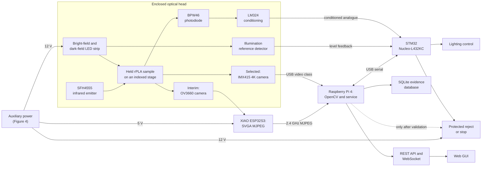
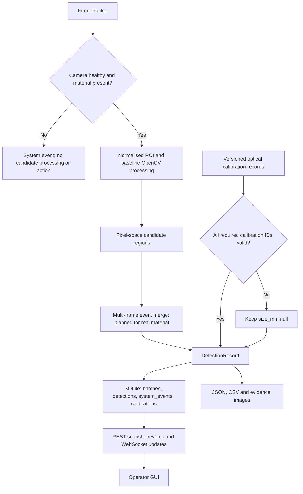
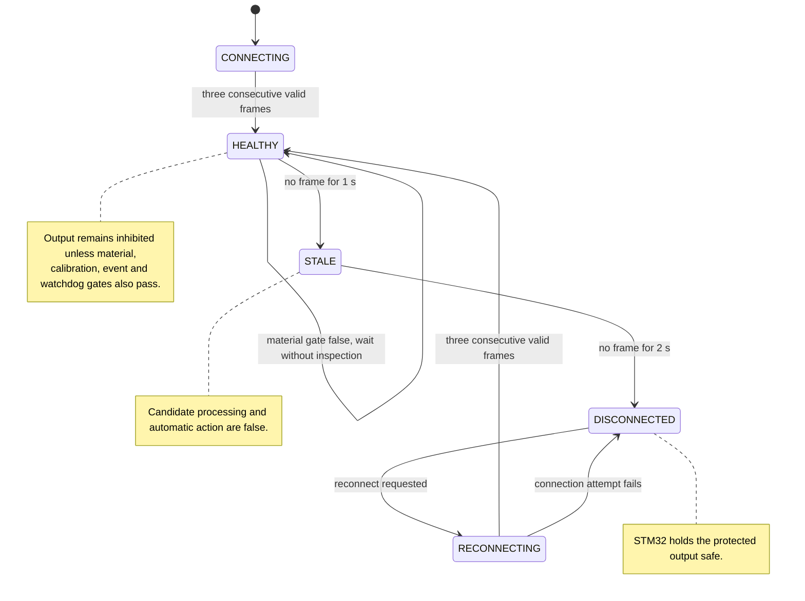
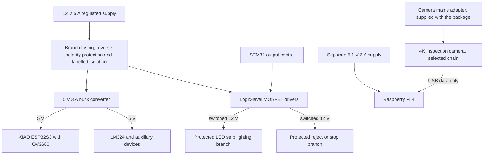

# Proposal Design Report

## Evidence-Traceable Surface Quality Monitoring for Recycled PLA Filament

| Document field | Status |
|---|---|
| Client context | BioLoop Manufacturing Pty Ltd |
| Discipline | ENG5105 Electrical Engineering |
| Deliverable | Proposal design report |
| Selected quality parameter | Visible rPLA filament surface quality |
| Selected concept | Plan A: 4K integrated inspection camera over USB video class, Raspberry Pi 4 processing and services, STM32 supervision and safe I/O. Interim implementation: ESP32S3 OV3660 acquisition, same downstream chain |
| Concept status | Plan A, close-range imaging of a held filament sample over USB, is the selected concept. Its procurement is approved but the hardware is not yet in hand, so Plan B runs as the interim implementation until it arrives. Every measurement in this report comes from the Plan B interim path; no Plan A measurement exists yet |
| Evidence cut-off | 15 August 2026 |
| Evidence status | Proposal with bounded integration evidence; real-material calibration and defect-performance validation remain pending |

## Executive Summary

BioLoop needs a laboratory-scale system that watches recycled polylactic acid (rPLA) filament for visible surface problems. The client brief lists bubbles, roughness, contamination, cracks and inclusions, and asks the electrical teams to cover live capture, communication, display, fault detection and, later, factory integration (Monash University, 2026d). Our selected concept is Plan A: a 4K integrated inspection camera imaging a held filament sample and feeding a Raspberry Pi 4 over USB, with an STM32 Nucleo-L432KC holding the lighting, the watchdog and an inhibited downstream output. A 1.75 mm strand needs magnification far more than it needs frame rate, and holding the sample still during exposure is what makes that magnification affordable (Sony Semiconductor Solutions, 2019). The camera does not come with the university kit and is not in hand, so nothing in this report was measured on Plan A.

Until that hardware arrives the build runs on Plan B, which uses boards the university already supplied (Monash University, 2026c): an ESP32S3 camera node feeding the same Raspberry Pi and STM32 roles over a controlled wireless link. Plan B is an interim front end rather than a rejected alternative, because everything downstream of the frame source is shared; Section 5.8 makes the changeover a front-end swap rather than a redesign. One limit belongs up front. The service, API and GUI evidence all comes from a Windows development host, so it says nothing about running on the Pi and nothing about real STM32 I/O.

Nothing yet shows that the system works as an rPLA defect detector. The recorded integration test ran with no rPLA in the region of interest, so it establishes that frames keep moving through the chain and nothing about defect accuracy, minimum detectable size or industrial readiness. Every numerical requirement in Section 3 still carries the `PROPOSED_REQUIREMENT` label. One question is now settled rather than deferred: inspection is designed around a stationary, indexed filament sample, because that is what buys the working distance and magnification a 1.75 mm strand needs, and because the brief asks for defect detection and grading without asking where along the strand a defect sits. That decision narrows the brief's in-line operating context, which Section 1.2 states outright rather than argues away. Physical acceptance depends on controlled optics, optical calibration, labelled real-material specimens, independent validation groups and a documented requirement review once the material is in hand.

## Acknowledgement of Country

This project is carried out at the Monash University Clayton campus. We acknowledge the people of the Kulin Nations, the Traditional Owners and Custodians of the unceded lands on which the University's Australian campuses stand, and pay respect to their Elders past and present (Monash University, 2026e). This project concerns circular use of materials, but circularity alone does not make an engineering system responsible. Our work should conserve resources, avoid preventable waste, and account for the energy, electronics and decisions introduced by the monitoring device. We recognise that care for Country carries responsibilities extending beyond the technical boundary of this proposal.

# 1. Background and Purpose

## 1.1 Client and manufacturing context

BioLoop's proposed manufacturing hub is meant to produce rPLA and rPLA-composite filament for Australian education, engineering, manufacturing and consumer markets. Product monitoring sits inside a wider circular-manufacturing system, alongside automation, resource efficiency, safety and economic viability (Monash University, 2026d). Filament only reaches a customer after extrusion, cooling, handling and spooling, so a visible anomaly caught late can mean rework, a rejected product, or a customer who no longer trusts the batch. Watching the line as it runs moves that decision point earlier.

Recycled PLA is not one uniform input. Published comparisons report that feedstock origin, recycling history and processing conditions can all affect the properties of recycled filament and printed products (Hidalgo-Carvajal et al., 2023; Wei & Bähr, 2024). Moisture can influence morphology and tensile behaviour in PLA-containing fused-filament material as well (Quader et al., 2024). Those findings justify monitoring. They do not let a camera diagnose moisture, degradation or extrusion settings from appearance alone. A pit or a colour patch is evidence of a visible condition, and nothing more; its process cause stays a hypothesis until it is checked against independent process and material data.

The circular-economy argument needs the same restraint. Life-cycle studies of distributed filament production and closed-loop PLA recycling show why recovered material deserves serious consideration, and they also show that the benefits depend on system boundaries, energy and process choices (Caceres-Mendoza et al., 2023; Zhao et al., 2018). This proposal claims no completed life-cycle assessment. Its purpose is narrower: get surface-quality evidence in front of a person, a quality system or a later plant controller early enough to act on.

## 1.2 Purpose, question and boundary

The report asks:

> Can a low-cost machine-vision system detect and grade visible anomalies on rPLA filament under representative laboratory conditions, while withholding unsafe or uncalibrated outputs?

The system has to make useful detections, and their validity has to be established independently. A stream that looks live can still be stale, badly lit or geometrically uncalibrated. That is why acquisition health and evidence status are design functions here, not interface decoration.

Table 1 fixes the investigation boundary before any concepts get compared.

**Table 1. Proposed project scope.**

| In scope | Outside the present claim boundary |
|---|---|
| Visible bubbles or pits, cracks or scratches, contamination or inclusions, and abnormal surface texture identified from controlled images | Engineering roughness parameters such as Ra without a validated profilometric or structured-light reference |
| Laboratory-scale real-time acquisition, candidate detection, event recording, alarm presentation and safe-output requests on a held filament sample | Internal void metrology, polymer chemistry identification, or proof of a defect's process cause |
| Optical calibration followed by labelled real-rPLA testing | Uncalibrated millimetre dimensions, and any longitudinal position along a running line |
| Basic fault detection, and the interface through which a larger automated process would integrate it, as required by the brief (Monash University, 2026d) | Safety certification, autonomous production release, or industrial deployment claims |

What the system produces, then, is a traceable candidate record and a decision aid for the operator. Automatic rejection is not authorised yet.

One premise deserves stating before anything rests on it, because the brief does not actually state it. Nowhere does the brief say the filament is moving. It asks for online, real-time acquisition, for measurement under representative operating conditions, and for a system suitable for integration into an industrial filament manufacturing process (Monash University, 2026d). Read together, those three phrases could be taken to describe a continuously running line, because filament production is a continuous extrusion and take-up process rather than a batch one. That reading would be ours rather than the client's, so it is labelled `TEAM_INFERENCE` and carried in the open instead of being presented as a requirement.

The optics settle it for this design. A 1.75 mm strand and a 0.20 mm target feature need magnification, and magnification costs depth of field: the working geometry in Section 5.2 leaves roughly 1.4 mm of focus depth, which a fixture can hold and a moving strand cannot. Real-time acquisition is unaffected — frames stream, the health gate runs and a preliminary result appears within a second for each illumination branch — but the sample is stationary while the shutter is open. The design basis is therefore a held, indexed filament sample, and the requirement set follows from it. R4 is a capture-to-result target rather than a line-speed one, and no requirement asks where along a strand a defect sits.

That choice does narrow the brief, and claiming otherwise would be the easier position rather than the true one. Three of the brief's demands survive intact: the system acquires and decides in real time, it detects, grades and requests rejection, and it is not asked for a longitudinal location, which the brief never requests (Monash University, 2026d). The fourth does not survive. Under the same team reading recorded above, a system suitable for integration into an industrial filament manufacturing process has to inspect material that is running, and this one inspects material that is held. What this project delivers is therefore a bench-scale instrument that establishes the measurement — optics, calibration, classification, evidence chain and safe-output path — on specimens drawn from the process rather than on the process itself.

Naming that gap is what makes it addressable, and it is an optical problem before it is a software one. Freezing motion at this magnification needs either a much shorter exposure with correspondingly more light, or a sensor and lens geometry that does not pay for scale in depth of field, because a running strand needs more focus depth than a fixture does. Everything above the optical layer is written to survive that change: the requirement set, the source-independent contracts, the supervision design, the calibration protocol and the validation method all hold when the head changes. Continuous in-line inspection therefore sits on the consultation list in Section 3 as a scoped extension, and it needs a different optical head rather than a different report.

# 2. Literature Review and Design Implications

## 2.1 What surface images can establish

Research on rPLA gives us a reason to inspect, not a visual ground truth. Material source, repeated processing and moisture can all change performance (Hidalgo-Carvajal et al., 2023; Quader et al., 2024; Wei & Bähr, 2024), and the brief separately lists bubbles, roughness, contamination, cracks and inclusions as surface conditions that may indicate process or material problems (Monash University, 2026d). The word *may* is doing real work in that sentence. We use the literature to define defect families and challenge conditions, then insist on labelled specimens before anything is assigned a class. Visual evidence on its own cannot tell a moisture-driven bubble from a cavity produced some other way, so a causal label needs independent process evidence.

Industrial anomaly-detection research warns against treating a tidy laboratory image as the operating domain. Recent datasets cover advanced operating scenarios, real industrial imagery and multi-view observations (Carvalho et al., 2024; Heckler-Kram et al., 2026; Wang et al., 2024). Their reported model results do not transfer to rPLA, because the objects, labels, optics and prevalence are all different. What does transfer is the experimental discipline: camera geometry, background, illumination, viewpoint and dataset split have to be controlled and documented.

## 2.2 Optics, illumination and acquisition

A cylindrical filament is a difficult optical target. Highlights migrate as the strand is turned, a single view cannot guarantee full circumferential coverage, and compression can invent block or edge artefacts. Unsynchronised dynamic line-scan research shows why sampling alignment deserves explicit treatment (Verspeek et al., 2024). A feature-fusion study on hot-rolled steel establishes performance inside its own material and dataset and nothing beyond it; it says nothing about illumination or geometry robustness for rPLA (Sundarrajan & Rajendran, 2023). An experimental comparison of area- and line-scan modalities makes a related point: some surface defects become visible only under particular sensor and illumination arrangements (Krassnig et al., 2025). Controlled diffuse and low-angle illumination, a fixed region of interest, locked focus and exposure where the hardware supports it, and a repeatable sample geometry are therefore part of the measurement concept rather than refinements to add later.

Plan A spends its budget on resolving power rather than on freezing motion. Its sensor is specified for 3840 × 2160 recording pixels on a 6.43 mm diagonal (Sony Semiconductor Solutions, 2019), so narrowing the field to a short held sample resolves detail that a wide-angle arrangement at the same distance cannot. Plan B uses the supplied OV3660 rolling-shutter imager, whose sensor limits are set out in its datasheet (OmniVision Technologies, 2011), through the supported ESP32 camera stack (Espressif Systems, 2026; Seeed Studio, 2026). No datasheet predicts this application's defect accuracy. Plan B works at a much coarser scale, and its compression, optical control and working-distance limits become test conditions rather than assumptions.

## 2.3 Alternatives to area-scan surface imaging

We considered three measurement families, because they answer different quality questions. Area- or line-scan vision preserves spatial evidence about colour, texture, inclusions, cracks and other visible features, though its response depends on view and illumination (Krassnig et al., 2025). Multi-axis optical diameter sensing has been validated on recycled ABS and PLA filament and can record diameter and shape along a spool (Petsiuk & Pearce, 2021), but a diameter trace on its own classifies no visible surface condition and reveals no internal void. Laser-line profilometry supplies quantitative height and topography, and has detected surface deviations from point clouds in material-extrusion research; it also adds equipment and processing cost, and the validation cited concerns deposited layers rather than moving feedstock (Lafirenza et al., 2023).

Given the present brief, the supplied hardware and the semester constraints, Plan B uses area-scan imaging for visible spatial anomalies and the photodiode only for material-presence and optical-health gating. Diameter sensing or profilometry becomes a scoped extension if stakeholder consultation makes diameter or engineering roughness a primary requirement. Naming them here is not evidence that Plan B already measures those properties. The same distinction is why Table 1 excludes Ra and internal void metrology.

## 2.4 Processing roles and evidence flow

Running every task on the camera node would simplify the wiring and compress acquisition, analysis, storage, interface and fault recovery into one resource-constrained device. Edge-computing literature supports putting time-sensitive visual processing near the equipment while keeping system roles distinct (Katsigiannis & Mykoniatis, 2024). So in this design the ESP32S3 takes image acquisition and transport, the Raspberry Pi 4 takes OpenCV, records, services and the GUI, and the STM32 takes deterministic capture gating, watchdog, lighting and output supervision. Manufacturer documents establish that the Pi and Nucleo platforms expose suitable computing and interface resources (Raspberry Pi Ltd, 2026a; STMicroelectronics, 2026). That is capability evidence. It is not proof that these roles have been deployed.

This separation creates a useful failure boundary. In the target Pi/STM32 design, a camera timeout puts the Pi service into a reconnecting or fault state while the STM32 inhibits the reject or stop request. A wired-in latest-frame policy and a frame-age watchdog are what stop an old image from quietly becoming a current quality event. Both controls now sit in the resident Windows service and pass threaded unit tests, but neither has been deployed or verified on the Pi. The architecture consequently treats health metadata, timestamps, calibration identifiers and null physical fields as part of the evidence chain.

## 2.5 Validation implications

Adjacent video frames are highly correlated. If near-duplicate frames from one defect land in both training and test data, reported performance comes out optimistic; broader machine-learning work identifies leakage as a reproducibility threat (Kapoor & Narayanan, 2023), and video-object-detection research shows the specific risk that spatiotemporal correlation creates (Figueiredo & Mendes, 2024). Validation therefore separates data by physical spool or batch and by defect event, never by shuffling individual frames at random.

Accuracy on its own would hide what rare defects cost. The proposed assessment reports event-level precision, recall and F1 score, false alarms per specimen, missed events, latency, and stability across the declared lighting modes and viewing angles. Sample counts and uncertainty go with those values. None of them exists yet.

Table 2 turns these literature findings into design decisions and names the project-specific evidence still missing.

**Table 2. Literature-to-design transfer.**

| Evidence cluster | Design implication | Evidence still required for this project |
|---|---|---|
| rPLA variability and moisture (Hidalgo-Carvajal et al., 2023; Quader et al., 2024; Wei & Bähr, 2024) | Treat visible anomalies as observations, not automatic root-cause diagnoses | Labelled real-rPLA specimens linked to documented conditions |
| Industrial anomaly and multi-view datasets (Carvalho et al., 2024; Heckler-Kram et al., 2026; Wang et al., 2024) | Freeze optics and record viewpoint, lighting and dataset provenance | Representative images from the final fixture |
| Dynamic imaging and surface inspection (Krassnig et al., 2025; Sundarrajan & Rajendran, 2023; Verspeek et al., 2024) | Control exposure, motion, geometry and illumination; test coverage limits | Speed challenge and circumferential-coverage study |
| Optical diameter sensing and laser profilometry (Lafirenza et al., 2023; Petsiuk & Pearce, 2021) | Retain them as requirement-driven alternatives, not capabilities implied by area-scan images | Stakeholder priority, comparative test plan and approved cost/schedule change before any scope extension |
| Leakage and correlated video (Figueiredo & Mendes, 2024; Kapoor & Narayanan, 2023) | Split validation by independent spool/batch/event | Pre-registered dataset split and held-out test results |

# 3. Stakeholders, Needs and Proposed Requirements

## 3.1 Stakeholder evidence status

Nobody has handed us a record of talking to a stakeholder, so this report has none. Everything below comes from the BioLoop brief, the discipline instructions and the literature. None of it should be read as something a client said, a participant agreed to, or a meeting settled. The distinction matters because the rubric asks for engagement and for requirements that actually shape the design (Monash University, 2026a, 2026b). We can write down what ought to be discussed. We cannot invent what someone said.

**Table 3. Stakeholder map and provisional design response.**

| Stakeholder group | Need inferred from brief or system use | Proposed design response | Current status |
|---|---|---|---|
| BioLoop/client representative | Traceable quality evidence, cost awareness and a path to automated integration | Requirement register, event records, API and explicit acceptance gates | Brief-derived; confirmation pending |
| Production operator | Clear health state, actionable alarms and no silent stale-data decision | Single-screen status, candidate overlay, alarm history and inhibited output when unhealthy | Proposed |
| Quality assurance personnel | Reviewable images, batch context, repeatable classification and export | Versioned calibration/model identifiers, immutable event fields and dataset export | Proposed |
| Maintenance and electrical personnel | Diagnosable faults, serviceable interfaces and safe recovery | Camera/processor/lighting health, watchdog states and manual reset rules | Proposed |
| Laboratory supervisor and technical staff | Safe, testable use of supplied equipment | Enclosed optical path, low-voltage prototype domains and staged fault tests | Brief- and equipment-derived |
| Filament users | Consistent product information without unsupported quality claims | Evidence-backed grading only after validation; retain uncertain events for review | Literature-derived; confirmation pending |

What we can deliver at this stage is the engagement plan itself. No session has been held, so every consultation outcome in this report is recorded as pending. M1 owns the plan. It covers the six groups in Table 3 through short structured sessions built to test assumptions rather than collect a ceremonial signature. Each session asks the same five questions: which defect families cause rejection, what false-alarm burden is tolerable, how long evidence must be retained, who may authorise a stop or reject action, and which operating speeds and lighting conditions count as representative. Answers go into a dated decision log that records the affected requirement, the owner, the rationale and any change to verification. A confirmed answer updates the status column of Table 3 and the stakeholder-basis column of Table 4. An unanswered question stays visible as pending; it does not get closed by assumption. No representative material has arrived and no calibration exists, so every value that depends on measurement is unconfirmed, and nothing in Table 3 is claimed as stakeholder-approved.

## 3.2 Proposed requirements and verification

Every numeric threshold in Table 4 carries the `PROPOSED_REQUIREMENT` label. The numbers exist because the electrical discipline guidance asks for a testable design baseline (Monash University, 2026a), and writing a number down is what makes a requirement arguable in the first place. They are our numbers, though, and stakeholder review or experimental evidence can still move any of them.

**Table 4. Proposed requirements register.**

| ID | Proposed requirement | Stakeholder/source basis | Planned verification | Status or present gap |
|---|---|---|---|---|
| R1 | Detect at least three agreed classes of visible surface anomaly | Defect families from the project brief (Monash University, 2026d); class count is team-proposed and awaits stakeholder confirmation | Held-out, event-level labelled test | `PENDING_REAL_MATERIAL` |
| R2 | For each accepted R1 class, target the declared class-specific characteristic dimension at or above 0.20 mm | Team engineering target under the discipline requirement for measurable specifications (Monash University, 2026a); stakeholder confirmation pending | Calibrated target and labelled specimens using the definitions below | `PENDING_REAL_MATERIAL`; optical scale unavailable |
| R3 | For every accepted R1 class whose events meet R2, achieve event-level precision and recall of at least 90% per class | Team performance target under (Monash University, 2026a); false-alarm and miss tolerance await stakeholder confirmation | Independent spool/batch/event split; report per-class counts and confidence intervals | `PENDING_REAL_MATERIAL`; no accuracy result exists |
| R4 | Return a preliminary result within 1 s, measured per illumination branch from the start of its soft-start | Team responsiveness target under (Monash University, 2026a); operator expectation awaits stakeholder confirmation | Timed capture-to-display runs on the final fixture | Proposed; the interim continuous path sustains 10.77 frames/s at SVGA, which bounds preview responsiveness but is not this measure |
| R5 | At P95, assert the alarm within 500 ms of the first frame in which a marked defect is clearly visible with illumination health already confirmed | Team alarm target under (Monash University, 2026a); response expectation awaits stakeholder confirmation | Synchronously film the scene reference and GUI/output; include confirmation, processing, communications and indication | Proposed; current brightness-control path timing is not this measure |
| R6 | Store defect type, size, confidence, evidence image, sample and view identifiers, time and batch identifier with the required calibration provenance | Data and visualisation need from the brief (Monash University, 2026d), made testable under (Monash University, 2026a) | Schema, file and record audit | Partly implemented; live evidence images and complete optical provenance remain pending, and size stays null until calibration |
| R7 | During a 30 min run, keep confirmed-event record loss below 1%, where `loss = (N_expected - N_complete) / N_expected` and a complete record has its durable database row plus required evidence image | Team reliability target under (Monash University, 2026a); stakeholder tolerance pending | Reconcile frozen expected event IDs against durable database rows, image files and export; report frame drops separately | Proposed; drop instrumentation is now in the service, but the final hardware test remains pending |
| R8 | Enter a safe hold or fault state after camera, lighting or processor failure | Fault-detection/integration need from the brief (Monash University, 2026d); team safety interpretation, with later risk assessment required | Fault injection and output-state observation on final wiring | Software/network path evidence only; physical safe I/O pending |
| R9 | Store and serve only images confined to the enclosed filament tunnel, with local-only storage and external publication disabled by default | Team privacy-by-design control; legal and stakeholder retention/access rules remain pending | Audit every final-evidence image and the storage/access configuration; accept zero outside-tunnel or person-containing frames | Not achieved by the current full annotated development preview; enclosure and release controls pending |

R2 needs one frozen primary dimension per accepted class, or the same threshold ends up meaning different things to different people. We use equivalent-circle diameter for a compact pit, bubble, inclusion or contamination region; calibrated transverse width for a crack or scratch, with axial length reported separately; and the smaller calibrated bounding dimension for an abnormal-texture patch. Class definitions and the ground-truth method are approved and frozen before data collection, so the 0.20 mm threshold cannot be quietly redefined once results are in. R3 works the same way: precision and recall must both pass for each of the three or more accepted classes, and we keep every class's event counts and confusion matrix so a macro or micro summary cannot bury a failing class. A pilot will indicate the minimum independent event count, but that count is frozen before the untouched test rather than picked afterwards.

R4 is measured per view rather than per specimen, and that has to be settled before the number means anything. One operator capture request runs the automatic cycle of Section 5.5, which drives both illumination branches in turn at one rotational index and so yields two views; R4 applies to each view separately, from the moment its branch begins its soft-start to the moment that view's preliminary result is displayed. A complete specimen is six rotational indexes under two branches — twelve views and one merged event set, as Section 5.2 sets out — and the specimen verdict is the merge of those twelve, carrying no one-second claim of its own. Keeping the soft-start and settling intervals inside the R4 budget rather than beside it is deliberate, because the operator waits through them: excluding them would let the requirement pass while the wait grew. It also makes the settling interval M5 measures at G2 a direct constraint on whether R4 can be met at all.

R4 is also where the design tension shows most clearly. A lower interim demonstration threshold may well help integration along, but it cannot quietly replace the one-second final target; moving that target takes a documented requirement change. If the final fixture misses it, the defensible responses are optimisation, a justified reduction in captured resolution, or formal renegotiation. Reporting only the runs that passed is not one of them.

# 4. Concepts and Selection

## 4.1 Selection method

The rubric requires at least two differentiated concepts and an evidence-backed recommendation (Monash University, 2026b). We apply four mandatory gates before any preference scoring: availability of the issued primary imaging hardware, avoidance of an unapproved concept-specific primary-camera purchase, procurement timing, and semester deliverability. Each gate returns one of three outcomes, and telling them apart matters because they answer two different questions. A fail removes a concept from selection outright, however attractive it looks technically. A conditional pass keeps it in selection and names the evidence still owed. A deferral says only that the concept cannot be built and validated inside the window this report covers, which decides which concept carries the interim implementation rather than which concept is selected. Plan A is deferred on the last gate and selected on the strength of the other three, and that deferral is exactly why Plan B carries the interim build. These are team feasibility decisions for this proposal, not stakeholder-approved budget limits.

## 4.2 Plan A: close-range imaging of a held sample (selected concept)

Plan A connects a 4K integrated inspection camera to the Pi over USB video class, images a filament sample held in a fixture, and keeps the STM32-based watchdog, lighting and safe I/O functions. The camera carries its own lens and an adjustable field, so working distance and magnification are set once and locked. Its strength is scale. Narrowing the field to a short held sample puts far more pixels across a 1.75 mm strand than a wide-angle arrangement at the same distance can, and the sensor is specified for 3840 × 2160 recording pixels on a 6.43 mm diagonal (Sony Semiconductor Solutions, 2019). The device also carries an integral illuminator; this design switches it off and leaves illumination under STM32 control, so that bright-field and low-angle dark-field stay separate commanded modes rather than one fixed ring. Optical alignment, reflective cylindrical geometry, depth of field and single-view coverage all still need calibration.

The concept is credible, and it is the one we selected. Its procurement is approved, but the camera is not university-supplied and is not in hand, so no Plan A measurement exists. Table 5 lists only the purchases unique to Plan A.

**Table 5. Plan-A-only incremental procurement. Price and availability are team-reported channel evidence, not a retained supplier document.**

| Item | Quantity | Cost basis | Observed availability | Source |
|---|---:|---|---|---|
| 4K integrated inspection camera with adjustable field, integral illuminator and stand | 1 | A$142.00 through the team's own supply channel | Available through the team's channel; approved and not yet ordered | Team supply channel; package contents and sensor identity from (Banggood, 2026) |
| **Plan-A-only subtotal** |  | **A$142.00** | Shipping or handling added at order | Confirmed against a dated receipt at order |

One line does not make an optical head, so it is worth being precise about what the camera buys and what it does not. The listing states that the package carries the camera, its lens, an integral illuminator, a stand, a remote, a power supply, an HDMI cable, a Type-C to USB-A cable and a case (Banggood, 2026), which is why no separate mount, supply or host cable appears against Plan A. What the package cannot supply is everything that makes the measurement repeatable: the enclosure and camera bracket that hold the working distance, the indexed sample holder that presents the specimen, the diffuser and crossed-polariser set that make a glossy cylinder legible under the existing LED strip, and the calibration set that turns pixels into millimetres and an assumed sampling density into a measured one. Those four groups are listed in Table 16 because both acquisition chains need them, not because they are optional.

The costing separates what is known from what is allowed for. Two figures are known: the camera at A$142.00 through the team's own supply channel, and the LED strip already held by the team at A$18.00. Everything else is either supplied by the university or a part nobody has quoted, and those groups carry team planning allowances in Table 16 rather than empty cells, each stated as a range with its basis and replaced by a dated quotation before commitment. The camera is still the largest concept-specific commitment in this build and the line most worth challenging at review, and that judgement does not rest on the exact figure. The listing is a retail source rather than a manufacturer specification, so the sensor parameters used in Section 5.2 are taken from the sensor manufacturer instead (Sony Semiconductor Solutions, 2019). Plan A is the selected target configuration, and Plan B carries the build until the hardware arrives.

## 4.3 Plan B: supplied-hardware distributed vision (interim implementation)

Plan B uses the university-supplied XIAO ESP32S3 Sense, Raspberry Pi 4 and STM32 Nucleo-L432KC (Monash University, 2026c). Its proposed chain is:

> Controlled optical head and rPLA filament sample -> ESP32S3 OV3660 acquisition -> 2.4 GHz Wi-Fi MJPEG -> Raspberry Pi 4 OpenCV, API/WebSocket, SQLite and GUI <-> STM32 watchdog, lighting and inhibited output interface

The OV3660 and ESP32 camera documentation supports the chosen acquisition stack (Espressif Systems, 2026; OmniVision Technologies, 2011; Seeed Studio, 2026), and the Pi and Nucleo documents support their planned processing and interface roles (Raspberry Pi Ltd, 2026a; STMicroelectronics, 2026). Plan B needs no new primary camera and builds on software and a live transport path that are already integrated, which is why it can carry the project while the Plan A hardware is in procurement. It also puts real limitations on display: JPEG artefacts, wireless delay or interruption, limited optical control, a fixed field that cannot be narrowed onto a 1.75 mm strand, and no guaranteed full-circumference view. Those constraints become test conditions and risk controls. Choosing Plan A removes the field and optical-control limits; it does not remove the rest.

## 4.4 Feasibility gates and technical comparison

Table 6 applies the mandatory gates first; Table 7 records the technical preferences afterwards.

**Table 6. Mandatory feasibility gates.**

| Gate | Plan A | Plan B | Decision significance |
|---|---|---|---|
| Primary imaging hardware available, issued or approved for purchase | **Pass**: the inspection camera is not issued, but concept-specific procurement is approved | **Conditional pass**: primary camera and computing platforms are listed as supplied; issue, condition and compatibility checks remain pending (Monash University, 2026c) | Plan A starts from an approved purchase instead of the issued baseline |
| No unapproved concept-specific primary-camera purchase | **Pass**: the camera purchase is approved; it remains the largest concept-specific line, and its delivered cost is recorded at order rather than estimated here | **Pass** for primary imaging: no additional main camera purchase; common additions remain subject to approval | Approval removes the budget-authority objection; it does not by itself deliver hardware |
| Procurement/lead-time exposure | **Conditional pass with residual risk**: the camera is available through the team's own supply channel at a known price, but no order has been placed, no dated delivery commitment exists, and a retail product page is not durable evidence of either | **Conditional pass with residual risk**: core platforms still need issue checks, while fixture, lighting and protection parts remain unfrozen | A supplier dispatch estimate is not a delivery commitment; neither concept may rely on an unverified arrival date |
| Semester implementation and validation | **Deferred**: the Plan A optical chain has not been integrated or calibrated within the window this report covers, so Plan B carries the interim build and Section 5.8 defines the migration | **Pass conditionally**: existing Plan B path can proceed to real-material tests | A deferral here bears on which concept can be built now rather than on which is selected: Plan A validation follows delivery, and Plan B interim validation remains conditional on material and fixture availability |

A separate scoring exercise records technical preference, and it does not override those gates. Scores are team-assigned comparative judgements from 1 (weak) to 5 (strong), not measurements. Every Plan A score above 3 rates potential rather than demonstrated behaviour, and the evidence-confidence column says so line by line: the adjustable field, the working distance, the USB video-class behaviour on Linux and the delivered resolving power are supplier claims or arithmetic, and none of them has been measured. Plan A is therefore a conditionally selected target rather than a proven one, and the claims that carry the most weight become gates in Section 8 instead of assumptions the build inherits. The provisional weights put 65% on measurement capability (R1–R4), 15% on Pi integration (R4, R6 and R7), and 20% on cost and procurement constraints. They reflect the team's present technical judgement, and we claim no stakeholder approval for them. R5 is not scored separately because neither concept has a physical scene-to-alarm result: Plan A removes the Wi-Fi leg, which is not the same as proving the 500 ms target. R8 and R9 are common STM32, enclosure and governance obligations rather than camera-choice discriminators. R5, R8 and R9 therefore stay mandatory release tests for whichever acquisition chain gate GP selects; they are not benefits any weighted score implies. The matrix is sensitive to its weights, so it exposes the trade-off rather than certifying the decision.

**Table 7. Weighted concept comparison.**

| Criterion | Weight | Plan A | Plan B | Evidence confidence | Basis of judgement |
|---|---:|---:|---:|---|---|
| Defect-classification potential (R1, R3) | 25% | 5 | 3 | Low (both): no rPLA accuracy data | Plan A offers a more configurable machine-vision optical chain; neither concept has rPLA accuracy data |
| Close-range imaging suitability (R2, R4) | 20% | 5 | 2 | Low (A): field and working distance come from a retail listing | Adjustable narrow field with locked focus and exposure versus a fixed wide field and compressed wireless transport (Banggood, 2026; OmniVision Technologies, 2011) |
| Spatial-detail potential (R2) | 20% | 5 | 3 | Low (A): sampling density is arithmetic (Sony Semiconductor Solutions, 2019); resolving power unmeasured | A field that can be narrowed onto a 1.75 mm strand versus the supplied OV3660 path |
| Raspberry Pi integration (R4, R6, R7) | 15% | 4 | 4 | Low (A): a supplier claim. Medium (B): the path runs | USB video class versus supported network acquisition; the Plan A device's class compliance on the Pi is a supplier claim and is not yet verified |
| Concept-specific cost (project constraint) | 10% | 3 | 5 | Medium: one known price, five allowances | A$142.00 plus shipping for Plan A imaging, an approved purchase but the largest concept-specific line in the build; no new Plan B main camera |
| Procurement timing (schedule constraint) | 10% | 4 | 5 | Low (A): no order, no dated commitment | Plan A depends on one delivery that has not been ordered or dated; Plan B core platforms listed as supplied, subject to issue check |
| **Weighted total** | **100%** | **4.55** | **3.35** | — | Comparative score only; the total ranks potential and does not certify it |

Plan A leads the weighted matrix and clears the availability and cost gates, so it is the selected concept. What remains open is delivery and verification rather than choice: the order has not been placed, the device's USB class compliance on the Pi is still a supplier claim, and the optical chain has not been integrated or calibrated inside the window this report covers. Plan B therefore runs as the interim implementation on supplied hardware — which is what produced the evidence recorded in Sections 5 to 7 — and Section 5.8 defines the migration executed on delivery. The ordering is deliberate: the interim path keeps requirements, contracts, supervision and validation moving while the selected optics are in procurement. Neither configuration is claimed to meet the retained requirements on present images.

# 5. Functional Design and Specifications

The design splits the inspection task into two measurement paths, and they are deliberately unequal. The camera path carries the spatial evidence: where a visible candidate region sits and what shape it has. The auxiliary infrared path answers something much narrower — is material there, and is the optical head behaving the way it should? A candidate gets recorded only when acquisition is healthy. An automatic reject or stop request needs a good deal more than that: healthy acquisition, valid calibration, confirmed material presence, a validated event rule, and an output that has been enabled. That boundary is the heart of the design. A bright contour is not a defect just because software can draw a box around it.

The selected acquisition device is an integrated 4K inspection camera built on the IMX415 sensor (Banggood, 2026; Sony Semiconductor Solutions, 2019), connected to the Raspberry Pi 4 as a USB video-class device. Until that hardware arrives, acquisition runs on the university-supplied XIAO ESP32S3 Sense with OV3660 (Monash University, 2026c). The processing platforms do not change between the two: the Pi takes the non-deterministic vision and data services, and the STM32 Nucleo-L432KC takes time-critical I/O supervision. The one difference is where compression sits — the interim ESP32S3 compresses in the camera node and sends JPEG over the air, while the selected device compresses inside its own module and delivers frames over a local cable. Neither path is uncompressed, and the migration in Section 5.8 gains optical control and a shorter transport rather than raw pixels. Manufacturer documents back those platform capabilities (Espressif Systems, 2026; OmniVision Technologies, 2011; Raspberry Pi Ltd, 2026a; Seeed Studio, 2026; Sony Semiconductor Solutions, 2019; STMicroelectronics, 2026). What they cannot back is application performance, USB class behaviour on the Pi, or a finished Pi/STM32 deployment, and every measured value in this report came off the interim configuration.

## 5.1 End-to-end functional architecture

**Figure 1. Proposed hardware, data and inhibited-action architecture, showing the selected Plan A acquisition front end and the interim Plan B front end that feeds the same downstream chain.**

Figure 1 puts the vision and service functions we developed on Windows into the Pi role they are meant to occupy, and separates them from the action authority the STM32 is meant to hold. The arrows describe the target integration baseline, not wiring that exists. Both acquisition front ends are drawn together because everything downstream of the frame source is shared: the Plan A camera reaches the Pi over USB video class, the interim Plan B camera reaches it over controlled 2.4 GHz MJPEG, and both hand frames to the same source-independent contract. Only one front end runs at a time. That shared boundary is exactly what makes the migration in Section 5.8 a front-end swap instead of a redesign.

The diagram also marks the action boundary. Raspberry Pi software may propose an event; the STM32 owns the physical output and withdraws permission the moment heartbeat, lighting or communications health is lost. This is a safety-oriented laboratory control architecture. It is not a safety-certified machinery function, and that difference is not a matter of wording. Connecting any of it to production equipment later would need a machine risk assessment and a safety-function design against the relevant framework, ISO 13849-1 included, rather than a prototype watchdog carrying that weight alone (International Organization for Standardization, 2023). OT network segmentation and least-functionality principles would apply as well (Stouffer et al., 2023).

Every requirement below still carries the `PROPOSED_REQUIREMENT` label. The project brief establishes the need for laboratory-scale, online surface-quality monitoring (Monash University, 2026d), and the discipline guidance requires measurable specifications with a verification route (Monash University, 2026a). Neither of those amounts to a stakeholder approving our numbers, and no record supplied to this report shows that anyone has. Table 8 assigns each requirement to functions and a verification route, and leaves the gap visible rather than papering over it.

**Table 8. Functional allocation and verification status of the proposed requirements.**

| ID | Proposed target | Functional allocation | Verification and present status |
|---|---|---|---|
| R1 | Detect at least three visible surface-defect classes. | Optical head; OpenCV/event classifier; labelled database. | Independent real-rPLA event test. `PENDING_REAL_MATERIAL`; current boxes are candidates only. |
| R2 | Demonstrate the frozen class-specific characteristic dimension at or above 0.20 mm. | Fixed optics, pixel scale and class-specific event measurement defined in Section 3.2. | Calibrated reference features at final working distance. `PENDING_REAL_MATERIAL`. |
| R3 | For every accepted R1 class meeting R2, achieve event-level precision and recall of at least 90% per class. | Event logic, ground truth and evaluation scripts. | Held-out spool/segment/event evaluation; report per-class counts, confidence intervals, F1 and macro/micro summaries. `PENDING_REAL_MATERIAL`. |
| R4 | Return a preliminary result within 1 s, measured per illumination branch from the start of its soft-start. | Selected chain: camera, USB transport, newest-frame policy and Pi vision. Interim chain adds the Wi-Fi leg. | Timed capture-to-display runs on the final fixture. The recorded 10.77 FPS SVGA integration result bounds interim preview responsiveness but is not this measure; latest-frame and drop instrumentation are now wired into the resident service but remain unmeasured on the Pi. |
| R5 | At P95, assert the alarm within 500 ms of the first frame in which a marked defect is clearly visible with illumination health already confirmed. | Timestamped event tracker, confirmation rule, API/UI and STM32 output request. | One video carrying the illuminated field, a millisecond reference and the GUI/output indication. Existing brightness-step timing is only `LIVE_INTEGRATION_ONLY` and is not this measure. |
| R6 | Store type, size, confidence, evidence image, specimen and view identifiers, time and batch identifier with required calibration provenance. | `DetectionRecord`, SQLite, image store, calibration manifests and export. | Schema/file round-trip test, then calibrated record audit. Current generic calibration linkage and live image persistence are incomplete; physical fields remain null. |
| R7 | Operate for 30 min with confirmed-event record loss below 1%. | Resident service, SQLite transaction path, durable image store and health log. | Reconcile frozen expected event IDs to complete durable rows/images/exports using the Section 3.2 formula; report acquisition/processing frame drops separately. Not yet tested. |
| R8 | Enter a safe hold or fault state after camera, light or processor failure. | Pi health gate, STM32 watchdog and protected output. | Hardware fault injection with the final wiring. Software/network evidence exists, but safe I/O remains pending. |
| R9 | Store and serve only the enclosed filament-tunnel view, locally by default. | Shrouded optical head, release crop/mask and Pi-local database. | Audit every final-evidence frame and storage/access configuration for zero outside-tunnel/person content. Current development endpoints serve a full annotated frame rather than an ROI crop; R9 is not achieved (Australian Government, 2025; Office of the Australian Information Commissioner, 2026). |

## 5.2 Optical head and camera specification

The selected camera is an integrated 4K inspection module built on the Sony IMX415. That sensor is specified as a diagonal 6.43 mm (Type 1/2.8) CMOS device carrying 8.46 M effective pixels, with 3840 × 2160 recommended recording pixels (Sony Semiconductor Solutions, 2019). The module adds a fixed lens with an adjustable field, a minimum working distance near 70 mm, a 4K USB video output and an integral illuminator that this design leaves switched off (Banggood, 2026).

What matters here is scale, and scale is arithmetic. For a horizontal pixel count \(N_h\) spread over an imaged field width \(w_f\), the optical sampling density \(s\) and the pixel span of a feature of width \(d\) are

\[
s=\frac{N_h}{w_f}, \qquad n_d=s\,d.
\]

The planned working point sets \(w_f=40\ \text{mm}\), which covers most of a held sample in one frame and gives \(s=96\) px/mm. A 1.75 mm strand then spans about 168 px and the 0.20 mm R2 target feature about 19 px. Two cautions belong with those numbers. Sampling density is not resolving power: the module publishes no aperture and its field adjustment may combine optical and electronic zoom, so the delivered detail can be well below what the pixel count suggests, and G3 measures it against a resolution target rather than assuming it. Depth of field also shrinks as the field narrows. A first-order estimate at an assumed f/4 working aperture gives roughly 1.4 mm of total depth at this working point, against which a 1.75 mm cylinder already consumes about 0.26 mm across the usable ±45° arc — enough margin for a located sample, and not enough for a strand that is free to wander. That trade is the reason the design holds the sample still. None of it is a performance claim. The millimetres-per-pixel scale is fixed only at calibration, so the minimum detectable size under R2 stays `PENDING_REAL_MATERIAL`, and a sensor that supports 4K at 30 Hz does not deliver R4 either: R4 covers Pi-side decode, inspection and storage, and none of that has been measured in this configuration.

The interim configuration uses the supplied OV3660. It can expose larger frames, but what the project needs is a stable operating point, not the biggest mode in the datasheet. SVGA 800 × 600 is fixed as the interim live profile; VGA 640 × 480 stays available as a manual recovery option, and XGA or anything larger falls outside the selected operating configuration. The active normalised ROI maps at SVGA to `(254, 47, 195, 527)`. Storing the ROI in normalised coordinates is deliberate: it survives the change of sensor and frame size at migration. Its position stays provisional until the fixture and the filament settle the true optical axis. OV3660 readout, JPEG compression and wireless transport can each introduce timing or block artefacts, so exposure duration, illumination mode and candidate persistence have to be tested together rather than one at a time (Espressif Systems, 2026; OmniVision Technologies, 2011). The wireless leg and the fixed wide field are the specific limits the selected configuration removes; compression is not one of them, because the selected module also encodes inside its own housing.

The proposed head uses a rigid camera bracket, a matte black sample holder with rotational indexing, a matte background and an external shroud. The holder grips the strand outside the imaged region so that nothing but filament sits in the field, and it carries a unique sample identifier for every specimen. Working distance, field, focus and exposure get locked once calibration is done. Switchable bright-field illumination is there to bring out colour or texture contrast; low-angle dark-field illumination is there to make surface relief cast shadow. Both modes are experimental variables, not evidence that any particular anomaly is detectable. Industrial anomaly datasets make the same point from the other direction: appearance changes and view geometry belong in the validation set, not hidden behind one convenient image condition (Carvalho et al., 2024; Heckler-Kram et al., 2026; Wang et al., 2024).

One camera sees one arc of a round object. It does not give full 360-degree coverage, and no amount of processing invents the hidden side. Holding the sample makes the answer mechanical rather than optical: the holder indexes the strand through a fixed set of rotations and the results are merged per sample. The arithmetic decides how many. A single view reads a usable arc of roughly ±45° before the surface turns too far from the optical axis, so four positions at 90° would meet edge to edge with no overlap and no tolerance for placement error. Six positions at 60° are planned instead, which leaves about 30° of overlap to absorb it. Each position is captured under both illumination modes, so a specimen produces twelve images and one merged event set. The head will also carry a scale target plus dark and white references that can be inserted without moving the camera. None of that supports a physical-resolution claim. Engineering roughness and internal voids stay outside this optical design.

## 5.3 Auxiliary photodiode chain

The SFH4555 emits across the filament path and the BPW46 returns a photocurrent that tracks the irradiance reaching it. That pair answers two questions which fail differently: whether material sits in the path, and whether the optical path is still clean. The LM324 stage turns that current into a voltage and trims high-frequency noise before the STM32 converter samples it. At the proposal stage, the first transimpedance estimate is

\[
R_f=\frac{V_{span}}{I_{PD}},
\]

where \(I_{PD}\) is the photocurrent measured in the final geometry and \(V_{span}\) is the usable output swing. With feedback capacitance \(C_f\), the approximate low-pass corner is

\[
f_c=\frac{1}{2\pi R_f C_f}.
\]

None of \(R_f\), \(C_f\), the LED current or the decision thresholds can be frozen before the optical head is assembled. The provisional constraints are still explicit. M3 will pick the transimpedance gain so the measured path-state range occupies roughly 10–80% of the ADC input range without clipping, then choose \(C_f\) so the measured step response stays at least five times faster than the fastest material-presence transition while still attenuating the high-frequency noise actually observed. LED drive gets current-limited below the manufacturer's continuous rating and rechecked at the measured enclosure temperature. Dark, clear-path, normal-filament, blocked-path and misaligned-filament distributions set the threshold, with a recorded guard band, at G3. A valid auxiliary state can gate inspection or flag optical degradation. It cannot locate a scratch, classify contamination or estimate feature size.

The analogue channel terminates at the microcontroller rather than at the Raspberry Pi. The STM32 Nucleo-L432KC already carries the microcontroller's own converter (STMicroelectronics, 2026), so the supplied MCP3208 is held as a spare rather than wired into the released design; a separate SPI converter would add a second acquisition path for a single auxiliary channel. Routing the channel to the STM32 also places the presence and optical-health decision on the device that owns the physical output, which is the separation Section 5.1 applies throughout. The Pi receives the resulting state in the existing Pi–STM32 frame, so the health gate in Figure 2 keeps the same input. M3 will confirm the converter's resolution, input range and available pins against the device datasheet before the interface is frozen. The conditioning stage must still be bounded. The LM324 is not a rail-to-rail device, so if it operates from the regulated 5 V analogue branch its output range and every normal and single-fault input condition must be checked. M3 will constrain the converter pin to the microcontroller's analogue input range through gain and bias design plus an input series resistor and a measured clamp/divider arrangement, and will measure the minimum, maximum and protection current under normal and single-fault conditions before the microcontroller is connected; component values remain a G2/G3 measurement decision. Raspberry Pi GPIO and SPI remain 3.3 V interfaces, and no 5 V analogue or digital signal may connect directly to either controller. Section 8 records the official component sources for these release constraints.

One detector cannot do a third job. The lighting loop in Section 5.5 needs to know how much light the optical head is actually putting out, and this channel cannot tell it. A silicon photodiode responds across the visible band as well as the near infrared, so the same reading moves when the specimen's colour changes, when the holder turns to a new index and when either illumination branch changes output, and one number cannot say which of those happened. Two measures keep the jobs apart. Presence and path health are sampled only in the dark window the capture cycle already provides, with both visible branches de-energised, which makes it an infrared measurement rather than a mixed one; M3 confirms at G2 that energising either branch does not move that reading, and fits an infrared-pass filter over the detector if it does. The lighting loop gets its own reference detector: a second photodiode on a separate conditioning stage and a separate converter channel, aimed at the diffuser output rather than at the specimen, so that what it follows is lamp output rather than whatever happens to be in front of the lens. Calibration splits the same way in Section 7 — the five presence states belong to the infrared channel and the per-branch level bands belong to the reference detector — so the loop and the presence gate never read one number against two different expectations. What the reference detector cannot see is a shift in geometry, which is why placement tolerance stays a Section 7 measurement rather than something this loop corrects.

## 5.4 Raspberry Pi processing, provenance and storage

The planned Pi deployment keeps the source-independent Week 3 contracts rather than replacing them. `FramePacket` carries the image, frame number, acquisition and receipt times, camera source and connection state. A `DetectionRecord` carries a candidate label, pixel bounding box, pixel area, algorithm score, provisional grade and batch context. The SQLite schema holds `batches`, `detections`, `system_events` and `calibrations`, and the service now enables SQLite foreign-key enforcement, so a detection cannot reference a batch that was never opened. Those boundaries are what make a later algorithm change auditable, and they fit the edge-computing role described in current industrial vision work (Katsigiannis & Mykoniatis, 2024). The schema is not finished, though. It carries one generic `calibration_id`, and its calibration table records optical pixels/mm and an evidence path — not the illumination mode, the rotational index or the resolution-target evidence a size claim rests on. Before a physical size can be traceable, the released design needs a calibration record that identifies the optical scale together with the capture conditions it was measured under.

**Figure 2. Health-gated candidate-processing and evidence-record flow.**

Figure 2 shows where health, calibration and provenance step in to stop a pixel-space candidate from picking up physical meaning it has not earned.

The Windows development baseline uses a configurable threshold of 145, a minimum area of 120 px and an enabled material-presence gate (ENG5105 Project Team, 2026a, 2026i). These are prototype parameters, not settled ones. The gate currently expects a dark target through 80% of the ROI height, which keeps a nearby hand or a small background object from starting inspection, and it will need retuning once rPLA is in front of the camera. The one-slot `LatestFrameBuffer` and the 1 s `STALE`/2 s `DISCONNECTED` monitor started as `OFFLINE_FAULT_INJECTION_ONLY` primitives; the resident service now instantiates both. Acquisition and inspection run on separate threads. The reader publishes each frame into the one-slot buffer, a backlogged frame is discarded and counted, and the inspection thread judges health from the age of the newest frame it holds rather than from whether the last read returned inside its configured 3000 ms timeout. That distinction matters: a frame older than the configured stale window downgrades the service state even while reads keep succeeding, and three consecutive frames are required before inspection resumes. The `dropped_frames` field now reports the buffer's discard count instead of a constant zero, and every snapshot carries `frame_age_ms` beside its configured thresholds. All of this is development-host software evidence from threaded unit tests. It does not establish Pi deployment, backlog suppression under real network load, or the R4, R7 and R8 results, which still need the final fixture. Multi-frame merging turns repeated frame candidates into event candidates only once representative material exists.

The current model-level data rule is strict: without its generic `calibration_id`, `size_mm` stays null. That safeguard is not the same thing as proven provenance. The resident live service leaves `image_path` and the calibration linkage null, and the current calibration table cannot identify the optical-scale evidence a size claim needs. Synthetic records carry `OFFLINE_SYNTHETIC_ONLY`; live camera candidates carry `LIVE_INTEGRATION_ONLY`. Neither supports a physical claim. Before R6 can pass, the release schema has to require the relevant calibration IDs or a composite-manifest hash, plus a durable evidence-image path.

## 5.5 STM32 supervision and safe I/O

The proposed STM32 firmware will sample the auxiliary optical channel, debounce the operator capture request, check the Pi heartbeat, switch the two illumination branches through protected drivers, report the active mode, and own the reject/stop demonstrator output (STMicroelectronics, 2026). None of these functions has been demonstrated on physical STM32 wiring yet.

The microcontroller's role is narrow, and stating it plainly matters, because a supervisor that only forwarded messages would not earn its place in the design. The microcontroller owns the decisions that must not depend on a general-purpose operating system running a web stack: whether material is present, whether the optical path is healthy, which illumination mode is actually energised, whether the Pi is still alive, and whether a physical output may move. Lighting is the clearest case. The brief names lighting control as a design challenge for surface quality (Monash University, 2026d), and this design keeps it as a commanded function rather than a fixed lamp. The bright-field and low-angle dark-field branches are driven separately through rated transistor drivers, the active mode is reported back in the existing Pi–STM32 frame, and a capture is refused when the reported mode and the requested mode disagree. Illumination mode becomes part of the evidence record instead of an ambient condition nobody wrote down. The camera module carries its own illuminator, and the design leaves it off precisely so that this control stays meaningful; if it were used, the mode field would describe something the system does not command. G2 verifies driver levels, switching behaviour, branch protection and the mode-report path before any of it is released.

Illumination is automatic. The operator presses capture once for a specimen position and takes no decision about which mode is used or how bright it is; the controller runs both modes in turn and holds each one at a level it measures rather than a level it assumes. Convenience is not the reason. An operator adjusting a lamp between captures would make every image a different measurement, and the mode and level stored against a record have to describe what the hardware actually did.

A capture cycle runs as follows.

1. The request arrives on the debounced input.
2. Both branches are de-energised, and the infrared channel of Section 5.3 is sampled in that dark window; the request is accepted only if material presence and optical health hold.
3. The bright-field branch is ramped from zero across a soft-start interval to its calibrated drive level.
4. The controller trims that level until the reference detector of Section 5.3 reads inside the band recorded for the branch at calibration, then reports that capture may proceed.
5. The Pi captures, and the record stores the branch, the drive level actually used and the measured reference value.
6. Steps 2 to 5 repeat for the low-angle dark-field branch.
7. Both branches return to off, which is also the safe state.

The trim in step 4 is what makes the illumination repeatable, and how it is bounded matters more than how it is tuned. Drive level is the actuator and the reference detector is the feedback, so the loop regulates the light the head emits rather than the current the driver delivers. Calibration seeds it: with a white reference in the field, G3 records the drive level and the reference value that give a correct exposure for each branch, and those two numbers become the set point and the acceptance band. Correction is deliberately slow, because what it exists to absorb is slow — emitter warm-up, thermal droop and ageing — and a faster loop would chase image content instead.

Authority over that correction is limited, and the limit is what carries the evidence argument. The controller may move the drive level only inside a window around the calibrated value. Needing to leave that window to reach the set point means something physical has changed, a degraded emitter or a clouded diffuser, so the controller raises an optical-health fault rather than compensating for it. An unbounded loop would keep the picture looking correct while the optical head quietly degraded, which is precisely the failure this design cannot afford. Camera exposure stays locked for the same reason: two loops competing over the same brightness would leave neither the image nor the record meaning anything.

One manual path stays open. During commissioning M5 can set a drive level by hand to explore geometry, and any capture taken under a manual level is flagged in the record so that it can never be counted as calibrated evidence. Six quantities are frozen before any of this is released, and none of them can be taken from a datasheet: the soft-start interval, the calibrated drive level and acceptance band for each branch, the settling interval, the correction limit and the loop rate. M5 measures the strip's rise to steady output and the camera's exposure convergence at G2 and sets the settling interval from the slower of the two with margin; G3 fixes the presence thresholds from the measured five-state distributions, and the illumination set points and bands from the white-reference exposures. Table 12 allocates the lighting 8.00 W normal and 12.00 W peak, so holding a branch energised through a long session is a thermal question rather than an electrical one, and the measured enclosure temperature decides whether a cool-down between captures is required.

**Figure 3. Proposed acquisition-health states and output-inhibition behaviour.**

Figure 3 defines what counts as a qualified recovery, and which states must keep candidate processing or physical output inhibited. The resident Windows service now enforces the 1 s `STALE` and 2 s `DISCONNECTED` transitions and the three-consecutive-frame recovery rule, judging health from the age of the newest buffered frame rather than from whether a read returned inside its configured 3000 ms timeout, as Section 5.4 records. That is development-host evidence from threaded unit tests. It does not establish Pi deployment, behaviour under real network load, or any of the R4, R7 and R8 results, so the state timing in the figure stays a design awaiting verification on the target hardware.

The released Pi service must not replay old frames. It will require three consecutive valid, age-bounded frames before processing resumes, and a Pi restart or a heartbeat loss will clear output permission. After a latched hardware fault, re-enabling any automatic demonstrator will take a manual acknowledgement. If the web interface fails while the STM32 is still alive, the operator loses visibility, but the proposed watchdog and output inhibition stay local to the control path. These are target behaviours, pending live-service integration and the final wiring tests.

## 5.6 Communications, API and user interface

Table 9 separates transport that is implemented from hardware interfaces that are only proposed. Table 10 then fixes the Windows development API behind the present GUI evidence.

**Table 9. Subsystem communications and integrity rules, covering the selected and interim acquisition chains.**

| Interface | Payload and present/planned mode | Integrity, timing and recovery rule |
|---|---|---|
| Inspection camera → Pi (selected) | USB video class carrying frames from a sensor specified for 3840 × 2160 recording pixels (Sony Semiconductor Solutions, 2019); no wireless leg, and compression moves inside the camera housing. | `PROPOSED_INTERFACE`: class enumeration on Linux, negotiated pixel format, USB bandwidth contention, cable seating and capture-stall behaviour become the acquisition fault classes, and all of them must be confirmed on the Raspberry Pi and fault-injected at G5 before the migration is accepted. |
| OV3660/ESP32S3 → Pi (interim) | HTTP multipart MJPEG over controlled 2.4 GHz Wi-Fi; SVGA 800 × 600. Replaced by the USB link on migration. | Resident service is the only direct MJPEG client. Read/open timeout and reconnect logic gate processing; rate is measured, not assumed. |
| Pi ↔ STM32 | Proposed USB serial baseline: 115200 bit/s, 8-N-1; framed monotonic sequence, millisecond timestamp, material-presence state, active illumination mode, health bitmask, lighting command and output request. | `PROPOSED_INTERFACE`: CRC-16 per frame and 10 Hz heartbeat; three invalid/missing heartbeats or more than 300 ms without a valid frame inhibits output. M5 freezes the framing/timing after G2 bench checks, and G5 verifies fault response. |
| Capture request → STM32 | Operator capture button as a debounced digital input with a hardware pull-up, read alongside the sample-presence state derived from the optical channel. | `PROPOSED_INTERFACE`: a capture is accepted only when presence, optical health and the reported illumination mode all agree with the request; debounce interval, accept/reject rule and input protection are frozen after G2 bench checks. |
| Optical channel → STM32 | Proposed conditioned analogue input sampled by the microcontroller's converter, timestamped and reported in the existing Pi–STM32 frame; initial bench rate 200 samples/s per active channel. | `PROPOSED_INTERFACE`: for the shortest measured presence transition \(t_{min}\), require \(f_s\geq10/t_{min}\) so at least ten samples span it; stale/out-of-range values create an optical-health fault. M3 sets thresholds from the five-state distributions at G3. |
| STM32 → local LCD | I2C summary of system health and safe-output state. | Diagnostic only; it does not override the web/database record. |
| Pi → browser | REST and WebSocket over the local Ethernet/Wi-Fi network. | Local-by-default access; the UI must show disconnection and last update rather than silently freeze. |
| Future plant link | MQTT or Modbus TCP/RTU is an option, not part of the validated baseline. | Requires an interface-control revision, OT security review and separate acceptance (ISO/IEC/IEEE, 2023; Stouffer et al., 2023). |

The implemented Windows development service listens on port 8765 (ENG5105 Project Team, 2026e). Its current API contract is explicit:

**Table 10. Implemented development-service API contract.**

| Method and endpoint | Response or action | GUI use |
|---|---|---|
| `GET /api/health` | Acquisition, processing, gate and evidence state, including the development field `automatic_actions_allowed`. | Health banner and diagnostics; this field is not actuator authorisation. |
| `GET /api/snapshot` | Current summary plus candidate records. | Initial page state and resynchronisation. |
| `GET /api/events?limit=` | Bounded event history for the active batch. | Event table and export preparation. |
| `POST /api/events/delete` | Development-only hard deletion of selected database rows. It now writes a `DETECTION_RECORDS_DELETED` event naming the requested identifiers, but still records no operator identity, reason or tombstone. | Traceable clean-up only; disable before evidence release and replace with role-identified quarantine/tombstone handling. |
| `GET /api/frame.jpg` | Latest annotated JPEG, or 503 before a frame is available. | Single-frame view. |
| `GET /api/stream.mjpg` | Shared annotated MJPEG output. | Live view without another direct camera client. |
| `POST /api/control/reconnect` | Requests camera recovery. | Manual recovery control. |
| `WS /ws` | Pushes changed snapshots. | Low-delay health and event updates. |

These endpoints are Windows-host implementation evidence. Deployment and start-up persistence on the Raspberry Pi, the USB serial contract and physical STM32 I/O are all still plans. One name in the present service is actively misleading. `automatic_actions_allowed` is no more than a development readiness Boolean computed from `camera_state == HEALTHY` and the material-presence gate. It does not check calibration, event validation, STM32 heartbeat, fault latches or operator authorisation, and no actuator is connected to it. It must be renamed before release. The target interface should expose a separate `safe_output_authorized` that goes true only when frame data is not stale, optical calibration is valid, the event rule is validated, the reported lighting mode matches the requested one, the Pi–STM32 heartbeat and watchdog are live, the operator has explicitly enabled output, and no fault is latched. Until every G5 release condition passes — physical fault injection, a confirmed safe default level and owner sign-off — that value stays false and physical output stays inhibited. The hard-delete endpoint now writes an audit event naming what was removed, but an irreversible delete still contradicts the proposed append-only evidence governance and has no place in an evidence-release configuration. Before acceptance it should be disabled, or replaced by a controlled soft delete carrying identity, time, reason, retention policy and an append-only audit record. Existing evidence must never disappear without a trace.

The GUI should let an operator understand the whole chain at a glance: camera and material-gate health, evidence label, live ROI, candidate overlays, frame rate, post-decode-to-GUI latency, batch and calibration identifiers, Pi/STM32/lighting states, event history and export. Before calibration it shows pixel measurements. Physical size and position stay blank, and candidate status must never be dressed up as a validated quality grade. The local LCD carries only a small health summary, so that losing the browser does not look like losing the controller.

## 5.7 Power budget and protection

The proposal keeps computing separate from lighting and switched loads. Table 11 allocates the 5.1 V computing domain; Table 12 gives an all-in 12 V auxiliary-domain allocation that includes the demonstrator branch. Both are team values for sizing and protection. They are not measured consumption, and they are not manufacturer-declared application loads (Monash University, 2026a, 2026c; Raspberry Pi Ltd, 2026a; STMicroelectronics, 2026). The Pi and STM32 figures bound the intended service and USB load; the auxiliary figures allocate the interim camera node, analogue, lighting and demonstrator branches. M3 replaces every allocation with start-up and steady-state current evidence at G2, before any fuse or conductor selection is released.

**Table 11. Proposed 5.1 V Raspberry Pi-domain power allocation.**

| 5.1 V Raspberry Pi domain load | Normal | Peak |
|---|---:|---:|
| Raspberry Pi 4 | 7.50 W | 12.50 W |
| STM32 Nucleo via USB | 0.25 W | 0.50 W |
| **Domain total** | **7.75 W** | **13.00 W** |

A 5.1 V, 3 A supply provides \(P_{available}=5.1\times3=15.3\ \text{W}\). The allocated peak margin is

\[
M_{Pi}=\frac{15.3-13.0}{15.3}\times100=15.0\%.
\]

**Table 12. Proposed 12 V auxiliary-domain power allocation.**

| 12 V auxiliary-domain load | Normal | Peak | Path |
|---|---:|---:|---|
| ESP32S3 Sense + OV3660 | 1.50 W | 2.50 W | 12 V to regulated 5 V |
| IR/analogue/LCD electronics | 0.40 W | 0.80 W | Mixed regulated rails: LM324/auxiliary devices as confirmed; conditioned output clamped to the STM32 analogue input range |
| Controlled lighting | 8.00 W | 12.00 W | 12 V branch |
| Reject/stop demonstrator | 0 W | 5.00 W | Protected switched branch; calculation treats 5.00 W as a 12 V-side allocation |
| 4K inspection camera (selected chain) | — | — | Its own mains adapter, supplied with the package; outside this domain, and carrying data to the Pi over USB only |

Assuming 85% conversion efficiency for the 5 V loads,

\[
P_{12V,normal}=\frac{1.50+0.40}{0.85}+8.00=10.24\ \text{W},
\]

\[
P_{12V,peak}=\frac{2.50+0.80}{0.85}+12.00+5.00=20.88\ \text{W}.
\]

A regulated 12 V, 5 A source supplies 60 W, leaving

\[
M_{12V}=\frac{60-20.88}{60}\times100=65.2\%.
\]

The selected camera does not appear in either domain total, and that is a claim the incoming check has to confirm rather than an omission. The package is listed as including a power supply (Banggood, 2026), so the design assumes a mains adapter feeding the camera directly, with the USB link carrying data alone. If incoming inspection finds the device bus-powered instead, the 5.1 V domain has to absorb it: a Raspberry Pi 4 USB port rated at 900 mA adds up to 4.50 W, taking the peak allocation in Table 11 from 13.00 W to 17.50 W against the 15.30 W the supply provides. That is a negative margin, so a bus-powered device forces a larger 5.1 V supply or a self-powered hub before the fixture is wired, and the enclosure earth and protection boundary between the adapter and the auxiliary domain have to be drawn either way.

Peak allocation is not the final electrical design. The 20.88 W value assumes the demonstrator's 5.00 W is already expressed at the 12 V source; if the selected device draws from a converted 5 V rail instead, its peak has to be divided by the measured converter efficiency and the total recalculated before G2. Week 5+ tests must capture start-up inrush, steady current, Pi undervoltage logs and regulator temperature before fuse, conductor and connector ratings are frozen. Every domain gets branch fusing, reverse-polarity protection and labelled isolation. Switched inductive loads need flyback suppression, lighting is switched by a rated transistor/MOSFET driver, and signal returns meet at a controlled ground point. The Pi supply must never source the demonstrator branch.

**Figure 4. Auxiliary power and protection domain, showing the branches the 12 V source feeds and where protection and switching sit.**

Figure 4 separates the computing supply from the auxiliary domain, and it now carries a third supply: the selected camera's own adapter, drawn deliberately outside both the 12 V branch and the Pi rail so that the assumption stated above is visible rather than buried. No switched load draws from the Raspberry Pi rail, every 12 V branch passes the protection stage before it reaches a load, and both switched branches sit behind logic-level drivers the STM32 commands. The auxiliary analogue channel is referenced to the microcontroller's own supply rather than to the 12 V domain, which is what keeps the conditioned signal inside the input limits recorded in Section 5.3. Component values, fuse ratings and conductor sizes stay a G2 measurement decision.

## 5.8 Migration from the interim configuration to the selected concept

We chose the interim path so that migration would be a front-end replacement rather than a redesign. Everything from the frame contract downwards is shared: the source-independent contracts recorded in Appendix A (ENG5105 Project Team, 2026a) may not be reached into by any camera adapter, the acquisition adapter is injected through a `capture_factory`, and the inspection thread receives frames without knowing where they came from. That separation already exists in the current code, and it is the reason the selected concept can be adopted without reopening the requirement set, the supervision layer or the evidence schema.

Table 13 states what changes, what is preserved, and what evidence has to be re-established. The last column is the one that matters. Migration replaces the measurement instrument, so every value describing optical or timing performance dies with the change and has to be measured again on the new chain. No interim figure crosses over.

**Table 13. Migration from the interim OV3660 path to the selected close-range USB path.**

| Layer | Change on migration | Preserved | Evidence status after migration |
|---|---|---|---|
| Camera and transport | The 4K USB inspection camera replaces OV3660 over 2.4 GHz MJPEG; the ESP32S3 leaves the acquisition role | Enclosure, mounting bracket, sample holder, matte background, lighting modes | All acquisition timing and image-quality evidence is void and must be re-recorded |
| Acquisition software | A USB video-class capture adapter replaces the MJPEG client behind the existing `capture_factory`; the one-slot latest-frame buffer and frame-age monitor are retained and re-tuned | `FramePacket` contract, inspection thread, health state machine, drop instrumentation | Threaded unit tests re-run with the new adapter injected; hardware-free test strategy unchanged |
| Optical calibration | New optical calibration for the new sensor, field and working distance; a new `calibration_id` is issued | Normalised ROI definition, calibration record schema, provenance rules | Previous `calibration_id` is retired; `size_mm` returns to `null` until the new calibration is recorded |
| Processing, storage and interface | The schema extension Section 5.4 already requires — illumination mode, rotational index and evidence-image provenance — is completed before migration, and both acquisition chains then share the extended structure | OpenCV baseline, `DetectionRecord`, REST/WebSocket API, GUI, export | Contract tests re-run against the extended schema; records written under the pre-extension schema cannot carry optical provenance and are not promoted |
| Supervision and safe I/O | No change required | STM32 watchdog, heartbeat, lighting control, capture gating, inhibited output, G5 release gate | Fault-injection evidence must be repeated on the migrated wiring before the G5 gate is re-cleared |
| Requirements | No change to the retained targets | Requirement identifiers, verification routes, acceptance rules | R2, R3, R4 and R5 results revert to `PENDING_REAL_MATERIAL` and are re-measured on the selected chain |

Three conditions apply before any Plan A result gets reported. The hardware must pass incoming inspection for issue, condition and host compatibility, including confirmation that the device enumerates as a USB video-class source on the Raspberry Pi and that its field, focus and exposure can be locked and read back. A new versioned optical calibration must exist, because the pixel scale changes with the sensor and lens, and without it no millimetre value holds. The supervised fault tests behind the G5 safe-output release gate must be repeated, because removing the wireless leg changes the acquisition failure modes: Wi-Fi loss disappears as a fault class, while cable seating, USB bandwidth contention and Pi-side capture stalls arrive as new ones. RSK-13 covers the case where delivery or calibration blocks the migration; the interim configuration then stays the delivered path, and the change is reported as not performed rather than assumed.

Removing the wireless leg narrows the risk register too, not just the responsiveness problem. RSK-01 loses its wide-field sampling component, and RSK-03 loses its Wi-Fi latency and stale-buffer components. Migration alone closes neither risk. Multi-frame confirmation, frame-age monitoring and output inhibition all stay in force, and both entries have to be re-rated against measurements from the new chain rather than against the expectation that it performs better.

# 6. Current Integration Evidence and Limitations

Current work materially reduces integration risk. It also answers a different question from defect validation, and the two should not be confused. Every record below came off the interim OV3660 configuration, so none of it describes the selected close-range chain; Section 5.8 states which of these results migration invalidates. Table 14 records what happened under the documented conditions and, just as importantly, what cannot follow from it.

**Table 14. Current integration evidence, permitted inferences and claim boundaries.**

| Evidence and label | Exact recorded observation | Allowed inference | Does not establish |
|---|---|---|---|
| Week 4 camera-link record, `LIVE_INTEGRATION_ONLY` (ENG5105 Project Team, 2026h) | At 640 × 480, 792 frames arrived in 30.056 s, giving 26.35 FPS in the hardware integration test. | Physical camera identity, MJPEG connectivity and source-adapter operation. | Final SVGA throughput or any rPLA result. |
| Resolution and frame-rate record, `LIVE_INTEGRATION_ONLY` (ENG5105 Project Team, 2026f) | VGA recent window ≈10.48 FPS; SVGA windows 14.74, 15.60 and 13.96 FPS plus 10.77 FPS over a sustained 30 s test; XGA windows 9.72, 7.51 and 9.42 FPS. The displayed drop field was 0, but the resident counter was then initialised to zero and never incremented. SVGA 800 × 600 was selected. | An operating profile and exposed throughput constraint under the recorded no-filament condition. | Zero frame loss, R4, clarity or defect sensitivity; no raw per-frame rate trace is frozen. |
| Live-path brightness-step record, `LIVE_INTEGRATION_ONLY` (ENG5105 Project Team, 2026b, 2026d) | Ten reversible transitions gave 101.32 ms median, 222.99 ms P95, 87.12 ms minimum and 222.99 ms maximum. With only \(n=10\), the reported P95 equals the sample maximum and is a weak tail estimate. Brightness returned to 1; service state remained `HEALTHY`. | Camera-control request → OV3660 → Wi-Fi MJPEG → Python processing → local API JPEG response in that small integration sample. | Sensor-exposure-to-browser-paint latency, a stable production P95 or R5. |
| Live-path network-fault record, `LIVE_INTEGRATION_ONLY` (ENG5105 Project Team, 2026b, 2026c) | Scoped outbound blocking to camera `172.20.10.2` was recognised in 654.64 ms as `RECONNECTING`; detection and the development `automatic_actions_allowed` field were `false`; a 4 s hold added 0 frames; recovery to `HEALTHY` took 5689.35 ms; the firewall rule was removed. | The tested Windows path gated candidate processing and recovered from this injected fault. | Actuator authorisation, final Pi/Wi-Fi reliability, STM32 wiring or certified safe action. |
| Week 3 contract record, `OFFLINE_SYNTHETIC_ONLY` (ENG5105 Project Team, 2026g) | `FramePacket` → `BaselineVisionProcessor` → `DetectionRecord` → SQLite/JSON/CSV/annotated frames; physical fields are rejected without `calibration_id`. | Data-flow, provenance and null-field safeguards operate on repeatable synthetic inputs. | Classification of real bubbles, pits, scratches, cracks, contamination or inclusions. |
| Week 4 policy-primitive record, `OFFLINE_FAULT_INJECTION_ONLY` (ENG5105 Project Team, 2026h) | In the offline harness, buffer capacity is 1; no frame for 1 s produces `STALE`; no frame for 2 s produces `DISCONNECTED`; three consecutive valid frames are required after reconnection. The resident service now instantiates the same primitives behind a separate acquisition thread. | The one-slot buffer and 1 s/2 s state-policy primitives pass offline fault injection, and their service integration passes threaded unit tests on the development host. | Live backlog suppression under network load, live timeout compliance, full hardware safe-output behaviour or 30 min reliability. |

R4 is a capture-to-result target, and the interim numbers have to be read against that rather than against a frame rate. The sustained SVGA observation of 10.77 FPS is a continuous preview rate on the interim chain; it is not a capture-to-result time, and the two are not interchangeable. What the interim figure does bound is how quickly a live preview can settle before an operator triggers a capture. What it says nothing about is the selected chain, where each capture decodes a far larger frame and the relevant quantity is the interval between the capture request and a displayed preliminary result. That interval has not been measured on any configuration.

Timing needs the same restraint. The recorded 222.99 ms P95 sits inside the 500 ms R5 window, but its measurement path has no sensor-exposure timestamp and no browser-paint completion, so it measures a shorter chain than the requirement names. It also rests on ten transitions, where the reported P95 simply equals the maximum. We therefore do not use it as physical alarm-delay evidence, or as a stable estimate of the tail.

# 7. Calibration and Validation Strategy

Physical rPLA and fixture materials are expected on Thursday in Week 5, so application performance cannot be tested against the intended target yet. Until receipt and condition are confirmed, every application-performance item stays `PENDING_REAL_MATERIAL`. The method follows an evidence ladder: freeze the geometry, calibrate the measurement channels, tune only on separated development material, then evaluate once on independent units. Randomly splitting adjacent video frames would leak nearly identical appearances into both training and test sets and inflate the result (Figueiredo & Mendes, 2024; Kapoor & Narayanan, 2023).

## 7.1 Week 5+ calibration sequence

On receipt, the team will identify each spool and segment and photograph the test fixture before touching any threshold. The camera mount, guides, working distance, focus, exposure, capture profile, ROI, background and bright-/dark-field settings are then frozen as one optical configuration. The profile frozen is whichever one the configuration being calibrated actually runs — 3840 × 2160 on the selected chain, SVGA 800 × 600 on the interim one — and a calibration taken on either does not transfer to the other, which is why Section 5.8 re-establishes optical scale after migration instead of carrying it across. Dark and white references reveal saturation, drift and uneven illumination. The planned immutable configuration and calibration manifest records provenance, the relative path to raw data, measurement units, valid range, uncertainty, software version and file hash, and a configuration hash plus an optical calibration identifier links every later record to those choices.

Optical scale comes next. If a traceable reference of length \(L_{ref}\) spans \(P_{ref}\) pixels in the filament plane,

\[
s=\frac{L_{ref}}{P_{ref}}\;\text{mm/pixel}, \qquad L_{candidate}=sP_{candidate}.
\]

The optical-scale calibration is repeated at several positions across the ROI, and again after remounting. It also establishes the delivered resolution rather than assuming it: a resolution target is imaged at the frozen working point, and the finest resolved group is recorded beside the pixel scale, because a sampling density of 96 px/mm is not a promise that a 0.20 mm feature is legible. Depth of field is measured at the same time by stepping a target through focus, since the fixture tolerance depends on it. Only records carrying a valid optical calibration identifier may populate `size_mm`. The current single generic `calibration_id` field does not record the illumination mode or the rotational index the image was taken under, so the schema has to be extended before any physical value is released.

The auxiliary channel is calibrated last, inside the frozen head, because its current depends on the same geometry. We measure the five path states defined in Section 5.3 with both illumination branches de-energised, choose a gain that does not saturate, set the low-pass corner from the noise and dynamics actually observed, and keep the raw converter values beside the health decision. The illumination reference detector is calibrated in the same session but against a different reference: with a white target in the field, each branch is driven to a correct exposure and the drive level and reference reading are recorded as that branch’s set point and acceptance band, which is what the Section 5.5 loop regulates against. It stays a presence and health channel even if its signal happens to correlate with a visible anomaly.

## 7.2 Dataset and event-level evaluation

Ground truth attaches to physical sampling units, not to isolated frames. Normal specimens and deliberately characterised anomalous specimens are labelled with class, position within the specimen, physical extent where it can be measured, spool and batch, optical configuration, illumination mode, rotational index, and the annotator's decision. Spools, specimens or complete events are assigned to development and independent test partitions before any tuning. Difficult but foreseeable changes — material colour, surface gloss, illumination mode, illumination level, camera remounting, specimen reseating — belong in the test matrix; real-world anomaly benchmarks warn against presenting one narrow acquisition domain as general performance (Carvalho et al., 2024; Heckler-Kram et al., 2026; Wang et al., 2024).

Repeated boxes from the same region of a held sample will be merged into one event using spatial overlap within a view, and views of the same specimen are then reconciled across the indexed rotations. For event counts \(TP\), \(FP\) and \(FN\),

\[
Precision=\frac{TP}{TP+FP},\qquad Recall=\frac{TP}{TP+FN},\qquad
F1=\frac{2\,Precision\,Recall}{Precision+Recall}.
\]

The report pairs these with false alarms per specimen, misses by class and condition, and uncertainty or confidence intervals. Sample counts are set after a pilot and stakeholder review; naming a large sample-size target now would not make the future estimate any more reliable. The minimum independent event count for every accepted class is frozen before the untouched test all the same. We keep every failed case, and we freeze the independent test set before the final run.

## 7.3 Verification gates and decision rules

Table 15 turns the retained requirements into configuration-specific acceptance decisions, each with an explicit response to failure.

**Table 15. Planned verification gates and acceptance decisions.**

| Gate | Method and acceptance decision |
|---|---|
| Optical visibility: R1–R2 | Use calibrated references and independently labelled physical events at the frozen optical geometry of the configuration under test. Freeze the class-specific primary dimensions defined in Section 3.2. Accept only if at least three agreed visible classes and the proposed 0.20 mm primary-dimension target are demonstrated under declared conditions; otherwise revise optics or the requirement before the untouched test. |
| Classification: R3 | Freeze the minimum independent event count after the pilot, then score merged events once on the untouched spool/segment/event partition. For every accepted R1 class meeting R2, both event-level precision and recall must reach 90%; report per-class counts and confidence intervals, and do not let F1 or macro/micro aggregation conceal one failing class. |
| Responsiveness: R4 | Measure illumination soft-start and settling, capture, decode, inspection and display intervals separately across repeated single-view captures, with jitter, stalls and reconnects. If the measured capture-to-result interval exceeds 1 s, optimise capture/ROI/algorithm or formally revise R4 with stakeholder approval. The 10.77 FPS interim preview result cannot be relabelled as compliance with this requirement. |
| Alarm path: R5 | Freeze the event-confirmation rule and the trial count first. Film the illuminated field, a millisecond reference and the GUI/physical indication in one video; measure from the first video frame in which the marked defect is clearly visible and illumination health is already confirmed, to visible alarm assertion, including confirmation, processing and communications. Report the branch's soft-start and settling time separately, because it belongs to R4 and cannot be moved into or out of the R5 interval to suit a result. Compute the sensor-to-GUI and sensor-to-output distributions separately and retain the raw video with per-trial results. P95 must be within 500 ms on the predeclared test set. The present n = 10 brightness-control-path test does not count towards R5 acceptance. |
| Records and endurance: R6–R7 | Freeze expected confirmed-event IDs before a 30 min run. A complete durable record requires its database row, required evidence image, batch/time fields, sample and view identifiers, and applicable optical provenance. Compute loss as \((N_{expected}-N_{complete})/N_{expected}\), require it below 1%, audit for orphan/duplicate records, and report source-frame and processing drops separately. `dropped_frames` is now counted by the one-slot buffer, but it must not replace this item-by-item reconciliation. |
| Fault safety and safe-output release: R8 | Disconnect camera, block/attenuate lighting, force a lighting-mode mismatch, interrupt serial messages, stop the Pi service, and exercise watchdog timeout on real wiring. Every case must inhibit physical output and create a timestamped fault; recovery requires valid health and acknowledgement where latched. Any failure blocks G5 and keeps automatic output inhibited. |
| Privacy and enclosure: R9 | Inspect every stored and served final-evidence frame, the full field of view, enclosure and local storage/access configuration. Accept zero frames containing a person or pixels outside the enclosed filament tunnel; external publication remains disabled by default (Australian Government, 2025; Office of the Australian Information Commissioner, 2026). The current full-frame development preview cannot satisfy this gate. |

Acceptance is configuration-specific. A change to camera position, field or focus, exposure, illumination geometry, ROI, sample-holder geometry, event logic or model invalidates the affected calibration and triggers regression tests under the project lifecycle record (ISO/IEC/IEEE, 2023). We release a physical claim only when its requirement, optical provenance, independent dataset, stable evidence-record identifier, verified SHA-256 hash, result and limitation are all traceable. Until then the system is a well-instrumented candidate detector with bounded integration evidence — not a validated rPLA quality monitor.

# 8. Environmental, Safety, Ethical and Governance Implications, including Procurement

A recycled feedstock does not make the monitor environmentally beneficial by default. Earlier warning may avoid further processing or use of visibly non-conforming filament, which supports the intent of Sustainable Development Goal 12 (United Nations Department of Economic and Social Affairs, 2026). The camera, Raspberry Pi, lighting and network all consume energy, though; added electronics carry embodied impacts, and a poorly tuned detector can create avoidable rejects. No life-cycle assessment has been completed. Energy and reject observations are reported separately, and we will not claim a net benefit without a defined ISO 14040-compatible comparison (International Organization for Standardization, 2006). Reusing university hardware and choosing repairable fixture parts are design choices, not proof of environmental superiority.

Responsible operation means keeping uncertain measurements out of automatic quality decisions. A stale frame, a missing heartbeat, an unhealthy camera, absent calibration or a lighting mode that does not match the one requested all inhibit rejection and stop requests. The proposed STM32 watchdog provides independent supervision. Fuses, reverse-polarity protection, local decoupling and appropriate flyback suppression address the electrical hazards. The sample holder and the demonstrator output need guarding, low-energy commissioning and an accessible independent stop. These measures are informed by ISO 13849-1 (International Organization for Standardization, 2023), but the prototype is not safety-certified and must not be presented as an industrial safety-related control system.

The camera creates a different obligation. The release configuration views an enclosed filament region, crops or masks locally to the tunnel, and saves event evidence rather than continuous video. The current development endpoints still serve a full annotated frame with an ROI overlay, so they do not satisfy R9. Access, retention and deletion rules have to be agreed before data collection, with laboratory notice and controlled export; OAIC guidance and the Privacy Act give the context (Australian Government, 2025; Office of the Australian Information Commissioner, 2026), though this proposal makes no legal-compliance finding. Any frame containing a person is quarantined from the defect dataset pending review.

Configuration governance is what separates a convincing demonstration from reproducible evidence. We version camera settings, ROI, software, calibration files, requirement status and protocol as one baseline. A reported result needs its evidence label, its conditions and its configuration. `size_mm` stays null until valid optical calibration provenance exists, and spool, batch or event-group partitions are fixed before tuning. An acceptance evidence package must assign a stable evidence-record identifier and store a SHA-256 for raw data, logs, the database, images and video, test manifests and scripts. Consultation outcomes, requirement changes, failed tests and waivers enter a decision log that never assumes stakeholder approval, applying the traceability intent of ISO/IEC/IEEE 15288 (ISO/IEC/IEEE, 2023) and OT security's separation of operational, network and human controls (Stouffer et al., 2023). The current `/api/events/delete` route is a development-only hard deletion; it now writes an audit event naming the removed identifiers, but it still lacks authentication, a deletion reason and tombstones, so it must be disabled before evidence release. Deletion and export tests belong to the R9 audit. Released evidence will use role-identified quarantine/tombstone records with reason, time and operator identity; corrections will be appended rather than silently substituted, and no existing evidence chain may be erased.

Procurement uses the same discipline. The Plan A camera is approved at A$142.00 through the team's own supply channel and has not been ordered. A live retail page is a weak evidence base for either price or availability: its stock state and shipping options change without notice, and the page keeps no record of what it said on the day it was read. The citation (Banggood, 2026) is therefore used for package contents and sensor identity, while price and availability of record come from the team's channel, and what survives review is a dated screenshot or a formal quotation held in the evidence bank rather than a live URL. The fixture, auxiliary power, illumination optics, calibration and demonstrator groups carry team planning allowances instead of quotations, and Section 9 states them as ranges with that standing attached. Three claims hold up the Plan A scores in Table 7, and each becomes a gate rather than an assumption. Two of them are answerable before money moves. The device must be confirmed to present a standard USB video-class interface to Linux on the Raspberry Pi 4, because the listing names Windows and macOS only and a supplier's assurance is not a test. Its field adjustment must be confirmed to be optical rather than a digital crop, because the Section 5.2 sampling density assumes it. The third cannot honestly be gated before purchase, because it needs the device in hand: the delivered resolving power at the frozen working point, measured against a resolution target at G3, decides whether the arithmetic sampling density of 96 px/mm corresponds to a legible 0.20 mm feature. Failing either pre-order check stops the order. Failing the resolving-power measurement does not stop the build, but it forces a narrower field, a revised R2 or a different optical head, and it must be reported rather than absorbed. The approved purchase also needs a fresh stock, delivered-cost and delivered-lead-time check before the order goes in.

Electrical release uses official component limits rather than the equipment-list shorthand. Raspberry Pi documents its GPIO and alternate-function interfaces as 3.3 V (Raspberry Pi Ltd, 2026b); Microchip specifies the supplied MCP3208's operation, SPI and \(V_{REF}\)-bounded analogue input, which is the comparison behind using the microcontroller's own converter instead (Microchip Technology, 2008); and the LM324 data sheet establishes the supply and non-rail-to-rail output behaviour that must be allowed for in the conditioning stage (Texas Instruments, 2025). These sources support the Section 5.3 interface constraints. They do not verify the proposed wiring or component values.

# 9. Bill of Materials

Table 16 is arranged so that the standing of every figure is visible per line: university-supplied equipment, equipment already held, the one approved purchase at a known price, and the groups carrying a team planning allowance rather than a quotation. All amounts are Australian dollars and include GST unless a listing indicates otherwise; shipping is excluded. The distinction that matters is between the two known figures and the five allowances. An allowance is a budgeting range the team is prepared to defend for a class of part, not a price anyone has offered, and it is replaced by a dated quotation before its item is committed. Physical issue, condition and compatibility of supplied parts still require an incoming check (Monash University, 2026c).

**Table 16. Bill of materials for the selected build, including the items shared with the interim chain.**

| Status | Item or group | Qty. | Purpose in the build | Cost basis | Cost charged |
|---|---|---:|---|---|---:|
| University supplied | Raspberry Pi 4 4 GB, power supply and 32 GB SD card | 1 set | OpenCV service, API/WebSocket, SQLite and GUI (Raspberry Pi Ltd, 2026a) | Supplied; condition to be checked | A$0 |
| University supplied | STM32 Nucleo-L432KC | 1 | Heartbeat, capture gating, lighting and inhibited output interface (STMicroelectronics, 2026) | Supplied; condition to be checked | A$0 |
| University supplied | XIAO ESP32S3 Sense with OV3660 | 1 | SVGA MJPEG acquisition node (Espressif Systems, 2026; OmniVision Technologies, 2011; Seeed Studio, 2026) | Supplied; condition to be checked | A$0 |
| University supplied | SFH4555, BPW46 and LM324N, with the MCP3208 held as a spare | 1 channel/set | Filament-presence and optical-head health channel sampled by the STM32 | Supplied; final component values pending measurement | A$0 |
| University supplied | I2C LCD, LEDs, potentiometers, resistors, breadboard, protoboard, wire and headers | As issued | Local status, conditioning and prototype assembly | Supplied; quantity/condition to be checked | A$0 |
| Existing equipment | LED strip lighting set | 1 set | Controlled bright-field and low-angle dark-field illumination | Already purchased and held; no further procurement | A$18.00 |
| Planning allowance | Enclosed 12 V DC supply with screw terminals, 5 V conversion, MOSFET drivers, fuses, connectors and protection | 1 set | Separate auxiliary power and protected switching | Team allowance for an Australian-sourced set; ratings and quotation pending | A$80.00–120.00 |
| Planning allowance | Enclosure, camera bracket and indexed sample holder | 1 set | Enclosed optical geometry and repeatable sample placement | Team allowance; dimensions pending receipt of the camera and material, and the rotational indexing carries the upper end | A$40.00–90.00 |
| Planning allowance | Diffuser, crossed-polariser set and illumination reference detector for the LED strip | 1 set | Even bright-field illumination, specular suppression on a glossy cylinder, and closed-loop feedback on lamp output | Team allowance; film sizes pending the head geometry, and the detector drops out if the issued kit contains a spare photodiode | A$30.00–70.00 |
| Planning allowance | Optical calibration set: graduated scale, resolution target, dark and white references | 1 set | Pixel-scale calibration and measured resolving power at the frozen working point | Team allowance; target grade pending the measured field | A$40.00–90.00 |
| Planning allowance | Reject/stop demonstrator | 1 | Protected physical-output demonstration | Team allowance; purchased with the rest of the build, with its physical output released only after G5 and an authorised validated event rule | A$10.00–25.00 |
| Approved purchase | 4K integrated inspection camera, IMX415 sensor, adjustable field, integral illuminator and stand | 1 | Selected-concept acquisition over USB video class (Banggood, 2026; Sony Semiconductor Solutions, 2019) | Approved through the team's own supply channel; not yet ordered, and confirmed against a dated receipt | A$142.00 |
| **Additional procurement** |  |  | The camera plus the five allowance groups; compute is supplied and the strip is already held | **One known price and five team allowances** | **A$342.00–537.00** |
| **Build total** |  |  | Additional procurement plus the strip already paid for | **Two known prices and five team allowances** | **A$360.00–555.00** |

The camera sits in the same table as everything else because separating it would imply two budgets, and there is only one build. Its status column marks it as the single approved concept-specific purchase, and its cost basis records the channel price against the dated listing that established availability.

The total is a range because five of its seven charged lines are allowances rather than prices. Two are known: the camera at A$142.00 through the team's own supply channel, and the LED strip already held at A$18.00. The five allowances span A$200.00 to A$395.00 between them, which puts additional procurement at A$342.00 to A$537.00 and the whole build at A$360.00 to A$555.00 with the strip already paid for. The width of that range is the honest part of it, because nothing has been quoted and a quotation can land outside an allowance. Each allowance is replaced by a dated supplier record before its item is committed, and the totals are restated at that point rather than carried forward as if they had been prices all along.

Before commitment, every charged item requires a fresh availability, compatibility, delivered-cost and delivered-lead-time record; the present Plan B evidence does not establish delivery timing.

## 9.1 Purpose and intended use of each procured item

Table 16 records what each item costs and where that figure came from. This section records what each item is for and how the build will use it, which at this stage matters more than the price. Nothing below is a measured or calibrated value. Every quantity that governs performance — gains, thresholds, pixels per millimetre, working distance, drive currents, fuse ratings — is fixed later under the Section 7 calibration sequence, and none of it is claimed now.

**LED strip lighting set.** Surface defects on a translucent cylinder are visible or invisible depending almost entirely on how they are lit, and the project brief names lighting control as a design challenge for this quality parameter. The strip is the controllable source that makes illumination a design variable rather than whatever the room happens to provide. It is mounted inside the enclosed head in two roles: bright-field, aimed to bring out colour and texture contrast, and low-angle dark-field, aimed across the surface so that relief casts shadow. The STM32 switches it through a protected driver, so illumination state is recorded alongside every frame and loss of lighting becomes a detectable fault rather than a silent change in image appearance. Geometry, angle, drive current and which mode suits which defect family are experimental questions for Section 7. The strip exists so that those questions can be asked at all.

**Enclosed 12 V supply with screw terminals, 5 V conversion, MOSFET drivers, fuses, connectors and protection.** This is the auxiliary power domain drawn in Figure 4, and it exists to keep switched loads away from the computing supply. The enclosed screw-terminal form was chosen over a barrel-jack unit because the branches fan out to several loads and each needs a secure, inspectable termination rather than a shared adapter. The 12 V rail feeds the two lighting branches and the demonstrator branch. The buck stage derives the 5 V that the acquisition node and the analogue devices need. The MOSFET drivers are what let the STM32 switch the lighting and demonstrator branches without either load touching a controller pin. The fuses, reverse-polarity protection and labelled isolation are what make the assembly safe to work on and safe to leave powered. Ratings, fuse values and conductor sizes remain G2 measurement decisions.

**Enclosure, camera bracket and indexed sample holder.** These make the optical measurement repeatable. The enclosure shrouds the head so that ambient light does not enter the frame and so that stored images contain only the sample tunnel, which is what R9 asks for. The bracket holds the camera rigidly, because a working distance that shifts invalidates the optical calibration it was measured at. The holder is where the design earns its depth of field: it grips the specimen outside the imaged region, sets it on the optical axis to a tolerance the measured focus depth can absorb, and indexes it through the six rotations Section 5.2 specifies so that circumferential coverage is a mechanical guarantee rather than an optical hope. Holder geometry, index repeatability and the achievable placement tolerance are all Section 7 measurements.

**Diffuser, crossed-polariser set and illumination reference detector.** A 1.75 mm strand of filament is a glossy cylinder, and a glossy cylinder lit from one direction returns a saturated highlight down its length with darkness on either side of it. No amount of exposure control recovers surface detail from a saturated band. The diffuser spreads the existing strip into an even bright field so that the highlight becomes a broad gradient rather than a blown line; the polariser pair, one film over the source and one over the lens with their axes crossed, suppresses what remains of the specular return and leaves the diffuse component that actually carries texture and colour. Both are cheap film-and-frame items rather than instruments, and both change the illumination geometry, so either one entering or leaving the head invalidates the optical calibration recorded with it. Which combination suits which defect family is a Section 7 question, and the low-angle dark-field mode is deliberately left unpolarised, because relief is what it is meant to reveal. The reference detector belongs in this group rather than with the auxiliary channel, because what it has to watch is this assembly: a second photodiode looking at the diffuser output, on its own conditioning stage and its own converter channel, giving the Section 5.5 loop a reading that follows lamp output instead of following the specimen. It costs a few dollars and it is what stops one detector from being asked whether the light changed or the sample did.

**Optical calibration set.** This is the smallest line in the build and the one the largest claims rest on. A graduated scale imaged at the frozen working point fixes millimetres per pixel, without which `size_mm` stays null and R2 has no meaning. A resolution target imaged at the same point fixes something the scale cannot: whether the optics actually resolve what the pixel count implies. Section 5.2 puts the sampling density at 96 px/mm and states plainly that this is not a resolving power, and the target is how that gap gets closed with a measurement rather than an assumption. The dark and white references sit in the same holder so they can be inserted without moving the camera, and they reveal saturation, drift and uneven illumination that a picture of filament alone would hide.

**Reject/stop demonstrator.** This is the project's physical output, and it is what separates a detector from a monitoring system that can act. When an event is confirmed and every authorisation condition holds, the STM32 drives the demonstrator to signal the reject or stop decision the confirmed event calls for. It is also the test object for the whole safety argument: fault injection under R8 means something precisely because a real actuator exists that must stay inhibited when heartbeat, calibration or lighting health is lost. Its physical output stays disabled until the G5 release gate passes.

**4K integrated inspection camera.** This replaces the interim acquisition front end. What it buys is field control: its lens can be brought close enough to fill the frame with a short length of a 1.75 mm strand, which is the one thing the supplied wide-field module cannot do at any distance, and it reaches the Raspberry Pi over a cable instead of the wireless link the interim path depends on. It is bought as one unit rather than a body and a lens because its optics, focus control and stand are integrated, which shortens assembly at the cost of a fixed aperture the team does not choose. Its integral illuminator is deliberately unused, so that lighting stays a commanded function under Section 5.5. Section 5.2 records the reasoning behind the choice and the limits of the sampling-density figure, and Section 5.8 records what has to be re-established after the swap, since every acquisition-timing and image-quality result recorded so far belongs to the interim configuration and does not carry across.

# 10. Project Delivery Plan and Team Responsibilities

The delivery strategy runs on stage gates with a V-model structure. Needs become proposed requirements, interfaces, hazards and test definitions; implementation is followed by unit checks, subsystem integration, calibrated system tests, and independent validation against the matching requirement IDs. A gate does not pass because time has moved on. It passes when the evidence named for that stage has been created, reviewed and linked to its owner.

Two dates govern the sequence, and they are independent of each other. Plan A is the plan of record, so the selected camera is written into S1–S6 rather than parked at the end: gate GP decides, before calibration begins, whether the main sequence runs on it. Plan B is not a parallel build competing for the same weeks. It carries the software, interface and safety de-risking that neither chain can skip, and it becomes the acquisition front end for S2–S6 only if GP fails. That is what makes the fallback cheap: everything above the frame contract is already built and validated, so a failed GP costs optical calibration time rather than a redesign.

The second date is material. The evidence status changes on **Thursday 27 August 2026 (Week 5)**. Nothing before that date involves physical rPLA or fixture-material testing. Earlier work is limited to design, procurement preparation, software and synthetic tests, and bounded non-rPLA live integration. If material turns up late, incomplete, damaged or unsafe, the physical milestones move with it; synthetic results cannot cover the gap. Table 17 puts that dependency in the open. It is a release gate, not a schedule assumption we are hiding.

**Table 17. Stage-gated delivery schedule and evidence decisions.**

| Stage and timing | Planned work | Gate output and decision rule |
|---|---|---|
| S0: baseline, through Wed. 26 Aug. | Freeze requirements, interfaces, risks, fixture drawings and protocols; retain synthetic/live-integration labels | G0: owner-reviewed versioned baseline; no physical-performance release |
| GP: procurement decision gate, order by Wed. 26 Aug., arrival by Mon. 31 Aug. | Clear the two pre-order checks in Section 8, place the order, and confirm arrival before S2 opens | **GP decides which chain S2–S5 run on.** Pass puts the selected camera into the main sequence. A missed arrival date, a failed USB video-class check or a field adjustment that turns out to be digital drops the build to the interim chain for S2–S6 and moves the selected chain to stage SA |
| G1: material gate, Thu. 27 Aug. | Record receipt, quantity, condition, dimensions, traceability and hazards | Pass releases physical work; failure reschedules it and reviews scope |
| S1: safe shakedown, after G1 | Assemble fixture; check guarding, power, communications and inhibited outputs at low energy | G2: completed safety checklist, stable acquisition, no uncontrolled output |
| S2: calibration, Weeks 6–7 | Lock optics on the chain GP selected; establish pixel scale, delivered resolution, depth of field and references | G3: versioned IDs; invalid calibration keeps millimetre fields null. The calibration names the chain it was taken on and does not transfer to the other |
| S3: acquisition, Weeks 7–8 | Collect labelled events across the planned illumination modes, rotations and optical challenges; audit labels and partitions | G4: traceable ground truth and independent groups before tuning freeze |
| S4: robustness, Weeks 8–9 | Integrate subsystems; inject supervised network, power and sensor faults | **G5 safe-output release gate:** every R8 case inhibits physical output and records a timestamped fault; any failure or unresolved high risk keeps output inhibited |
| S5: validation, Week 10, after G5 | Evaluate event metrics, false alarms per specimen, capture-to-result time, latency and record loss on held-out groups, on the chain GP selected | Accept, optimise, narrow the envelope or revise a requirement; report failures. Automatic output still requires an authorised validated event rule and all live health/calibration gates |
| S6: release, Weeks 11–12 | Freeze configuration, assemble evidence and peer-review claims | Register links each accepted claim to its requirement ID, configuration, stable evidence-record identifier and SHA-256, test and owner |
| SA: migration, only if GP failed, on later delivery | Inspect the camera on arrival and confirm USB video-class enumeration on the Raspberry Pi; fit the USB front end behind the existing capture contract, re-calibrate, and repeat the S2–S5 protocol on the selected optical chain | GA: migration accepted only after incoming inspection, a new versioned calibration and repeated G5 fault tests. No Plan A result may be reported before its own calibration exists, and interim figures are never carried across |

This sequence puts the responsiveness gap on the table. The recorded SVGA integration test observed 10.77 FPS under the `LIVE_INTEGRATION_ONLY` evidence state (ENG5105 Project Team, 2026f), which is a preview rate on the interim chain rather than a capture-to-result time. The independent-validation gate therefore demands one of three things: optimisation, a narrower field and capture envelope, or a documented requirement change. A retrospective claim of compliance is not on that list. Stage SA measures capture-to-result on the selected optical chain after migration, since the USB link takes the Wi-Fi leg out of the path while 4K decoding adds Pi-side cost the interim profile never carried. We assume no improvement in advance. Any figure for the selected chain comes from measurements taken after its own calibration, and the interim result never gets restated as a Plan A result.

Table 18 maps each role identifier to the member who holds it; the identifiers are reused elsewhere in this report to keep the ownership columns compact. The planned workload shares in Table 18 sum to 100% and exist to guide balancing. They do not determine individual marks.

**Table 18. Proposed team responsibilities, workload shares and contribution evidence.**

| Role | Share | Primary accountability | Fixed support and review | Required contribution evidence |
|---|---:|---|---|---|
| M1 — Letu Ma, systems/project | 17% | Requirements, stakeholder protocol, architecture, schedule, interfaces, risk and integration | M4 on alarms/acceptance; all module owners | Decision log, baseline and requirement-status records |
| M2 — Tingyu Zheng, optics/camera | 16% | Camera, lighting, enclosure, coverage, image quality and calibration | M4 images/ROI; M6 optical repeats | Drawings, settings, calibration and image records |
| M3 — Zhiqian Wang, sensing/power | 16% | Photodiode/ADC, power, protection and electrical inspection | M5 wiring/faults; M4 health logs | Schematics, calculations, inspections and logs |
| M4 — Xinyang Wu, vision/UI/data | 18% | OpenCV, GUI, database, tracking, evaluation and analysis | M2 imaging; M6 independent labels/tests | Code, schema, test output and reproducible analysis |
| M5 — Niewei Fan, embedded/comms | 17% | STM32, capture gating, lighting modes, timing, watchdog, communications and safe output | M3 power; M6 mechanical/output tests | Firmware, interface traces and fault records |
| M6 — Haowei Ding, validation/mechanical/quality | 16% | Rig, ground truth, group split, validation, uncertainty and safety review | M4 metrics; M5 alignment/repeatability | Protocols, label audit, held-out results and review |

Integration stays shared. Every work item names an owner, a reviewer, an internal date and an evidence output. Any interface change takes a version increment, an owner review and a recorded impact check before it joins the baseline. Released calibration and test data are read-only: corrections get appended rather than substituted, and the development hard-delete route is excluded from the release configuration. We will run a weekly integration build and raise the cadence from G3 through the independent-validation gate, which keeps hand-offs visible without letting M1 or M4 become the default owner of whatever is unfinished.

# 11. Risk Register

A risk entry is only useful if the team can see it coming. Table 19 therefore pairs each proposal-stage risk with an observable trigger, an owner, a control and a rating. Ratings are read off the discipline brief's matrix: a probability drawn from Certain, Likely, Possible, Unlikely, Rare and Eliminated, and a harm severity drawn from Negligible, Marginal, Critical and Catastrophic, which together give Low, Medium, High or Very high. Every cell states the pair and the rating it produces, so the judgement can be checked instead of taken on trust. The probabilities are qualitative engineering estimates, not measured frequencies. No row is rated Eliminated, because no hazard has been physically removed yet. Residual ratings assume the listed controls are implemented and tested; they do not mean the hazard has gone away.

**Table 19. Proposal-stage risk register rated on the probability × harm-severity matrix.**

| ID | Risk and consequence | Initial probability × severity → rating | Observable trigger | Owner | Planned control and contingency | Residual probability × severity → rating |
|---|---|---|---|---|---|---|
| RSK-01 | Compression, glare or specular highlights resemble or hide defects | Likely × Critical → High | Candidate rate changes sharply with JPEG or illumination setting; edge shape shifts between views of the same specimen | M2/M4 | Lock exposure and geometry, test both illumination modes, confirm across indexed rotations, retain raw event evidence; narrow the operating envelope if needed | Unlikely × Critical → Medium |
| RSK-02 | Glare or incomplete angular coverage causes false alarms or missed surfaces | Likely × Critical → High | Saturated ROI, unstable background histogram or repeatable blind sector | M2 | Enclosed bright-/dark-field lighting, matte background, mirrors only after measured coverage test; report uncovered angles | Unlikely × Critical → Medium |
| RSK-03 | Wi-Fi loss, latency or stale buffering corrupts online decisions (interim chain; narrowed by migration) | Likely × Critical → High | Frame age exceeds threshold, health endpoint fails or backlog grows | M5/M4 | The one-slot buffer, age/state monitor and drop instrumentation now sit in the resident service and pass threaded unit tests; **still proposed:** Pi deployment, a controlled 2.4 GHz network and STM32-held output inhibition on real wiring. No live guarantee is claimed yet | Unlikely × Critical → Medium |
| RSK-04 | Week 5 materials are late, incomplete or unsuitable | Possible × Catastrophic → Very high | Receipt gate fails on 27 Aug. or fixture dimensions conflict | M1/M6 | Inspect at G1, keep pre-gate work non-physical, re-sequence software/documentation, escalate scope and dates without fabricating tests | Possible × Critical → High |
| RSK-05 | Too few representative defects produce weak or biased validation | Likely × Catastrophic → Very high | Required classes/groups are absent or labels cannot be independently checked | M6/M4 | Predefine sample/label protocol, retain interpretable OpenCV baseline, report class coverage and narrow claims; seek further material through approved channels | Possible × Critical → High |
| RSK-06 | Adjacent-frame or event leakage inflates performance | Possible × Critical → High | Frames from one spool, batch or event appear in tuning and test sets | M6 | Freeze group-level partitions before tuning, store provenance, run a partition audit and reject contaminated evaluation | Rare × Critical → Medium |
| RSK-07 | Calibration drift makes size values invalid | Likely × Critical → High | Focus, working distance, field setting or configuration hash changes; reference check fails | M2/M5 | Bind provenance-verified optical calibration IDs to records, perform reference checks, invalidate physical fields and recalibrate after change | Unlikely × Critical → Medium |
| RSK-08 | Power noise, undervoltage, inductive switching or a 5 V analogue output resets, damages or drives unsafe output from the controllers | Possible × Catastrophic → Very high | Pi undervoltage/reset log, rail sag, conditioned analogue input outside the microcontroller's range, MCU reset or output pulse during switching | M3/M5 | Separate power domains, clamp and limit the LM324 output to the STM32 analogue input range, fuses, decoupling, flyback suppression, measured inrush/steady-state/fault tests and watchdog-safe defaults | Unlikely × Catastrophic → High |
| RSK-09 | The sample holder or demonstrator creates pinch, entanglement or unexpected-motion hazards | Possible × Catastrophic → Very high | Guard open, alignment jam, watchdog loss or output occurs outside supervised command | M6/M5 | Guarding, low-energy commissioning, independent stop, supervised tests and inhibit output until G5 plus an authorised validated event rule and all live gates pass | Unlikely × Catastrophic → High |
| RSK-10 | Camera captures people, or evidence is retained, accessed or hard-deleted without an agreed rule | Possible × Critical → High | Face/body pixels outside the ROI appear in stored/served output, unapproved export, the development delete endpoint remains enabled, or no retention/deletion decision has been made | M1/M4 | Enclose and crop the view, local event-only storage, notice, role-based access; disable the unaudited hard-delete route and quarantine incidental images | Rare × Critical → Medium |
| RSK-11 | Interface or configuration mismatch prevents late integration | Likely × Critical → High | Schema/baud/state mismatch, unversioned setting or module passes alone but fails baseline build | M1 with all owners | Interface-control record, contract tests, versioned configurations, weekly integration and owner-reviewer sign-off | Unlikely × Critical → Medium |
| RSK-12 | Camera or common-part procurement arrives late or proves incompatible with the Raspberry Pi, delaying the fixture and validation | Possible × Catastrophic → Very high | No approved delivered quote/lead time by the procurement checkpoint, stock changes, or incoming electrical/mechanical checks fail | M1/M3/M6 | Obtain fresh stock, compatibility, delivered-cost and delivered-lead-time evidence; identify approved substitutes before order; repeat interface/power checks after any substitution and re-sequence without fabricating physical tests | Possible × Critical → High |
| RSK-13 | The selected camera arrives too late to migrate, fails to enumerate on the Raspberry Pi, or cannot be calibrated on the fixture, so the project delivers on the interim chain | Possible × Marginal → Medium | No confirmed dispatch by the procurement checkpoint, no USB video-class device node on the Pi, or field and working distance cannot be set on the fixture | M1/M2 | Keep the interim configuration fully validated so no requirement depends on migration; confirm host compatibility and field adjustment before ordering; report the migration as not performed rather than presenting interim figures as Plan A results | Rare × Marginal → Low |

The two ratings move for different reasons, and that difference is the mitigation strategy. Physical-harm severity does not fall. RSK-08 and RSK-09 stay Catastrophic because guarding, an independent stop and watchdog-safe defaults change how often a hazardous state is reached, not what happens once it is. Their residual High is exactly why actuation stays inhibited until the G5 release gate, rather than being released on the strength of a favourable rating. Schedule and material risks work the other way round, reducing severity instead of probability: RSK-04, RSK-05 and RSK-12 fall from Catastrophic to Critical because re-sequencing and narrowed claims preserve a defensible deliverable when a part or material fails to arrive, while the arrival date itself stays outside team control. RSK-06 and RSK-10 are the only two rows where a procedural control genuinely makes the event Rare, because frozen group partitions and an enclosed, release-cropped view remove the mechanism rather than soften the consequence.

The stop rules matter most. RSK-04 blocks physical testing. RSK-06 invalidates the affected performance estimate. RSK-07 forces physical-value fields back to null. RSK-08 or RSK-09 inhibits actuation. RSK-12 can move the affected gate and validation schedule, and RSK-13 can cancel the migration without touching any interim acceptance decision. A residual High data or schedule risk is accepted only by narrowing the claim or revising the plan through the decision log — never by lowering the evidence label.

# 12. Recommendation and Conclusion

Plan A is recommended as the selected concept: a 4K integrated inspection camera imaging a held, indexed filament sample and connected to the Raspberry Pi 4 over USB, with the same STM32 watchdog, lighting and safe-I/O supervision. A field that can be narrowed onto a 1.75 mm strand is what the interim wide-field wireless path cannot provide at any distance (OmniVision Technologies, 2011; Sony Semiconductor Solutions, 2019). Its procurement is approved, and what remains open is delivery and the confirmation that the device presents a standard USB video-class interface to the Raspberry Pi. That makes Plan B, on the supplied ESP32S3 OV3660 over controlled 2.4 GHz MJPEG, the interim implementation rather than a rejected alternative: it keeps the requirement set, the source-independent contracts, the supervision layer and the validation protocol in working order while the selected optics are procured. Section 5.8 defines the migration and the evidence that has to be re-established afterwards.

The cost boundary is stated as far as evidence allows and no further. Two figures are known: the Plan A camera at A$142.00 through the team's own supply channel, and the LED strip already held at A$18.00. The five remaining common lines are required by the build and none has been quoted, so they carry team planning allowances of A$200.00 to A$395.00 together and the build total is stated as the range A$360.00 to A$555.00 rather than as a figure. The camera is an approved commitment for the selected concept rather than a comparison-only number, and its delivered lead time has to be established at the point of order. Availability and delivered lead time for the common parts still need fresh evidence, and every allowance gives way to a dated quotation before commitment. These figures support the sequencing decision. They do not authorise a purchase on their own.

The recommendation authorises staged development, not acceptance. Plan B may advance only by passing the 27 August material gate, safe assembly inspection, versioned optical calibration, traceable real-material acquisition, held-out validation, supervised fault testing and the G5 safe-output release gate. Precision, recall, F1, minimum detectable physical size, delivered optical resolution and final latency are all still pending. So is stakeholder approval of the numerical requirements, which waits on documented consultation. If a gate fails, the defensible responses are to optimise, to restrict the operating envelope, or to revise the requirement with a recorded rationale. Plan A carries the same discipline: no Plan A performance may be reported until its hardware passes incoming inspection and its own versioned calibration, and this report records no Plan A measurement of any kind. Choosing a concept is not evidence that it performs.

What we propose, then, is a controlled measurement chain with honest state boundaries. Image acquisition produces a candidate record. Calibration may give that record physical meaning. Independent validation may support a defect claim. Only a healthy, non-stale, authorised state may request an action. That is the basis on which the interim Plan B build should be judged now, and the basis on which the selected Plan A configuration should be judged after migration.

# Appendix A. Internal Evidence Register

The report is intended to stand alone, so the measured values and their limitations are reproduced in Sections 5–6 rather than requiring access to the wider project directory. Table 20 identifies each team record by its reference entry and SHA-256; the corresponding entries are (ENG5105 Project Team, 2026a, 2026b, 2026c, 2026d, 2026e, 2026f, 2026g, 2026h, 2026i). Filenames remain in those entries solely for provenance. They are not assumed to accompany submission. The hashes identify the records reviewed at the evidence cut-off; they do not convert development-host evidence into Pi, STM32 or physical-defect evidence.

**Table 20. Internal integration, configuration and code evidence at 15 August 2026.**

| ID | Formal record reference | Evidence function and date | SHA-256 |
|---|---|---|---|
| IE1 | (ENG5105 Project Team, 2026f) | Summary-only VGA/SVGA/XGA screen and sustained-rate observations, 11 Aug. 2026 | `A75C316FBD64AFF205F48350EA37271ADEE31FF036F3040AA46EA5C350CDDC3E` |
| IE2 | (ENG5105 Project Team, 2026b) | Brightness-step timing and scoped network-fault observations, 11 Aug. 2026 | `16CFB2FF0C0449AACD100090F80CE764337888F1D67731E60207F5662A58B93D` |
| IE3 | (ENG5105 Project Team, 2026g) | Offline contracts, provenance and null-field safeguards, 10 Aug. 2026 | `EDB6D6645245F0882FFEC8CDC0B3738FE5109641D9518BC69A7F11204F2F5920` |
| IE4 | (ENG5105 Project Team, 2026h) | Historical live-link summary plus offline-only one-slot-buffer and state-policy evidence, 11 Aug. 2026 | `68D8AA905507B54CFDE71B15CA8D7D7CC6BDA270AA7859C2EC43C7B12FB933C8` |
| IE5 | (ENG5105 Project Team, 2026i) | Windows development ROI, threshold, minimum area, material-gate, frame-age and allowed-origin configuration | `CD63D586FAC65FD96BD66666D0EBEC535E7A1AE009FA8B35B471B84F4C7F1438` |
| IE6 | (ENG5105 Project Team, 2026e) | Windows development resident service, health logic and API endpoints | `551492CEA484C71EB2021B9C24766542B6D8E36A7F3D1C0FFD58FEB33FA91D4A` |
| IE7 | (ENG5105 Project Team, 2026a) | Source-independent baseline vision processor and default threshold | `A07C139F14C31C02B1EC209575A9579AE4FEEBC4DC1676050C2D0A760017B3F8` |
| IE8 | (ENG5105 Project Team, 2026d) | Raw ten-transition brightness-step timing record, 11 Aug. 2026 | `D2E1E23A9B8350906CADD0494775320A8CD973E3CEBBCB1DE0C7C5027F910298` |
| IE9 | (ENG5105 Project Team, 2026c) | Raw scoped network-fault and recovery record, 11 Aug. 2026 | `9F82F6D88965D99F9979610A508EF03347B7A4AF46749F7A02878FDFF07873AF` |

IE8 and IE9 supply machine-readable raw records for the timing and network-fault summaries. No equivalent raw per-frame trace is frozen for IE1, so the resolution/FPS evidence remains reproducible only at summary level and cannot substantiate frame-loss statistics. Before R2, R3, R5, R7, R8 or R9 acceptance, the evidence pack must also assign stable record identifiers and retain a SHA-256 for the remaining raw material, calibration provenance files, fixture scripts and test manifests; every summary value in this report must be recomputable from that pack.

# References

Australian Government. (2025). *Privacy Act 1988* (Compilation No. 103). https://www.legislation.gov.au/C2004A03712/2025-06-10

Banggood. (2026). *XHU6001 4K digital microscope camera with adjustable light source* [Product listing]. Retrieved August 22, 2026, from https://www.banggood.com/XHU6001-4K-Digital-Microscope-for-HDMI-Camera-160X-Sony-IMX415-Sensor-Magnification-USB-Output-High-Brightness-Adjustable-Light-Source-Long-Working-Distance-Plug-and-Play-Photography-Video-Recording-p-2046736.html

Caceres-Mendoza, C., Santander-Tapia, P., Cruz Sanchez, F. A., Troussier, N., Camargo, M., & Boudaoud, H. (2023). Life cycle assessment of filament production in distributed plastic recycling via additive manufacturing. *Cleaner Waste Systems, 5*, Article 100100. https://doi.org/10.1016/j.clwas.2023.100100

Carvalho, P., Lafou, M., Durupt, A., Leblanc, A., & Grandvalet, Y. (2024). Detecting visual anomalies in an industrial environment: Unsupervised methods put to the test on the AutoVI dataset. *Computers in Industry, 163*, Article 104151. https://doi.org/10.1016/j.compind.2024.104151

ENG5105 Project Team. (2026a). *Baseline vision processor snapshot* [Unpublished internal source-code record; source file: `src/week3/vision.py`].

ENG5105 Project Team. (2026b). *Live-path brightness-step and network-fault test record* [Unpublished internal technical record; source file: `LIVE_PATH_TEST_RESULTS_2026-08-11.md`].

ENG5105 Project Team. (2026c). *Raw scoped network-fault and recovery record* [Unpublished internal dataset; source file: `data/output/network_fault/network_fault_20260811.json`].

ENG5105 Project Team. (2026d). *Raw ten-transition brightness-step timing record* [Unpublished internal dataset; source file: `data/output/latency/latency_20260811.json`].

ENG5105 Project Team. (2026e). *Resident live-service implementation snapshot* [Unpublished internal source-code record; source file: `src/live_service.py`].

ENG5105 Project Team. (2026f). *Resolution and frame-rate integration test* [Unpublished internal technical record; source file: `RESOLUTION_TEST_RESULTS_2026-08-11.md`].

ENG5105 Project Team. (2026g). *Week 3 offline contracts and provenance record* [Unpublished internal technical record; source file: `WEEK3_OFFLINE_IMPLEMENTATION.md`].

ENG5105 Project Team. (2026h). *Week 4 camera-link and offline fault-policy record* [Unpublished internal technical record; source file: `WEEK4_OFFLINE_IMPLEMENTATION.md`].

ENG5105 Project Team. (2026i). *Windows live-service configuration snapshot* [Unpublished internal configuration record; source file: `config/live_service.json`].

Espressif Systems. (2026). *esp32-camera: ESP32 camera driver* [Computer software repository]. Retrieved August 15, 2026, from https://github.com/espressif/esp32-camera

Figueiredo, R. B. D., & Mendes, H. A. (2024). Analyzing information leakage on video object detection datasets by splitting images into clusters with high spatiotemporal correlation. *IEEE Access, 12*, 47646–47655. https://doi.org/10.1109/ACCESS.2024.3383047

Heckler-Kram, L., Neudeck, J.-H., Scheler, U., König, R., & Steger, C. (2026). The MVTec AD 2 dataset: Advanced scenarios for unsupervised anomaly detection. *International Journal of Computer Vision, 134*(4). https://doi.org/10.1007/s11263-026-02743-0

Hidalgo-Carvajal, D., Hortal Muñoz, Á., Garrido-González, J. J., Carrasco-Gallego, R., & Alcázar Montero, V. (2023). Recycled PLA for 3D printing: A comparison of recycled PLA filaments from waste of different origins. *Polymers, 15*(17), Article 3651. https://doi.org/10.3390/polym15173651

International Organization for Standardization. (2006). *Environmental management – Life cycle assessment – Principles and framework* (ISO 14040:2006). https://www.iso.org/standard/37456.html

International Organization for Standardization. (2023). *Safety of machinery – Safety-related parts of control systems – Part 1: General principles for design* (ISO 13849-1:2023). https://www.iso.org/standard/73481.html

ISO/IEC/IEEE. (2023). *Systems and software engineering – System life cycle processes* (ISO/IEC/IEEE 15288:2023). https://www.iso.org/standard/81702.html

Kapoor, S., & Narayanan, A. (2023). Leakage and the reproducibility crisis in machine-learning-based science. *Patterns, 4*(9), Article 100804. https://doi.org/10.1016/j.patter.2023.100804

Katsigiannis, M., & Mykoniatis, K. (2024). Enhancing industrial IoT with edge computing and computer vision: An analog gauge visual digitization approach. *Manufacturing Letters, 41*, 1264–1273. https://doi.org/10.1016/j.mfglet.2024.09.153

Krassnig, P. J., Haselmann, M., Kremnitzer, M., & Gruber, D. P. (2025). Efficient surface defect detection in industrial screen printing with minimized labeling effort. *Integrated Computer-Aided Engineering, 32*(1), 3–23. https://doi.org/10.3233/ICA-240742

Lafirenza, M., Guerra, M. G., & Lavecchia, F. (2023). A layerwise monitoring methodology based on blue laser line profilometer for material extrusion processes. *The International Journal of Advanced Manufacturing Technology, 127*, 5421–5436. https://doi.org/10.1007/s00170-023-11864-6

Microchip Technology. (2008). *MCP3204/3208: 2.7 V 4-channel/8-channel 12-bit A/D converters with SPI serial interface* (DS21298E). https://ww1.microchip.com/downloads/aemDocuments/documents/APID/ProductDocuments/DataSheets/21298e.pdf

Monash University. (2026a). *Concept design: Discipline-specific content (Electrical)* [ENG5105 course material].

Monash University. (2026b). *Electrical teams proposal report rubric 2026*.

Monash University. (2026c). *ENG5105 components – with pictures 2026*.

Monash University. (2026d). *ENG5105/ENG5106 integrated design semester 2 2026: Common context and project briefs* (Rev. 0).

Monash University. (2026e). *Welcome to Country and acknowledgement of Traditional Owners*. Retrieved August 15, 2026, from https://www.monash.edu/brandbook/about/welcome-to-country-and-acknowledgement-of-traditional-owners

Office of the Australian Information Commissioner. (2026). *Posting photos and videos*. Retrieved August 15, 2026, from https://www.oaic.gov.au/privacy/privacy-guidance-for-organisations-and-government-agencies/handling-personal-information/posting-photos-and-videos

OmniVision Technologies. (2011). *OV3660 color CMOS QSXGA image sensor datasheet* (Ver. 1.3). https://files.seeedstudio.com/wiki/SeeedStudio-XIAO-ESP32S3/res/OV3660_datasheet.pdf

Petsiuk, A., & Pearce, J. M. (2021). Open source filament diameter sensor for recycling, winding, and additive manufacturing machines. *Journal of Manufacturing Science and Engineering, 143*(10). https://doi.org/10.1115/1.4050762

Quader, R., Dramko, E., Grewell, D., Randall, J., & Narayanan, L. K. (2024). Characterizing the effect of filament moisture on tensile properties and morphology of fused deposition modeled polylactic acid/polybutylene succinate parts. *3D Printing and Additive Manufacturing, 11*(3), 1151–1161. https://doi.org/10.1089/3dp.2022.0222

Raspberry Pi Ltd. (2026a). *Raspberry Pi 4 Model B product brief*. https://pip.raspberrypi.com/documents/RP-008344-DS-raspberry-pi-4-product-brief.pdf

Raspberry Pi Ltd. (2026b). *Raspberry Pi hardware documentation: GPIO and the 40-pin header*. Retrieved August 15, 2026, from https://www.raspberrypi.com/documentation/hardware/rf/

Seeed Studio. (2026). *Getting started with Seeed Studio XIAO ESP32S3 series*. Retrieved August 15, 2026, from https://wiki.seeedstudio.com/xiao_esp32s3_getting_started/

Sony Semiconductor Solutions. (2019). *IMX415-AAQR: Diagonal 6.43 mm (type 1/2.8) CMOS solid-state image sensor with square pixel for colour cameras* (Ver. 1.0). https://www.sony-semicon.com/files/62/flyer_security/IMX415-AAQR_Flyer.pdf

STMicroelectronics. (2026). *STM32 Nucleo-32 boards: NUCLEO-L432KC* (DB2638 Rev. 9). https://www.st.com/resource/en/data_brief/nucleo-l432kc.pdf

Stouffer, K., Pease, M., Tang, C., Zimmerman, T., Pillitteri, V., Lightman, S., Hahn, A., Saravia, S., Sherule, A., & Thompson, M. (2023). *Guide to operational technology (OT) security* (NIST Special Publication 800-82r3). National Institute of Standards and Technology. https://doi.org/10.6028/NIST.SP.800-82r3

Sundarrajan, K., & Rajendran, B. K. (2023). Explainable efficient and optimized feature fusion network for surface defect detection. *The International Journal of Advanced Manufacturing Technology*. https://doi.org/10.1007/s00170-023-11789-0

Texas Instruments. (2025). *LMx24, LMx24x, LMx24xx, LM2902, LM2902x, LM2902xx, LM2902xxx quadruple operational amplifiers* (SLOS066AE). https://www.ti.com/lit/ds/symlink/lm324.pdf

United Nations Department of Economic and Social Affairs. (2026). *Sustainable Development Goal 12: Responsible consumption and production*. Retrieved August 15, 2026, from https://sdgs.un.org/goals/goal12

Verspeek, S., De Kerf, T., Ribbens, B., Maldague, X., Vanlanduit, S., & Steenackers, G. (2024). A novel line-scan algorithm for unsynchronised dynamic measurements. *Applied Sciences, 14*(1), Article 235. https://doi.org/10.3390/app14010235

Wang, C., Zhu, W., Gao, B.-B., Gan, Z., Zhang, J., Gu, Z., Qian, S., Chen, M., & Ma, L. (2024). Real-IAD: A real-world multi-view dataset for benchmarking versatile industrial anomaly detection. In *2024 IEEE/CVF Conference on Computer Vision and Pattern Recognition (CVPR)* (pp. 22883–22892). https://doi.org/10.1109/CVPR52733.2024.02159

Wei, X., & Bähr, R. (2024). A comparative study of 3D printing with virgin and recycled polylactic acid filaments. *CIRP Journal of Manufacturing Science and Technology, 54*, 75–84. https://doi.org/10.1016/j.cirpj.2024.08.007

Zhao, P., Rao, C., Gu, F., Sharmin, N., & Fu, J. (2018). Close-looped recycling of polylactic acid used in 3D printing: An experimental investigation and life cycle assessment. *Journal of Cleaner Production, 197*, 1046–1055. https://doi.org/10.1016/j.jclepro.2018.06.275
