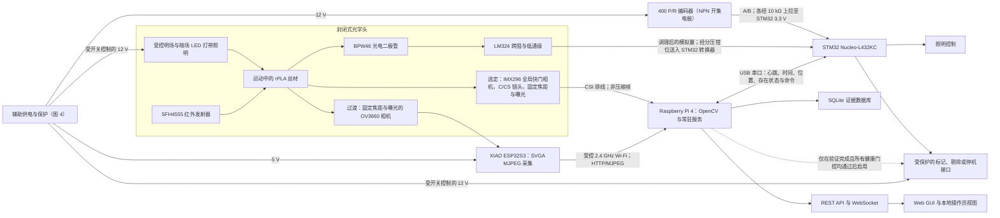
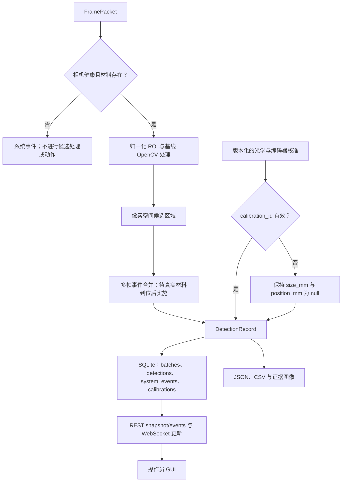
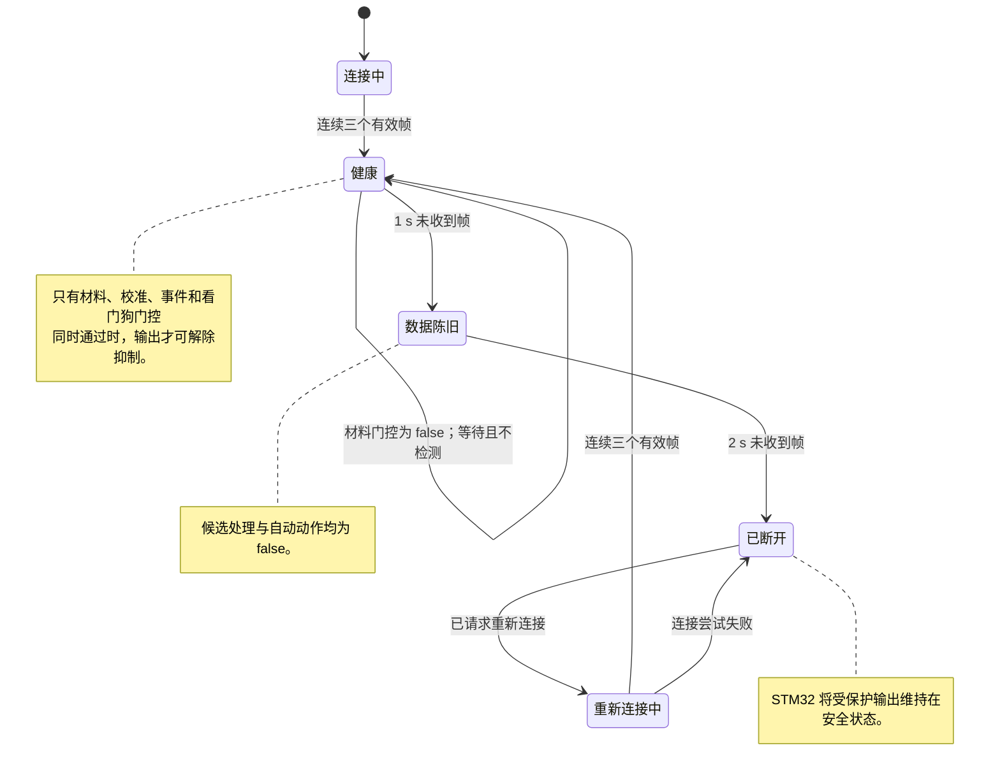
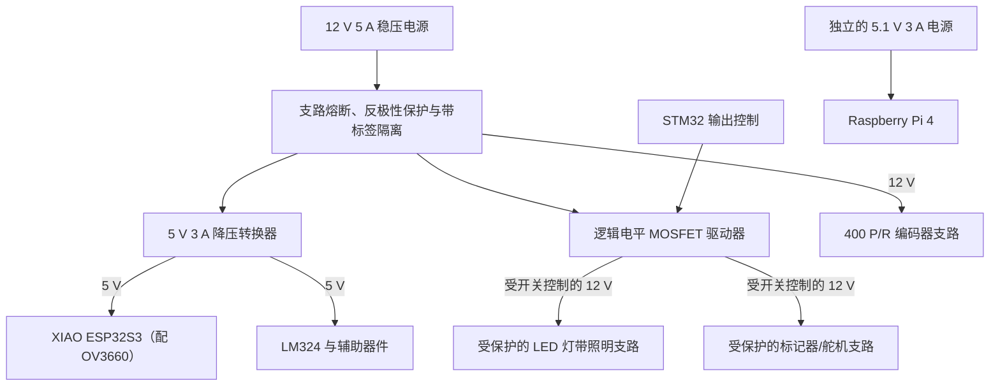

# 方案设计报告

## 面向再生 PLA 丝材的证据可追溯表面质量监测

| 文档字段 | 状态 |
|---|---|
| 客户背景 | BioLoop Manufacturing Pty Ltd |
| 学科 | ENG5105 电气工程 |
| 交付成果 | 方案设计报告 |
| 选定质量参数 | 可见 rPLA 丝材表面质量 |
| 选定方案 | Plan A：Raspberry Pi 全局快门相机经 CSI 直连、Raspberry Pi 4 处理与服务、STM32 监督与安全 I/O。过渡实现：ESP32S3 OV3660 采集，下游链路相同 |
| 方案状态 | 经 CSI 直连的全局快门成像方案 Plan A 为选定方案。其采购已获批准，但硬件尚未到手，因此在到货之前由 Plan B 作为过渡实现运行。本报告中的全部实测数据均来自 Plan B 过渡路径，尚不存在任何 Plan A 实测 |
| 证据截止日期 | 2026 年 8 月 15 日 |
| 证据状态 | 本方案已有边界明确的集成证据；真实材料校准与缺陷性能验证仍待完成 |

## 执行摘要

BioLoop 需要一套实验室规模的系统，盯住再生聚乳酸（rPLA）丝材表面的可见问题。客户任务书列出的关注点是气泡、粗糙、污染、裂纹和夹杂，并要求电气团队解决实时采集、通信、显示、故障检测，以及将来接入工厂的问题 (Monash University, 2026d)。我们选定的方案是 Plan A：全局快门相机配 C/CS 卡口镜头，直接接到 Raspberry Pi 4，由 STM32 Nucleo-L432KC 掌管编码器、照明、看门狗，以及处于禁止状态的下游输出。所有像素同时曝光，适合拍运动中的对象 (Raspberry Pi Ltd, 2026b)。相机和镜头都不在校方提供的设备里，也都还没到手，所以本报告里没有任何一项数据测自 Plan A。

在这批硬件到货之前，构建跑在 Plan B 上。Plan B 用的是校方已经发放的板子 (Monash University, 2026c)：一个 ESP32S3 相机节点，通过受控无线链路把帧送给同样的 Raspberry Pi 与 STM32 角色。Plan B 是过渡前端，不是被否决的备选——帧源之下的部分完全共用，所以第 5.8 节的切换是前端替换，不是重新设计。有一条限制要先讲清楚：现有的服务、API 和 GUI 证据全部来自 Windows 开发主机，所以它既说明不了这些功能在 Pi 上跑得起来，也说明不了 STM32 的物理 I/O。

到目前为止，没有任何证据表明这套系统作为 rPLA 缺陷检测器是管用的。已记录的集成测试运行时，感兴趣区域里没有 rPLA，所以它只能说明帧在链路上一直在走，说明不了缺陷准确率、最小可检测尺寸、毫米级位置准确度、可用线速度，也说明不了工业就绪程度。第 3 节里所有数值要求仍然标着 `PROPOSED_REQUIREMENT`。有一个悬着的问题先按暂定方案处理：第一版构建检测静止的丝材，因为传动方式还没定，真实材料也还没到，看不到丝材究竟怎么运动。编码器照常采购、照常接线，接口照常核验，但行程测量先放着。物理验收要等受控光学条件、光学标定、带标签的真实材料试样、相互独立的验证组，以及材料到手之后开展并形成记录的要求审查。

## 原住民传统土地所有者致谢

本项目在蒙纳士大学 Clayton 校区开展。我们承认 Kulin Nations 的人民，即大学各澳大利亚校区所在未割让土地的传统所有者与守护者，并向他们过去与现在的长者致以敬意 (Monash University, 2026e)。本项目涉及材料的循环利用，但循环性本身并不意味着该工程系统就是负责任的。我们的工作应节约资源、避免可预防的浪费，并将监测装置所引入的能源消耗、电子设备和决策纳入考量。我们认识到，守护传统土地所承载的责任超出了本方案的技术边界。

# 1. 背景与目的

## 1.1 客户与制造背景

BioLoop 拟建的制造中心，计划面向澳大利亚教育、工程、制造与消费市场生产 rPLA 和 rPLA 复合丝材。产品监测处在一个更大的循环制造系统里，与自动化、资源效率、安全和经济可行性并列 (Monash University, 2026d)。丝材要经过挤出、冷却、处理和绕卷才到得了客户手上，所以可见异常拖到后期才发现，往往就意味着返工、产品报废，或者客户不再信任这一批货。趁产线还在跑的时候观察，能把这个决策点提前。

再生 PLA 并不是成分与状态一致的单一输入。已有对比研究表明，原料来源、回收历史和加工条件都会影响再生丝材及打印制品的性能 (Hidalgo-Carvajal et al., 2023; Wei & Bähr, 2024)。水分同样可能改变含 PLA 的熔融沉积成型材料的形貌与拉伸行为 (Quader et al., 2024)。这些发现说明监测确有必要。但它们并不意味着相机能仅凭外观诊断水分、降解或挤出设置。凹坑或色斑只是某种可见状态的证据，仅此而已；在与独立的过程和材料数据核对之前，它的成因始终只是假设。

循环经济层面的论证同样需要克制。关于分布式丝材生产和 PLA 闭环回收的生命周期研究，既说明了认真对待回收材料的理由，也表明实际收益取决于系统边界、能源与工艺选择 (Caceres-Mendoza et al., 2023; Zhao et al., 2018)。本方案不声称已经完成生命周期评估。它的目的窄得多：把表面质量证据足够早地摆到人员、质量系统或后续工厂控制器面前，让他们来得及动作。

## 1.2 目的、问题与边界

本报告提出的问题是：

> 一套采用校方提供硬件的低成本机器视觉系统，能否在具有代表性的实验室条件下，对运动中的 rPLA 丝材可见异常进行检测、定位和分级，同时抑制不安全或未经校准的输出？

系统必须给出有用的检测结果，而且这些结果的有效性必须由独立途径确立。看着像是实时的图像流，仍然可能已经过时、光照很差，或者几何尺度根本没标定过。正因如此，采集健康状态与证据状态在这里属于设计功能，不是界面上的装饰。

在开始比较各方案之前，表 1 先把研究边界定下来。

**表 1. 拟定项目范围。**

| 范围内 | 超出当前主张边界 |
|---|---|
| 从受控图像中识别可见气泡或凹坑、裂纹或划痕、污染或夹杂，以及异常表面纹理 | 在缺少经验证的轮廓测量或结构光参照时，主张 Ra 等工程粗糙度参数 |
| 实验室规模的在线采集、候选异常检测、事件记录、报警呈现和安全输出请求 | 内部空洞计量、聚合物化学成分识别，或证明某项缺陷的工艺成因 |
| 完成光学与编码器校准后，对带标签的真实 rPLA 进行测试 | 未经校准的毫米尺寸或位置 |
| 按任务书要求开展基本故障检测，并与更大的自动化流程集成 (Monash University, 2026d) | 安全认证、生产自主放行或工业部署主张 |

所以系统产出的，是一条可追溯的候选异常记录，外加一份面向操作员的决策辅助。自动剔除目前还没有获准。

整个设计底下压着一条前提，而任务书其实没有写。任务书没有任何一处说丝材是运动的。它要求的是在线、实时采集，要求在具有代表性的运行条件下测量，并要求系统能够接入工业丝材制造流程 (Monash University, 2026d)。我们把这三句话放在一起读，得出的结论是：具有代表性的条件就是一条连续运转的产线，因为丝材生产是连续挤出与收卷的过程，而不是批次过程。这个结论是团队作出的，因此标记为 `TEAM_INFERENCE`，摆在明处，而不是当作客户要求来陈述。之所以要点明，是因为压在它上面的东西不少：第 4 节选全局快门相机的理由就是运动，R4 里 0–5 m/min 这个区间是同一条假设写成的数字，R6 背后的编码器也只为测量行进距离而存在。若日后利益相关者确认静止或步进式检测同样可接受，R4 与 R6 即可放宽，过渡阶段的滚动快门路径也不再算是妥协；无论哪种情况，架构、证据纪律和安全输出门控都不受影响。该前提一并进入第 3 节的咨询问题清单，那里已经列有「代表性运行速度」这一待确认项。第一版构建我们暂时走的是另一条分支：按静止丝材来做检测，因为传动方式还没定，真实材料也还没到，看不出丝材到底怎么动。这是记在决策日志里的起始配置，不是对目标设计的修改；等丝材到手就重新审视。

# 2. 文献综述与设计启示

## 2.1 表面图像能够证实什么

关于 rPLA 的研究给了我们检测的理由，却没有给出视觉真值。材料来源、重复加工与水分都可能改变性能 (Hidalgo-Carvajal et al., 2023; Quader et al., 2024; Wei & Bähr, 2024)；任务书另行列出气泡、粗糙、污染、裂纹和夹杂，认为这些表面状态可能反映工艺或材料问题 (Monash University, 2026d)。“可能”这个词在那句话里是实打实起作用的。我们用文献界定缺陷类别与挑战条件，然后坚持一条：没有带标签的试样，就不给任何东西定类别。仅凭视觉证据，分不出哪个气泡是水分造成的、哪个空腔来自别的机制，所以因果标签必须要有独立的过程证据。

工业异常检测研究提醒我们，别把整洁的实验室图像当成实际运行域。近期数据集涵盖复杂运行场景、真实工业图像和多视角观测 (Carvalho et al., 2024; Heckler-Kram et al., 2026; Wang et al., 2024)。这些研究报告的模型结果迁移不到 rPLA 上来，因为对象、标签、光学条件和异常占比全都不同。真正能迁移的是那套实验纪律：相机几何关系、背景、照明、视角和数据集划分，都必须受控并记录在案。

## 2.2 运动、光学与采集

运动中的圆柱形丝材是个难对付的光学目标。丝材转动时高光会跟着跑，单一视角保证不了整圈覆盖，压缩还会凭空造出块状或边缘伪影。非同步动态线扫描研究说明了为什么运动与采样对齐必须被明确处理 (Verspeek et al., 2024)。一项以热轧钢为对象的特征融合研究，只在它自己的材料和数据集内部证明了性能，出了这个范围什么也说明不了；它对 rPLA 的照明与几何稳健性一句话也没说 (Sundarrajan & Rajendran, 2023)。面阵与线阵检测方式的实验比较讲的是同一件事的另一面：有些表面缺陷只有在特定的传感器与照明布置下才现形 (Krassnig et al., 2025)。所以，受控的漫射与低角度照明、固定的感兴趣区域、在设备支持时锁定焦距与曝光，以及可重复的导向几何结构，都属于测量方案本身，而不是日后再加的修饰。

Plan A 在传感器端解决运动问题。Raspberry Pi 的全局快门相机让全部像素在同一瞬间曝光，并支持 C/CS 卡口镜头 (Raspberry Pi Ltd, 2026b)。Plan B 用的是校方提供的 OV3660 滚动快门成像器，其传感器限制写在数据手册里 (OmniVision Technologies, 2011)，通过受支持的 ESP32 相机栈工作 (Espressif Systems, 2026; Seeed Studio, 2026)。没有哪份数据手册能预测本应用的缺陷检测准确率。Plan B 只能换一条路来降低运动畸变风险：限定线速度、控制曝光、保持照明可重复，再做实证验证。

## 2.3 面阵表面成像之外的备选测量方式

我们比较了三类测量方式，因为它们回答的质量问题并不相同。面阵或线阵视觉能保留颜色、纹理、夹杂、裂纹等可见特征的空间证据，只是其响应依赖视角与照明 (Krassnig et al., 2025)。多轴光学直径测量已经在再生 ABS 和 PLA 丝材上得到验证，可以沿卷盘记录直径和形状 (Petsiuk & Pearce, 2021)；但仅凭一条直径轨迹，分类不了任何可见表面状态，也照不出内部空洞。激光线轮廓测量能给出定量的高度与表面形貌，并已在材料挤出研究中通过点云检出表面偏差；它同时也抬高了设备与处理成本，而且所引研究验证的是沉积层，不是运动中的进料丝材 (Lafirenza et al., 2023)。

结合本任务书、校方所供硬件和学期限制，Plan B 用面阵成像记录可见的空间异常，光电二极管则只用于材料存在与光学健康门控。只有当利益相关者咨询把直径或工程粗糙度确认为主要要求时，直径测量或轮廓测量才会成为范围明确的扩展。在这里提到它们，并不等于 Plan B 已经具备这些测量能力。同样的区分，也解释了表 1 为何把 Ra 和内部空洞测量排除在外。

## 2.4 处理职责与证据流

把所有任务都放在相机节点上跑，布线会简单些，代价是把采集、分析、存储、界面和故障恢复全压进同一个资源受限的设备。边缘计算文献支持把时效性要求高的视觉处理放在设备附近，同时保持清晰的系统职责划分 (Katsigiannis & Mykoniatis, 2024)。所以本设计里，ESP32S3 承担图像采集与传输，Raspberry Pi 4 承担 OpenCV、记录、服务和 GUI，STM32 承担确定性的编码器、看门狗、照明与输出监督。制造商文件证明 Pi 和 Nucleo 平台具备相应的计算与接口资源 (Raspberry Pi Ltd, 2026a; STMicroelectronics, 2026)。这是能力证据。它不能证明这些职责已经部署。

这种职责分离形成了一条有用的故障边界。在目标 Pi/STM32 设计中，相机超时后 Pi 服务进入重连或故障状态，同时 STM32 抑制标记或停机请求。真正接进服务的最新帧策略和帧龄看门狗，就是防止旧图像悄悄被当成当前质量事件的那道闸。这两项控制现已进入 Windows 常驻服务并通过线程化单元测试，但都还没有在 Pi 上部署或验证。由此，系统架构把健康元数据、时间戳、校准标识符和为 null 的物理字段一并纳入证据链。

## 2.5 对验证的启示

相邻视频帧高度相关。若同一缺陷的近重复帧同时落进训练数据和测试数据，报出来的性能就会偏乐观；更广泛的机器学习研究把数据泄漏列为可复现性威胁 (Kapoor & Narayanan, 2023)，视频目标检测研究也点出了时空相关性带来的具体风险 (Figueiredo & Mendes, 2024)。因此验证数据按实体卷盘或批次、以及按缺陷事件来划分，绝不随机打乱单帧图像。

只报准确率，会把低发生率缺陷的代价盖住。拟定评估要报告事件级的精确率、召回率和 F1 分数、每米误报警次数、漏检事件、延迟，以及在已声明的照明与速度条件下的稳定性。样本数与不确定性要跟着这些数值一起给出。目前这些结果一个都还没有。

表 2 把上述文献发现转化为设计决策，并点明本项目仍然缺少的特定证据。

**表 2. 从文献到设计的迁移。**

| 证据主题 | 设计启示 | 本项目仍需取得的证据 |
|---|---|---|
| rPLA 变异性与水分 (Hidalgo-Carvajal et al., 2023; Quader et al., 2024; Wei & Bähr, 2024) | 将可见异常视为观察结果，而非自动给出的根因诊断 | 与已记录条件相关联的带标签真实 rPLA 试样 |
| 工业异常与多视角数据集 (Carvalho et al., 2024; Heckler-Kram et al., 2026; Wang et al., 2024) | 固定光学条件，并记录视角、照明和数据集来源 | 来自最终夹具的代表性图像 |
| 动态成像与表面检测 (Krassnig et al., 2025; Sundarrajan & Rajendran, 2023; Verspeek et al., 2024) | 控制曝光、运动、几何结构和照明；测试覆盖范围限制 | 速度挑战与圆周覆盖研究 |
| 光学直径测量与激光轮廓测量 (Lafirenza et al., 2023; Petsiuk & Pearce, 2021) | 将其保留为由要求驱动的备选方式，而非面阵图像隐含的现有能力 | 扩展范围前取得利益相关者优先级、比较测试计划，以及获批的成本/进度变更 |
| 数据泄漏与相关视频 (Figueiredo & Mendes, 2024; Kapoor & Narayanan, 2023) | 按相互独立的卷盘/批次/事件划分验证数据 | 预注册的数据集划分与留出测试结果 |

# 3. 利益相关者、需求与拟定要求

## 3.1 利益相关者证据状态

没有人给过我们任何一份与利益相关者交谈的记录，所以本报告一份也没有。下面的需求全部来自 BioLoop 任务书、学科说明和文献。其中没有一条可以被当作客户说过的话、参与者同意的事，或某次会议达成的结论。这个区分很重要，因为评分标准要求利益相关者参与，也要求需求真正影响设计 (Monash University, 2026a, 2026b)。我们可以写下应该讨论什么，但不能虚构任何人的发言。

**表 3. 利益相关者图谱与暂定设计响应。**

| 利益相关者群体 | 根据任务书或系统用途推断的需求 | 拟定设计响应 | 当前状态 |
|---|---|---|---|
| BioLoop/客户代表 | 可追溯的质量证据、成本意识，以及接入自动化的路径 | 要求登记表、事件记录、API 和明确的验收门槛 | 源于任务书；待确认 |
| 生产操作员 | 清晰的健康状态、可执行的报警，且不得依据无提示的陈旧数据作出决策 | 单屏状态、候选异常叠加、报警历史，以及系统不健康时抑制输出 | 拟定 |
| 质量保证人员 | 可复核的图像、批次背景、可重复分类和导出功能 | 版本化的校准/模型标识符、不可变事件字段和数据集导出 | 拟定 |
| 维护与电气人员 | 可诊断故障、可维护接口和安全恢复 | 相机/处理器/编码器/照明健康状态、看门狗状态和手动复位规则 | 拟定 |
| 实验室主管与技术人员 | 安全且可测试地使用校方提供的设备 | 封闭光路、低电压原型域和分阶段故障测试 | 源于任务书与设备资料 |
| 丝材用户 | 获得一致的产品信息，且不含缺乏依据的质量主张 | 仅在验证后开展有证据支持的分级；保留不确定事件以供复核 | 源于文献；待确认 |

现阶段我们交得出的，是参与计划本身。一场会谈都还没开，因此报告里全部咨询结果都记为暂无。该计划由 M1 负责，覆盖表 3 中的六类群体，采用简短的结构化讨论，目的是检验假设，而不是收一个走过场的签字。每场讨论问同样五个问题：哪些缺陷类别会导致拒收、可容忍多少误报警、证据要保存多久、谁有权批准停机或剔除动作、哪些运行速度和照明条件算得上有代表性。答复写进带日期的决策日志，记录受影响的要求、负责人、理由，以及验证方式的任何变更。获得确认的答复会回填表 3 的状态列和表 4 的利益相关者依据列。没有得到答复的问题继续挂在暂无状态，不会用假设把它结掉。代表性材料还没到，标定也不存在，所以所有依赖实测的数值都未经确认，表 3 里也没有任何一项可以声称已获利益相关者批准。

## 3.2 拟定要求与验证

表 4 中每一个数值阈值都带着 `PROPOSED_REQUIREMENT` 标签。这些数字之所以存在，是因为电气学科指南要求给出可测试的设计基线 (Monash University, 2026a)——把数字写下来，要求才有得争。但它们是我们自己定的数，利益相关者审查或实验证据仍然可以推翻其中任何一个。

**表 4. 拟定要求登记表。**

| ID | 拟定要求 | 利益相关方/来源依据 | 计划验证方式 | 状态或当前缺口 |
|---|---|---|---|---|
| R1 | 检测至少三类经认可的可见表面异常 | 缺陷族来自项目任务书 (Monash University, 2026d)；类别数量由团队拟定，待利益相关方确认 | 使用留出数据开展事件级带标签测试 | `PENDING_REAL_MATERIAL` |
| R2 | 对每个获接受的 R1 类别，以不小于 0.20 mm 的已声明类别特征尺寸为目标 | 团队依据学科对可测规格的要求提出的工程目标 (Monash University, 2026a)；待利益相关方确认 | 使用下文定义，经校准的靶标和带标签试样 | `PENDING_REAL_MATERIAL`；尚无光学尺度 |
| R3 | 对每个满足 R2 的获接受 R1 类别，事件级精确率和召回率均至少达到 90% | 团队依据 (Monash University, 2026a) 提出的性能目标；误报与漏检容限待利益相关方确认 | 按相互独立的卷盘/批次/事件划分；报告各类别计数和置信区间 | `PENDING_REAL_MATERIAL`；尚无准确率结果 |
| R4 | 丝材速度为 0–5 m/min 时，处理速度至少达到 20 帧/秒 | 团队依据 (Monash University, 2026a) 提出的吞吐量目标；运行范围待利益相关方确认 | 在最终夹具上持续运行并开展速度挑战 | 未实现：当前 SVGA 集成观测值为 10.77 帧/秒；最新帧与丢弃计量现已进入服务，但尚未在 Pi 上实测 |
| R5 | 在 P95 下，自带标记缺陷越过已冻结 ROI 入口线的首个参考视频帧起 500 ms 内发出报警 | 团队依据 (Monash University, 2026a) 提出的报警目标；响应预期待利益相关方确认 | 同步拍摄场景参考与 GUI/输出；计入确认、处理、通信和指示 | 拟定；当前亮度控制路径时序并非此项测量 |
| R6 | 将纵向缺陷定位误差限制在 ±10 mm | 团队依据 (Monash University, 2026a) 提出的位置目标；待利益相关方确认 | 校准编码器 counts/mm，并进行标记距离测试 | `PENDING_REAL_MATERIAL`；尚未校准编码器 |
| R7 | 连同所需校准来源信息，存储缺陷类型、尺寸、置信度、证据图像、位置、时间和批次标识符 | 数据与可视化需求来自任务书 (Monash University, 2026d)，并依据 (Monash University, 2026a) 转化为可测试规格 | 审计数据库模式、文件与记录 | 部分实现；实时证据图像及完整光学/编码器来源仍待完成，尺寸/位置在校准前保持 null |
| R8 | 在 30 min 运行中，将已确认事件记录丢失率保持在 1% 以下；`loss = (N_expected - N_complete) / N_expected`，完整记录须包含持久数据库行及所需证据图像 | 团队依据 (Monash University, 2026a) 提出的可靠性目标；容限待利益相关方确认 | 将已冻结的预期事件 ID 与持久数据库行、图像文件和导出结果核对；另行报告帧丢失 | 拟定；丢帧计量现已进入服务，但最终硬件测试仍待完成 |
| R9 | 相机、照明、编码器或处理器故障后进入安全保持或故障状态 | 故障检测/集成需求来自任务书 (Monash University, 2026d)；安全解释由团队拟定，后续仍需风险评估 | 在最终布线上注入故障并观察输出状态 | 仅有软件/网络路径证据；物理安全 I/O 待完成 |
| R10 | 只存储和提供局限于封闭丝材通道的图像，默认仅本地存储并禁止对外发布 | 团队拟定的隐私保护控制；法律及利益相关方保留/访问规则待定 | 审计每张最终证据图像及存储/访问配置；人员或通道外像素须为零 | 当前完整标注开发预览未达标；外壳和放行控制待完成 |

R2 需要为每个获接受的类别冻结一个主要尺寸，否则同一个阈值在不同人手里含义就不一样。紧凑凹坑、气泡、夹杂或污染区域用等效圆直径；裂纹或划痕用经校准的横向宽度，轴向长度另行报告；异常纹理斑块用经校准包围框中较小的那个尺寸。类别定义与真值方法在采集数据之前批准并冻结，这样 0.20 mm 阈值就不会在看到结果之后被悄悄改掉。R3 的逻辑一样：三个或更多获接受类别中，每一类的精确率和召回率都必须分别通过；各类别的事件计数与混淆矩阵全部保留，宏平均或微平均汇总就埋不掉某个没过关的类别。试点会给出最小独立事件数的参考，但这个数要在从未用于调参的留出测试开始前冻结，不能事后再挑。

R4 是设计矛盾暴露得最清楚的地方。较低的阶段性演示阈值确实可能让集成推进得顺一些，但它不能悄悄取代 20 帧/秒这个最终目标；要动这个目标，就得走正式的要求变更记录。如果最终夹具达不到，站得住脚的做法是优化、设定有依据的线速度限制，或者正式重新协商。只报通过的那几次，不在其中。

# 4. 方案构想与选择

## 4.1 选择方法

评分标准要求至少提出两个具有差异化的方案构想，并给出有证据支持的建议 (Monash University, 2026b)。在做偏好评分之前，我们先设四道通过/不通过门槛：已发放的主成像硬件是否可用、能否避免采购未经批准的方案专属主相机、采购时序，以及学期内可交付性。一个方案只要没过其中任何一道强制门槛，就不能进入实施候选范围——技术上再有吸引力也不行。这些是团队针对本提案作出的可行性判断，不是利益相关者批准的预算限额。

## 4.2 Plan A：直连全局快门成像（选定方案）

Plan A 通过 CSI 把 Raspberry Pi Global Shutter Camera 接到 Pi 上，配适当的 C/CS 卡口镜头与受控照明，并保留基于 STM32 的编码器、看门狗、照明和安全 I/O 功能。它最大的长处是整个图像阵列一次性曝光，适合高速运动与机器视觉场合 (Raspberry Pi Ltd, 2026b)。本地 CSI 传输也把 Wi-Fi 和 MJPEG 从相机到处理器的路径上拿掉了。即便如此，光学对准、反光圆柱体几何结构和单视角覆盖范围仍然需要标定。

这个方案在技术上站得住，也正是我们选定的方案。它的采购已获批准，但主相机不是校方提供的，查询当日无库存，硬件还没到手，因此不存在任何 Plan A 实测数据。表 5 只列 Plan A 独有的采购项目。

**表 5. 经核实的 Plan A 专属增量采购，查询日期为 2026 年 8 月 15 日。**

| 项目 | 数量 | 价格 | 查询时供货状态 | 来源 |
|---|---:|---:|---|---|
| Raspberry Pi Global Shutter Camera | 1 | A$92.55 | 缺货 | (Core Electronics, 2026b) |
| Raspberry Pi 6 mm CS-mount lens | 1 | A$43.60 | 有货 | (Core Electronics, 2026c) |
| **Plan A 专属小计** |  | **A$136.15** | 不含运费 | 根据 (Core Electronics, 2026b, 2026c) 计算 |

这笔小计是加在共用原型需求之上的。Raspberry Pi、STM32、编码器、照明、外壳、电源/保护和标记器的成本都没有重复计入。与第 9 节的 Plan B 追加采购预算相比，这笔 A$136.15 的增量大约是 53–84%。该采购已获批准，可得性与成本两道门槛因而通过。还开着的是交付周期这一道：相机在查询当日缺货，到货时间没确认，光学链路无法在本报告覆盖的时间窗内完成集成与标定。所以 Plan A 是选定的目标配置，硬件到货之前由 Plan B 承担构建。

## 4.3 Plan B：基于校方提供硬件的分布式视觉（过渡实现）

Plan B 使用校方提供的 XIAO ESP32S3 Sense、Raspberry Pi 4 和 STM32 Nucleo-L432KC (Monash University, 2026c)。拟定链路如下：

> 受控光学头与 rPLA 丝材 -> ESP32S3 OV3660 采集 -> 2.4 GHz Wi-Fi MJPEG -> Raspberry Pi 4 OpenCV、API/WebSocket、SQLite 与 GUI <-> STM32 编码器、看门狗、照明及受抑制输出接口

OV3660 与 ESP32 相机文档支持所选的采集栈 (Espressif Systems, 2026; OmniVision Technologies, 2011; Seeed Studio, 2026)；Pi 和 Nucleo 文档支持它们规划中的处理与接口职责 (Raspberry Pi Ltd, 2026a; STMicroelectronics, 2026)。Plan B 不需要新买主相机，而且是在已经集成好的软件和实时传输路径上往前走——正因如此，它才能在 Plan A 硬件还在采购时撑住项目。它也把真实的限制摆了出来：滚动快门畸变、JPEG 伪影、无线延迟或中断、有限的光学控制，以及无法保证覆盖整个圆周。这些限制会转成测试条件和风险控制。选了 Plan A，它们并不会因此消失。

## 4.4 可行性门槛与技术比较

表 6 先应用强制门槛；表 7 随后才记录技术偏好。

**表 6. 强制可行性门槛。**

| 门槛 | Plan A | Plan B | 对决策的意义 |
|---|---|---|---|
| 主成像硬件可得（校方发放或已批准采购） | **通过**：全局快门相机与镜头并非校方发放，但方案专属采购已获批准 | **有条件通过**：主相机和计算平台被列为校方提供；设备发放、状态和兼容性检查仍待完成 (Monash University, 2026c) | Plan A 从已获批准的采购起步，而不必依赖已发放的基线设备起步 |
| 无需采购未经批准的方案专属主相机 | **通过**：A$136.15 的相机与镜头采购已获批准；该金额仍约为 Plan B 追加采购预算的 53–84% | **主成像部分通过**：无需额外购买主相机；共用新增部件仍须批准 | 这是团队设定的方案门槛，并非客户批准的预算阈值；双方均不计共用成本 |
| 采购/交付周期风险 | **不通过**：相机于 2026 年 8 月 15 日查询时缺货 (Core Electronics, 2026b)；到货时间尚未确认，不得假定任何到货日期 | **有条件通过，但有残余风险**：核心平台仍须发放检查；编码器页面显示本地库存为 0、预计 8 月 24–27 日发货，夹具、照明和保护部件仍未冻结 (Core Electronics, 2026a) | 供应商发货估计不是到货承诺；两个方案均不得依赖未经核验的到货日期 |
| 学期内实施与验证 | **推迟**：Plan A 光学链路无法在本报告覆盖的时间窗内完成集成与标定，因而由 Plan B 承担过渡构建，迁移方式见第 5.8 节 | **有条件通过**：现有 Plan B 路径可进入真实材料测试 | Plan A 的验证在到货后进行；Plan B 过渡阶段的验证仍取决于材料和夹具是否可用 |

评分不能推翻上述门槛。表 7 的分数是团队从 1（弱）到 5（强）作出的比较判断，不是测量结果。暂定权重中，65% 分配给测量能力（R1–R4 和 R6），15% 分配给 Pi 集成（R4、R7 和 R8），20% 分配给成本与采购约束。这些权重反映的是团队当前的技术判断，我们不声称它们获得了利益相关者批准。R5 没有单独评分，因为两个方案都拿不出从场景到报警的物理结果：Plan A 去掉了 Wi-Fi 环节，这跟证明 500 ms 目标不是一回事。R9 与 R10 是 STM32、外壳和治理层面的共同义务，不是区分相机选型的指标。所以 R5、R9、R10 对 Plan B 仍是强制放行测试，不是它加权分数暗示出来的好处。矩阵对权重较为敏感，因此它揭示的是取舍，而不是给决策背书。

**表 7. 加权方案比较。**

| 标准 | 权重 | Plan A | Plan B | 判断依据 |
|---|---:|---:|---:|---|
| 缺陷分类潜力（R1、R3） | 25% | 5 | 3 | Plan A 提供可配置性更高的机器视觉光学链路；两个方案都没有 rPLA 准确率数据 |
| 运动成像适用性（R2、R4） | 20% | 5 | 2 | 全局快门与滚动快门加压缩无线传输的比较 (OmniVision Technologies, 2011; Raspberry Pi Ltd, 2026b) |
| 空间细节潜力（R2、R6） | 20% | 4 | 3 | 可更换镜头与光学控制，对比校方提供的 OV3660 路径 |
| Raspberry Pi 集成（R4、R7、R8） | 15% | 5 | 4 | 直连 CSI，对比受支持的网络采集与服务集成 |
| 方案专属成本（项目约束） | 10% | 4 | 5 | Plan A 成像成本为 A$136.15 加运费，现已成为获批采购而非无经费来源的支出；Plan B 无需新购主相机 |
| 采购时序（进度约束） | 10% | 3 | 5 | Plan A 相机缺货；Plan B 核心平台被列为校方提供，但仍须核实是否发放 |
| **加权总分** | **100%** | **4.50** | **3.35** | 仅为比较分数 |

R5 未单独计分，因为两种方案都没有实景到报警的实测结果：Plan A 去掉了 Wi-Fi 环节，但并不因此证明 500 ms 目标。R9 和 R10 未单独计权：安全状态与隐私/外壳主要取决于两种方案共用的 Pi/STM32、夹具和治理设计，而不是主相机选择。它们仍是强制验收要求，不能因未计权而被忽略。

Plan A 在加权矩阵中领先，且已通过可得性与成本两道门槛，因而成为选定方案。还开着的只有交付周期这一道，它约束的是先后顺序而不是选择本身：相机在查询当日缺货，到货时间没确认，光学链路无法在本报告覆盖的时间窗内完成集成与标定。所以 Plan B 作为过渡实现，跑在校方发放的硬件上——第 5 至第 7 节记录的证据正是由它产生的——硬件到货后按第 5.8 节执行迁移。这个先后安排是刻意的：在选定光学器件还在采购的这段时间里，过渡路径让需求、契约、监管与验证工作保持推进。两种配置都不声称现有图像已经满足 R1–R10。

# 5. 功能设计与技术规格

本设计把检测任务拆成两条测量路径，而且是有意让它们不对等的。相机路径承担空间证据：可见候选区域在哪、形状如何。辅助红外路径只回答一个窄得多的问题——材料在不在，光学头的状态是否正常。只有采集健康时，系统才记录候选对象。要发出自动标记或停机请求，条件远不止于此：采集健康、校准有效、已确认材料存在、事件规则通过验证，而且输出已被启用。这条边界就是整个设计的核心。软件能在明亮轮廓外画一个框，不等于那里就是缺陷。

选定的采集器件是配 C/CS 卡口镜头的 Raspberry Pi 全局快门相机 (Core Electronics, 2026c; Raspberry Pi Ltd, 2026b)，直接接到 Raspberry Pi 4 上。在这套硬件到手之前，采集由校方提供的 XIAO ESP32S3 Sense（配 OV3660）承担 (Monash University, 2026c)。两种配置的处理平台完全一样：Pi 拿非确定性的视觉与数据服务，STM32 Nucleo-L432KC 拿时间关键型 I/O 监管。唯一的区别是过渡阶段的 ESP32S3 还兼管图像采集和 JPEG 压缩，而 CSI 路径会把这份活拿走。制造商文档能支撑这些平台能力 (Espressif Systems, 2026; OmniVision Technologies, 2011; Raspberry Pi Ltd, 2026a, 2026b; Seeed Studio, 2026; STMicroelectronics, 2026)。它们支撑不了的是应用性能，也支撑不了 Pi/STM32 已完成部署；本报告里每一个实测值都出自过渡配置。

## 5.1 端到端功能架构

**图 1. 拟议的硬件、数据及动作抑制架构，同时给出选定的 Plan A 采集前端与向同一下游链路供帧的 Plan B 过渡前端。**

图 1 把我们在 Windows 上开发的视觉与服务功能，放回它们本该占据的 Pi 角色，并与规划中由 STM32 掌握的动作权限分开。箭头描述的是目标集成基线，不是已经存在的布线。两个采集前端画在一起，是因为帧源之下的部分完全共用：Plan A 相机经 CSI 排线接入 Pi，过渡的 Plan B 相机经受控 2.4 GHz MJPEG 接入，两者都把帧交给同一个源无关契约。任何时刻只有一个前端在跑。正是这条共用边界，让第 5.8 节的迁移成为前端替换，而不是重新设计。

图中也标出了动作边界。Raspberry Pi 软件可以提出事件；物理输出归 STM32，一旦心跳、编码器、照明或通信健康状态丢失，它立刻撤销输出许可。这是一套面向安全的实验室控制架构，不是经过安全认证的机器安全功能——这个区别不是措辞问题。日后若要把它接到生产设备上，必须按相关框架（含 ISO 13849-1）开展机器风险评估和安全功能设计，而不是让一个原型看门狗独自扛这份责任 (International Organization for Standardization, 2023)。OT 网络分段与最小功能原则同样适用 (Stouffer et al., 2023)。

下面每一条要求都还带着 `PROPOSED_REQUIREMENT` 标签。项目任务书确立了实验室尺度在线表面质量监测的需求 (Monash University, 2026d)，学科指导要求给出可测量的规格和验证路径 (Monash University, 2026a)。但这两条都不等于有利益相关者批准了我们的数字，而本报告收到的记录里，也没有任何一份显示有人批准过。表 8 把每项要求对应到功能和验证路径上，并且把这个缺口摆在明处，而不是遮过去。

**表 8. 拟议要求的功能分配与验证状态。**

| ID | 拟议目标 | 功能分配 | 验证方式与当前状态 |
|---|---|---|---|
| R1 | 至少检测三类可见表面缺陷。 | 光学头；OpenCV/事件分类器；标注数据库。 | 独立的真实 rPLA 事件测试。`PENDING_REAL_MATERIAL`；当前边界框仅代表候选对象。 |
| R2 | 目标缺陷的特征尺寸至少为 0.20 mm。 | 固定光学系统、像素尺度和事件测量。 | 在最终工作距离下使用校准参考特征。`PENDING_REAL_MATERIAL`。 |
| R3 | 对 R2 缺陷，精确率至少达到 90%，召回率至少达到 90%。 | 事件逻辑、真实标注与评估脚本。 | 在留出的线轴/区段/事件上评估；报告置信度与 F1。`PENDING_REAL_MATERIAL`。 |
| R4 | 在 0–5 m/min 范围内至少处理 20 帧/秒。 | 选定链路：相机、CSI 传输、最新帧缓冲区与 Pi 视觉处理；过渡链路额外包含 Wi-Fi 环节。 | 在每个测试速度下测量最终夹具的持续吞吐量。已记录的 10.77 帧/秒 SVGA 集成结果不满足该要求；最新帧与丢弃计量现已接入常驻服务，但尚未在 Pi 上实测。 |
| R5 | 缺陷确认后 500 ms 内发出警报。 | 带时间戳的事件跟踪器、API/UI 与 STM32 输出请求。 | 使用可见计时参考，测量从场景到显示/输出的时间。现有亮度阶跃计时仅为 `LIVE_INTEGRATION_ONLY`。 |
| R6 | 将缺陷轴向位置误差限制在 ±10 mm。 | 编码器尺度、时间对齐及相机到标记器的偏移。 | 在两个行进方向上重复进行已知位置试验。`position_mm` 仍为 null。 |
| R7 | 存储类型、尺寸、置信度、图像、位置、时间和批次标识符。 | `DetectionRecord`、SQLite、图像存储与导出。 | 先进行模式/往返测试，再审计已校准记录。结构已经存在；物理字段仍为 null。 |
| R8 | 运行 30 min，记录丢失率低于 1%。 | 常驻服务、SQLite 事务路径和健康日志。 | 在 30 min 最终硬件运行中核对源帧/事件/数据库/导出。尚未作为完整要求进行测试。 |
| R9 | 相机、编码器或处理器故障后进入安全保持或故障状态。 | Pi 健康门控、STM32 看门狗和受保护输出。 | 使用最终布线进行硬件故障注入。已有软件/网络证据，安全 I/O 仍待验证。 |
| R10 | 仅拍摄封闭检测区域内的丝材，数据默认存储在本地。 | 遮光光学头、受限 ROI 和 Pi 本地数据库。 | 检查夹具、视场隐私及存储/访问。已实现本地存储；最终外壳仍待完成 (Australian Government, 2025; Office of the Australian Information Commissioner, 2026)。 |

## 5.2 光学头与相机规格

选定的相机是 Raspberry Pi 全局快门相机。其公布规格为 Sony IMX296LQR-C 传感器、1.58 百万像素、最高 1456 × 1088 @ 60 Hz、6.3 mm 传感器对角线、3.45 µm 方形像素、CS 卡口并附 C-CS 转接环，在光照足够时曝光时间可低至 30 µs (Raspberry Pi Ltd, 2026b)。对本应用来说有三点后果。全局快门一次曝光整个像素阵列，消除了卷帘快门加在运动目标上的几何畸变。30 µs 曝光直接限住了运动模糊：在 R4 规定的 5 m/min 上限速度下，丝材在这段时间里前进 2.5 µm，在任何实际放大率下都不到一个像素间距，于是模糊不再是限制，照明成了限制。1456 × 1088 阵列在线性方向上的像素数约为过渡 SVGA 配置的 1.8 倍，同样视场下能分辨更细的细节。这些都不构成性能主张。毫米/像素标度取决于镜头和工作距离，只有标定时才被固定，所以 R2 的最小可检出尺寸仍是 `PENDING_REAL_MATERIAL`。传感器支持 60 Hz 也不等于达成 R4：R4 是覆盖 Pi 侧解码、检测与存储的系统级要求，而这些在该配置下都还没测过。

过渡配置用的是校方提供的 OV3660。它能输出更大的画幅，但项目要的是一个稳定工作点，不是数据手册里最大的那个模式。因此过渡实时配置固定在 SVGA 800 × 600；VGA 640 × 480 保留作手动恢复选项，XGA 及更大的模式不在选定运行配置之内。当前归一化 ROI 在 SVGA 下映射为 `(254, 47, 195, 527)`。把 ROI 存成归一化坐标是有意为之：迁移时换了传感器和画幅，它依然有效。在夹具和丝材定下真实光轴之前，这个位置只是暂定。OV3660 的卷帘快门读出、JPEG 压缩和无线传输都可能引入运动或时序伪影，所以曝光时长、线速度和候选持续性必须放在同一组试验里一起考察，而不是分开测 (Espressif Systems, 2026; OmniVision Technologies, 2011)。这三类伪影正是选择全局快门 CSI 配置的具体理由，迁移之后它们会全部离开采集路径。

拟议光学头采用刚性相机支架、可重复定位的丝材导向件、哑光背景和外部遮光罩。标定做完之后，工作距离、焦点和曝光就锁死。可切换的明场照明用来凸显颜色或纹理对比；低角度暗场照明用来让表面起伏投下阴影。两种模式都是实验变量，不是某个异常一定能被检出的证据。工业异常数据集从反面说明了同一件事：外观变化和观察几何应当进入验证集，而不是被一种恰好好看的成像条件掩盖过去 (Carvalho et al., 2024; Heckler-Kram et al., 2026; Wang et al., 2024)。

一台相机只看得到圆形物体的一段圆弧。它给不了完整的 360° 覆盖，再多的处理也变不出背面。只有当第 5 周及以后的证据表明背面漏检确实占主导时，才会评估反射镜或后续的多视角布置，而且无论加哪一种，都要重新做光学标定。光学头会带一个比例尺靶标，以及无需移动相机即可插入的暗参考和白参考。这些都不支撑任何物理分辨率主张。工程粗糙度和内部空洞仍在本光学设计范围之外。

## 5.3 辅助光电二极管链路

SFH4555 横穿丝材通道发射红外光，BPW46 输出随接收辐照度变化的光电流。LM324 级把这股电流转成电压，并在 STM32 转换器采样之前削掉高频噪声。在方案阶段，初始跨阻估算为

\[
R_f=\frac{V_{span}}{I_{PD}},
\]

其中，\(I_{PD}\) 是在最终几何条件下测得的光电流，\(V_{span}\) 为可用输出摆幅。引入反馈电容 \(C_f\) 后，近似低通截止频率为

\[
f_c=\frac{1}{2\pi R_f C_f}.
\]

在光学头装好之前，\(R_f\)、\(C_f\)、LED 电流和判定阈值都不能冻结。暂定的设计约束仍然是明确的。M3 将选择跨阻增益，使实测路径状态范围在不削顶的前提下约占 ADC 输入范围的 10–80%；再选取 \(C_f\)，在衰减实际观测到的高频噪声的同时，让实测阶跃响应速度至少达到最快材料存在状态跃迁的五倍。LED 驱动电流限制在制造商连续额定值以下，并在实测外壳温度下复核。暗态、通光路径、正常丝材、阻断路径和丝材偏位这五种分布，在 G3 用于设定带记录保护裕量的阈值。有效的辅助状态可以对检测做门控，也可以提示光学性能退化。它定位不了划痕，分类不了污染物，也估不出特征尺寸。

模拟通道终止于微控制器，而不是 Raspberry Pi。STM32 Nucleo-L432KC 本身已带有微控制器自己的转换器 (STMicroelectronics, 2026)，因此校方提供的 MCP3208 作为备件保留，不接入放行设计；为一条辅助通道再加一路 SPI 转换器，等于多出第二条采集路径。把该通道接到 STM32，也把材料存在与光学健康的判定放到了拥有物理输出的那个器件上，这与第 5.1 节对编码器采用的职责划分一致。Pi 通过已有的 Pi–STM32 帧收到该状态，因此图 2 的健康门控输入不变。M3 将在冻结接口之前，依据器件数据手册确认转换器的分辨率、输入范围与可用引脚。信号调理级仍须受到约束：LM324 并非轨到轨器件，若其由稳压 5 V 模拟支路供电，则必须核查其输出摆幅以及全部正常与单一故障输入状态。M3 必须通过增益/偏置设计以及串联限流与钳位分压，将转换器引脚限制在微控制器的模拟输入范围内，并在正常状态和单一故障状态下实测最小值、最大值及保护电流，之后才可连接微控制器；元件取值仍属 G2/G3 阶段的实测决策。Raspberry Pi 的 GPIO 与 SPI 仍为 3.3 V 接口，任何 5 V 模拟或数字信号都不得直接连接任一控制器。第 8 节记录支撑这些放行约束的官方元件资料。

## 5.4 Raspberry Pi 处理、溯源与存储

规划中的 Pi 部署保留与数据源无关的第 3 周契约，而不是把它换掉。`FramePacket` 携带图像、帧号、采集与接收时间、相机数据源和连接状态。`DetectionRecord` 携带候选标签、像素边界框、像素面积、算法分数、暂定等级和批次上下文。SQLite 模式包含 `batches`、`detections`、`system_events` 和 `calibrations`，服务现已启用 SQLite 外键约束，检测记录因而无法引用从未开启的批次。正是这些边界让后续的算法改动可以审计，也契合当前工业视觉研究所描述的边缘计算角色 (Katsigiannis & Mykoniatis, 2024)。但这套模式还没做完。它只有一个通用的 `calibration_id`，其校准表记录的是光学 pixels/mm 和一条证据路径——没有编码器 counts/mm，没有时间戳对齐，也没有相机到标记器的偏移。要让物理尺寸或位置可追溯，放行设计必须提供分开的光学与编码器校准记录，或者一份能同时标识两者的哈希复合清单。

**图 2. 健康状态门控的候选处理与证据记录流程。**

图 2 标出了健康状态、校准与溯源信息在哪些环节介入，阻止像素空间的候选对象取得它并未挣得的物理含义。

Windows 开发基线采用可配置阈值 145、最小面积 120 px，并启用材料存在门控 (ENG5105 Project Team, 2026a, 2026i)。这些是原型参数，不是定下来的参数。现有门控要求深色目标贯穿 ROI 高度的 80%，这能挡住邻近的手或小型背景物体启动检测；等 rPLA 摆到相机前面，还得重新调。单槽 `LatestFrameBuffer` 与 1 s `STALE`/2 s `DISCONNECTED` 监视器起初只是 `OFFLINE_FAULT_INJECTION_ONLY` 原语，现在常驻服务已经把两者都实例化了。采集与检测跑在各自的线程上。读取方把每一帧发布到单槽缓冲，积压帧被丢弃并计数，检测线程依据手里最新那一帧的帧龄判断健康状态，而不是依据上一次读取有没有在配置的 3000 ms 超时内返回。这个区别很要紧：帧龄超过配置的陈旧窗口时，即使读取一直成功，服务状态照样降级；要恢复检测，则需要连续三个有效帧。`dropped_frames` 字段现在报告缓冲的实际丢弃计数，不再恒为 0，每份快照也一并给出 `frame_age_ms` 及其配置阈值。这些全都是开发主机上线程化单元测试给出的软件证据。它证明不了 Pi 部署，证明不了真实网络负载下的积压抑制，也给不出 R4、R8 和 R9 的结果——那些仍然要等最终夹具。只有取得代表性材料之后，多帧合并才会把重复的帧候选转成事件候选。

当前模型层的数据规则很严格：没有那个通用 `calibration_id`，`size_mm` 与 `position_mm` 就保持为 null。但这道保护并不等于溯源已经得到证明。常驻实时服务把 `image_path` 和校准关联都留成 null，而现有校准表也标识不出位置所需的、分开的光学与编码器/偏移证据。合成记录带 `OFFLINE_SYNTHETIC_ONLY`，实时相机候选带 `LIVE_INTEGRATION_ONLY`，两者都支撑不了物理主张。要让 R7 通过，放行模式必须强制要求相关的校准 ID 或复合清单哈希，外加一条持久的证据图像路径。

## 5.5 STM32 监管与安全 I/O

拟议的 STM32 固件将对 400 脉冲/转编码器的脉冲计数，为位置更新添加时间戳，采样辅助光学通道，检查 Pi 心跳，通过受保护驱动器切换照明，并掌管标记/剔除/停机演示器输出 (STMicroelectronics, 2026)。所选编码器的 A、B 两相为 NPN 开集电极输出。每相都须经 10 kΩ 上拉至 STM32 的 3.3 V 逻辑电源，并与编码器电源共地——绝不能上拉到 4.8–24 V 的编码器供电轨。输入保护、低/高电平、电气边沿，以及最高试验速度下的计数完整性，全部在 G2/G3 实测。若正交解码对两相全部四个边沿计数，则每相 400 脉冲/转对应理论上的 1600 计数/转。这些功能目前都还没有在 STM32 的物理布线上演示过。对于实测有效轮周长 \(C\)，

\[
k_e=\frac{1600}{C}\;\text{counts/mm}, \qquad q_e=\frac{C}{1600}\;\text{mm/count}.
\]

这里不为 \(C\) 赋值。轮体打滑、偏心、预载荷以及相机到标记器的偏移都必须实测，只凭编码器分辨率证明不了 R6。所选编码器的规格是 NPN 开集电极 A/B 器件，随附 10 kΩ 电阻，供电范围 4.8–24 V。拟议的台架接口由一条已确认的稳压支路为它供电，A/B 两相各经 10 kΩ 上拉至 STM32 的 3.3 V 轨，共地，并配实测的输入滤波与保护。禁止上拉到 5 V，也禁止上拉到编码器供电轨。G2 会在选定线缆长度下核验高/低电平与上升时间，之后才放行 1600 计数/转这个假设。第一版构建并不动用这些。在真实材料到位之前，检测按静止丝材规划：编码器照常安装，其电气接口照常在 G2 核验，而 counts/mm 标定、R6 的轴向位置和基于行程的事件合并，都推迟到丝材到货、传动方式定下来之后。这是记入决策日志的暂定配置，不是要求变更。

**图 3. 拟议采集健康状态与输出抑制行为。**

图 3 定义了什么算合格的恢复，以及哪些状态下候选处理或物理输出必须保持受抑制。当前常驻服务并没有执行图中的 1 s `STALE`、2 s `DISCONNECTED` 与连续三帧恢复规则；它用的是同步读取和已配置的 3000 ms 读取超时。图中的状态时序只是一套在离线组件中测试过、还等着移植到 Pi 上验证的设计，不是常驻服务已经跑起来的实时超时证据。

放行的 Pi 服务不得重放旧帧。它要求连续收到三个有效且帧龄受限的帧之后才恢复处理；Pi 重启或心跳丢失都会清除输出许可。锁存硬件故障之后，任何自动演示器要重新启用，都需要人工确认。若 Web 界面在 STM32 仍然运行时失效，操作员会失去可视信息，但拟议的看门狗与输出抑制仍留在本地控制路径上。以上都是目标行为，有待实时服务集成和最终布线测试。

现有健康响应里的 `automatic_actions_allowed` 这个名字很容易造成误解：实现只检查相机状态为 `HEALTHY` 且目标存在。它只是一个开发期的处理就绪布尔量，不是执行机构授权，而且当前根本没有执行机构接上去。它不检查校准、事件验证、STM32 心跳、故障锁存或操作员授权，发布前必须改名。目标接口应当另设 `safe_output_authorized`，只有在帧数据未过时、光学与编码器校准有效、事件规则已验证、编码器与照明健康、Pi–STM32 心跳与看门狗有效、操作员明确启用且没有锁存故障时，它才为 true。在通过 G5 物理故障注入、确认安全默认电平并取得负责人签核之前，该字段必须保持 false，物理输出保持抑制，安全输出放行门始终关闭。

## 5.6 通信、API 与用户界面

表 9 把已经实现的传输方式和仅为拟议的硬件接口分开；表 10 则固定当前 GUI 证据背后所用的 Windows 开发 API。

**表 9. 子系统通信与完整性规则，涵盖选定与过渡两条采集链路。**

| 接口 | 载荷与当前/计划模式 | 完整性、时序与恢复规则 |
|---|---|---|
| 全局快门相机 → Pi（选定） | CSI-2 排线传输非压缩帧，最高 1456 × 1088 (Raspberry Pi Ltd, 2026b)；无无线环节，无 JPEG 环节。 | `PROPOSED_INTERFACE`：排线接触、CSI 带宽与采集停顿成为采集侧故障类别，必须在 G5 完成故障注入后，迁移才被接受。 |
| OV3660/ESP32S3 → Pi（过渡） | 通过受控 2.4 GHz Wi-Fi 传输 HTTP multipart MJPEG；SVGA 800 × 600；迁移时由 CSI 链路取代。 | 常驻服务是唯一直接 MJPEG 客户端。读取/打开超时与重连逻辑对处理进行门控；速率必须测量，不能假定。 |
| Pi ↔ STM32 | 拟议 USB 串口基线：115200 bit/s，8-N-1；带帧封装的单调递增序号、毫秒时间戳、编码器计数、材料存在状态、健康位掩码、照明命令和输出请求。 | `PROPOSED_INTERFACE`：每帧采用 CRC-16，并使用 10 Hz 心跳；出现三个无效/缺失心跳，或超过 300 ms 未收到有效帧时，必须抑制输出。M5 在 G2/G3 故障测试期间验证并冻结这些数值；安全输出放行门在 G5 物理故障测试和签核前保持关闭。 |
| 编码器 → STM32 | A/B 两路 NPN 开集电极信号；每相 400 脉冲/转，各经 10 kΩ 上拉至 STM32 3.3 V。 | 编码器电源与逻辑上拉分开但共地；不得上拉至 4.8–24 V 编码器供电轨。实测逻辑电平、边沿、方向及全速计数后，方可冻结四倍频解码。 |
| 光学通道 → STM32 | 拟议由微控制器自带转换器采样的调理模拟输入，带时间戳，并与编码器计数一同放入已有的 Pi–STM32 帧；初始台架速率为每个活动通道 200 samples/s。 | `PROPOSED_INTERFACE`：LM324 输出须受限并钳位在微控制器的模拟输入范围内；最终速率必须保持为实测最快材料存在状态跃迁的至少十倍。陈旧/超范围值会触发光学健康故障；M3 在 G3 根据五种状态分布设定阈值。 |
| STM32 → 本地 LCD | 通过 I2C 显示系统健康与安全输出状态摘要。 | 仅供诊断；不能覆盖 Web/数据库记录。 |
| Pi → 浏览器 | 通过本地 Ethernet/Wi-Fi 网络提供 REST 与 WebSocket。 | 默认仅限本地访问；UI 必须显示断连状态和最近更新时间，不能无提示地冻结。 |
| 未来工厂链路 | MQTT 或 Modbus TCP/RTU 是可选方案，不属于已验证基线。 | 需要修订接口控制文件、开展 OT 安全审查并单独验收 (ISO/IEC/IEEE, 2023; Stouffer et al., 2023)。 |

已经实现的 Windows 开发服务监听端口 8765 (ENG5105 Project Team, 2026e)。当前 API 契约定义如下：

**表 10. 已实现的开发服务 API 契约。**

| 方法与端点 | 响应或动作 | GUI 用途 |
|---|---|---|
| `GET /api/health` | 采集、处理、门控与证据状态；现有 `automatic_actions_allowed` 仅等于“相机健康且目标存在”。 | 健康横幅与诊断；该字段名称具有误导性，不得解释为执行机构授权。 |
| `GET /api/snapshot` | 当前摘要及候选记录。 | 页面初始状态与重新同步。 |
| `GET /api/events?limit=` | 当前批次的有界事件历史。 | 事件表与导出准备。 |
| `POST /api/events/delete` | 直接硬删除选定的检测记录，并返回刷新后的快照。 | 仅限开发环境；现已写入 `DETECTION_RECORDS_DELETED` 审计事件并记录被删标识符，但仍没有认证、删除理由或墓碑，不得用于受控证据。 |
| `GET /api/frame.jpg` | 最新标注 JPEG；若尚无可用帧则返回 503。 | 单帧视图。 |
| `GET /api/stream.mjpg` | 共享的标注 MJPEG 输出。 | 实时视图，无需增加另一个直接相机客户端。 |
| `POST /api/control/reconnect` | 请求相机恢复。 | 手动恢复控制。 |
| `WS /ws` | 推送发生变化的快照。 | 低延迟健康与事件更新。 |

这些端点是 Windows 主机上的实现证据。Raspberry Pi 上的部署与启动持久化、USB 串口契约以及 STM32 物理 I/O，都还停留在计划阶段。硬删除端点现在会写一条审计事件，记下被删掉的是什么；但不可逆的删除依然与拟议的追加式证据治理相冲突，在证据放行配置里没有它的位置。验收之前应当把它禁用，或者换成带身份、时间、理由、保留策略和追加式审计记录的受控软删除。既有证据绝不能无痕消失。

GUI 应让操作员一眼看清整条链路：相机和材料门控健康状态、证据标签、实时 ROI、候选叠加框、帧率、解码后到 GUI 的延迟、批次与校准标识符、Pi/STM32/编码器/照明状态、事件历史及导出。标定之前只显示像素测量值。物理尺寸和位置一律留空，候选状态也绝不能被包装成已经验证的质量等级。本地 LCD 只显示一份简要健康摘要，免得浏览器失效被当成控制器失效。

## 5.7 功率预算与保护

本方案把计算设备与照明、开关负载分开。表 11 分配 5.1 V 计算域；表 12 给出含标记器在内的 12 V 辅助域完整分配。两者都是团队用于容量选型与保护设计的数值。它们不是实测功耗，也不是制造商声明的应用负载 (Monash University, 2026a, 2026c; Raspberry Pi Ltd, 2026a; STMicroelectronics, 2026)。Pi 与 STM32 的数值用于界定拟议服务及 USB 负载；辅助域数值分配给拟议的相机、模拟、照明、编码器和标记器支路。M3 会在 G2 用启动与稳态电流证据替换每一项分配值，之后才放行熔断器与导线选型。

**表 11. 拟议 5.1 V Raspberry Pi 域功率分配。**

| 5.1 V Raspberry Pi 域负载 | 正常 | 峰值 |
|---|---:|---:|
| Raspberry Pi 4 | 7.50 W | 12.50 W |
| 通过 USB 供电的 STM32 Nucleo | 0.25 W | 0.50 W |
| **域总计** | **7.75 W** | **13.00 W** |

5.1 V、3 A 电源可提供 \(P_{available}=5.1\times3=15.3\ \text{W}\)。分配后的峰值裕量为

\[
M_{Pi}=\frac{15.3-13.0}{15.3}\times100=15.0\%.
\]

**表 12. 拟议 12 V 辅助域功率分配。**

| 12 V 辅助域负载 | 正常 | 峰值 | 路径 |
|---|---:|---:|---|
| ESP32S3 Sense + OV3660 | 1.50 W | 2.50 W | 12 V 转稳压 5 V |
| 红外/模拟/LCD 电子部件 | 0.40 W | 0.80 W | 12 V 转稳压 5 V/3.3 V；调理后的输出钳位在 STM32 的模拟输入范围内 |
| 受控照明 | 8.00 W | 12.00 W | 12 V 支路 |
| 编码器 | 0.50 W | 1.20 W | 元件确认后的额定支路 |
| 标记器/舵机演示器 | 0 W | 5.00 W | 受保护的开关支路 |

假定 5 V 负载的转换效率为 85%，则

\[
P_{12V,normal}=\frac{1.50+0.40}{0.85}+8.00+0.50=10.74\ \text{W},
\]

\[
P_{12V,peak}=\frac{2.50+0.80}{0.85}+12.00+1.20+5.00=22.08\ \text{W}.
\]

稳压 12 V、5 A 电源可提供 60 W，剩余裕量为

\[
M_{12V}=\frac{60-22.08}{60}\times100=63.2\%.
\]

峰值分配不等于最终电气设计。22.08 W 这个数值假定标记器的 5.00 W 已经按 12 V 侧计入；若选定器件改从转换后的 5 V 电源取电，其峰值就必须除以实测转换效率，并在 G2 之前重算总量。第 5 周及以后的测试必须记录启动浪涌、稳态电流、Pi 欠压日志与稳压器温度，之后才能冻结熔断器、导线和连接器的额定值。每个电源域都配支路熔断、反极性保护和带标签的隔离措施。开关感性负载需要续流抑制，照明由额定晶体管/MOSFET 驱动器控制，各信号回流在受控接地点汇合。Pi 电源绝不能给标记器或舵机供电。

**图 4. 辅助供电与保护域，给出 12 V 电源所供的各条支路，以及保护与开关环节的位置。**

图 4 把计算供电与辅助供电域分开。任何开关负载都不从 Raspberry Pi 电源取电，每条 12 V 支路都先过保护环节再到负载，两条开关支路都位于由 STM32 指挥的逻辑电平驱动器之后。辅助模拟通道以微控制器自身供电为基准，而不取自 12 V 域——正是这一点使调理后的信号保持在第 5.3 节所记的输入限值之内。元件参数、熔断器额定值与导线截面仍属 G2 阶段的实测决定。

## 5.8 从过渡配置迁移到选定方案

我们之所以选这条过渡路径，就是为了让迁移成为前端替换，而不是重新设计。帧契约以下的部分完全共用：`src/week3/` 保存源无关契约，任何相机适配器都不得伸手进去；采集适配器通过 `capture_factory` 注入；检测线程拿到帧时并不知道帧从哪来。这一分离已经存在于当前代码里，也正是选定方案能在不重开需求集合、监管层和证据模式的前提下被采纳的原因。

表 13 给出迁移时改什么、留什么，以及哪些证据必须重新建立。真正要紧的是末尾那一列。迁移换掉的是测量仪器，所以一切描述光学或时序性能的数值都随这次变更作废，必须在新链路上重测。过渡期的数值一个都不能沿用。

**表 13. 从过渡 OV3660 路径迁移到选定的全局快门 CSI 路径。**

| 层次 | 迁移时的变更 | 保留内容 | 迁移后的证据状态 |
|---|---|---|---|
| 相机与传输 | Raspberry Pi 全局快门相机经 CSI 排线取代经 2.4 GHz MJPEG 的 OV3660；ESP32S3 退出采集角色 | 外壳、安装支架、丝材导向件、哑光背景、照明模式 | 全部采集时序与图像质量证据失效，必须重新记录 |
| 采集软件 | 在既有 `capture_factory` 之后，以 CSI 采集适配器取代 MJPEG 客户端；保留并重新调参单槽最新帧缓冲与帧龄监视 | `FramePacket` 契约、检测线程、健康状态机、丢弃计量 | 以注入的新适配器重跑线程化单元测试；无硬件依赖的测试策略不变 |
| 光学标定 | 针对新传感器、新镜头与新工作距离重新标定，并签发新的 `calibration_id` | 归一化 ROI 定义、标定记录模式、来源规则 | 原 `calibration_id` 退役；在新标定记录形成之前，`size_mm` 与 `position_mm` 恢复为 `null` |
| 处理、存储与接口 | 无需变更 | OpenCV 基线、`DetectionRecord`、SQLite 模式、REST/WebSocket API、GUI、导出 | 契约测试原样重跑；模式未变，故模式类证据可以沿用 |
| 监管与安全 I/O | 无需变更 | STM32 编码器、看门狗、心跳、照明控制、输出抑制、G5 放行关口 | 故障注入证据必须在迁移后的接线上重做，之后才可重新通过 G5 关口 |
| 需求 | R1–R10 指标不变 | 需求标识、验证路径、验收规则 | R2、R3、R4、R5 与 R6 的结果回退为 `PENDING_REAL_MATERIAL`，并在选定链路上重新测量 |

在报告任何 Plan A 结果之前，有三项条件要满足。硬件必须通过发放、状态与镜头兼容性的来料检查，其中包括预定工作距离上的 C-CS 后截距。必须形成新的版本化光学标定，因为像素标度会随传感器与镜头变化，没有它，任何毫米量值都不成立。G5 安全输出放行关口背后的受监督故障测试必须重做，因为去掉无线环节之后，采集侧的故障模式变了：Wi-Fi 丢失不再是一类故障，排线接触、CSI 带宽和 Pi 侧采集停顿则成了新的故障类别。RSK-13 覆盖到货或标定导致迁移做不成的情形；那时过渡配置就是交付路径，这次变更如实记为未执行，而不是假定已完成。

去掉无线环节，收窄的不只是吞吐问题，还有风险登记册。RSK-01 失去卷帘快门与 JPEG 那部分成分，RSK-03 失去 Wi-Fi 时延与陈旧缓冲那部分成分。但迁移本身并不关闭这两项风险。多帧确认、帧龄监视与输出抑制继续有效，两条记录都必须依据新链路上的实测结果重新评级，而不是依据「它应该表现更好」这种预期。

# 6. 当前集成证据与局限

当前工作确实把集成风险压下去了。但它回答的是另一个问题，不是缺陷验证，两者不能混为一谈。下面每一条记录都产生于过渡 OV3660 配置，因而都不描述选定的全局快门链路；其中哪些结果会因迁移而失效，见第 5.8 节。表 14 记录了既定条件下实际发生的情况，同样重要的是，它也写明了哪些结论不能由此推出。

**表 14. 当前集成证据、允许推断与声明边界。**

| 证据与标签 | 准确记录的观察结果 | 允许作出的推断 | 无法证实的事项 |
|---|---|---|---|
| 第 4 周相机链路记录，`LIVE_INTEGRATION_ONLY` (ENG5105 Project Team, 2026h) | 在 640 × 480 下，硬件集成测试于 30.056 s 内接收 792 帧，得到 26.35 FPS。 | 物理相机身份、MJPEG 连通性及数据源适配器运行。 | 最终 SVGA 吞吐量或任何 rPLA 结果。 |
| 分辨率与帧率记录，`LIVE_INTEGRATION_ONLY` (ENG5105 Project Team, 2026f) | VGA 近期窗口 ≈10.48 FPS；SVGA 窗口分别为 14.74、15.60 和 13.96 FPS，持续 30 s 测试为 10.77 FPS；XGA 窗口分别为 9.72、7.51 和 9.42 FPS。报告中的 `dropped_frames` 字段为 0；选定 SVGA 800 × 600。 | 在记录的无丝材条件下，得到可复现的运行配置，并暴露出吞吐量约束。 | 该记录产生时常驻服务没有递增该字段的路径，因而不能据此证明零丢帧、R4、R8、可用线速度、清晰度或缺陷敏感度。 |
| 实时路径亮度阶跃记录，`LIVE_INTEGRATION_ONLY` (ENG5105 Project Team, 2026b, 2026d) | 十次可逆转换得到 101.32 ms 中位数、222.99 ms P95、87.12 ms 最小值和 222.99 ms 最大值。亮度恢复至 1；服务状态保持 `HEALTHY`。在 n=10 时，P95 等于样本最大值。 | 该测试中的相机控制请求 → OV3660 → Wi-Fi MJPEG → Python 处理 → 本地 API JPEG 响应路径；这些数值仅描述该小样本。 | 稳定的尾部延迟估计、传感器曝光到浏览器绘制的延迟，或 R5。 |
| 实时路径网络故障记录，`LIVE_INTEGRATION_ONLY` (ENG5105 Project Team, 2026b, 2026c) | 对相机 `172.20.10.2` 的出站连接实施限定范围阻断后，系统在 654.64 ms 内识别为 `RECONNECTING`；检测字段与名为 `automatic_actions_allowed` 的开发就绪字段均为 `false`；保持 4 s 期间新增帧数为 0；恢复至 `HEALTHY` 用时 5689.35 ms；防火墙规则随后被移除。 | 受测 Windows 路径对处理实施了门控，并从该注入故障中恢复。 | 该字段不是执行机构授权，不能证明最终 Pi/Wi-Fi 可靠性、STM32 布线或经认证的安全动作。 |
| 第 3 周契约记录，`OFFLINE_SYNTHETIC_ONLY` (ENG5105 Project Team, 2026g) | `FramePacket` → `BaselineVisionProcessor` → `DetectionRecord` → SQLite/JSON/CSV/标注帧；没有 `calibration_id` 时拒绝物理字段。 | 数据流、溯源及空字段保护可在可重复的合成输入上运行。 | 对真实气泡、凹坑、划痕、裂纹、污染或夹杂物进行分类。 |
| 第 4 周策略原语记录，`OFFLINE_FAULT_INJECTION_ONLY` (ENG5105 Project Team, 2026h) | 离线 `LatestFrameBuffer` 容量为 1；离线连接策略在 1 s 无帧时产生 `STALE`、2 s 无帧时产生 `DISCONNECTED`，并要求连续三个有效帧恢复。常驻服务现已在独立采集线程上实例化相同原语。 | 单槽缓冲与离线状态机原语通过离线故障注入测试，其服务集成通过开发主机上的线程化单元测试。 | 真实网络负载下的积压抑制、实时超时符合性、完整硬件安全输出行为，或 30 min 可靠性。 |

R4 是最明确的待解决设计缺口：拟议值是 20 处理帧/秒，而持续 SVGA 观测值只有 10.77 帧/秒。设线速度为 \(v\)、处理速率为 \(f\)，相邻帧之间的轴向移动距离就是 \(\Delta x=v/f\)。按观测速率算，在 1、3 和 5 m/min 时分别是 1.55、4.64 和 7.74 mm/帧；按 20 帧/秒算，则是 0.83、2.50 和 4.17 mm/帧。这些数值描述的是轴向采样间距，不是可检测的特征尺寸。一个特征到底能不能被看到，仍然取决于帧重叠、视场、模糊程度和事件跟踪。

计时也要保持同样的克制。R5 的 500 ms 警报窗口，在 1 m/min 下对应 8.33 mm 行程，在 5 m/min 下对应 41.67 mm。记录的 222.99 ms P95 在数学上可以映射为 5 m/min 下的 18.58 mm，但这条测量路径既没有传感器曝光时间戳，也没有浏览器完成绘制的时间。它还只有十次跃迁，报出来的 P95 其实就等于样本最大值。所以我们不把它当作物理警报延迟的证据，也不把它当作尾部延迟的稳定估计。

# 7. 校准与验证策略

物理 rPLA 和夹具材料预计在第 5 周星期四到位，所以应用性能现在还没法针对目标对象测试。在确认收货和材料状态之前，所有应用性能项目都保持 `PENDING_REAL_MATERIAL`。方法遵循一条证据阶梯：先冻结几何条件，再标定测量通道，只在相互分离的开发材料上调参，最终对独立单元做一次评估。若随机拆分相邻视频帧，几乎一模一样的外观会同时漏进训练集和测试集，把结果抬高 (Figueiredo & Mendes, 2024; Kapoor & Narayanan, 2023)。

## 7.1 第 5 周及以后的校准顺序

材料到位后，团队会在动任何阈值之前先识别每个线轴与区段，并拍下测试夹具。随后把相机安装位、导向件、工作距离、焦点、曝光、SVGA 配置、ROI、背景以及明场/暗场设置冻结为一个光学配置。暗参考与白参考用来揭示饱和、漂移和照明不均。计划中的不可变配置/标定清单会记录来源、原始数据相对路径、测量单位、适用范围、不确定度、软件版本与文件哈希；一个配置哈希加一个光学标定标识符，把后续每一条记录都拴回这些选择上。

下一步是光学尺度标定。若长度为 \(L_{ref}\) 的可溯源参考物在丝材平面内跨越 \(P_{ref}\) 个像素，则

\[
s=\frac{L_{ref}}{P_{ref}}\;\text{mm/pixel}, \qquad L_{candidate}=sP_{candidate}.
\]

该尺度会在 ROI 的多个位置重复测量，相机重新安装之后也要复测。编码器标定通过双向实测行程估计 counts/mm、打滑量和重复性，同时建立 Pi–STM32 时间戳对齐以及相机到标记器的偏移。只有同时携带有效光学与编码器标定标识符的记录——或者一份能同时解析出两者的哈希复合清单——才允许填充 `size_mm` 或 `position_mm`。当前那个单一的通用 `calibration_id` 字段承载不了这份来源信息，所以在放行任何物理量之前，数据库模式必须先扩展。

辅助通道排在已冻结的光学头里最末一项标定，因为它的电流同样受这套几何条件影响。我们会测量第 5.3 节定义的五种路径状态，选一个不会饱和的增益，依据实际观测到的噪声与动态设定低通截止频率，并把原始转换值与健康判定一并保留。即便它的信号恰好与某种可见异常相关，它也仍然只是材料存在与健康状态通道。

## 7.2 数据集与事件级评估

真实标注附着在物理采样单元上，而不是孤立的帧上。正常区段与经过有意表征的异常区段，会按类别、轴向位置、可测时的物理范围、线轴与批次、光学配置和标注者判定来标注。调参之前，线轴、区段或完整事件就已被分到开发分区与独立测试分区。材料颜色、表面光泽、速度、照明水平、相机重新安装——这些难对付但可以预见的变化都要进测试矩阵；真实世界异常基准提醒我们，别把单一狭窄的采集域说成通用性能 (Carvalho et al., 2024; Heckler-Kram et al., 2026; Wang et al., 2024)。

来自同一运动区域的重复边界框将依据时间和校准后的编码器重叠合并为一个事件。对于事件计数 \(TP\)、\(FP\) 和 \(FN\)，

\[
Precision=\frac{TP}{TP+FP},\qquad Recall=\frac{TP}{TP+FN},\qquad
F1=\frac{2\,Precision\,Recall}{Precision+Recall}.
\]

报告会把这些指标与每米误报数、按类别与条件划分的漏检情况，以及不确定度或置信区间一并给出。样本数在试点测试和利益相关方审查之后才定；现在随口报一个大样本目标，并不会让将来的估计更可靠。即便如此，每个获接受类别的最小独立事件数仍要在从未用过的测试之前冻结。全部失败案例都会保留，独立测试集也会在最终运行之前冻结。

## 7.3 验证门槛与决策规则

表 15 把 R1–R10 转成针对特定配置的验收判定，每一条都写明失败之后怎么办。

**表 15. 规划中的验证门槛与验收判定。**

| 门槛 | 方法与验收判定 |
|---|---|
| 光学可见性：R1–R2 | 在调参前登记可追溯的参考物，设置低于、接近和高于 0.20 mm 的特征，并在固定 SVGA 配置下覆盖 ROI 多个位置和重新安装后的重复测量。保存原始帧、参考物来源、标注、配置哈希与尺度不确定度。只有在声明条件下证明至少三个一致认可的可见类别及拟议 0.20 mm 目标后才可验收；否则修改光学系统或要求。 |
| 分类：R3 | 在调参前冻结线轴/区段/事件清单和独立测试分区，由独立标注者核查真值，再以事件级 TP、FP、FN 运行固定版本的评估脚本，并保留脚本版本、原始输出和失败案例。对于 R2 事件，精确率和召回率都必须达到 90%；不能仅用 F1 掩盖其中一项不合格。 |
| 吞吐量与速度：R4 | 在 0–5 m/min 下分别测量接收、解码、处理和验收帧率，同时记录抖动、停顿与重连。若 SVGA 仍低于 20 FPS，则优化采集/ROI/算法，或经利益相关方批准后正式修订 R4。不得把 10.77 FPS 结果改称为达标。 |
| 警报路径：R5 | 预先定义并记录 \(t_0\)（场景中的缺陷/计时参考进入）与 \(t_1\)（GUI 呈现或物理输出变化），用同一视频中的毫秒时钟或 LED 同时拍摄输入与输出。冻结事件确认规则和试验次数，保留原始视频及逐次结果；分别计算传感器到 GUI 与传感器到输出的分布，P95 必须位于拟议 500 ms 窗口内。当前 n=10 的亮度控制路径测试不计作 R5 验收。 |
| 位置：R6 | 将参考物放置在已知轴向位置，在各速度下进行正向与反向试验，并计入轮体打滑及相机到标记器的偏移。仅当绝对误差在声明测试范围内始终不超过 ±10 mm 时方可验收。 |
| 记录与耐久性：R7–R8 | 在最终硬件上运行 30 min，并以独立清单核对源端发送、服务接收、成功处理、合并事件、SQLite 记录、证据图像和导出数量。保存原始日志、数据库及核对脚本；缺失率按“缺失记录/预期记录”计算且必须低于 1%。审计孤立/重复记录，并分别报告源帧丢弃与处理丢弃。`dropped_frames` 现已由单槽缓冲实际计数，但仍不得用它代替上述逐项核对。 |
| 故障安全：R9 | 断开相机，阻断/衰减照明，中断编码器和串口消息，停止 Pi 服务，并在真实布线上触发看门狗超时。每种情况都必须把物理输出维持在已测得的安全默认电平并生成带时间戳的故障记录；恢复须满足帧未过时、校准/事件/编码器/照明/心跳/看门狗门控、操作员启用及锁存确认。在物理故障测试和负责人签核前，安全输出放行门保持关闭；`automatic_actions_allowed` 不得作为验收依据。 |
| 隐私与外壳：R10 | 在完整视场放置可识别的测试图案，逐帧检查外壳/ROI 外像素没有被持久化；同时审计监听地址、存储路径、访问控制、保留期、删除和导出行为。保存视场照片、配置与审计日志。不应有意拍摄丝材通道以外的人员或区域，外部发布默认保持禁用 (Australian Government, 2025; Office of the Australian Information Commissioner, 2026)。 |

验收只对特定配置有效。相机位置、镜头或焦点、曝光、照明几何、ROI、编码器轮、事件逻辑或模型里的任何一处变化，都会让受影响的标定失效，并依据项目生命周期记录触发回归测试 (ISO/IEC/IEEE, 2023)。只有当一项物理声明的对应要求、光学与编码器来源、独立数据集、稳定的证据记录标识符、经核验的 SHA-256 哈希、结果与局限全都可追溯时，我们才会发布它。在那之前，系统只是一个集成证据边界明确、仪器记录充分的候选检测器——不是已经验证的 rPLA 质量监测器。

# 8. 环境、安全、伦理与治理影响（含采购）

用了再生原料，并不会自动让这套监测系统产生环境效益。及早预警或许能免掉对外观明显不合格线材的继续加工或使用，这与可持续发展目标 12 的宗旨一致 (United Nations Department of Economic and Social Affairs, 2026)。但相机、Raspberry Pi、照明和网络都在耗电；新增电子设备带着隐含的环境影响，调校不当的检测器还会造出本来可以避免的废品。生命周期评估目前一份也没做。能源消耗与废品观察结果分开报告；在没有一套定义明确、符合 ISO 14040 的比较方案之前，我们不会声称存在净环境收益 (International Organization for Standardization, 2006)。复用校方硬件、选可维修的夹具部件，是设计选择，不是环境优越性的证据。

负责任的运行，意味着把不确定的测量挡在自动质量决策之外。陈旧帧、心跳缺失、相机状态异常、标定缺失或编码器状态无效，任何一条都会禁止标记、剔除和停机请求。拟议的 STM32 看门狗提供独立监督。保险丝、反接保护、本地去耦和适当的续流抑制用来控制电气危险。运动导向件和标记器必须配防护，在低能量条件下调试，并设一个够得着的独立停止装置。这些措施参考了 ISO 13849-1 (International Organization for Standardization, 2023)，但这个原型没有取得安全认证，也不得被表述成工业安全相关控制系统。

相机带来的是另一类责任。放行配置只拍封闭的线材区域，在本地裁剪或遮蔽到该通道，并保存事件证据而不是连续视频。当前开发端点仍然提供带 ROI 叠加框的完整标注帧，因此不满足 R10。访问、保留和删除规则必须在采集数据之前商定，同时设置实验室告示并控制导出；OAIC 指南和澳大利亚《1988 年隐私法》提供了背景 (Australian Government, 2025; Office of the Australian Information Commissioner, 2026)，但本提案不作任何法律合规认定。任何包含人员影像的帧，都要从缺陷数据集中隔离出来，等待审查。

一次演示能不能变成可复现的证据，靠的就是配置治理。我们会把相机设置、ROI、软件、标定文件、需求状态和协议当作同一条基线来做版本管理。每一项报告出来的结果，都要附上它的证据标签、条件和配置。在有效的光学与编码器标定来源同时存在之前，`position_mm` 与 `size_mm` 保持为 null；按卷盘、批次或事件组划分的分组也在调参之前就固定下来。验收证据包必须为原始数据、日志、数据库、图像与视频、测试清单和脚本分配稳定的证据记录标识符，并保存 SHA-256。咨询结果、需求变更、失败测试和豁免全部写进决策日志，而这份日志绝不预设利益相关方已经批准。这套做法落实的是 ISO/IEC/IEEE 15288 的可追溯性意图 (ISO/IEC/IEEE, 2023)，也遵循 OT 安全对运行、网络与人为控制的区分 (Stouffer et al., 2023)。

当前 `POST /api/events/delete` 会硬删除检测记录；它现已写入命名被删标识符的审计事件，但仍缺少认证、理由与墓碑，只适用于开发环境。形成受治理证据前，应禁用该端点或用受控软删除取代；删除与导出测试必须纳入 R10 审计。放行证据将采用带角色标识、理由、时间与操作员身份的隔离/墓碑记录；更正以追加方式记录，不得静默替换，任何更正都不得抹除既有证据链。

采购沿用同一套纪律。2026 年 8 月 15 日，编码器页面显示价格 A$41.30、本地库存为 0、状态为“有交付周期”，预计发货窗口是 8 月 24–27 日 (Core Electronics, 2026a)。这只是一张带日期的供应商页面快照，说明的是进度风险，证明不了实际到货；夹具、辅助供电和标记器仍然用规划预留额。Plan A 的供应商页面显示，相机价格 A$92.55，配套镜头 A$43.60，而且相机缺货 (Core Electronics, 2026b, 2026c)。这笔已获批的采购在下单之前，仍须重新核查库存、兼容性、到货成本与到货周期。

电气放行依据官方元件限值，而不是设备清单中的简称。Raspberry Pi 将 GPIO 及复用功能接口规定为 3.3 V (Raspberry Pi Ltd, 2026c)；Microchip 给出了校方所配 MCP3208 的工作条件、SPI 以及受 \(V_{REF}\) 限制的模拟输入范围，这正是改用微控制器自带转换器所依据的对比 (Microchip Technology, 2008)；LM324 数据手册则说明了信号调理级必须计入的供电与非轨到轨输出特性 (Texas Instruments, 2025)。这些资料支撑的是第 5.3 节的接口约束。它们验证不了拟议的布线或元件数值。

# 9. 材料清单

现有成本数字中，只有一部分经过供应商核验。表 16 将大学提供的设备、已核验的供应商价格与团队规划预留额分开列示。所有金额均为澳元；供应商数据访问于 2026 年 8 月 15 日，除非页面另有说明，均含 GST。运费不计。大学供应部件的实际发放、状态和兼容性仍须通过到货检查确认 (Monash University, 2026c)。

**表 16. Plan B 材料清单及追加采购预算区间。**

| 状态 | 物项或组别 | 数量 | Plan B 用途 | 成本依据 | 计入成本 |
|---|---|---:|---|---|---:|
| 大学提供 | Raspberry Pi 4 4 GB、电源和 32 GB SD 卡 | 1 套 | OpenCV 服务、API/WebSocket、SQLite 和 GUI (Raspberry Pi Ltd, 2026a) | 已提供；状态待检查 | A$0 |
| 大学提供 | STM32 Nucleo-L432KC | 1 | 编码器、心跳、照明及带禁止逻辑的输出接口 (STMicroelectronics, 2026) | 已提供；状态待检查 | A$0 |
| 大学提供 | XIAO ESP32S3 Sense（配 OV3660） | 1 | SVGA MJPEG 采集节点 (Espressif Systems, 2026; OmniVision Technologies, 2011; Seeed Studio, 2026) | 已提供；状态待检查 | A$0 |
| 大学提供 | SFH4555、BPW46 与 LM324N，MCP3208 作为备件保留 | 1 通道/套 | 由 STM32 采样的线材存在检测与光学头健康状态通道 | 已提供；最终元件参数待测量 | A$0 |
| 大学提供 | I2C LCD、LED、电位器、电阻、面包板、洞洞板、导线和排针 | 按发放数量 | 本地状态显示、信号调理和原型装配 | 已提供；数量/状态待检查 | A$0 |
| 已核验采购 | 增量式光电旋转编码器，400 P/R | 1 | 长度-位置测量 | 供应商页面：本地库存为 0、有交付周期、预计 8 月 24–27 日发货 (Core Electronics, 2026a) | A$41.30 |
| 已有设备 | LED 灯带照明组件 | 1 套 | 受控明场与低角度暗场照明 | 已购入并在手，无需再采购 | A$0 |
| 规划预留 | 带螺丝端子的封装式 12 V 直流电源、5 V 转换、MOSFET 驱动、保险丝、连接器及保护元件 | 1 套 | 独立辅助供电与受保护开关 | 按澳洲本地采购的团队估算区间；额定值与报价均为拟定 | A$80–A$120 |
| 规划预留 | 反射镜、外壳、支架和导向件 | 1 套 | 封闭光学几何结构与线材控制 | 团队估算区间；尺寸待实物到达后确定 | A$30–A$70 |
| 规划预留 | 标记器/舵机演示装置 | 1 | 基于位置的输出演示 | 团队估算区间；与其余部件一同采购，其物理输出仅在通过 G5 且事件规则经验证和授权后放行 | A$10–A$25 |
| **Plan B 追加采购预算区间** |  |  |  | **一项已核验价格加三项规划预留** | **A$161.30–A$256.30** |

Plan A 是选定方案，其采购已获批准。其 IMX296 全局快门相机在技术上适用于快速运动下的机器视觉成像，并且需要合适的 C/CS 卡口镜头 (Raspberry Pi Ltd, 2026b)。这两个物项都不属于产生本报告证据的过渡构建，目前也尚未到手；表 17 将其单独列出，使过渡预算与选定方案预算保持可审计。

**表 17. 选定方案 Plan A 的已获批准成像采购。**

| 已获批准的 Plan A 物项 | 数量 | 2026 年 8 月 15 日的证据 | 已核验价格 |
|---|---:|---|---:|
| Raspberry Pi Global Shutter Camera, CE09593 | 1 | 供应商页面；缺货 (Core Electronics, 2026b) | A$92.55 |
| Raspberry Pi 6 mm CS-mount lens, CE06937 | 1 | 供应商页面；有货 (Core Electronics, 2026c) | A$43.60 |
| **Plan A 专属成像小计** |  | **不含运费** | **A$136.15** |

将这一概念专属小计加入共同追加采购预算后，Plan A 的总预算区间为**运费前 A$297.45–A$392.45**。这不是报价，也不是采购订单。Raspberry Pi、STM32、电源、夹具、编码器和标记器等共同需求只计算一次；该比较既未隐去共同成本，也未将其重复计入 Plan A。

承诺采购前，每个计费物项都须重新取得可用性、兼容性、到货成本和到货周期记录；现有 Plan B 证据并未确定交付时序。

## 9.1 各采购物项的用途与使用方式

表 16 与表 17 记录了每个物项的价格及其来源。本节记录的是每个物项做什么用、构建时怎么用——在现阶段，这比价格更重要。以下没有任何一项是实测值或标定值。所有决定性能的量——增益、阈值、单位长度计数、工作距离、驱动电流、熔断器额定值——都在第 7 节的标定流程中确定，此处不作任何主张。

**增量式旋转编码器，400 P/R。** 相机的一帧图像能显示候选异常在图像中的位置，但显示不出它在丝材上的位置。编码器提供的就是第二个坐标。它与丝材行进耦合转动，STM32 对其 A/B 正交边沿计数，每个计数都带时间戳，从而使某一帧能够对应到一个行程数值。有四件事依赖它。R6 要求给出缺陷的轴向位置，而只有测得行程，这个位置才有意义；在此之前 `position_mm` 一直为 null。事件合并同样需要它：同一个物理缺陷会在连续若干帧中穿过感兴趣区域，正是行程把「同一缺陷被反复看到」和「若干个不同缺陷」区分开。标记器位于相机下游，因此要对某个缺陷动作，就必须知道它何时到达标记器，这仍然是行程测量而不是时间上的猜测。编码器还兼作一路存活信号：若产线本应运转而计数停止变化，STM32 即判为故障并抑制输出。安装方式、驱动丝材运动的传动装置，以及把计数换算为长度的标定，全部属于第 7 节的工作——这正是第 5.5 节有意不给有效轮周长赋值的原因。编码器的用途建立在第 1.2 节标记为 `TEAM_INFERENCE` 的材料运动前提之上。第一版构建我们暂时把这条前提搁置，按静止检测规划，因此编码器照常采购、接线并核验接口，而它的行程职责先休眠，等真实材料显示丝材怎么运动之后再启用。

**LED 灯带照明组件。** 半透明圆柱体上的表面缺陷可见与否，几乎完全取决于怎么打光，而任务书正是把照明控制列为该质量参数的一项设计挑战。灯带就是那个可控光源，它让照明成为一个设计变量，而不是房间里恰好有什么光就用什么光。它安装在封闭光学头内部，承担两种角色：明场，用于凸显颜色与纹理对比；低角度暗场，掠过表面照射，使起伏投下阴影。STM32 通过受保护的驱动器对其开关，因此照明状态会与每一帧一同记录，照明丢失也就成为可检测的故障，而不是图像外观的一次无声变化。几何布置、角度、驱动电流，以及哪种模式适合哪一类缺陷，都是第 7 节的实验问题。灯带的存在，是为了让这些问题有条件被提出。

**带螺钉端子的封闭式 12 V 电源、5 V 转换、MOSFET 驱动器、熔断器、连接器与保护件。** 这就是图 4 中画出的辅助供电域，它的存在是为了让开关负载远离计算供电。之所以选封闭式螺钉端子而非圆口适配器，是因为各支路要分接到多个负载，每一路都需要牢固且可检查的端接，而不是共用一个适配器。12 V 支路为照明、编码器和标记器支路供电；降压级得到采集节点与模拟器件所需的 5 V；MOSFET 驱动器使 STM32 能够开关照明与标记器支路，而这两个负载都不必接触控制器引脚；熔断器、反极性保护和带标签的隔离措施则让整个组件在检修时和带电放置时都是安全的。额定值、熔断器取值与导线截面仍属 G2 阶段的实测决定。

**反射镜、外壳、支架与导向件。** 这些让光学测量具备可重复性。外壳把光学头罩起来，使环境光不进入画面，也使存储的图像只包含丝材通道——这正是 R10 的要求。支架把相机刚性固定，因为工作距离一旦变动，据此标定的光学参数即失效。导向件让丝材沿可重复的路径穿过视场，否则丝材在景深方向自由游动，锁定焦点就失去意义。反射镜则是针对圆周覆盖问题准备的：一台相机只能看到圆形物体的一段圆弧，若后续证据表明背面漏检占主导，反射镜布置是第一个值得尝试的方案。增加反射镜需要重新做光学标定，因此它被有意留作后续选项，而不是初始光学头的一部分。

**标记器/舵机演示器。** 这是本项目的物理输出，也正是它把一个检测器和一套能够动作的监测系统区分开。当事件得到确认且全部授权条件成立时，STM32 驱动标记器在受影响的那段丝材上做标记，使该缺陷在运行结束后仍能被找回。它同时也是整个安全论证的试验对象：R9 的故障注入之所以有意义，恰恰是因为存在一个真实执行机构，而它必须在心跳、标定、编码器或照明健康状态丢失时保持被抑制。在通过 G5 放行关口之前，其物理输出始终保持禁用。

**全局快门相机与 C/CS 卡口镜头。** 这两件替换过渡阶段的采集前端。相机一次性曝光整个传感器阵列，这正是被摄对象在运动时真正要紧的特性；而且它经排线接入 Raspberry Pi，不再依赖过渡路径所用的无线链路。镜头单独采购，是因为该相机出厂不带固定光学系统：卡口的意义在于让工作距离和视场按丝材通道来选定，而不是被模组预先决定。第 5.2 节记录了选型理由，第 5.8 节记录了替换之后必须重新建立哪些内容——迄今记录的全部采集时序与图像质量结果都属于过渡配置，并不能延续过去。

# 10. 项目交付计划与团队职责

交付策略走的是阶段门控，结构上遵循 V 模型：需求转化为拟议要求、接口、危险因素和测试定义；实施完成后，依次做单元检查、子系统集成、经标定的系统测试，以及针对相应要求 ID 的独立验证。关口不会因为时间过去就自动通过。它通过的条件是：该阶段指定的证据已经形成、经过评审，并关联到负责人。

证据状态将在**2026 年 8 月 27 日星期四（第 5 周）**发生变化。这个日期之前，不做任何 rPLA 实物或夹具材料测试。在此之前的工作只限于设计、采购准备、软件与合成测试，以及边界明确的非 rPLA 实时集成。材料若迟到、不完整、损坏或不安全，实物里程碑就跟着往后挪；合成结果补不上这个缺口。表 18 把这项依赖摆在明处。它是放行关口，不是我们藏起来的进度假设。

**表 18. 阶段门控交付进度与证据决策。**

| 阶段与时间 | 计划工作 | 关口输出与决策规则 |
|---|---|---|
| S0：基线，截至 2026 年 8 月 26 日星期三 | 冻结需求、接口、风险、夹具图纸和协议；复核编码器交付期和经批准的兼容替代方案；保留 `synthetic`/`live-integration` 标签 | G0：经负责人评审的版本化基线；关键采购时序有记录；不得发布实物性能结论 |
| G1：材料关口，2026 年 8 月 27 日星期四 | 记录收货情况、数量、状态、尺寸、可追溯信息和危险因素 | 通过后方可开展实物相关工作；未通过则重新排期并审查范围 |
| S1：安全试运行，G1 后 | 装配夹具；以低能量检查防护、供电、通信和处于禁止状态的输出 | G2：安全检查清单完成、采集稳定且无失控输出 |
| S2：校准，第 6–7 周 | 锁定光学设置；建立比例尺、counts/mm、相机-标记器偏移和参考基准 | G3：形成版本化 ID；校准无效时，毫米字段保持 `null` |
| S3：采集，第 7–8 周 | 在计划速度/光学挑战条件下采集已标注事件；审计标签和分组 | G4：调参冻结前具备可追溯的基准真值与相互独立的分组 |
| S4：稳健性，第 8–9 周 | 集成各子系统；在监督下注入网络、供电和传感器故障 | **G5 安全输出放行关口：**每个 R9 故障都须禁止物理输出并生成带时间戳的故障记录；任何失败或未解决的高风险均使输出保持禁止 |
| S5：验证，第 10 周，G5 后 | 在留出组上评估事件指标、误报次数/m、位置、吞吐量、延迟和记录丢失 | 接受、优化、缩小适用范围或修订需求；如实报告失败。自动输出还须具有经授权、验证的事件规则，并通过全部实时健康/校准门控 |
| S6：发布，第 11–12 周 | 冻结配置、汇总证据并对主张开展同行评审 | 登记册把每项获接受的主张关联至要求 ID、配置、稳定的证据记录标识符及 SHA-256、测试和负责人 |
| SA：迁移至选定方案，到货后进行 | 到货后对相机与镜头做来料检查；在既有采集契约之后接入 CSI 前端，重新标定，并在选定光学链路上重复 S2–S5 协议 | GA：迁移只有在通过来料检查、形成新的版本化标定并重做 G5 故障测试之后才被接受。在形成自身标定之前不得报告任何 Plan A 结果，过渡期数值一律不得沿用 |

这一顺序把吞吐量缺口摆到了台面上。已记录的 SVGA 集成测试在 `LIVE_INTEGRATION_ONLY` 证据状态下测得 10.77 FPS (ENG5105 Project Team, 2026f)，低于拟议的 20 FPS。因此独立验证关口要求三者取其一：优化系统、缩小速度与视场范围，或者形成有记录的需求变更。事后宣称已经合规，不在这三项里。阶段 SA 会在迁移之后，于选定光学链路上重新测同一项吞吐指标，因为 CSI 传输把 Wi-Fi 与 MJPEG 环节从路径里拿掉了。我们不预设性能会变好：选定链路的任何数值都必须来自它自身标定之后的实测，过渡期的结果也绝不改写成 Plan A 的结果。

表 19 给出各角色标识符与承担成员的对应关系；报告其余位置沿用这些标识符，以保持责任列紧凑。表 19 中的规划工作量占比合计为 100%，作用是指导任务均衡。它不决定个人成绩。

**表 19. 拟议团队职责、工作量占比与贡献证据。**

| 角色 | 占比 | 主要责任 | 固定支持与评审 | 必需的贡献证据 |
|---|---:|---|---|---|
| M1 — Letu Ma，系统/项目 | 17% | 需求、利益相关方协议、架构、进度、接口、风险和集成 | M4 支持报警/验收；所有模块负责人参与 | 决策日志、基线和需求状态记录 |
| M2 — Tingyu Zheng，光学/相机 | 16% | 相机、照明、外壳、覆盖范围、图像质量和校准 | M4 支持图像/ROI；M6 开展光学重复测试 | 图纸、设置、校准和图像记录 |
| M3 — Zhiqian Wang，传感/供电 | 16% | 光电二极管/ADC、供电、保护和电气检查 | M5 支持布线/故障；M4 提供健康状态日志 | 原理图、计算、检查记录和日志 |
| M4 — Xinyang Wu，视觉/UI/数据 | 18% | OpenCV、GUI、数据库、跟踪、评估和分析 | M2 支持成像；M6 提供独立标签/测试 | 代码、数据库模式、测试输出和可复现分析 |
| M5 — Niewei Fan，嵌入式/通信 | 17% | STM32、编码器、时序、看门狗、通信和安全输出 | M3 支持供电；M6 开展机械/输出测试 | 固件、接口轨迹以及故障/位置记录 |
| M6 — Haowei Ding，验证/机械/质量 | 16% | 试验台、基准真值、分组划分、验证、不确定性和安全评审 | M4 支持指标；M5 支持对准/重复性 | 协议、标签审计、留出结果和评审记录 |

集成仍由全体成员共同承担。每项工作都要指定负责人、评审者、内部日期和证据输出。任何接口变更在纳入基线之前，都要递增版本号、经负责人评审，并记录影响检查。已发布的标定与测试数据设为只读：更正采用追加方式，不替换原记录，开发期的硬删除端点也不进入放行配置。我们每周跑一次集成构建，并从 G3 起直到独立验证关口提高频率——这样交接始终可见，也不至于让 M1 或 M4 默认接手所有没做完的活。

# 11. 风险登记册

一条风险记录只有在团队能看见它逼近时才真正有用。所以表 20 为每项提案阶段风险配上可观察的触发条件、负责人、控制措施和评级。评级取自学科任务书给出的矩阵：概率取自必然（Certain）、很可能（Likely）、可能（Possible）、不太可能（Unlikely）、罕见（Rare）与已消除（Eliminated），危害严重度取自可忽略（Negligible）、轻微（Marginal）、严重（Critical）与灾难性（Catastrophic），两者合起来给出低、中、高或极高。每个单元格都写出所取的组合和由它推出的评级，这样这个判断就可以被核查，而不是被人一口断定。各项概率是定性的工程估计，不是实测频率。没有任何一行评为“已消除”，因为到目前为止还没有哪个危险在物理上被移除。残余评级的前提是所列控制措施都已实施并通过测试；它不表示危险已经消失。

**表 20. 按概率 × 危害严重度矩阵评级的提案阶段风险登记册。**

| ID | 风险与后果 | 初始概率 × 严重度 → 评级 | 可观察触发条件 | 负责人 | 规划控制措施与应急方案 | 残余概率 × 严重度 → 评级 |
|---|---|---|---|---|---|---|
| RSK-01 | 滚动快门、MJPEG 或运动伪影与缺陷相似，或将缺陷掩盖 | 很可能 × 严重 → 高 | 候选率随速度/JPEG 设置急剧变化；边缘形状在帧间偏移 | M2/M4 | 锁定曝光与几何条件，按速度测试各项设置，采用多帧确认并保留原始事件证据；必要时缩小运行范围 | 不太可能 × 严重 → 中 |
| RSK-02 | 眩光或角度覆盖不完整导致误报或表面漏检 | 很可能 × 严重 → 高 | ROI 饱和、背景直方图不稳定或出现可重复的盲区 | M2 | 采用封闭的明场/暗场照明和哑光背景；只有完成覆盖范围实测后才使用反射镜，并报告未覆盖角度 | 不太可能 × 严重 → 中 |
| RSK-03 | Wi-Fi 丢失、延迟或陈旧缓冲破坏在线决策（过渡链路；迁移后收窄） | 很可能 × 严重 → 高 | 帧龄超过阈值、健康端点失败或积压增长 | M5/M4 | 单槽缓冲、帧龄状态机与丢弃计量现已进入常驻服务并通过线程化单元测试；仍待完成：Pi 部署、受控 2.4 GHz 网络，以及真实接线上由 STM32 保持的输出禁止。尚未主张任何实时保证 | 不太可能 × 严重 → 中 |
| RSK-04 | 第 5 周材料迟到、不完整或不适用 | 可能 × 灾难性 → 极高 | 8 月 27 日收货关口未通过，或夹具尺寸冲突 | M1/M6 | 在 G1 检查；关口前工作保持为非实物工作；重排软件/文档任务，并在不虚构测试的前提下上报范围和日期问题 | 可能 × 严重 → 高 |
| RSK-05 | 代表性缺陷数量过少，导致验证薄弱或存在偏差 | 很可能 × 灾难性 → 极高 | 所需类别/分组缺失，或标签无法得到独立核查 | M6/M4 | 预先定义样本/标注协议，保留可解释的 OpenCV 基线，报告类别覆盖并收窄主张；通过获批准的渠道寻求更多材料 | 可能 × 严重 → 高 |
| RSK-06 | 相邻帧或事件泄漏夸大性能 | 可能 × 严重 → 高 | 同一卷盘、批次或事件的帧同时进入调参与测试集 | M6 | 调参前冻结组级划分，保存来源信息，执行划分审计，并拒绝受污染的评估 | 罕见 × 严重 → 中 |
| RSK-07 | 校准漂移使尺寸或位置值失效 | 很可能 × 严重 → 高 | 焦点、工作距离、滚轮几何参数或配置哈希发生变化；参考检查失败 | M2/M5 | 将经来源核验的光学与编码器校准 ID 绑定到记录；执行参考检查，变化后使物理量字段失效并重新校准 | 不太可能 × 严重 → 中 |
| RSK-08 | 电源噪声、欠压、感性开关或 5 V 模拟输出使控制器复位、受损或产生不安全输出 | 可能 × 灾难性 → 极高 | Pi 欠压/复位日志、供电轨电压跌落、调理后的模拟输入超出微控制器范围、MCU 复位，或开关动作期间出现输出脉冲 | M3/M5 | 分离电源域，将 LM324 输出钳位并限制在 STM32 的模拟输入范围内，设置保险丝、去耦和续流抑制，开展启动/稳态/故障实测，并采用看门狗安全默认状态 | 不太可能 × 灾难性 → 高 |
| RSK-09 | 导向件或标记器造成夹伤、缠绕或意外运动危险 | 可能 × 灾难性 → 极高 | 防护打开、对准卡阻、看门狗丢失，或在受监督命令之外出现输出 | M6/M5 | 设置防护、低能量调试和独立停止装置；开展受监督测试，并在 G5、经授权且验证的事件规则及全部实时门控通过前禁止输出 | 不太可能 × 灾难性 → 高 |
| RSK-10 | 相机拍摄到人员，或证据在没有商定规则的情况下被保留、访问或硬删除 | 可能 × 严重 → 高 | ROI 外出现人脸/身体、未经批准的导出、开发删除端点仍启用，或尚未作出保留/删除决定 | M1/M4 | 封闭/裁剪视野，仅在本地保存事件，设置告示，确定基于角色的访问；禁用未经审计的硬删除并隔离偶然拍到的影像 | 罕见 × 严重 → 中 |
| RSK-11 | 接口或配置不匹配，导致后期集成失败 | 很可能 × 严重 → 高 | 模式/波特率/状态不匹配、设置未版本化，或模块单独通过但在基线构建中失败 | M1 与所有负责人 | 建立接口控制记录和契约测试，使用版本化配置，开展每周集成，并由负责人-评审者签核 | 不太可能 × 严重 → 中 |
| RSK-12 | 编码器或共用部件到货晚或不兼容，延误夹具与验证 | 可能 × 灾难性 → 极高 | 采购检查点前没有获批的到货报价/周期、库存发生变化，或到货电气/机械检查失败 | M1/M3/M6 | 订购前取得最新库存、兼容性、到货成本与周期证据；预先识别获批替代件；替换后重复接口/供电检查，并在不虚构实物测试的前提下重排工作 | 可能 × 严重 → 高 |
| RSK-13 | 选定相机到货过晚以致无法迁移，或无法在夹具上完成标定，项目最终以过渡链路交付 | 可能 × 轻微 → 中 | 采购检查点前仍无确认发货，或 C/CS 后截距与工作距离无法在夹具上调定 | M1/M2 | 保持过渡配置处于完整验证状态，使任何需求都不依赖迁移；下单前先确认镜头兼容性与后截距；迁移未完成时如实记为未执行，不得把过渡期数值当作 Plan A 结果 | 罕见 × 轻微 → 低 |

两个评级下降的原因并不相同，这个差别本身就是缓解策略。物理伤害的严重度降不下来。RSK-08 与 RSK-09 保持“灾难性”，因为防护、独立停止装置和看门狗安全默认状态改变的是进入危险状态的频率，而不是进去之后的后果。它们的残余“高”正是执行机构要一直禁止到 G5 放行关口的理由，而不是靠一个好看的评级提前放行。进度与材料类风险走的是另一条路，降的是严重度而不是概率：RSK-04、RSK-05 与 RSK-12 从“灾难性”降到“严重”，因为部件或材料没按期到货时，重排任务和收窄主张仍能保住一份站得住脚的交付物，而到货日期本身不在团队控制之内。RSK-06 与 RSK-10 是仅有的两行，程序性控制真的把事件压到了“罕见”——冻结的组级划分和封闭并裁剪后的视野移除了发生机制，而不只是削弱后果。

停止规则最为关键。RSK-04 阻止受影响的实物测试。RSK-06 使受影响的性能估计无效。RSK-07 强制物理量字段恢复为 `null`。RSK-08 或 RSK-09 禁止执行机构动作。RSK-12 可以推迟受影响的关口与验证计划，RSK-13 可能让迁移取消，但不影响任何过渡阶段的验收判定。对于残余“高”的数据或进度风险，只能通过收窄主张、或在决策日志里修订计划来接受——绝不能靠降低证据标签来处理。

# 12. 建议与结论

建议把 Plan A 定为选定方案：Raspberry Pi 全局快门相机配 C/CS 卡口镜头，经 CSI 直连 Raspberry Pi 4，并保留同样的 STM32 编码器、看门狗、照明与安全 I/O 监督。全局快门采集消除了制约过渡路径的滚动快门畸变与无线压缩伪影 (OmniVision Technologies, 2011; Raspberry Pi Ltd, 2026b)。它的采购已获批准，交付周期是唯一还开着的可行性门槛。因此，采用校方提供的 ESP32S3 OV3660、经受控 2.4 GHz MJPEG 传输的 Plan B 是过渡实现，而不是被否决的备选：它让需求集合、源无关契约、监管层和验证协议在选定光学器件采购期间保持可用。第 5.8 节定义了迁移方式，以及迁移之后必须重新建立的证据。

成本边界支持这个判断。Plan B 的追加采购预算区间为**运费前 A$161.30–A$256.30**，其中每一项都是构建所必需的；只有 A$41.30 的编码器拿到了供应商核验价格，其余都是预留估算。把已核验的 A$136.15 Plan A 专属相机与镜头小计加进去，得到 **Plan A 的总预算 A$297.45–A$392.45**；2026 年 8 月 15 日那天，所列相机缺货 (Core Electronics, 2026a, 2026b, 2026c)。该小计是选定方案已获批的采购承诺，不再只是对比用的数字；下单时必须重新取得库存与到货周期证据。Plan B 共用部件的可用性和到货周期同样还需要最新证据。这些数字支持的是先后顺序的决策，它们本身不构成采购授权。

该建议授权的是分阶段开发，不是验收。Plan B 只有依次通过 8 月 27 日材料关口、安全装配检查、版本化光学与编码器标定、可追溯的真实材料采集、留出验证、受监督故障测试，以及 G5 安全输出放行关口之后，才可以往前推进。精确率、召回率、F1、最小可检出的物理尺寸、毫米精度、可用线速度和最终延迟，全都还没有定论。利益相关方对数值指标的批准同样悬着，要等书面咨询记录。某一关口没过时，站得住脚的做法是优化、限制运行范围，或者在记录理由之后修订需求。Plan A 适用同一套纪律：在它的硬件通过来料检查、完成自身版本化标定之前，不得报告任何 Plan A 性能；本报告也没有记录任何一项 Plan A 实测数据。选定一个方案，不等于有证据证明它能做到。

所以我们提出的，是一条状态边界清晰、受控的测量链。图像采集产生候选记录。标定可以赋予这条记录物理含义。独立验证或许能支撑一项缺陷主张。只有在系统健康、数据未过时且已获授权的状态下，才可以请求动作。过渡的 Plan B 构建现在应当以此为基础接受评价，选定的 Plan A 配置则应当在迁移完成之后据此接受评价。

# 附录 A. 内部证据登记册

本报告须在不访问整个项目目录的情况下独立成立，因此，第 5–6 节已经完整列出相关测量值及其限制。表 21 通过参考文献编号和 SHA-256 标识每项团队记录；对应条目为 (ENG5105 Project Team, 2026a, 2026b, 2026c, 2026d, 2026e, 2026f, 2026g, 2026h, 2026i)。原始文件名只为说明证据来源而保留在这些条目中，不假设它们会随作业一并提交。哈希标识证据截止时实际审查的记录；它们不会把开发主机证据转化为 Pi、STM32 或实物缺陷证据。

**表 21. 截至 2026 年 8 月 15 日的内部集成、配置和代码证据。**

| ID | 正式记录引用 | 证据作用与日期 | SHA-256 |
|---|---|---|---|
| IE1 | (ENG5105 Project Team, 2026f) | 仅摘要的 VGA/SVGA/XGA 筛选与持续速率观察，2026 年 8 月 11 日 | `A75C316FBD64AFF205F48350EA37271ADEE31FF036F3040AA46EA5C350CDDC3E` |
| IE2 | (ENG5105 Project Team, 2026b) | 亮度阶跃时序与限定范围的网络故障观察，2026 年 8 月 11 日 | `16CFB2FF0C0449AACD100090F80CE764337888F1D67731E60207F5662A58B93D` |
| IE3 | (ENG5105 Project Team, 2026g) | 离线契约、来源信息与 `null` 字段保护，2026 年 8 月 10 日 | `EDB6D6645245F0882FFEC8CDC0B3738FE5109641D9518BC69A7F11204F2F5920` |
| IE4 | (ENG5105 Project Team, 2026h) | 实时连接、缓冲与故障状态证据摘要，2026 年 8 月 11 日 | `68D8AA905507B54CFDE71B15CA8D7D7CC6BDA270AA7859C2EC43C7B12FB933C8` |
| IE5 | (ENG5105 Project Team, 2026i) | Windows 开发环境的 ROI、阈值、最小面积、材料关口、帧龄与允许来源配置 | `CD63D586FAC65FD96BD66666D0EBEC535E7A1AE009FA8B35B471B84F4C7F1438` |
| IE6 | (ENG5105 Project Team, 2026e) | Windows 开发环境的常驻服务、健康状态逻辑和 API 端点 | `551492CEA484C71EB2021B9C24766542B6D8E36A7F3D1C0FFD58FEB33FA91D4A` |
| IE7 | (ENG5105 Project Team, 2026a) | 与图像源无关的基线视觉处理器和默认阈值 | `A07C139F14C31C02B1EC209575A9579AE4FEEBC4DC1676050C2D0A760017B3F8` |
| IE8 | (ENG5105 Project Team, 2026d) | 十次亮度阶跃的原始计时记录，2026 年 8 月 11 日 | `D2E1E23A9B8350906CADD0494775320A8CD973E3CEBBCB1DE0C7C5027F910298` |
| IE9 | (ENG5105 Project Team, 2026c) | 限定范围网络故障与恢复的原始记录，2026 年 8 月 11 日 | `9F82F6D88965D99F9979610A508EF03347B7A4AF46749F7A02878FDFF07873AF` |

IE8 与 IE9 为计时和网络故障摘要提供了机器可读的原始记录。IE1 没有冻结同等的逐帧原始轨迹，分辨率/FPS 证据只能在摘要层面复核，也不能支持帧丢失统计。在 R2、R3、R5、R8、R9 或 R10 验收前，证据包还必须为其余原始材料、校准来源文件、固定脚本和测试清单分配稳定的记录标识符并保存 SHA-256；报告中的汇总值必须能够由该包重新计算。

# 参考文献

Australian Government. (2025). *Privacy Act 1988* (Compilation No. 103). https://www.legislation.gov.au/C2004A03712/2025-06-10

Caceres-Mendoza, C., Santander-Tapia, P., Cruz Sanchez, F. A., Troussier, N., Camargo, M., & Boudaoud, H. (2023). Life cycle assessment of filament production in distributed plastic recycling via additive manufacturing. *Cleaner Waste Systems, 5*, Article 100100. https://doi.org/10.1016/j.clwas.2023.100100

Carvalho, P., Lafou, M., Durupt, A., Leblanc, A., & Grandvalet, Y. (2024). Detecting visual anomalies in an industrial environment: Unsupervised methods put to the test on the AutoVI dataset. *Computers in Industry, 163*, Article 104151. https://doi.org/10.1016/j.compind.2024.104151

Core Electronics. (2026a). *Incremental photoelectric rotary encoder – 400 P/R*. Retrieved 15 August 2026, from https://core-electronics.com.au/incremental-photoelectric-rotary-encoder-400p-r.html

Core Electronics. (2026b). *Official camera modules – Raspberry Pi Global Shutter Camera*. Retrieved 15 August 2026, from https://core-electronics.com.au/raspberry-pi/camera/official-camera-modules.html

Core Electronics. (2026c). *Raspberry Pi 6 mm wide angle camera lens (CS-mount)*. Retrieved 15 August 2026, from https://core-electronics.com.au/raspberry-pi-6mm-wide-angle-lens.html

ENG5105 Project Team. (2026a). *Baseline vision processor snapshot* [Unpublished internal source-code record; source file: `src/week3/vision.py`].

ENG5105 Project Team. (2026b). *Live-path brightness-step and network-fault test record* [Unpublished internal technical record; source file: `LIVE_PATH_TEST_RESULTS_2026-08-11.md`].

ENG5105 Project Team. (2026c). *Raw scoped network-fault and recovery record* [Unpublished internal dataset; source file: `data/output/network_fault/network_fault_20260811.json`].

ENG5105 Project Team. (2026d). *Raw ten-transition brightness-step timing record* [Unpublished internal dataset; source file: `data/output/latency/latency_20260811.json`].

ENG5105 Project Team. (2026e). *Resident live-service implementation snapshot* [Unpublished internal source-code record; source file: `src/live_service.py`].

ENG5105 Project Team. (2026f). *Resolution and frame-rate integration test* [Unpublished internal technical record; source file: `RESOLUTION_TEST_RESULTS_2026-08-11.md`].

ENG5105 Project Team. (2026g). *Week 3 offline contracts and provenance record* [Unpublished internal technical record; source file: `WEEK3_OFFLINE_IMPLEMENTATION.md`].

ENG5105 Project Team. (2026h). *Week 4 camera-link and offline fault-policy record* [Unpublished internal technical record; source file: `WEEK4_OFFLINE_IMPLEMENTATION.md`].

ENG5105 Project Team. (2026i). *Windows live-service configuration snapshot* [Unpublished internal configuration record; source file: `config/live_service.json`].

Espressif Systems. (2026). *esp32-camera: ESP32 camera driver* [Computer software repository]. Retrieved 15 August 2026, from https://github.com/espressif/esp32-camera

Figueiredo, R. B. D., & Mendes, H. A. (2024). Analyzing information leakage on video object detection datasets by splitting images into clusters with high spatiotemporal correlation. *IEEE Access, 12*, 47646–47655. https://doi.org/10.1109/ACCESS.2024.3383047

Heckler-Kram, L., Neudeck, J.-H., Scheler, U., König, R., & Steger, C. (2026). The MVTec AD 2 dataset: Advanced scenarios for unsupervised anomaly detection. *International Journal of Computer Vision, 134*(4). https://doi.org/10.1007/s11263-026-02743-0

Hidalgo-Carvajal, D., Hortal Muñoz, Á., Garrido-González, J. J., Carrasco-Gallego, R., & Alcázar Montero, V. (2023). Recycled PLA for 3D printing: A comparison of recycled PLA filaments from waste of different origins. *Polymers, 15*(17), Article 3651. https://doi.org/10.3390/polym15173651

International Organization for Standardization. (2006). *Environmental management – Life cycle assessment – Principles and framework* (ISO 14040:2006). https://www.iso.org/standard/37456.html

International Organization for Standardization. (2023). *Safety of machinery – Safety-related parts of control systems – Part 1: General principles for design* (ISO 13849-1:2023). https://www.iso.org/standard/73481.html

ISO/IEC/IEEE. (2023). *Systems and software engineering – System life cycle processes* (ISO/IEC/IEEE 15288:2023). https://www.iso.org/standard/81702.html

Kapoor, S., & Narayanan, A. (2023). Leakage and the reproducibility crisis in machine-learning-based science. *Patterns, 4*(9), Article 100804. https://doi.org/10.1016/j.patter.2023.100804

Katsigiannis, M., & Mykoniatis, K. (2024). Enhancing industrial IoT with edge computing and computer vision: An analog gauge visual digitization approach. *Manufacturing Letters, 41*, 1264–1273. https://doi.org/10.1016/j.mfglet.2024.09.153

Krassnig, P. J., Haselmann, M., Kremnitzer, M., & Gruber, D. P. (2025). Efficient surface defect detection in industrial screen printing with minimized labeling effort. *Integrated Computer-Aided Engineering, 32*(1), 3–23. https://doi.org/10.3233/ICA-240742

Lafirenza, M., Guerra, M. G., & Lavecchia, F. (2023). A layerwise monitoring methodology based on blue laser line profilometer for material extrusion processes. *The International Journal of Advanced Manufacturing Technology, 127*, 5421–5436. https://doi.org/10.1007/s00170-023-11864-6

Microchip Technology. (2008). *MCP3204/3208: 2.7 V 4-channel/8-channel 12-bit A/D converters with SPI serial interface* (DS21298E). https://ww1.microchip.com/downloads/aemDocuments/documents/APID/ProductDocuments/DataSheets/21298e.pdf

Monash University. (2026a). *Concept design: Discipline-specific content (Electrical)* [ENG5105 course material].

Monash University. (2026b). *Electrical teams proposal report rubric 2026*.

Monash University. (2026c). *ENG5105 components – with pictures 2026*.

Monash University. (2026d). *ENG5105/ENG5106 integrated design semester 2 2026: Common context and project briefs* (Rev. 0).

Monash University. (2026e). *Welcome to Country and acknowledgement of Traditional Owners*. Retrieved 15 August 2026, from https://www.monash.edu/brandbook/about/welcome-to-country-and-acknowledgement-of-traditional-owners

Office of the Australian Information Commissioner. (2026). *Posting photos and videos*. Retrieved 15 August 2026, from https://www.oaic.gov.au/privacy/privacy-guidance-for-organisations-and-government-agencies/handling-personal-information/posting-photos-and-videos

OmniVision Technologies. (2011). *OV3660 color CMOS QSXGA image sensor datasheet* (Ver. 1.3). https://files.seeedstudio.com/wiki/SeeedStudio-XIAO-ESP32S3/res/OV3660_datasheet.pdf

Petsiuk, A., & Pearce, J. M. (2021). Open source filament diameter sensor for recycling, winding, and additive manufacturing machines. *Journal of Manufacturing Science and Engineering, 143*(10). https://doi.org/10.1115/1.4050762

Quader, R., Dramko, E., Grewell, D., Randall, J., & Narayanan, L. K. (2024). Characterizing the effect of filament moisture on tensile properties and morphology of fused deposition modeled polylactic acid/polybutylene succinate parts. *3D Printing and Additive Manufacturing, 11*(3), 1151–1161. https://doi.org/10.1089/3dp.2022.0222

Raspberry Pi Ltd. (2026a). *Raspberry Pi 4 Model B product brief*. https://pip.raspberrypi.com/documents/RP-008344-DS-raspberry-pi-4-product-brief.pdf

Raspberry Pi Ltd. (2026b). *Raspberry Pi Global Shutter Camera*. Retrieved 15 August 2026, from https://www.raspberrypi.com/products/raspberry-pi-global-shutter-camera/

Raspberry Pi Ltd. (2026c). *Raspberry Pi hardware documentation: GPIO and the 40-pin header*. Retrieved 15 August 2026, from https://www.raspberrypi.com/documentation/hardware/rf/

Seeed Studio. (2026). *Getting started with Seeed Studio XIAO ESP32S3 series*. Retrieved 15 August 2026, from https://wiki.seeedstudio.com/xiao_esp32s3_getting_started/

STMicroelectronics. (2026). *STM32 Nucleo-32 boards: NUCLEO-L432KC* (DB2638 Rev. 9). https://www.st.com/resource/en/data_brief/nucleo-l432kc.pdf

Stouffer, K., Pease, M., Tang, C., Zimmerman, T., Pillitteri, V., Lightman, S., Hahn, A., Saravia, S., Sherule, A., & Thompson, M. (2023). *Guide to operational technology (OT) security* (NIST Special Publication 800-82r3). National Institute of Standards and Technology. https://doi.org/10.6028/NIST.SP.800-82r3

Sundarrajan, K., & Rajendran, B. K. (2023). Explainable efficient and optimized feature fusion network for surface defect detection. *The International Journal of Advanced Manufacturing Technology*. https://doi.org/10.1007/s00170-023-11789-0

Texas Instruments. (2025). *LMx24, LMx24x, LMx24xx, LM2902, LM2902x, LM2902xx, LM2902xxx quadruple operational amplifiers* (SLOS066AE). https://www.ti.com/lit/ds/symlink/lm324.pdf

United Nations Department of Economic and Social Affairs. (2026). *Sustainable Development Goal 12: Responsible consumption and production*. Retrieved 15 August 2026, from https://sdgs.un.org/goals/goal12

Verspeek, S., De Kerf, T., Ribbens, B., Maldague, X., Vanlanduit, S., & Steenackers, G. (2024). A novel line-scan algorithm for unsynchronised dynamic measurements. *Applied Sciences, 14*(1), Article 235. https://doi.org/10.3390/app14010235

Wang, C., Zhu, W., Gao, B.-B., Gan, Z., Zhang, J., Gu, Z., Qian, S., Chen, M., & Ma, L. (2024). Real-IAD: A real-world multi-view dataset for benchmarking versatile industrial anomaly detection. In *2024 IEEE/CVF Conference on Computer Vision and Pattern Recognition (CVPR)* (pp. 22883–22892). https://doi.org/10.1109/CVPR52733.2024.02159

Wei, X., & Bähr, R. (2024). A comparative study of 3D printing with virgin and recycled polylactic acid filaments. *CIRP Journal of Manufacturing Science and Technology, 54*, 75–84. https://doi.org/10.1016/j.cirpj.2024.08.007

Zhao, P., Rao, C., Gu, F., Sharmin, N., & Fu, J. (2018). Close-looped recycling of polylactic acid used in 3D printing: An experimental investigation and life cycle assessment. *Journal of Cleaner Production, 197*, 1046–1055. https://doi.org/10.1016/j.jclepro.2018.06.275
