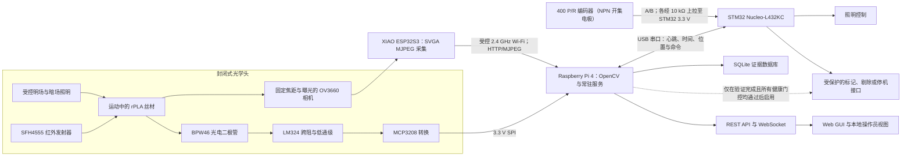
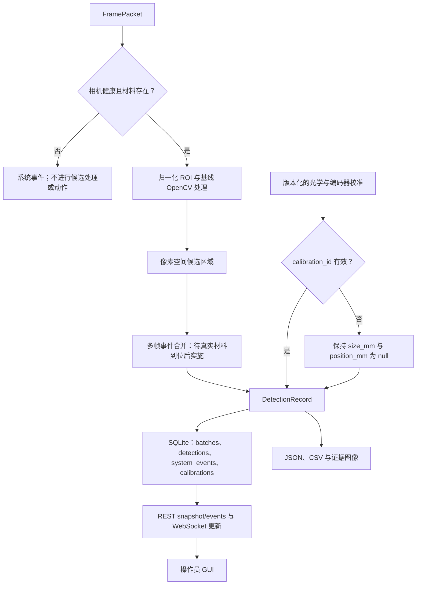
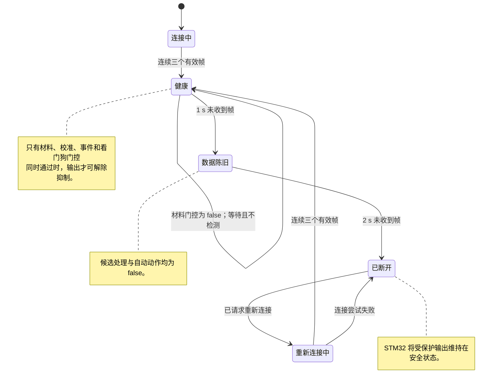

# 方案设计报告

## 面向再生 PLA 丝材的证据可追溯表面质量监测

| 文档字段 | 状态 |
|---|---|
| 客户背景 | BioLoop Manufacturing Pty Ltd |
| 学科 | ENG5105 电气工程 |
| 交付成果 | 方案设计报告 |
| 选定质量参数 | 可见 rPLA 丝材表面质量 |
| 选定方案 | Plan B：ESP32S3 OV3660 采集、Raspberry Pi 4 处理与服务、STM32 监督与安全 I/O |
| 方案状态 | Plan A 仅作为评分标准要求的对比方案保留；Plan B 是唯一具备条件可行性的实施与验证路径，且须通过所述门槛 |
| 证据截止日期 | 2026 年 8 月 15 日 |
| 证据状态 | 本方案已有边界明确的集成证据；真实材料校准与缺陷性能验证仍待完成 |

## 执行摘要

BioLoop 需要一套实验室规模的系统，在再生聚乳酸（rPLA）丝材随制造流程运动时监测其可见表面异常。客户任务书将气泡、粗糙、污染、裂纹和夹杂列为相关的表面质量问题，并要求电气团队处理实时采集、通信、可视化、故障检测以及未来的工业集成 [1]。本报告建议采用 Plan B：在规划架构中，带 OV3660 相机的 ESP32S3 Sense 节点通过受控的 2.4 GHz 网络传输 MJPEG；Raspberry Pi 4 承担 OpenCV 处理、数据存储、API/WebSocket 服务和操作员界面；STM32 Nucleo-L432KC 承担编码器输入、照明控制、看门狗监督以及受抑制的下游 I/O。这三个计算平台均在校方提供的基线设备清单内 [2]。现有服务/API/GUI 证据来自 Windows 开发主机，不足以证明相关功能已部署至 Pi，也不能证明 STM32 物理 I/O 已经实现。

Plan A 提供了技术上更强的相机选项，但无法在选定的学期实施路径内交付。该方案将 Raspberry Pi 与全局快门相机及 C/CS 卡口镜头连接。所有像素同时曝光，对高速运动成像确有吸引力 [3]，但相机和镜头均不在校方提供的设备之列。经核实，Plan A 专属采购小计为 A$136.15，尚未计入运费，其中相机 A$92.55、镜头 A$43.60；2026 年 8 月 15 日查询时，相机还处于缺货状态 [4], [5]。新增成本与采购不确定性使其无法通过强制门槛。Raspberry Pi、STM32、照明、编码器、外壳和保护硬件等共用项目被有意排除在 Plan A 小计之外。Plan A 因而仍是公平的对比方案，但不会采购、搭建或测试，也不会作为未来迁移路径。

Plan B 在校方设备实际发放且状态合格、材料到位并且夹具可用的条件下，具备学期内交付可行性，但尚未验证为 rPLA 缺陷检测器。一项记录在案的 30 s SVGA 集成测试，在其声明条件下观察到 10.77 帧/秒的处理速率 [6]。测试期间，感兴趣区域内没有 rPLA；该结果只能证明受测路径中的帧传输和处理具有连续性，不能证明没有发生帧丢失。该服务此后已围绕单槽帧缓冲重建，会丢弃并计数积压帧；这属于开发主机上的软件证据，不改变上述已记录结果。现有软件还会在网络恢复期间暂停检测，并将未经校准的物理量字段保留为 null；这两项行为都不能证明缺陷准确率、最小可检测尺寸、毫米级位置准确度、可用线速度或工业就绪程度。第 3 节中的全部数值要求均标记为 `PROPOSED_REQUIREMENT`。物理验收取决于受控光学条件、光学与编码器校准、带标签的真实材料试样、相互独立的验证组，以及计划于第 5 周星期四材料到达后开展并形成记录的要求审查。

## 原住民传统土地所有者致谢

我们承认蒙纳士大学所在未割让土地的传统所有者与守护者，包括 Kulin Nations 的人民，并向他们过去与现在的长者致以敬意 [7]。本项目涉及材料的循环利用，但循环性本身并不意味着该工程系统就是负责任的。我们的工作应节约资源、避免可预防的浪费，并将监测装置所引入的能源消耗、电子设备和决策纳入考量。我们认识到，守护传统土地所承载的责任超出了本方案的技术边界。

# 1. 背景与目的

## 1.1 客户与制造背景

BioLoop 拟建的制造中心计划面向澳大利亚教育、工程、制造与消费市场生产 rPLA 和 rPLA 复合丝材。产品监测处于一个更广泛的循环制造系统之中，与自动化、资源效率、安全和经济可行性并列 [1]。丝材只有经过挤出、冷却、处理和绕卷后才可能到达客户手中，因此，可见异常若到后期才被发现，往往意味着返工、产品报废，或客户对该批次失去信心。在线观察提供了一个更早的决策节点。

再生 PLA 并非成分与状态完全一致的输入。已有对比研究表明，原料来源、回收历史和加工条件会影响再生丝材及打印制品的性能 [8], [9]。水分也可能改变含 PLA 的熔融沉积成型材料的形貌与拉伸行为 [10]。这些发现说明监测有其必要性，却不意味着相机能够仅凭外观诊断水分、降解或挤出设置。凹坑或色斑只是可见状态的证据；在与独立的过程和材料数据核对之前，其成因仍是假设。

循环经济层面的论证同样需要克制。关于分布式丝材生产和 PLA 闭环回收的生命周期研究，既说明了认真考虑回收材料的理由，也表明实际收益取决于系统边界、能源与工艺选择 [11], [12]。本方案不声称已经完成生命周期评估。它的目的更为聚焦：及时提供表面质量证据，使人员、质量系统或后续工厂控制器能够据此采取行动。

## 1.2 目的、问题与边界

本报告提出的问题是：

> 一套采用校方提供硬件的低成本机器视觉系统，能否在具有代表性的实验室条件下，对运动中的 rPLA 丝材可见异常进行检测、定位和分级，同时抑制不安全或未经校准的输出？

系统必须给出有用的检测结果，而且这些结果的有效性须经独立验证。看似实时的图像流仍可能已经过时、照明不佳或几何尺度未经校准，因此，采集健康状态与证据状态属于设计功能，而不是界面装饰。

在比较各方案前，表 1 明确了研究边界。

**表 1. 拟定项目范围。**

| 范围内 | 超出当前主张边界 |
|---|---|
| 从受控图像中识别可见气泡或凹坑、裂纹或划痕、污染或夹杂，以及异常表面纹理 | 在缺少经验证的轮廓测量或结构光参照时，主张 Ra 等工程粗糙度参数 |
| 实验室规模的在线采集、候选异常检测、事件记录、报警呈现和安全输出请求 | 内部空洞计量、聚合物化学成分识别，或证明某项缺陷的工艺成因 |
| 完成光学与编码器校准后，对带标签的真实 rPLA 进行测试 | 未经校准的毫米尺寸或位置 |
| 按任务书要求开展基本故障检测，并与更大的自动化流程集成 [1] | 安全认证、生产自主放行或工业部署主张 |

预期输出是可追溯的候选异常记录，以及面向操作员的决策辅助。自动剔除尚未获准。

# 2. 文献综述与设计启示

## 2.1 表面图像能够证实什么

关于 rPLA 的研究说明了开展检测的理由，却没有提供视觉真值。材料来源、重复加工与水分都可能改变性能 [8]–[10]；任务书则另行列出气泡、粗糙、污染、裂纹和夹杂，认为这些表面状态可能反映工艺或材料问题 [1]。“可能”一词很关键。我们利用文献界定缺陷类别与挑战条件，随后要求通过带标签的试样才能赋予类别。仅凭视觉证据，无法区分由水分引起的气泡与其他机制形成的空腔，因此因果标签还需要独立的过程证据。

工业异常检测研究也提醒我们，不能把整洁的实验室图像当作实际运行域。近期数据集涵盖复杂运行场景、真实工业图像和多视角观测 [13]–[15]。这些研究报告的模型结果不能直接迁移至 rPLA，因为对象、标签、光学条件和异常占比均不相同。能够迁移的是实验原则：必须控制并记录相机几何关系、背景、照明、视角和数据集划分。

## 2.2 运动、光学与采集

运动中的圆柱形丝材是难以处理的光学目标。丝材转动时，高光会随之移动；单一视角无法保证覆盖整个圆周；压缩还可能产生块状或边缘伪影。非同步动态线扫描研究说明了为何必须明确处理运动与采样对齐问题 [16]。一项以热轧钢为对象的特征融合研究，只能证明其特定材料与数据集内的性能，不能证明对 rPLA 照明和几何变化的稳健性 [17]。面阵与线阵检测方式的实验比较同样表明，有些表面缺陷只有在特定传感器与照明布置下才会显现 [18]。因此，受控的漫射与低角度照明、固定感兴趣区域、在设备支持时锁定焦距/曝光，以及可重复的导向几何结构，均属于测量方案的一部分。

Plan A 在传感器端处理运动问题。Raspberry Pi 的全局快门相机可使全部像素同时曝光，并支持 C/CS 卡口镜头 [3]。Plan B 采用校方提供的 OV3660 滚动快门成像器，其传感器限制见数据手册 [19]，并通过受支持的 ESP32 相机栈工作 [20], [21]。没有任何数据手册能够预测本应用的缺陷检测准确率。Plan B 必须转而通过限定线速度、控制曝光、保持照明可重复，并开展实证验证来降低运动畸变风险。

## 2.3 面阵表面成像之外的备选测量方式

团队比较了三类测量方式，因为它们回答的质量问题并不相同。面阵或线阵视觉能够保留颜色、纹理、夹杂、裂纹等可见特征的空间证据，但其响应依赖视角与照明 [18]。多轴光学直径测量已经在再生 ABS 和 PLA 丝材上得到验证，并可沿卷盘记录直径和形状 [22]；然而，仅凭直径轨迹无法分类全部可见表面状态，也无法揭示内部空洞。激光线轮廓测量能够提供定量高度和表面形貌，并已在材料挤出研究中通过点云检测表面偏差，但会增加设备与处理成本，而且所引研究验证的是沉积层，并非运动中的进料丝材 [23]。

结合本任务书、校方所供硬件和学期限制，Plan B 因而采用面阵成像记录可见空间异常，光电二极管则只用于材料存在与光学健康门控。只有当利益相关者咨询把直径或工程粗糙度确认为主要要求时，才应把直径测量或轮廓测量作为范围明确的扩展；它们不能反向证明 Plan B 已经具备这些测量能力。这也解释了表 1 为何排除 Ra 与内部空洞测量。

## 2.4 处理职责与证据流

将所有任务都放在相机节点上运行会简化布线，却也会把采集、分析、存储、界面和故障恢复压缩到同一个资源受限设备中。边缘计算文献支持在设备附近完成时效性要求较高的视觉处理，同时保持清晰的系统职责划分 [24]。本设计的规划职责如下：ESP32S3 承担图像采集与传输；Raspberry Pi 4 承担 OpenCV、记录、服务和 GUI；STM32 承担确定性的编码器、看门狗、照明与输出监督。制造商文件证明 Pi 和 Nucleo 平台具备相应的计算与接口资源 [25], [26]。这些是能力证据，不能证明上述职责已经部署。

这种职责分离形成了有用的故障边界。在目标 Pi/STM32 设计中，相机超时后，Pi 服务应进入重连或故障状态，同时 STM32 抑制标记或停机请求。为防止旧图像在无提示的情况下被当作当前质量事件，必须把最新帧策略和帧龄看门狗真正接入服务；这两项控制现已进入 Windows 常驻服务并通过线程化单元测试，但尚未在 Pi 上部署验证。由此，系统架构将健康元数据、时间戳、校准标识符和为 null 的物理字段一并纳入证据链。

## 2.5 对验证的启示

相邻视频帧高度相关。若同一缺陷的近重复帧同时出现在训练数据与测试数据中，所报告的性能可能偏乐观；更广泛的机器学习研究将数据泄漏视为可复现性威胁 [27]，视频目标检测研究也揭示了时空相关性造成的具体风险 [28]。因此，验证数据将按实体卷盘或批次以及缺陷事件划分，而不是随机打乱单帧图像。

仅报告准确率，会掩盖低发生率缺陷带来的代价。拟定评估将报告事件级精确率、召回率和 F1 分数、每米误报警次数、漏检事件、延迟，以及在已声明照明和速度条件下的稳定性。样本数与不确定性必须与这些数值同时报告。目前尚无任何此类结果。

表 2 将上述文献发现转化为设计决策，并标明本项目仍然缺少的特定证据。

**表 2. 从文献到设计的迁移。**

| 证据主题 | 设计启示 | 本项目仍需取得的证据 |
|---|---|---|
| rPLA 变异性与水分 [8]–[10] | 将可见异常视为观察结果，而非自动给出的根因诊断 | 与已记录条件相关联的带标签真实 rPLA 试样 |
| 工业异常与多视角数据集 [13]–[15] | 固定光学条件，并记录视角、照明和数据集来源 | 来自最终夹具的代表性图像 |
| 动态成像与表面检测 [16], [17], [18] | 控制曝光、运动、几何结构和照明；测试覆盖范围限制 | 速度挑战与圆周覆盖研究 |
| 光学直径测量与激光轮廓测量 [22], [23] | 将其保留为由要求驱动的备选方式，而非面阵图像隐含的现有能力 | 扩展范围前取得利益相关者优先级、比较测试计划，以及获批的成本/进度变更 |
| 数据泄漏与相关视频 [27], [28] | 按相互独立的卷盘/批次/事件划分验证数据 | 预注册的数据集划分与留出测试结果 |

# 3. 利益相关者、需求与拟定要求

## 3.1 利益相关者证据状态

本方案报告尚未获得直接的利益相关者咨询记录。以下需求源于 BioLoop 项目任务书、学科说明和文献，不应归因于某次会议、某位参与者或客户批准。这一区分很重要，因为评分标准要求利益相关者参与，并要求相关需求能够为设计提供依据 [29], [30]。报告可以说明应讨论哪些问题，却不能虚构任何人的发言。

**表 3. 利益相关者图谱与暂定设计响应。**

| 利益相关者群体 | 根据任务书或系统用途推断的需求 | 拟定设计响应 | 当前状态 |
|---|---|---|---|
| BioLoop/客户代表 | 可追溯的质量证据、成本意识，以及接入自动化的路径 | 要求登记表、事件记录、API 和明确的验收门槛 | 源于任务书；待确认 |
| 生产操作员 | 清晰的健康状态、可执行的报警，且不得依据无提示的陈旧数据作出决策 | 单屏状态、候选异常叠加、报警历史，以及系统不健康时抑制输出 | 拟定 |
| 质量保证人员 | 可复核的图像、批次背景、可重复分类和导出功能 | 版本化的校准/模型标识符、不可变事件字段和数据集导出 | 拟定 |
| 维护与电气人员 | 可诊断故障、可维护接口和安全恢复 | 相机/处理器/编码器/照明健康状态、看门狗状态和手动复位规则 | 拟定 |
| 实验室主管与技术人员 | 安全且可测试地使用校方提供的设备 | 封闭光路、低电压原型域和分阶段故障测试 | 源于任务书与设备资料 |
| 丝材用户 | 获得一致的产品信息，且不含缺乏依据的质量主张 | 仅在验证后开展有证据支持的分级；保留不确定事件以供复核 | 源于文献；待确认 |

接下来的利益相关者参与应检验假设，而不是追求形式化签字。一场简短的结构化讨论可以询问：哪些缺陷类别会导致拒收、可容忍多少误报警、证据需要保存多久、谁有权批准停机或剔除动作，以及哪些运行速度和照明条件具有代表性。每项答复都应写入带日期的决策日志，记录受影响的要求、负责人、理由及验证方式变更。在形成这类记录前，表 3 中没有任何优先级可被声称已经获得利益相关者批准。

## 3.2 拟定要求与验证

表 4 中每一个数值阈值均为 `PROPOSED_REQUIREMENT`。这些数值按照电气学科指南的要求，提供可测试的设计基线 [29]；它们仍可依据利益相关者审查和实验结果进行修订。

**表 4. 拟定要求登记表。**

| ID | 拟定要求 | 利益相关方/来源依据 | 计划验证方式 | 状态或当前缺口 |
|---|---|---|---|---|
| R1 | 检测至少三类经认可的可见表面异常 | 缺陷族来自项目任务书 [1]；类别数量由团队拟定，待利益相关方确认 | 使用留出数据开展事件级带标签测试 | `PENDING_REAL_MATERIAL` |
| R2 | 对每个获接受的 R1 类别，以不小于 0.20 mm 的已声明类别特征尺寸为目标 | 团队依据学科对可测规格的要求提出的工程目标 [29]；待利益相关方确认 | 使用下文定义，经校准的靶标和带标签试样 | `PENDING_REAL_MATERIAL`；尚无光学尺度 |
| R3 | 对每个满足 R2 的获接受 R1 类别，事件级精确率和召回率均至少达到 90% | 团队依据 [29] 提出的性能目标；误报与漏检容限待利益相关方确认 | 按相互独立的卷盘/批次/事件划分；报告各类别计数和置信区间 | `PENDING_REAL_MATERIAL`；尚无准确率结果 |
| R4 | 丝材速度为 0–5 m/min 时，处理速度至少达到 20 帧/秒 | 团队依据 [29] 提出的吞吐量目标；运行范围待利益相关方确认 | 在最终夹具上持续运行并开展速度挑战 | 未实现：当前 SVGA 集成观测值为 10.77 帧/秒；最新帧与丢弃计量现已进入服务，但尚未在 Pi 上实测 |
| R5 | 在 P95 下，自带标记缺陷越过已冻结 ROI 入口线的首个参考视频帧起 500 ms 内发出报警 | 团队依据 [29] 提出的报警目标；响应预期待利益相关方确认 | 同步拍摄场景参考与 GUI/输出；计入确认、处理、通信和指示 | 拟定；当前亮度控制路径时序并非此项测量 |
| R6 | 将纵向缺陷定位误差限制在 ±10 mm | 团队依据 [29] 提出的位置目标；待利益相关方确认 | 校准编码器 counts/mm，并进行标记距离测试 | `PENDING_REAL_MATERIAL`；尚未校准编码器 |
| R7 | 连同所需校准来源信息，存储缺陷类型、尺寸、置信度、证据图像、位置、时间和批次标识符 | 数据与可视化需求来自任务书 [1]，并依据 [29] 转化为可测试规格 | 审计数据库模式、文件与记录 | 部分实现；实时证据图像及完整光学/编码器来源仍待完成，尺寸/位置在校准前保持 null |
| R8 | 在 30 min 运行中，将已确认事件记录丢失率保持在 1% 以下；`loss = (N_expected - N_complete) / N_expected`，完整记录须包含持久数据库行及所需证据图像 | 团队依据 [29] 提出的可靠性目标；容限待利益相关方确认 | 将已冻结的预期事件 ID 与持久数据库行、图像文件和导出结果核对；另行报告帧丢失 | 拟定；丢帧计量现已进入服务，但最终硬件测试仍待完成 |
| R9 | 相机、照明、编码器或处理器故障后进入安全保持或故障状态 | 故障检测/集成需求来自任务书 [1]；安全解释由团队拟定，后续仍需风险评估 | 在最终布线上注入故障并观察输出状态 | 仅有软件/网络路径证据；物理安全 I/O 待完成 |
| R10 | 只存储和提供局限于封闭丝材通道的图像，默认仅本地存储并禁止对外发布 | 团队拟定的隐私保护控制；法律及利益相关方保留/访问规则待定 | 审计每张最终证据图像及存储/访问配置；人员或通道外像素须为零 | 当前完整标注开发预览未达标；外壳和放行控制待完成 |

R2 为每个获接受类别冻结一个主要尺寸：紧凑凹坑、气泡、夹杂或污染区域采用等效圆直径；裂纹或划痕采用经校准的横向宽度，并另行报告轴向长度；异常纹理斑块采用经校准包围框中较小的尺寸。类别定义与真值方法必须在采集前批准并冻结，不能在看到结果后改变 0.20 mm 阈值。R3 要求三个或更多获接受类别中的每一类都分别通过精确率与召回率门槛；报告还须保留各类别的事件计数与混淆矩阵，使宏平均或微平均汇总不能掩盖未通过的类别。试点将为最小独立事件数提供依据，但该数量必须在从未用于调参的留出测试开始前冻结，不能事后选择。

R4 揭示了当前最突出的设计矛盾。较低的阶段性演示阈值或许有助于集成，却不能在没有形成正式要求变更记录的情况下取代 20 帧/秒最终目标。如果最终夹具无法达标，项目将转入优化、设定有依据的线速度限制，或正式重新协商要求。选择性报告不是验收方法。

# 4. 方案构想与选择

## 4.1 选择方法

评分标准要求至少提出两个具有差异化的方案构想，并给出有证据支持的建议 [30]。我们在偏好评分前设置四项通过/不通过门槛：已发放的主成像硬件是否可用、是否可避免采购未经批准的方案专属主相机、采购时序以及学期内可交付性。即使技术上很有吸引力，只要未通过任何一项强制门槛，该方案便不能进入实施候选范围。这些是团队针对本提案作出的可行性判断，并非利益相关者批准的预算限额。

## 4.2 Plan A：直连全局快门成像对比方案

Plan A 通过 CSI 将 Raspberry Pi Global Shutter Camera 连接至 Pi，配用适当的 C/CS 卡口镜头与受控照明，并保留基于 STM32 的编码器、看门狗、照明和安全 I/O 功能。它的主要优势是图像阵列同步曝光，适用于高速运动和机器视觉 [3]。本地 CSI 传输也使相机到处理器的路径不再依赖 Wi-Fi 和 MJPEG。即便如此，光学对准、反光圆柱体几何结构和单视角覆盖范围仍需校准。

这一方案在技术上可信；但主相机既非校方提供，查询时也无库存，因此本项目仍无法采用。表 5 仅列出 Plan A 独有的采购项目。

**表 5. 经核实的 Plan A 专属增量采购，查询日期为 2026 年 8 月 15 日。**

| 项目 | 数量 | 价格 | 查询时供货状态 | 来源 |
|---|---:|---:|---|---|
| Raspberry Pi Global Shutter Camera | 1 | A$92.55 | 缺货 | [4] |
| Raspberry Pi 6 mm CS-mount lens | 1 | A$43.60 | 有货 | [5] |
| **Plan A 专属小计** |  | **A$136.15** | 不含运费 | 根据 [4], [5] 计算 |

该小计是在共用原型需求之外新增的成本。Raspberry Pi、STM32、编码器、照明、外壳、电源/保护或标记器成本均未重复计入。与第 9 节的 Plan B 必需核心预算相比，这笔 A$136.15 的增量约为 62–104%；若把可选标记器计入完整预算，增幅约为 55–96%。采购尚未获批，查询当日相机处于缺货状态，新光学链路还会占用有限的集成时间；团队据此认为，这一增幅对于当前实施路径过高。Plan A 未能通过可用性、成本、交付周期和学期内交付四项门槛，不会进入采购或验证阶段。

## 4.3 Plan B：基于校方提供硬件的分布式视觉

Plan B 使用校方提供的 XIAO ESP32S3 Sense、Raspberry Pi 4 和 STM32 Nucleo-L432KC [2]。拟定链路如下：

> 受控光学头与 rPLA 丝材 -> ESP32S3 OV3660 采集 -> 2.4 GHz Wi-Fi MJPEG -> Raspberry Pi 4 OpenCV、API/WebSocket、SQLite 与 GUI <-> STM32 编码器、看门狗、照明及受抑制输出接口

OV3660 与 ESP32 相机文档支持所选采集栈 [19]–[21]；Pi 和 Nucleo 文档支持其规划的处理与接口职责 [25], [26]。Plan B 无需新购主相机，并以已经集成的软件和实时传输路径为基础。它也暴露出真实限制：滚动快门畸变、JPEG 伪影、无线延迟或中断、有限的光学控制，以及无法保证覆盖整个圆周。这些限制将转化为测试条件与风险控制，不会因为作出了选择而被掩盖。

## 4.4 可行性门槛与技术比较

表 6 先应用强制门槛，再考虑表 7 记录的技术偏好。

**表 6. 强制可行性门槛。**

| 门槛 | Plan A | Plan B | 对决策的意义 |
|---|---|---|---|
| 已发放的主成像硬件可用 | **不通过**：未提供全局快门相机和镜头 | **有条件通过**：主相机和计算平台被列为校方提供；设备发放、状态和兼容性检查仍待完成 [2] | Plan A 无法从已发放的基线设备起步 |
| 无需采购未经批准的方案专属主相机 | **不通过**：至少 A$136.15 加运费，约为 Plan B 必需核心预算的 62–104%；计入可选标记器时为 55–96% | **主成像部分通过**：无需额外购买主相机；共用新增部件仍须批准 | 这是团队设定的方案门槛，并非客户批准的预算阈值；双方均不计共用成本 |
| 采购/交付周期风险 | **不通过**：相机于 2026 年 8 月 15 日缺货 [4] | **有条件通过，但有残余风险**：核心平台仍须发放检查；编码器页面显示本地库存为 0、预计 8 月 24–27 日发货，夹具、照明和保护部件仍未冻结 [31] | 供应商发货估计不是到货承诺；两个方案均不得依赖未经核验的到货日期 |
| 学期内实施与验证 | **不通过**：新光学链路到货、集成与校准都会偏晚 | **有条件通过**：现有 Plan B 路径可进入真实材料测试 | 验证仍取决于材料和夹具是否可用 |

评分不能推翻上述门槛。表 7 的分数是团队从 1（弱）到 5（强）作出的比较判断，并非测量结果。暂定权重中，65% 分配给测量能力（R1–R4 和 R6），15% 分配给 Pi 集成（R4、R7 和 R8），20% 分配给成本与采购约束。这些权重尚未获得利益相关者批准。矩阵对其较为敏感，因此只用于揭示取舍，不为决策提供认证。

**表 7. 加权方案比较。**

| 标准 | 权重 | Plan A | Plan B | 判断依据 |
|---|---:|---:|---:|---|
| 缺陷分类潜力（R1、R3） | 25% | 5 | 3 | Plan A 提供可配置性更高的机器视觉光学链路；两个方案都没有 rPLA 准确率数据 |
| 运动成像适用性（R2、R4） | 20% | 5 | 2 | 全局快门与滚动快门加压缩无线传输的比较 [19], [3] |
| 空间细节潜力（R2、R6） | 20% | 4 | 3 | 可更换镜头与光学控制，对比校方提供的 OV3660 路径 |
| Raspberry Pi 集成（R4、R7、R8） | 15% | 5 | 4 | 直连 CSI，对比受支持的网络采集与服务集成 |
| 方案专属成本（项目约束） | 10% | 3 | 5 | Plan A 成像成本为 A$136.15 加运费；Plan B 无需新购主相机 |
| 采购时序（进度约束） | 10% | 3 | 5 | Plan A 相机缺货；Plan B 核心平台被列为校方提供，但仍须核实是否发放 |
| **加权总分** | **100%** | **4.40** | **3.35** | 仅为比较分数 |

R5、R9 和 R10 未单独计权：报警时延、安全状态与隐私/外壳主要取决于两种方案共用的 Pi/STM32、夹具和治理设计，而不是主相机选择。它们仍是强制验收要求，不能因未计权而被忽略。

Plan A 仍在加权矩阵中领先。可行性结果却具有决定作用：更高的偏好分数无法让不可用的硬件到位，也不能消除采购与交付周期的不确定性。Plan B 因而被选为有条件可行的唯一实施路径；设备发放与状态、材料、夹具和后续验证关口仍须逐项通过。该建议建立在可交付性与清晰的验证策略之上，并不声称现有图像已经满足 R1–R10。

# 5. 功能设计与技术规格

方案 B 将检测任务分为两条彼此关联、却有意承担不同证据强度的测量路径。相机路径提供可见候选区域的空间证据；辅助红外路径只回答一个更窄的问题：材料是否存在，以及光学头的工作状态是否合理。只有采集状态健康时，系统才可记录候选对象。若要发出自动标记或停机请求，则必须同时满足更严格的条件：采集健康、校准有效、已确认材料存在、事件规则经过验证，并且输出已启用。这一道边界构成设计核心。软件能够在明亮轮廓外画出边界框，并不意味着它就是缺陷。

选定硬件为学校提供的 XIAO ESP32S3 Sense（配 OV3660）、Raspberry Pi 4 和 STM32 Nucleo-L432KC [2]。这些拟议角色依据工作负载与故障隔离需求划分，而非仅按处理器的标称能力确定：ESP32S3 被分配图像采集与压缩任务，Pi 被分配非确定性视觉和数据服务，STM32 被分配时间关键型 I/O 监管任务。制造商文档能够支持这些平台能力 [19], [20], [21], [25], [26]。它们不能证明应用性能，也不能证明 Pi/STM32 部署已经完成。

## 5.1 端到端功能架构

**图 1. 拟议方案 B 的硬件、数据及动作抑制架构。**

图 1 将当前在 Windows 上开发的视觉/服务功能置于其拟议的 Pi 角色中，并将其与规划由 STM32 控制的动作权限分开。图中的箭头描述目标集成基线，并不表示物理布线已经完成。

图中也明确了动作边界。Raspberry Pi 软件可以提出事件，但物理输出由 STM32 控制；一旦心跳、编码器、照明或通信健康状态丢失，后者便撤销输出许可。这是一种面向安全的实验室控制架构，不是经过安全认证的机器安全功能。未来若接入生产设备，必须依据相关框架开展机器风险评估与安全功能设计，其中包括 ISO 13849-1，不能只依赖原型看门狗 [32]。OT 网络分段和最小功能原则同样适用 [33]。

下列拟议要求仍标记为 `PROPOSED_REQUIREMENT`。项目任务书确立了实验室尺度在线表面质量监测的需求 [1]，专业指导则要求给出可测量的规格及验证方法 [29]。本报告收到的记录中，没有任何材料表明利益相关方已经批准这些数值阈值。表 8 将每项要求分配给相应功能及验证路径，同时保留当前缺口。

**表 8. 拟议要求的功能分配与验证状态。**

| ID | 拟议目标 | 功能分配 | 验证方式与当前状态 |
|---|---|---|---|
| R1 | 至少检测三类可见表面缺陷。 | 光学头；OpenCV/事件分类器；标注数据库。 | 独立的真实 rPLA 事件测试。`PENDING_REAL_MATERIAL`；当前边界框仅代表候选对象。 |
| R2 | 目标缺陷的特征尺寸至少为 0.20 mm。 | 固定光学系统、像素尺度和事件测量。 | 在最终工作距离下使用校准参考特征。`PENDING_REAL_MATERIAL`。 |
| R3 | 对 R2 缺陷，精确率至少达到 90%，召回率至少达到 90%。 | 事件逻辑、真实标注与评估脚本。 | 在留出的线轴/区段/事件上评估；报告置信度与 F1。`PENDING_REAL_MATERIAL`。 |
| R4 | 在 0–5 m/min 范围内至少处理 20 帧/秒。 | 相机、Wi-Fi、最新帧缓冲区与 Pi 视觉处理。 | 在每个测试速度下测量最终夹具的持续吞吐量。已记录的 10.77 帧/秒 SVGA 集成结果不满足该要求；最新帧与丢弃计量现已接入常驻服务，但尚未在 Pi 上实测。 |
| R5 | 缺陷确认后 500 ms 内发出警报。 | 带时间戳的事件跟踪器、API/UI 与 STM32 输出请求。 | 使用可见计时参考，测量从场景到显示/输出的时间。现有亮度阶跃计时仅为 `LIVE_INTEGRATION_ONLY`。 |
| R6 | 将缺陷轴向位置误差限制在 ±10 mm。 | 编码器尺度、时间对齐及相机到标记器的偏移。 | 在两个行进方向上重复进行已知位置试验。`position_mm` 仍为 null。 |
| R7 | 存储类型、尺寸、置信度、图像、位置、时间和批次标识符。 | `DetectionRecord`、SQLite、图像存储与导出。 | 先进行模式/往返测试，再审计已校准记录。结构已经存在；物理字段仍为 null。 |
| R8 | 运行 30 min，记录丢失率低于 1%。 | 常驻服务、SQLite 事务路径和健康日志。 | 在 30 min 最终硬件运行中核对源帧/事件/数据库/导出。尚未作为完整要求进行测试。 |
| R9 | 相机、照明、编码器或处理器故障后进入安全保持或故障状态。 | Pi 健康门控、STM32 看门狗和受保护输出。 | 使用最终布线进行硬件故障注入。已有软件/网络证据，安全 I/O 仍待验证。 |
| R10 | 仅拍摄封闭检测区域内的丝材，数据默认存储在本地。 | 遮光光学头、受限 ROI 和 Pi 本地数据库。 | 检查夹具、视场隐私及存储/访问。已实现本地存储；最终外壳仍待完成 [34], [35]。 |

## 5.2 光学头与相机规格

尽管 OV3660 可以输出更大的画幅，项目所需的是稳定工作点，而非数据手册中尺寸最大的模式。因此，方案 B 的实时配置固定为 SVGA 800 × 600；VGA 640 × 480 仅作为手动恢复选项，XGA 或更大模式不属于选定的运行配置。当前归一化 ROI 在 SVGA 下映射为 `(254, 47, 195, 527)`。在夹具和丝材确定真实光轴之前，这一位置只是暂定值。OV3660 的卷帘快门读出、JPEG 压缩和无线传输都可能引入运动或时序伪影，因而需要把曝光时长、线速度与候选持续性放在同一组试验中考察 [19], [20]。

拟议光学头采用刚性相机支架、可重复定位的丝材导向件、哑光背景与外部遮光罩。校准完成后，工作距离、焦点和曝光将被锁定。可切换的明场照明用于呈现颜色或纹理对比；低角度暗场照明则用于增强表面起伏的可见性。两种模式都是实验变量，不能据此证明某一特定异常必然可检测。工业异常数据集也说明，验证必须覆盖外观变化和观察几何，而不能让单一便利的成像条件掩盖这些因素 [13]–[15]。

单台相机只能观察圆柱形丝材的可见弧面，无法覆盖完整的 360° 圆周。只有当第 5 周及以后的证据显示背面漏检占主导时，才会评估反射镜或后续多视角布置；一旦加入，必须重新进行光学校准。光学头将配备比例尺靶标以及无需移动相机即可插入的暗参考和白参考。这里不作物理分辨率主张。工程粗糙度与内部空洞也不在范围内。

## 5.3 辅助光电二极管链路

SFH4555 横穿丝材通道发射红外光，BPW46 输出随接收辐照度变化的光电流。LM324 级将该电流转换为电压，并在 MCP3208 数字化之前抑制高频噪声。在方案阶段，初始跨阻估算为

\[
R_f=\frac{V_{span}}{I_{PD}},
\]

其中，\(I_{PD}\) 是在最终几何条件下测得的光电流，\(V_{span}\) 为可用输出摆幅。引入反馈电容 \(C_f\) 后，近似低通截止频率为

\[
f_c=\frac{1}{2\pi R_f C_f}.
\]

光学头完成装配之前，\(R_f\)、\(C_f\)、LED 电流和判定阈值的数值不能冻结。不过，暂定设计约束已经明确。M3 将选择跨阻增益，使实测路径状态范围在不削顶的前提下约占 ADC 输入范围的 10–80%；随后选取 \(C_f\)，在衰减已观测高频噪声的同时，使实测阶跃响应速度至少达到最快材料存在状态跃迁的五倍。LED 驱动电流将被限制在制造商的连续额定值以下，并在实测外壳温度下复核。暗态、通光路径、正常丝材、阻断路径及丝材偏位五种分布将在 G3 用于设定带有记录保护裕量的阈值。有效的辅助状态可以对检测进行门控，也可提示光学性能退化；它不能定位划痕、对污染物分类或估计特征尺寸。

本项目将 MCP3208 的 `VDD` 与 `VREF` 均设为 3.3 V，并以 3.3 V 逻辑连接 Pi 的 SPI，以免把 5 V 数字电平施加到仅容许 3.3 V 的 Pi GPIO。LM324 并非轨到轨器件；其供电和输出摆幅不能直接视为 ADC 输入保护。M3 必须通过增益/偏置设计以及串联限流与钳位保护，将 MCP3208 输入限制在 0–3.3 V，并在正常状态和单一故障状态下实测最小值、最大值及保护电流，之后才可连接 Pi。第 8 节记录支撑这些放行约束的官方元件资料。

## 5.4 Raspberry Pi 处理、溯源与存储

规划中的 Pi 部署保留与数据源无关的第 3 周契约，而不是将其替换。`FramePacket` 携带图像、帧号、采集/接收时间、相机数据源及连接状态。`DetectionRecord` 则包含候选标签、像素边界框、像素面积、算法分数、暂定等级和批次上下文。SQLite 模式包含 `batches`、`detections`、`system_events` 和 `calibrations`，服务现已启用 SQLite 外键约束，使检测记录无法引用从未开启的批次。这些边界使后续算法变化可以审计，也契合当前工业视觉研究所描述的边缘计算角色 [24]。

**图 2. 健康状态门控的候选处理与证据记录流程。**

图 2 标出了健康状态、校准与溯源信息应在哪些环节阻止像素空间候选对象获得缺乏证据支持的物理含义。

Windows 开发基线采用可配置阈值 145、最小面积 120 px，并启用材料存在门控 [36], [37]。这些都属于原型参数。现有门控要求深色目标贯穿 ROI 高度的 80%；它能阻止邻近的手或小型背景物体启动检测，但仍须用 rPLA 重新调参。单槽 `LatestFrameBuffer` 与 1 s `STALE`/2 s `DISCONNECTED` 监视器起初属于 `OFFLINE_FAULT_INJECTION_ONLY` 原语，当前常驻服务已将两者实例化。采集与检测运行在各自线程上：读取方把每一帧发布到单槽缓冲，积压帧被丢弃并计数，检测线程依据所持最新帧的帧龄判定健康状态，而不是依据上一次读取是否在已配置的 3000 ms 超时内返回。当帧龄超过已配置的陈旧窗口时，即使读取持续成功，服务状态也会降级；恢复检测则需要连续三个有效帧。`dropped_frames` 字段现在报告缓冲的实际丢弃计数，不再恒为 0，快照也一并给出 `frame_age_ms` 及其配置阈值。这属于开发主机上的线程化单元测试软件证据：它不能证明 Pi 部署、真实网络负载下的积压抑制，也不能给出 R4、R8 和 R9 结果，这些仍需最终夹具。只有取得代表性材料后，多帧合并才会把多个重复帧候选转换为事件候选。

当前数据模型只在 `calibration_id` 为 null 时阻止写入 `size_mm` 与 `position_mm`，并未验证该标识符是否对应真实校准。现有存储库也没有检测记录到校准表的外键、编码器校准、配置哈希、不确定度/适用范围字段，或可核验校准来源的写入路径。这一非空检查只能称为空字段保护，不能证明校准有效。验收前必须补齐不可变的校准/配置清单及其哈希，并验证每条物理量记录的引用。合成记录使用 `OFFLINE_SYNTHETIC_ONLY`，实时相机候选使用 `LIVE_INTEGRATION_ONLY`；两者都不能支持物理主张。

## 5.5 STM32 监管与安全 I/O

拟议的 STM32 固件将对 400 脉冲/转编码器的脉冲进行计数，为位置更新添加时间戳，检查 Pi 心跳，通过受保护驱动器切换照明，并控制标记/剔除/停机演示器输出 [26]。所选编码器的 A、B 两相信号为 NPN 开集电极输出；每相信号均须使用 10 kΩ 电阻上拉至 STM32 的 3.3 V 逻辑电源，并与编码器电源共地，绝不能上拉至编码器的 4.8–24 V 供电轨。输入保护、低/高电平、电气边沿和最高试验速度下的计数完整性须在 G2/G3 实测。若正交解码对两相全部四个边沿计数，则每相 400 脉冲/转对应理论上的 1600 计数/转。上述功能尚未在 STM32 物理布线上得到演示。对于实测有效轮周长 \(C\)，

\[
k_e=\frac{1600}{C}\;\text{counts/mm}, \qquad q_e=\frac{C}{1600}\;\text{mm/count}.
\]

这里不为 \(C\) 赋值。轮体打滑、偏心、预载荷及相机到标记器的偏移均须实测；只凭编码器分辨率不足以证明 R6。

**图 3. 拟议采集健康状态与输出抑制行为；1 s/2 s/三帧规则目前仅在离线组件中实现。**

图 3 定义了目标恢复资格判据，以及候选处理或物理输出必须保持受抑制的状态。当前常驻服务并未按图中的 1 s `STALE`、2 s `DISCONNECTED` 和连续三帧恢复规则运行；它采用同步读取和已配置的 3000 ms 读取超时。图中的状态时序只是在离线组件中测试过、仍待移植并在 Pi 上验证的设计，不是常驻服务已经实现的实时超时证据。

目标设计不重放旧帧，并要求连续收到三个有效帧后才恢复处理；Pi 重启或心跳丢失都会清除输出许可。锁存硬件故障发生后，任何自动演示器重新启用之前都应要求人工确认。若 Web 界面在 STM32 仍运行时失效，操作员会失去可视信息，但拟议的看门狗和输出抑制仍保留在本地控制路径中。

现有健康响应中的 `automatic_actions_allowed` 名称容易造成误解：实现只检查相机状态为 `HEALTHY` 且目标存在。它只是开发期处理就绪字段，不是执行机构授权，当前也没有执行机构连接。目标接口应另设 `safe_output_authorized`，且只有在帧数据未过时、光学与编码器校准有效、事件规则已验证、编码器/照明健康、Pi–STM32 心跳与看门狗有效、操作员明确启用且没有锁存故障时才为 true。在通过 G5 物理故障注入、确认安全默认电平并形成负责人签核之前，安全输出放行门始终保持关闭。

## 5.6 通信、API 与用户界面

表 9 区分了已经实现的传输方式与拟议硬件接口；表 10 则固定当前 GUI 证据所用的 Windows 开发 API。

**表 9. 方案 B 子系统通信与完整性规则。**

| 接口 | 载荷与当前/计划模式 | 完整性、时序与恢复规则 |
|---|---|---|
| OV3660/ESP32S3 → Pi | 通过受控 2.4 GHz Wi-Fi 传输 HTTP multipart MJPEG；SVGA 800 × 600。 | 常驻服务是唯一直接 MJPEG 客户端。读取/打开超时与重连逻辑对处理进行门控；速率必须测量，不能假定。 |
| Pi ↔ STM32 | 拟议 USB 串口基线：115200 bit/s，8-N-1；带帧封装的单调递增序号、毫秒时间戳、编码器计数、健康位掩码、照明命令和输出请求。 | `PROPOSED_INTERFACE`：每帧采用 CRC-16，并使用 10 Hz 心跳；出现三个无效/缺失心跳，或超过 300 ms 未收到有效帧时，必须抑制输出。M5 在 G2/G3 故障测试期间验证并冻结这些数值；安全输出放行门在 G5 物理故障测试和签核前保持关闭。 |
| 编码器 → STM32 | A/B 两路 NPN 开集电极信号；每相 400 脉冲/转，各经 10 kΩ 上拉至 STM32 3.3 V。 | 编码器电源与逻辑上拉分开但共地；不得上拉至 4.8–24 V 编码器供电轨。实测逻辑电平、边沿、方向及全速计数后，方可冻结四倍频解码。 |
| MCP3208 → Pi | `VDD=VREF=3.3 V` 的拟议 SPI 采样，包含通道标识、序号和时间戳；初始台架速率为每个活动通道 200 samples/s。 | `PROPOSED_INTERFACE`：LM324 输出须受限并保护在 0–3.3 V；最终速率必须保持为实测最快材料存在状态跃迁的至少十倍。陈旧/超范围值会触发光学健康故障；M3 在 G3 根据五种状态分布设定阈值。 |
| STM32 → 本地 LCD | 通过 I2C 显示系统健康与安全输出状态摘要。 | 仅供诊断；不能覆盖 Web/数据库记录。 |
| Pi → 浏览器 | 通过本地 Ethernet/Wi-Fi 网络提供 REST 与 WebSocket。 | 默认仅限本地访问；UI 必须显示断连状态和最近更新时间，不能无提示地冻结。 |
| 未来工厂链路 | MQTT 或 Modbus TCP/RTU 是可选方案，不属于已验证基线。 | 需要修订接口控制文件、开展 OT 安全审查并单独验收 [33], [38]。 |

已经实现的 Windows 开发服务监听端口 8765 [39]。当前 API 契约定义如下：

**表 10. 已实现的开发服务 API 契约。**

| 方法与端点 | 响应或动作 | GUI 用途 |
|---|---|---|
| `GET /api/health` | 采集、处理、门控与证据状态；现有 `automatic_actions_allowed` 仅等于“相机健康且目标存在”。 | 健康横幅与诊断；该字段名称具有误导性，不得解释为执行机构授权。 |
| `GET /api/snapshot` | 当前摘要及候选记录。 | 页面初始状态与重新同步。 |
| `GET /api/events?limit=` | 当前批次的有界事件历史。 | 事件表与导出准备。 |
| `POST /api/events/delete` | 直接硬删除选定的检测记录，并返回刷新后的快照。 | 仅限开发环境；现已写入 `DETECTION_RECORDS_DELETED` 审计事件并记录被删标识符，但仍没有认证、删除理由或墓碑，不得用于受控证据。 |
| `GET /api/frame.jpg` | 最新标注 JPEG；若尚无可用帧则返回 503。 | 单帧视图。 |
| `GET /api/stream.mjpg` | 共享的标注 MJPEG 输出。 | 实时视图，无需增加另一个直接相机客户端。 |
| `POST /api/control/reconnect` | 请求相机恢复。 | 手动恢复控制。 |
| `WS /ws` | 推送发生变化的快照。 | 低延迟健康与事件更新。 |

这些端点是 Windows 主机上的实现证据。Raspberry Pi 上的部署与启动持久化、USB 串口契约及 STM32 物理 I/O 仍处于规划阶段。验收前应将硬删除端点禁用，或改为具有身份、时间、理由、保留策略和追加式审计记录的受控软删除；既有证据不得被无痕移除。

GUI 应让操作员一眼看清整条链路：相机和材料门控健康状态、证据标签、实时 ROI、候选叠加框、帧率、解码后到 GUI 的延迟、批次与校准标识符、Pi/STM32/编码器/照明状态、事件历史及导出。校准前仅显示像素测量值。物理尺寸和位置必须留空，候选状态也不得呈现为已经验证的质量等级。本地 LCD 只显示简要健康摘要，避免浏览器失效被误解为控制器失效。

## 5.7 功率预算与保护

本方案将计算设备与照明、开关负载分开。表 11 分配 5.1 V 计算域，表 12 分配 12 V 辅助域。两者均为团队用于容量选型与保护设计的数值，并非实测功耗或制造商声明的应用负载 [29], [2], [25], [26]。Pi 与 STM32 数值用于界定拟议服务及 USB 负载；辅助域数值则分配给拟议相机、模拟、照明、编码器和标记器支路。M3 将在 G2 以启动和稳态电流证据替换各项分配值，然后才发布熔断器与导线选型。

**表 11. 拟议 5.1 V Raspberry Pi 域功率分配。**

| 5.1 V Raspberry Pi 域负载 | 正常 | 峰值 |
|---|---:|---:|
| Raspberry Pi 4 | 7.50 W | 12.50 W |
| 通过 USB 供电的 STM32 Nucleo | 0.25 W | 0.50 W |
| **域总计** | **7.75 W** | **13.00 W** |

5.1 V、3 A 电源可提供 \(P_{available}=5.1\times3=15.3\ \text{W}\)。分配后的峰值裕量为

\[
M_{Pi}=\frac{15.3-13.0}{15.3}\times100=15.0\%.
\]

**表 12. 拟议 12 V 辅助域功率分配。**

| 12 V 辅助域负载 | 正常 | 峰值 | 路径 |
|---|---:|---:|---|
| ESP32S3 Sense + OV3660 | 1.50 W | 2.50 W | 12 V 转稳压 5 V |
| 红外/模拟/LCD 电子部件 | 0.40 W | 0.80 W | 12 V 转稳压 5 V/3.3 V；MCP3208 的 `VDD`/`VREF` 为 3.3 V |
| 受控照明 | 8.00 W | 12.00 W | 12 V 支路 |
| 编码器 | 0.50 W | 1.20 W | 元件确认后的额定支路 |
| 标记器/舵机演示器 | 0 W | 5.00 W | 受保护的开关支路 |

假定 5 V 负载的转换效率为 85%，则

\[
P_{12V,normal}=\frac{1.50+0.40}{0.85}+8.00+0.50=10.74\ \text{W},
\]

\[
P_{12V,peak}=\frac{2.50+0.80}{0.85}+12.00+1.20+5.00=22.08\ \text{W}.
\]

稳压 12 V、3 A 电源可提供 36 W，剩余裕量为

\[
M_{12V}=\frac{36-22.08}{36}\times100=38.7\%.
\]

峰值分配并不等同于最终电气设计。第 5 周及以后的测试必须记录启动浪涌、稳态电流、Pi 欠压日志与稳压器温度，之后才能确定熔断器、导线和连接器的额定值。每个电源域均设置支路熔断、反极性保护和带标签的隔离措施。开关感性负载需要续流抑制，照明须由额定晶体管/MOSFET 驱动器控制，各信号回流则在受控接地点汇合。Pi 电源绝不能为标记器/舵机供电。

# 6. 当前集成证据与局限

当前工作只降低了集成风险。表 13 记录了既定条件下实际发生的情况，同样明确了哪些结论不能由此推出；它回答的不是缺陷验证问题。

**表 13. 当前集成证据、允许推断与声明边界。**

| 证据与标签 | 准确记录的观察结果 | 允许作出的推断 | 无法证实的事项 |
|---|---|---|---|
| 第 4 周相机链路记录，`LIVE_INTEGRATION_ONLY` [40] | 在 640 × 480 下，硬件集成测试于 30.056 s 内接收 792 帧，得到 26.35 FPS。 | 物理相机身份、MJPEG 连通性及数据源适配器运行。 | 最终 SVGA 吞吐量或任何 rPLA 结果。 |
| 分辨率与帧率记录，`LIVE_INTEGRATION_ONLY` [6] | VGA 近期窗口 ≈10.48 FPS；SVGA 窗口分别为 14.74、15.60 和 13.96 FPS，持续 30 s 测试为 10.77 FPS；XGA 窗口分别为 9.72、7.51 和 9.42 FPS。报告中的 `dropped_frames` 字段为 0；选定 SVGA 800 × 600。 | 在记录的无丝材条件下，得到可复现的运行配置，并暴露出吞吐量约束。 | 该记录产生时常驻服务没有递增该字段的路径，因而不能据此证明零丢帧、R4、R8、可用线速度、清晰度或缺陷敏感度。 |
| 实时路径亮度阶跃记录，`LIVE_INTEGRATION_ONLY` [41], [42] | 十次可逆转换得到 101.32 ms 中位数、222.99 ms P95、87.12 ms 最小值和 222.99 ms 最大值。亮度恢复至 1；服务状态保持 `HEALTHY`。在 n=10 时，P95 等于样本最大值。 | 该测试中的相机控制请求 → OV3660 → Wi-Fi MJPEG → Python 处理 → 本地 API JPEG 响应路径；这些数值仅描述该小样本。 | 稳定的尾部延迟估计、传感器曝光到浏览器绘制的延迟，或 R5。 |
| 实时路径网络故障记录，`LIVE_INTEGRATION_ONLY` [41], [43] | 对相机 `172.20.10.2` 的出站连接实施限定范围阻断后，系统在 654.64 ms 内识别为 `RECONNECTING`；检测字段与名为 `automatic_actions_allowed` 的开发就绪字段均为 `false`；保持 4 s 期间新增帧数为 0；恢复至 `HEALTHY` 用时 5689.35 ms；防火墙规则随后被移除。 | 受测 Windows 路径对处理实施了门控，并从该注入故障中恢复。 | 该字段不是执行机构授权，不能证明最终 Pi/Wi-Fi 可靠性、STM32 布线或经认证的安全动作。 |
| 第 3 周契约记录，`OFFLINE_SYNTHETIC_ONLY` [44] | `FramePacket` → `BaselineVisionProcessor` → `DetectionRecord` → SQLite/JSON/CSV/标注帧；没有 `calibration_id` 时拒绝物理字段。 | 数据流、溯源及空字段保护可在可重复的合成输入上运行。 | 对真实气泡、凹坑、划痕、裂纹、污染或夹杂物进行分类。 |
| 第 4 周策略原语记录，`OFFLINE_FAULT_INJECTION_ONLY` [40] | 离线 `LatestFrameBuffer` 容量为 1；离线连接策略在 1 s 无帧时产生 `STALE`、2 s 无帧时产生 `DISCONNECTED`，并要求连续三个有效帧恢复。常驻服务现已在独立采集线程上实例化相同原语。 | 单槽缓冲与离线状态机原语通过离线故障注入测试，其服务集成通过开发主机上的线程化单元测试。 | 真实网络负载下的积压抑制、实时超时符合性、完整硬件安全输出行为，或 30 min 可靠性。 |

R4 是最明确的待解决设计缺口：拟议值为 20 处理帧/秒，而持续 SVGA 观测值仅为 10.77 帧/秒。设线速度为 \(v\)、处理速率为 \(f\)，相邻帧间的轴向移动距离为 \(\Delta x=v/f\)。按观测速率计算，在 1、3 和 5 m/min 时分别为 1.55、4.64 和 7.74 mm/帧；按 20 帧/秒计算，则分别为 0.83、2.50 和 4.17 mm/帧。这些数值描述的是轴向采样间距，不是可检测特征尺寸。一个特征能否被观察到，仍取决于帧重叠、视场、模糊程度及事件跟踪。

对计时也必须保持同样的约束。R5 的 500 ms 警报窗口在 1 m/min 下对应 8.33 mm 行程，在 5 m/min 下对应 41.67 mm。记录的 222.99 ms P95 在数学上可映射为 5 m/min 下的 18.58 mm，但 n=10 的 P95 与样本最大值重合，只是小样本的描述性统计，不能稳定估计尾部延迟。该测量路径还缺少传感器曝光时间戳和浏览器完成绘制的时间；我们不把它用作物理警报延迟证据。

# 7. 校准与验证策略

物理 rPLA 和夹具材料预计在第 5 周星期四到位，因此应用性能尚不能针对目标对象开展测试。在确认收货及材料状态之前，所有应用性能项目均保持 `PENDING_REAL_MATERIAL`。方法遵循一条证据阶梯：冻结几何条件，校准测量通道，只在相互分离的开发材料上调参，再对独立单元进行一次评估。若随机拆分相邻视频帧，几乎相同的外观会同时泄漏到训练集与测试集，进而夸大结果 [27], [28]。

## 7.1 第 5 周及以后的校准顺序

材料到位后，团队将在调整任何阈值之前识别每个线轴/区段，并拍摄测试夹具。随后把相机安装位、导向件、工作距离、焦点、曝光、SVGA 配置、ROI、背景以及明场/暗场设置冻结为一个光学配置。暗参考与白参考用于揭示饱和、漂移和照明不均。计划中的不可变配置/校准清单将记录来源、原始数据相对路径、测量单位、适用范围、不确定度、软件版本与文件哈希，并用不同的光学和编码器校准 ID 关联检测记录。当前数据库只有通用校准表和非空 `calibration_id` 检查，没有指向校准表的外键、编码器校准、配置哈希、不确定度/适用范围或经核验的写入路径；在补齐并测试这些内容前，不能声称标识符已证明校准来源或有效性。

下一步是光学尺度标定。若长度为 \(L_{ref}\) 的可溯源参考物在丝材平面内跨越 \(P_{ref}\) 个像素，则

\[
s=\frac{L_{ref}}{P_{ref}}\;\text{mm/pixel}, \qquad L_{candidate}=sP_{candidate}.
\]

该尺度将在 ROI 的多个位置重复测量，相机重新安装后也要复测。编码器校准通过双向实测行程估计 counts/mm、打滑量和重复性，同时建立 Pi–STM32 时间戳对齐及相机到标记器的偏移。只有在上述来源清单、引用完整性和有效范围检查均已实现并通过测试后，同时携带有效光学与编码器校准标识符的记录才允许填充 `size_mm` 或 `position_mm`。

辅助通道是已冻结光学头中的末项校准，因为其电流同样受该几何条件影响。我们会测量第 5.3 节定义的五种路径状态，选择不会饱和的增益，依据观测到的噪声/动态设置低通截止频率，并将原始 ADC 值与健康判定一并保留。即使其信号与某种可见异常相关，它仍只是材料存在/健康通道。

## 7.2 数据集与事件级评估

真实标注附着于物理采样单元，而非孤立帧。正常区段与经过有意表征的异常区段将按类别、轴向位置、可测时的物理范围、线轴/批次、光学配置和标注者判定进行标注。调参之前，线轴、区段或完整事件会被分配到开发分区与独立测试分区。材料颜色、表面光泽、速度、照明水平和相机重新安装等困难但可预见的变化均应纳入测试矩阵；真实世界异常基准提醒我们，不能把单一狭窄采集域呈现为通用性能 [13]–[15]。

来自同一运动区域的重复边界框将依据时间和校准后的编码器重叠合并为一个事件。对于事件计数 \(TP\)、\(FP\) 和 \(FN\)，

\[
Precision=\frac{TP}{TP+FP},\qquad Recall=\frac{TP}{TP+FN},\qquad
F1=\frac{2\,Precision\,Recall}{Precision+Recall}.
\]

报告还会同时给出每米误报数、按类别与条件划分的漏检情况，以及不确定度或置信区间。样本目标将在试点测试和利益相关方审查后确定；现在预设一个缺乏依据的大样本数，并不会让未来估计更可靠。我们会保留全部失败案例，并在最终运行前冻结独立测试集。

## 7.3 验证门槛与决策规则

表 14 将 R1–R10 转化为针对特定配置的验收判定，并明确规定失败后的应对措施。

**表 14. 规划中的验证门槛与验收判定。**

| 门槛 | 方法与验收判定 |
|---|---|
| 光学可见性：R1–R2 | 在调参前登记可追溯的参考物，设置低于、接近和高于 0.20 mm 的特征，并在固定 SVGA 配置下覆盖 ROI 多个位置和重新安装后的重复测量。保存原始帧、参考物来源、标注、配置哈希与尺度不确定度。只有在声明条件下证明至少三个一致认可的可见类别及拟议 0.20 mm 目标后才可验收；否则修改光学系统或要求。 |
| 分类：R3 | 在调参前冻结线轴/区段/事件清单和独立测试分区，由独立标注者核查真值，再以事件级 TP、FP、FN 运行固定版本的评估脚本，并保留脚本版本、原始输出和失败案例。对于 R2 事件，精确率和召回率都必须达到 90%；不能仅用 F1 掩盖其中一项不合格。 |
| 吞吐量与速度：R4 | 在 0–5 m/min 下分别测量接收、解码、处理和验收帧率，同时记录抖动、停顿与重连。若 SVGA 仍低于 20 FPS，则优化采集/ROI/算法，或经利益相关方批准后正式修订 R4。不得把 10.77 FPS 结果改称为达标。 |
| 警报路径：R5 | 预先定义并记录 \(t_0\)（场景中的缺陷/计时参考进入）与 \(t_1\)（GUI 呈现或物理输出变化），用同一视频中的毫秒时钟或 LED 同时拍摄输入与输出。冻结事件确认规则和试验次数，保留原始视频及逐次结果；分别计算传感器到 GUI 与传感器到输出的分布，P95 必须位于拟议 500 ms 窗口内。当前 n=10 的亮度控制路径测试不计作 R5 验收。 |
| 位置：R6 | 将参考物放置在已知轴向位置，在各速度下进行正向与反向试验，并计入轮体打滑及相机到标记器的偏移。仅当绝对误差在声明测试范围内始终不超过 ±10 mm 时方可验收。 |
| 记录与耐久性：R7–R8 | 在最终硬件上运行 30 min，并以独立清单核对源端发送、服务接收、成功处理、合并事件、SQLite 记录、证据图像和导出数量。保存原始日志、数据库及核对脚本；缺失率按“缺失记录/预期记录”计算且必须低于 1%。`dropped_frames` 现已由单槽缓冲实际计数，但仍不得用它代替上述逐项核对。 |
| 故障安全：R9 | 断开相机，阻断/衰减照明，中断编码器和串口消息，停止 Pi 服务，并在真实布线上触发看门狗超时。每种情况都必须把物理输出维持在已测得的安全默认电平并生成带时间戳的故障记录；恢复须满足帧未过时、校准/事件/编码器/照明/心跳/看门狗门控、操作员启用及锁存确认。在物理故障测试和负责人签核前，安全输出放行门保持关闭；`automatic_actions_allowed` 不得作为验收依据。 |
| 隐私与外壳：R10 | 在完整视场放置可识别的测试图案，逐帧检查外壳/ROI 外像素没有被持久化；同时审计监听地址、存储路径、访问控制、保留期、删除和导出行为。保存视场照片、配置与审计日志。不应有意拍摄丝材通道以外的人员或区域，外部发布默认保持禁用 [34], [35]。 |

验收只对特定配置有效。相机位置、镜头/焦点、曝光、照明几何、ROI、编码器轮、事件逻辑或模型中的任一变化，都会使受影响的校准失效，并依据项目生命周期记录触发回归测试 [38]。只有当物理声明能够追溯到对应要求、校准标识符、独立数据集、原始结果与局限时，我们才会发布该声明。在此之前，系统仍是一个具有边界明确的集成证据、仪器记录充分的候选检测器，而不是已经验证的 rPLA 质量监测器。

# 8. 环境、安全、伦理与治理影响（含采购）

采用再生原料，并不会自动使这套监测系统产生环境效益。及早预警或可避免继续加工或使用外观明显不合格的线材，这与可持续发展目标 12 的宗旨一致 [45]。然而，相机、Raspberry Pi、照明和网络均会耗能；新增电子设备带有隐含环境影响，调校不当的检测器还可能造成原本可以避免的废品。目前尚未完成生命周期评估。能源消耗与废品观察结果将分开报告；在没有定义明确且符合 ISO 14040 的比较方案之前，不会声称存在净环境收益 [46]。复用大学提供的硬件并采用可维修的夹具部件，属于设计选择，而非环境优越性的证据。

负责任的运行要求将不确定测量排除在自动质量决策之外。陈旧帧、心跳缺失、相机状态异常、校准缺失或编码器状态无效，均会禁止标记、剔除和停机请求。拟议的 STM32 看门狗提供独立监督。保险丝、反接保护、本地去耦及适当的续流抑制用于控制电气危险。运动导向件和可选标记器必须配备防护，并应在低能量条件下调试，同时设置便于触达且独立的停止装置。这些措施参考了 ISO 13849-1 [32]，但该原型既未取得安全认证，也不得被表述为工业安全相关控制系统。

相机则带来另一类责任。放行配置只拍摄封闭的线材区域，在本地裁剪或遮蔽至该通道，并保存事件证据而不是连续视频。当前开发端点仍提供带 ROI 叠加框的完整标注帧，尚不满足 R10。数据采集前必须商定访问、保留和删除规则，同时设置实验室告示并控制导出；OAIC 指南和澳大利亚《1988 年隐私法》为此提供背景 [34], [35]，但本提案不作任何法律合规认定。若未来采集的某帧包含人员影像，则须从缺陷数据集中隔离，待审查后再行处理。

配置治理决定了一次演示能否形成可复现的证据。我们会把相机设置、ROI、软件、校准文件、需求状态和协议作为同一基线进行版本管理。每项报告结果都须附带证据标签、条件与配置。在经来源核验的光学校准 ID 和编码器校准 ID 同时存在之前，`position_mm` 与 `size_mm` 保持为 `null`；按卷盘、批次或事件组划分的分组也会在调参前固定。当前数据库模式尚不能验证这些来源；附录 A 虽已列出两项原始集成记录，却没有覆盖校准、真实材料、耐久性、故障安全或隐私验收所需的完整原始证据。验收证据包必须为原始数据、日志、数据库、图像/视频、测试清单与脚本分配稳定的证据记录标识符并保存 SHA-256。咨询结果、需求变更、失败测试和豁免均写入决策日志，且日志绝不预设利益相关方已批准。该做法落实 ISO/IEC/IEEE 15288 的可追溯性意图 [38]，也遵循 OT 安全对运行、网络与人为控制的区分 [33]。

当前 `POST /api/events/delete` 会硬删除检测记录；它现已写入命名被删标识符的审计事件，但仍缺少认证、理由与墓碑，只适用于开发环境。形成受治理证据前，应禁用该端点或用受控软删除取代；删除与导出测试必须纳入 R10 审计，且任何更正都不得抹除既有证据链。

采购沿用同样的纪律。2026 年 8 月 15 日，编码器页面显示价格为 A$41.30、本地库存为 0、状态为“有交付周期”，预计发货窗口为 8 月 24–27 日 [31]。这只是带日期的供应商页面快照，意味着进度风险，并不能证明实际到货；照明、电源/保护、夹具和可选标记器仍采用规划预留额。Plan A 的供应商页面显示，相机价格为 A$92.55，配套镜头为 A$43.60，且相机缺货 [4], [5]。获得批准前，必须重新核查库存、兼容性、到货成本与到货周期。Plan A 不会进入采购。

电气放行依据官方元件限值，而不是设备清单中的简称。Raspberry Pi 将 GPIO 及复用功能接口规定为 3.3 V [47]；Microchip 给出了 MCP3208 的工作条件、SPI 以及受 \(V_{REF}\) 限制的模拟输入范围 [48]；LM324 数据手册则说明了信号调理级必须计入的供电与非轨到轨输出特性 [49]。这些资料支撑第 5.3 节的接口约束，但不能验证拟议布线或元件数值。

# 9. 材料清单

现有成本数字中，只有一部分经过供应商核验。表 15 将大学提供的设备、已核验的供应商价格与团队规划预留额分开列示。所有金额均为澳元；供应商数据访问于 2026 年 8 月 15 日，除非页面另有说明，均含 GST。运费不计。大学供应部件的实际发放、状态和兼容性仍须通过到货检查确认 [2]。

**表 15. Plan B 材料清单及追加采购预算区间。**

| 状态 | 物项或组别 | 数量 | Plan B 用途 | 成本依据 | 计入成本 |
|---|---|---:|---|---|---:|
| 大学提供 | Raspberry Pi 4 4 GB、电源和 32 GB SD 卡 | 1 套 | OpenCV 服务、API/WebSocket、SQLite 和 GUI [25] | 已提供；状态待检查 | A$0 |
| 大学提供 | STM32 Nucleo-L432KC | 1 | 编码器、心跳、照明及带禁止逻辑的输出接口 [26] | 已提供；状态待检查 | A$0 |
| 大学提供 | XIAO ESP32S3 Sense（配 OV3660） | 1 | SVGA MJPEG 采集节点 [19]–[21] | 已提供；状态待检查 | A$0 |
| 大学提供 | SFH4555、BPW46、LM324N 和 MCP3208 | 1 通道/套 | 线材存在检测与光学头健康状态通道 | 已提供；最终元件参数待测量 | A$0 |
| 大学提供 | I2C LCD、LED、电位器、电阻、面包板、洞洞板、导线和排针 | 按发放数量 | 本地状态显示、信号调理和原型装配 | 已提供；数量/状态待检查 | A$0 |
| 已核验采购 | 增量式光电旋转编码器，400 P/R | 1 | 长度-位置测量 | 供应商页面：本地库存为 0、有交付周期、预计 8 月 24–27 日发货 [31] | A$41.30 |
| 规划预留 | 受控漫射与低角度照明 | 1 套 | 可重复的明场/暗场成像 | 团队估算区间；供应商未确定 | A$30–A$60 |
| 规划预留 | 12 V 电源、5 V 转换、MOSFET、保险丝、连接器及保护元件 | 1 套 | 独立辅助供电与受保护开关 | 团队估算区间；拓扑/报价待定 | A$30–A$50 |
| 规划预留 | 反射镜、外壳、支架和导向件 | 1 套 | 封闭光学几何结构与线材控制 | 团队估算区间；尺寸待实物到达后确定 | A$30–A$70 |
| 规划预留 | 标记器/舵机演示装置 | 1 | 可选的基于位置的输出演示 | 团队估算区间；仅在通过 G5 且事件规则经验证和授权后放行 | A$10–A$25 |
| **Plan B 必需追加采购基线（不含可选标记器）** |  |  |  | **一项已核验价格加三项必需规划预留** | **A$131.30–A$221.30** |
| **Plan B 完整追加采购预算区间（含可选标记器）** |  |  |  | **一项已核验价格加四项规划预留** | **A$141.30–A$246.30** |

保留 Plan A 仅为使可行性决策可审计。其 IMX296 全局快门相机在技术上适用于快速运动下的机器视觉成像，并且需要合适的 C/CS 卡口镜头 [3]。这两个物项都不属于实施 BOM；表 16 将两项仅作对比的采购单独列出。

**表 16. 仅作对比的 Plan A 成像采购。**

| 仅作对比的 Plan A 物项 | 数量 | 2026 年 8 月 15 日的证据 | 已核验价格 |
|---|---:|---|---:|
| Raspberry Pi Global Shutter Camera, CE09593 | 1 | 供应商页面；缺货 [4] | A$92.55 |
| Raspberry Pi 6 mm CS-mount lens, CE06937 | 1 | 供应商页面；有货 [5] | A$43.60 |
| **Plan A 专属成像小计** |  | **不含运费** | **A$136.15** |

将这一概念专属小计加入共同采购基线后，Plan A 的必需预算区间（不含可选标记器）为**运费前 A$267.45–A$357.45**；加入 A$10–A$25 的可选标记器后，完整总预算区间仍为**运费前 A$277.45–A$382.45**。这不是报价，也不是采购订单。Raspberry Pi、STM32、照明、电源、夹具、编码器和标记器等共同需求只计算一次；该比较既未隐去共同成本，也未将其重复计入 Plan A。

承诺采购前，每个计费物项都须重新取得可用性、兼容性、到货成本和到货周期记录；现有 Plan B 证据并未确定交付时序。

# 10. 项目交付计划与团队职责

交付策略采用阶段门控，并遵循 V 模型的对应关系：需求被转化为拟议要求、接口、危险因素和测试定义；实施完成后，依次开展单元检查、子系统集成、经校准的系统测试，以及对相应要求 ID 的独立验证。关口不会随时间经过而通过；指定证据必须已经形成、经过评审，并关联到负责人。

证据状态将在**2026 年 8 月 27 日星期四（第 5 周）**发生变化。在此之前，不开展任何 rPLA 实物或夹具材料测试。此前的工作仅限于设计、采购准备、软件/合成测试和边界明确的非 rPLA 实时集成。材料若迟到、不完整、损坏或不安全，实物测试里程碑必须相应顺延；合成结果不能填补这一证据缺口。表 17 暴露了这项依赖。它是放行关口，不是隐藏的进度假设。

**表 17. 阶段门控交付进度与证据决策。**

| 阶段与时间 | 计划工作 | 关口输出与决策规则 |
|---|---|---|
| S0：基线，截至 2026 年 8 月 26 日星期三 | 冻结需求、接口、风险、夹具图纸和协议；复核编码器交付期和经批准的兼容替代方案；保留 `synthetic`/`live-integration` 标签 | G0：经负责人评审的版本化基线；关键采购时序有记录；不得发布实物性能结论 |
| G1：材料关口，2026 年 8 月 27 日星期四 | 记录收货情况、数量、状态、尺寸、可追溯信息和危险因素 | 通过后方可开展实物相关工作；未通过则重新排期并审查范围 |
| S1：安全试运行，G1 后 | 装配夹具；以低能量检查防护、供电、通信和处于禁止状态的输出 | G2：安全检查清单完成、采集稳定且无失控输出 |
| S2：校准，第 6–7 周 | 锁定光学设置；建立比例尺、counts/mm、相机-标记器偏移和参考基准 | G3：形成版本化 ID；校准无效时，毫米字段保持 `null` |
| S3：采集，第 7–8 周 | 在计划速度/光学挑战条件下采集已标注事件；审计标签和分组 | G4：调参冻结前具备可追溯的基准真值与相互独立的分组 |
| S4：稳健性，第 8–9 周 | 集成各子系统；在监督下注入网络、供电和传感器故障 | **G5 安全输出放行关口：**每个 R9 故障都须禁止物理输出并生成带时间戳的故障记录；任何失败或未解决的高风险均使输出保持禁止 |
| S5：验证，第 10 周，G5 后 | 在留出组上评估事件指标、误报次数/m、位置、吞吐量、延迟和记录丢失 | 接受、优化、缩小适用范围或修订需求；如实报告失败。自动输出还须具有经授权、验证的事件规则，并通过全部实时健康/校准门控 |
| S6：发布，第 11–12 周 | 冻结配置、汇总证据并对主张开展同行评审 | 登记册把每项获接受的主张关联至要求 ID、配置、稳定的证据记录标识符及 SHA-256、测试和负责人 |

这一顺序直接暴露出吞吐量缺口。已记录的 SVGA 集成测试在 `LIVE_INTEGRATION_ONLY` 证据状态下测得 10.77 FPS [6]，低于拟议的 20 FPS。因此，独立验证关口要求采取以下决策之一：优化系统、缩小速度/视场范围，或形成有记录的需求变更；绝不能事后声称已经合规。

由于尚未提供成员姓名，本计划使用六个角色标识符。表 18 中的规划工作量占比合计为 100%，用于指导任务均衡，而不决定个人成绩。

**表 18. 拟议团队职责、工作量占比与贡献证据。**

| 角色 | 占比 | 主要责任 | 固定支持与评审 | 必需的贡献证据 |
|---|---:|---|---|---|
| M1，系统/项目 | 17% | 需求、利益相关方协议、架构、进度、接口、风险和集成 | M4 支持报警/验收；所有模块负责人参与 | 决策日志、基线和需求状态记录 |
| M2，光学/相机 | 16% | 相机、照明、外壳、覆盖范围、图像质量和校准 | M4 支持图像/ROI；M6 开展光学重复测试 | 图纸、设置、校准和图像记录 |
| M3，传感/供电 | 16% | 光电二极管/ADC、供电、保护和电气检查 | M5 支持布线/故障；M4 提供健康状态日志 | 原理图、计算、检查记录和日志 |
| M4，视觉/UI/数据 | 18% | OpenCV、GUI、数据库、跟踪、评估和分析 | M2 支持成像；M6 提供独立标签/测试 | 代码、数据库模式、测试输出和可复现分析 |
| M5，嵌入式/通信 | 17% | STM32、编码器、时序、看门狗、通信和安全输出 | M3 支持供电；M6 开展机械/输出测试 | 固件、接口轨迹以及故障/位置记录 |
| M6，验证/机械/质量 | 16% | 试验台、基准真值、分组划分、验证、不确定性和安全评审 | M4 支持指标；M5 支持对准/重复性 | 协议、标签审计、留出结果和评审记录 |

集成仍由全体成员共同承担。每项工作都要指定负责人、评审者、内部日期与证据输出。任何接口变更在纳入基线前，必须递增版本号，经负责人评审，并记录影响检查。已发布的校准/测试数据设为只读；更正内容采用追加方式，不得替换原记录，开发期硬删除端点也不进入放行配置。我们将每周运行一次集成构建，并从 G3 起直至独立验证关口提高频率，使交接始终可见，同时避免把未完成工作默认交给 M1 或 M4。

# 11. 风险登记册

只有团队能够观察到风险正在逼近时，一条风险记录才真正有用。因此，表 19 为每项提案阶段风险配置了可观察触发条件、负责人、控制措施和残余优先级。各项评级均为定性判断，并非实测概率。残余评级以所列控制措施已经实施并通过测试为前提；它不表示危险已经消失。

**表 19. 提案阶段风险登记册。**

| ID | 风险与后果 | 初始评级 | 可观察触发条件 | 负责人 | 规划控制措施与应急方案 | 残余评级 |
|---|---|---|---|---|---|---|
| RSK-01 | 滚动快门、MJPEG 或运动伪影与缺陷相似，或将缺陷掩盖 | 高 | 候选率随速度/JPEG 设置急剧变化；边缘形状在帧间偏移 | M2/M4 | 锁定曝光与几何条件，按速度测试各项设置，采用多帧确认并保留原始事件证据；必要时缩小运行范围 | 中 |
| RSK-02 | 眩光或角度覆盖不完整导致误报或表面漏检 | 高 | ROI 饱和、背景直方图不稳定或出现可重复的盲区 | M2 | 采用封闭的明场/暗场照明和哑光背景；只有完成覆盖范围实测后才使用反射镜，并报告未覆盖角度 | 中 |
| RSK-03 | Wi-Fi 丢失、延迟或陈旧缓冲破坏在线决策 | 高 | 帧龄超过阈值、健康端点失败或积压增长 | M5/M4 | 单槽缓冲、帧龄状态机与丢弃计量现已进入常驻服务并通过线程化单元测试；仍待完成：Pi 部署、受控 2.4 GHz 网络，以及真实接线上由 STM32 保持的输出禁止。尚未主张任何实时保证 | 中 |
| RSK-04 | 第 5 周材料迟到、不完整或不适用 | 高 | 8 月 27 日收货关口未通过，或夹具尺寸冲突 | M1/M6 | 在 G1 检查；关口前工作保持为非实物工作；重排软件/文档任务，并在不虚构测试的前提下上报范围和日期问题 | 中–高 |
| RSK-05 | 代表性缺陷数量过少，导致验证薄弱或存在偏差 | 高 | 所需类别/分组缺失，或标签无法得到独立核查 | M6/M4 | 预先定义样本/标注协议，保留可解释的 OpenCV 基线，报告类别覆盖并收窄主张；通过获批准的渠道寻求更多材料 | 中–高 |
| RSK-06 | 相邻帧或事件泄漏夸大性能 | 高 | 同一卷盘、批次或事件的帧同时进入调参与测试集 | M6 | 调参前冻结组级划分，保存来源信息，执行划分审计，并拒绝受污染的评估 | 低–中 |
| RSK-07 | 校准漂移使尺寸或位置值失效 | 高 | 焦点、工作距离、滚轮几何参数或配置哈希发生变化；参考检查失败 | M2/M5 | 将经来源核验的光学与编码器校准 ID 绑定到记录；执行参考检查，变化后使物理量字段失效并重新校准 | 中 |
| RSK-08 | 电源噪声、欠压、感性开关或 5 V 模拟输出使控制器/ADC 复位、受损或产生不安全输出 | 高 | Pi 欠压/复位日志、供电轨电压跌落、MCP3208 输入超出 0–3.3 V、MCU 复位，或开关动作期间出现输出脉冲 | M3/M5 | 分离电源域，采用 3.3 V MCP3208 `VDD`/`VREF`/SPI，限制并保护 LM324 输出，设置保险丝、去耦和续流抑制，开展启动/稳态/故障实测，并采用看门狗安全默认状态 | 中 |
| RSK-09 | 导向件或标记器造成夹伤、缠绕或意外运动危险 | 高 | 防护打开、对准卡阻、看门狗丢失，或在受监督命令之外出现输出 | M6/M5 | 设置防护、低能量调试和独立停止装置；开展受监督测试，并在 G5、经授权且验证的事件规则及全部实时门控通过前禁止输出 | 中 |
| RSK-10 | 相机拍摄到人员，或证据在没有商定规则的情况下被保留、访问或硬删除 | 中 | ROI 外出现人脸/身体、未经批准的导出、开发删除端点仍启用，或尚未作出保留/删除决定 | M1/M4 | 封闭/裁剪视野，仅在本地保存事件，设置告示，确定基于角色的访问；禁用未经审计的硬删除并隔离偶然拍到的影像 | 低–中 |
| RSK-11 | 接口或配置不匹配，导致后期集成失败 | 高 | 模式/波特率/状态不匹配、设置未版本化，或模块单独通过但在基线构建中失败 | M1 与所有负责人 | 建立接口控制记录和契约测试，使用版本化配置，开展每周集成，并由负责人-评审者签核 | 中 |
| RSK-12 | 编码器或共用部件到货晚或不兼容，延误夹具与验证 | 高 | 采购检查点前没有获批的到货报价/周期、库存发生变化，或到货电气/机械检查失败 | M1/M3/M6 | 订购前取得最新库存、兼容性、到货成本与周期证据；预先识别获批替代件；替换后重复接口/供电检查，并在不虚构实物测试的前提下重排工作 | 中–高 |

停止规则最为关键。RSK-04 阻止受影响的实物测试；RSK-06 使受影响的性能估计无效；RSK-07 强制物理量字段恢复为 `null`；RSK-08 或 RSK-09 禁止执行机构动作；RSK-12 可以推迟受影响的关口与验证计划。对于残余“中–高”的数据或进度风险，只能通过收窄主张或在决策日志中修订计划予以接受，不能通过降低证据标签来处理。

# 12. 建议与结论

建议将有条件可行的 Plan B 作为唯一实施路径。其架构由 ESP32S3 OV3660 完成采集并经受控 2.4 GHz 网络传输 MJPEG，Raspberry Pi 4 承担视觉/服务/数据库/GUI，STM32 负责编码器、看门狗、照明和安全 I/O 监督。Plan A 在技术上仍具可信度，尤其适用于运动成像 [3]；但它未通过大学硬件可用性、增量成本、库存/交付周期和学期内交付关口。该决策意在选择最强且可实施的概念，并非声称 Plan B 相机在理论上更优。

成本边界支持这一判断。Plan B 的必需追加采购基线（不含可选标记器）为**运费前 A$131.30–A$221.30**；计入 A$10–A$25 的可选标记器后，完整预算区间为**运费前 A$141.30–A$246.30**。其中仅 A$41.30 的编码器价格经供应商核验，其余均为预留估算。在共同成本上加入已核验的 A$136.15 Plan A 专属相机/镜头小计后，Plan A 对应的必需预算为**A$267.45–A$357.45**，完整预算仍为**A$277.45–A$382.45**；2026 年 8 月 15 日，Plan A 相机缺货 [4], [5], [31]。Plan B 共用部件的可用性和到货周期仍须取得最新证据。这些数字支持概念选择，但不构成采购授权。

该建议授权的是分阶段开发，而非验收。Plan B 只有依次通过 8 月 27 日材料关口、安全装配检查、版本化光学与编码器校准、可追溯的真实材料采集、留出验证、受监督故障测试，以及 G5 安全输出放行关口后，方可推进。精确率、召回率、F1、最小可检出的物理尺寸、毫米精度、可用线速度和最终延迟仍待确定。利益相关方对数值指标的批准，也有待形成书面咨询记录。若某一关口未通过，合理且可追溯的应对方式是优化、限制运行范围，或在记录理由后修订需求。

拟议贡献由此落在一条状态边界清晰、受控的测量链上：图像采集形成候选记录；校准可以赋予其物理含义；独立验证或可支持缺陷主张；只有系统健康、数据未过时且已经通过授权门控时，才可以请求动作。Plan B 应以此为基础申请经费、完成构建并接受评价。

# 附录 A. 内部证据登记册

本报告须在不访问整个项目目录的情况下独立成立，因此，第 5–6 节已经完整列出相关测量值及其限制。表 20 通过参考文献编号和 SHA-256 标识每项团队记录；对应条目为 [6], [36], [37], [39]–[44]。原始文件名只为说明证据来源而保留在这些条目中，不假设它们会随作业一并提交。哈希标识证据截止时实际审查的记录；它们不会把开发主机证据转化为 Pi、STM32 或实物缺陷证据。

**表 20. 截至 2026 年 8 月 15 日的内部集成、配置和代码证据。**

| ID | 正式记录引用 | 证据作用与日期 | SHA-256 |
|---|---|---|---|
| IE1 | [6] | 仅摘要的 VGA/SVGA/XGA 筛选与持续速率观察，2026 年 8 月 11 日 | `A75C316FBD64AFF205F48350EA37271ADEE31FF036F3040AA46EA5C350CDDC3E` |
| IE2 | [41] | 亮度阶跃时序与限定范围的网络故障观察，2026 年 8 月 11 日 | `16CFB2FF0C0449AACD100090F80CE764337888F1D67731E60207F5662A58B93D` |
| IE3 | [44] | 离线契约、来源信息与 `null` 字段保护，2026 年 8 月 10 日 | `EDB6D6645245F0882FFEC8CDC0B3738FE5109641D9518BC69A7F11204F2F5920` |
| IE4 | [40] | 实时连接、缓冲与故障状态证据摘要，2026 年 8 月 11 日 | `68D8AA905507B54CFDE71B15CA8D7D7CC6BDA270AA7859C2EC43C7B12FB933C8` |
| IE5 | [36] | Windows 开发环境的 ROI、阈值、最小面积、材料关口、帧龄与允许来源配置 | `CD63D586FAC65FD96BD66666D0EBEC535E7A1AE009FA8B35B471B84F4C7F1438` |
| IE6 | [39] | Windows 开发环境的常驻服务、健康状态逻辑和 API 端点 | `551492CEA484C71EB2021B9C24766542B6D8E36A7F3D1C0FFD58FEB33FA91D4A` |
| IE7 | [37] | 与图像源无关的基线视觉处理器和默认阈值 | `A07C139F14C31C02B1EC209575A9579AE4FEEBC4DC1676050C2D0A760017B3F8` |
| IE8 | [42] | 十次亮度阶跃的原始计时记录，2026 年 8 月 11 日 | `D2E1E23A9B8350906CADD0494775320A8CD973E3CEBBCB1DE0C7C5027F910298` |
| IE9 | [43] | 限定范围网络故障与恢复的原始记录，2026 年 8 月 11 日 | `9F82F6D88965D99F9979610A508EF03347B7A4AF46749F7A02878FDFF07873AF` |

IE8 与 IE9 为计时和网络故障摘要提供了机器可读的原始记录。IE1 没有冻结同等的逐帧原始轨迹，分辨率/FPS 证据只能在摘要层面复核，也不能支持帧丢失统计。在 R2、R3、R5、R8、R9 或 R10 验收前，证据包还必须为其余原始材料、校准来源文件、固定脚本和测试清单分配稳定的记录标识符并保存 SHA-256；报告中的汇总值必须能够由该包重新计算。

# 参考文献

[1] Monash University, *ENG5105/ENG5106 Integrated Design Semester 2 2026: Common Context and Project Briefs*, Rev. 0, 2026.

[2] Monash University, *ENG5105 Components - With Pictures 2026*, 2026.

[3] Raspberry Pi Ltd, *Raspberry Pi Global Shutter Camera*, accessed 15 Aug. 2026. https://www.raspberrypi.com/products/raspberry-pi-global-shutter-camera/

[4] Core Electronics, *Official Camera Modules - Raspberry Pi Global Shutter Camera*, A$92.55 and out of stock when accessed 15 Aug. 2026. https://core-electronics.com.au/raspberry-pi/camera/official-camera-modules.html

[5] Core Electronics, *Raspberry Pi 6 mm Wide Angle Camera Lens (CS-Mount)*, A$43.60 when accessed 15 Aug. 2026. https://core-electronics.com.au/raspberry-pi-6mm-wide-angle-lens.html

[6] ENG5105 Project Team, *Resolution and Frame-Rate Integration Test*, unpublished internal technical record, 11 Aug. 2026 (source file: `RESOLUTION_TEST_RESULTS_2026-08-11.md`; results and limitations reproduced in Section 6 and Appendix A).

[7] Monash University, *Welcome to Country and Acknowledgement of Traditional Owners*, accessed 15 Aug. 2026. https://www.monash.edu/brandbook/about/welcome-to-country-and-acknowledgement-of-traditional-owners

[8] D. Hidalgo-Carvajal, Á. Hortal Muñoz, J. J. Garrido-González, R. Carrasco-Gallego and V. Alcázar Montero, “Recycled PLA for 3D Printing: A Comparison of Recycled PLA Filaments from Waste of Different Origins,” *Polymers*, vol. 15, no. 17, art. 3651, 2023. https://doi.org/10.3390/polym15173651

[9] X. Wei and R. Bähr, “A comparative study of 3D printing with virgin and recycled polylactic acid filaments,” *CIRP Journal of Manufacturing Science and Technology*, vol. 54, pp. 75-84, 2024. https://doi.org/10.1016/j.cirpj.2024.08.007

[10] R. Quader, E. Dramko, D. Grewell, J. Randall and L. K. Narayanan, “Characterizing the Effect of Filament Moisture on Tensile Properties and Morphology of Fused Deposition Modeled Polylactic Acid/Polybutylene Succinate Parts,” *3D Printing and Additive Manufacturing*, vol. 11, no. 3, pp. 1151-1161, 2024. https://doi.org/10.1089/3dp.2022.0222

[11] C. Caceres-Mendoza, P. Santander-Tapia, F. A. Cruz Sanchez, N. Troussier, M. Camargo and H. Boudaoud, “Life cycle assessment of filament production in distributed plastic recycling via additive manufacturing,” *Cleaner Waste Systems*, vol. 5, art. 100100, 2023. https://doi.org/10.1016/j.clwas.2023.100100

[12] P. Zhao et al., “Close-looped recycling of polylactic acid used in 3D printing: An experimental investigation and life cycle assessment,” *Journal of Cleaner Production*, vol. 197, pp. 1046-1055, 2018. https://doi.org/10.1016/j.jclepro.2018.06.275

[13] L. Heckler-Kram, J.-H. Neudeck, U. Scheler, R. König and C. Steger, “The MVTec AD 2 Dataset: Advanced Scenarios for Unsupervised Anomaly Detection,” *International Journal of Computer Vision*, vol. 134, no. 4, 2026. https://doi.org/10.1007/s11263-026-02743-0

[14] P. Carvalho et al., “Detecting visual anomalies in an industrial environment: Unsupervised methods put to the test on the AutoVI dataset,” *Computers in Industry*, vol. 163, art. 104151, 2024. https://doi.org/10.1016/j.compind.2024.104151

[15] C. Wang et al., “Real-IAD: A Real-World Multi-View Dataset for Benchmarking Versatile Industrial Anomaly Detection,” in *Proc. IEEE/CVF Conference on Computer Vision and Pattern Recognition*, pp. 22883-22892, 2024. https://doi.org/10.1109/CVPR52733.2024.02159

[16] S. Verspeek, T. De Kerf, B. Ribbens, X. Maldague, S. Vanlanduit and G. Steenackers, “A Novel Line-Scan Algorithm for Unsynchronised Dynamic Measurements,” *Applied Sciences*, vol. 14, no. 1, art. 235, 2024. https://doi.org/10.3390/app14010235

[17] K. Sundarrajan and B. K. Rajendran, “Explainable efficient and optimized feature fusion network for surface defect detection,” *The International Journal of Advanced Manufacturing Technology*, 2023. https://doi.org/10.1007/s00170-023-11789-0

[18] P. J. Krassnig, M. Haselmann, M. Kremnitzer and D. P. Gruber, “Efficient surface defect detection in industrial screen printing with minimized labeling effort,” *Integrated Computer-Aided Engineering*, vol. 32, no. 1, pp. 3–23, 2025. https://doi.org/10.3233/ICA-240742

[19] OmniVision Technologies, *OV3660 Color CMOS QSXGA Image Sensor Datasheet*, ver. 1.3, 2011. https://files.seeedstudio.com/wiki/SeeedStudio-XIAO-ESP32S3/res/OV3660_datasheet.pdf

[20] Espressif Systems, *esp32-camera: ESP32 Camera Driver*, official repository and driver documentation, accessed 15 Aug. 2026. https://github.com/espressif/esp32-camera

[21] Seeed Studio, *Getting Started with Seeed Studio XIAO ESP32S3 Series*, updated 14 May 2026, accessed 15 Aug. 2026. https://wiki.seeedstudio.com/xiao_esp32s3_getting_started/

[22] A. Petsiuk and J. M. Pearce, “Open Source Filament Diameter Sensor for Recycling, Winding, and Additive Manufacturing Machines,” *Journal of Manufacturing Science and Engineering*, vol. 143, no. 10, 2021. https://doi.org/10.1115/1.4050762

[23] M. Lafirenza, M. G. Guerra and F. Lavecchia, “A layerwise monitoring methodology based on blue laser line profilometer for Material Extrusion processes,” *The International Journal of Advanced Manufacturing Technology*, vol. 127, pp. 5421–5436, 2023. https://doi.org/10.1007/s00170-023-11864-6

[24] M. Katsigiannis and K. Mykoniatis, “Enhancing industrial IoT with edge computing and computer vision: An analog gauge visual digitization approach,” *Manufacturing Letters*, vol. 41, pp. 1264-1273, 2024. https://doi.org/10.1016/j.mfglet.2024.09.153

[25] Raspberry Pi Ltd, *Raspberry Pi 4 Model B Product Brief*, Apr. 2026. https://pip.raspberrypi.com/documents/RP-008344-DS-raspberry-pi-4-product-brief.pdf

[26] STMicroelectronics, *STM32 Nucleo-32 Boards: NUCLEO-L432KC*, DB2638 Rev. 9, Apr. 2026. https://www.st.com/resource/en/data_brief/nucleo-l432kc.pdf

[27] S. Kapoor and A. Narayanan, “Leakage and the Reproducibility Crisis in Machine-Learning-Based Science,” *Patterns*, vol. 4, no. 9, art. 100804, 2023. https://doi.org/10.1016/j.patter.2023.100804

[28] R. B. D. Figueiredo and H. A. Mendes, “Analyzing Information Leakage on Video Object Detection Datasets by Splitting Images Into Clusters With High Spatiotemporal Correlation,” *IEEE Access*, vol. 12, pp. 47646-47655, 2024. https://doi.org/10.1109/ACCESS.2024.3383047

[29] Monash University, *Concept Design: Discipline-Specific Content (Electrical)*, ENG5105, 2026.

[30] Monash University, *Electrical Teams Proposal Report Rubric 2026*, 2026.

[31] Core Electronics, *Incremental Photoelectric Rotary Encoder - 400 P/R*, A$41.30, zero local stock, available with a lead time, and expected dispatch 24–27 Aug. when accessed 15 Aug. 2026. https://core-electronics.com.au/incremental-photoelectric-rotary-encoder-400p-r.html

[32] International Organization for Standardization, *ISO 13849-1:2023 Safety of Machinery - Safety-Related Parts of Control Systems - Part 1: General Principles for Design*, 2023. https://www.iso.org/standard/73481.html

[33] K. Stouffer et al., *Guide to Operational Technology (OT) Security*, NIST SP 800-82 Rev. 3, 2023. https://doi.org/10.6028/NIST.SP.800-82r3

[34] Office of the Australian Information Commissioner, *Posting Photos and Videos*, accessed 15 Aug. 2026. https://www.oaic.gov.au/privacy/privacy-guidance-for-organisations-and-government-agencies/handling-personal-information/posting-photos-and-videos

[35] Australian Government, *Privacy Act 1988*, Compilation No. 103, 10 June 2025. https://www.legislation.gov.au/C2004A03712/2025-06-10

[36] ENG5105 Project Team, *Windows Live-Service Configuration Snapshot*, unpublished internal configuration record, evidence cut-off 15 Aug. 2026 (source file: `config/live_service.json`; relevant settings reproduced in Section 5.4 and Appendix A).

[37] ENG5105 Project Team, *Baseline Vision Processor Snapshot*, unpublished internal source-code record, evidence cut-off 15 Aug. 2026 (source file: `src/week3/vision.py`; relevant behaviour reproduced in Section 5.4 and Appendix A).

[38] ISO/IEC/IEEE, *ISO/IEC/IEEE 15288:2023 Systems and Software Engineering - System Life Cycle Processes*, 2023. https://www.iso.org/standard/81702.html

[39] ENG5105 Project Team, *Resident Live-Service Implementation Snapshot*, unpublished internal source-code record, evidence cut-off 15 Aug. 2026 (source file: `src/live_service.py`; relevant interfaces and limitations reproduced in Sections 5.4–5.6 and Appendix A).

[40] ENG5105 Project Team, *Week 4 Camera-Link and Offline Fault-Policy Record*, unpublished internal technical record, 11 Aug. 2026 (source file: `WEEK4_OFFLINE_IMPLEMENTATION.md`; results and limitations reproduced in Section 6 and Appendix A).

[41] ENG5105 Project Team, *Live-Path Brightness-Step and Network-Fault Test Record*, unpublished internal technical record, 11 Aug. 2026 (source file: `LIVE_PATH_TEST_RESULTS_2026-08-11.md`; results and limitations reproduced in Section 6 and Appendix A).

[42] ENG5105 Project Team, *Raw Ten-Transition Brightness-Step Timing Record*, unpublished internal machine-readable dataset, 11 Aug. 2026 (source file: `data/output/latency/latency_20260811.json`; summary statistics reproduced in Section 6 and Appendix A).

[43] ENG5105 Project Team, *Raw Scoped Network-Fault and Recovery Record*, unpublished internal machine-readable dataset, 11 Aug. 2026 (source file: `data/output/network_fault/network_fault_20260811.json`; results reproduced in Section 6 and Appendix A).

[44] ENG5105 Project Team, *Week 3 Offline Contracts and Provenance Record*, unpublished internal technical record, 10 Aug. 2026 (source file: `WEEK3_OFFLINE_IMPLEMENTATION.md`; tested behaviours and limitations reproduced in Section 6 and Appendix A).

[45] United Nations Department of Economic and Social Affairs, *Sustainable Development Goal 12: Responsible Consumption and Production*, accessed 15 Aug. 2026. https://sdgs.un.org/goals/goal12

[46] International Organization for Standardization, *ISO 14040:2006 Environmental Management - Life Cycle Assessment - Principles and Framework*, 2006. https://www.iso.org/standard/37456.html

[47] Raspberry Pi Ltd, *Raspberry Pi Hardware Documentation: GPIO and the 40-pin Header*, accessed 15 Aug. 2026. https://www.raspberrypi.com/documentation/hardware/rf/

[48] Microchip Technology Inc., *MCP3204/3208: 2.7 V 4-Channel/8-Channel 12-Bit A/D Converters with SPI Serial Interface*, DS21298E, 2008. https://ww1.microchip.com/downloads/aemDocuments/documents/APID/ProductDocuments/DataSheets/21298e.pdf

[49] Texas Instruments, *LMx24, LMx24x, LMx24xx, LM2902, LM2902x, LM2902xx, LM2902xxx Quadruple Operational Amplifiers*, SLOS066AE, rev. Sept. 2025. https://www.ti.com/lit/ds/symlink/lm324.pdf
