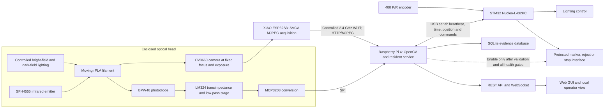
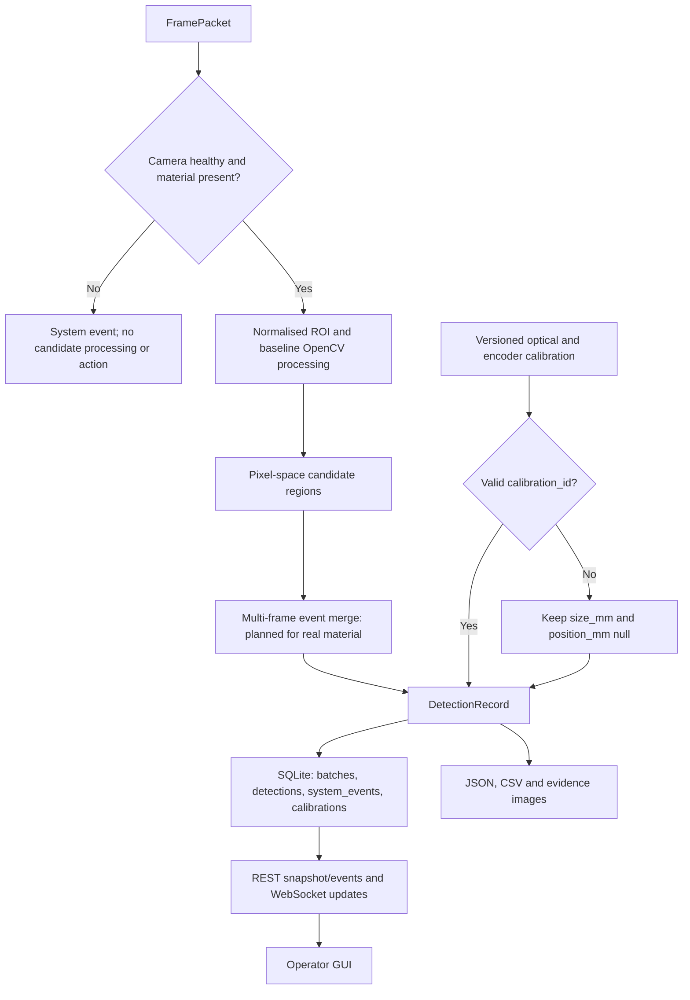

# 5. Functional Design and Specifications

Plan B turns the inspection task into two linked but deliberately unequal measurement paths. The camera path supplies spatial evidence about visible candidate regions. The auxiliary infrared path answers a narrower question: is material present, and is the optical head behaving plausibly? A candidate may be recorded only when acquisition is healthy; an automatic marker or stop request needs the stronger conjunction of healthy acquisition, valid calibration, confirmed material presence, a validated event rule, and an enabled output. This boundary is central to the design. A bright contour is not a defect simply because software can draw a box around it.

The selected hardware is the university-supplied XIAO ESP32S3 Sense with OV3660, Raspberry Pi 4 and STM32 Nucleo-L432KC [4]. Their proposed roles follow workload and failure-containment needs rather than nominal processor capability. The ESP32S3 is allocated image acquisition and compression, the Pi is allocated non-deterministic vision and data services, and the STM32 is allocated time-critical I/O supervision. Manufacturer documents support these platform capabilities, but they are neither application benchmarks nor evidence of completed Pi/STM32 deployment [18]–[22].

## 5.1 End-to-end functional architecture

**Figure 1. Proposed Plan B hardware, data and inhibited-action architecture.**

Figure 1 places the current Windows-developed vision/service functions in their intended Pi role and separates them from the proposed STM32 action authority. The arrows describe the target integration baseline, not completed physical wiring.

The diagram also marks the action boundary. Raspberry Pi software may propose an event; under the proposed design, the STM32 will own the physical output and remove permission when heartbeat, encoder, lighting or communications health is lost. This is a safety-oriented laboratory control architecture, not a safety-certified machinery function. Any later connection to production equipment would require a machine risk assessment and safety-function design against the relevant framework, including ISO 13849-1, rather than relying on the prototype watchdog alone [24]. OT network segmentation and least-functionality principles would also apply [32].

The proposed requirements below remain `PROPOSED_REQUIREMENT`. The project brief establishes the need for laboratory-scale, online surface-quality monitoring [1], while the discipline guidance requires measurable specifications and verification [2]. No record supplied to this report shows that a stakeholder has approved the numerical thresholds. Table 8 assigns each requirement to functions and a verification route while retaining the present gap.

**Table 8. Functional allocation and verification status of the proposed requirements.**

| ID | Proposed target | Functional allocation | Verification and present status |
|---|---|---|---|
| R1 | Detect at least three visible surface-defect classes. | Optical head; OpenCV/event classifier; labelled database. | Independent real-rPLA event test. `PENDING_REAL_MATERIAL`; current boxes are candidates only. |
| R2 | Target defects with feature size at least 0.20 mm. | Fixed optics, pixel scale and event measurement. | Calibrated reference features at final working distance. `PENDING_REAL_MATERIAL`. |
| R3 | For R2 defects, achieve at least 90% precision and at least 90% recall. | Event logic, ground truth and evaluation scripts. | Held-out spool/segment/event evaluation; report confidence and F1. `PENDING_REAL_MATERIAL`. |
| R4 | Process at least 20 frames/s from 0–5 m/min. | Camera, Wi-Fi, newest-frame buffer and Pi vision. | Sustained final-fixture throughput at each test speed. Not met by the recorded 10.77 FPS SVGA integration result. |
| R5 | Raise an alarm within 500 ms after defect confirmation. | Timestamped event tracker, API/UI and STM32 output request. | Visible timing reference from scene through display/output. Existing brightness-step timing is only `LIVE_INTEGRATION_ONLY`. |
| R6 | Limit axial defect-position error to ±10 mm. | Encoder scale, time alignment and camera-to-marker offset. | Repeated known-position trials in both travel directions. `position_mm` remains null. |
| R7 | Store type, size, confidence, image, position, time and batch identifier. | `DetectionRecord`, SQLite, image store and export. | Schema/round-trip test, then calibrated record audit. Structure exists; physical fields remain null. |
| R8 | Operate for 30 min with less than 1% record loss. | Resident service, SQLite transaction path and health log. | Reconcile source frames/events/database/export during a 30 min final-hardware run. Not yet tested as a full requirement. |
| R9 | Enter a safe hold or fault state after camera, light, encoder or processor failure. | Pi health gate, STM32 watchdog and protected output. | Hardware fault injection with the final wiring. Software/network evidence exists, but safe I/O remains pending. |
| R10 | Image only the filament inside an enclosed inspection region and store data locally by default. | Shrouded optical head, bounded ROI and Pi-local database. | Fixture inspection, field-of-view privacy check and storage/access audit. Local storage is implemented; final enclosure is pending [25], [33]. |

## 5.2 Optical head and camera specification

Although the OV3660 can expose larger frames, the project needs a stable operating point rather than the largest datasheet mode. SVGA 800 × 600 is therefore fixed as the Plan B live profile; VGA 640 × 480 remains a manual recovery option, and XGA or larger modes are outside the selected operating configuration. The active normalised ROI maps at SVGA to `(254, 47, 195, 527)`. Its position is provisional until the fixture and filament establish the true optical axis. OV3660 rolling-shutter readout, JPEG compression and wireless transport can introduce motion or timing artefacts, so exposure duration, line speed and candidate persistence must be tested together [18], [19].

The proposed head uses a rigid camera bracket, repeatable filament guides, a matte background and an external shroud. Working distance, focus and exposure will be locked after calibration. Switchable bright-field illumination is intended to reveal colour or texture contrast; low-angle dark-field illumination is intended to make surface relief more conspicuous. The modes are experimental variables, not proof that any particular anomaly is detectable. Industrial anomaly datasets also show why appearance changes and view geometry must be represented in validation rather than hidden by one convenient image condition [10]–[12].

One camera observes only the visible arc of the cylindrical filament. It does not provide full 360-degree coverage. A mirror or later multi-view arrangement may be evaluated only if blind-side misses dominate the Week 5+ evidence; adding it would require a new optical calibration. The head will include a scale target and dark/white references that can be inserted without moving the camera. No minimum physical defect size, surface roughness value or internal-void measurement is attributed to this optical design.

## 5.3 Auxiliary photodiode chain

The SFH4555 emits across the filament path and the BPW46 supplies a photocurrent that varies with received irradiance. The LM324 stage converts that current to a voltage and limits high-frequency noise before the MCP3208 digitises it. At the proposal stage, the first transimpedance estimate is

\[
R_f=\frac{V_{span}}{I_{PD}},
\]

where \(I_{PD}\) is the photocurrent measured in the final geometry and \(V_{span}\) is the usable output swing. With feedback capacitance \(C_f\), the approximate low-pass corner is

\[
f_c=\frac{1}{2\pi R_f C_f}.
\]

Numerical values for \(R_f\), \(C_f\), LED current and decision thresholds cannot be frozen before the optical head is assembled. The provisional design constraints are nevertheless explicit. M3 will choose the transimpedance gain so the measured path-state range occupies approximately 10–80% of the ADC input range without clipping, then select \(C_f\) so the measured step response remains at least five times faster than the fastest material-presence transition while attenuating observed high-frequency noise. LED drive will be current-limited below the manufacturer's continuous rating and checked at the measured enclosure temperature. Dark, clear-path, normal-filament, blocked-path and misaligned-filament distributions will set a threshold with a recorded guard band at G3. A valid auxiliary state can gate inspection or flag optical degradation; it cannot localise a scratch, classify contamination or estimate feature size.

## 5.4 Raspberry Pi processing, provenance and storage

The planned Pi deployment preserves the source-independent Week 3 contracts rather than replacing them. `FramePacket` carries the image, frame number, acquisition/receipt times, camera source and connection state. A `DetectionRecord` carries a candidate label, pixel bounding box, pixel area, algorithm score, provisional grade and batch context. The SQLite schema contains `batches`, `detections`, `system_events` and `calibrations`. These boundaries make later algorithm changes auditable and fit the edge-computing role described in current industrial vision work [15].

**Figure 2. Health-gated candidate-processing and evidence-record flow.**

Figure 2 shows where health, calibration and provenance can prevent a pixel-space candidate from acquiring unsupported physical meaning.

The Windows development baseline uses a configurable threshold of 145, minimum area of 120 px and an enabled material-presence gate (Appendix A, IE5 and IE7). These are prototype parameters. The gate presently expects a dark target through 80% of the ROI height; it prevents a nearby hand or small background object from starting inspection, but must be retuned with rPLA. A one-frame latest buffer discards backlog so delayed images do not queue into false spatial decisions. Multi-frame merging will convert repeated frame candidates into event candidates only after representative material exists.

The data rule is strict: without a valid `calibration_id`, `size_mm` and `position_mm` remain null. Synthetic records carry `OFFLINE_SYNTHETIC_ONLY`; live camera candidates carry `LIVE_INTEGRATION_ONLY`. Neither label permits a physical defect name or performance claim.

## 5.5 STM32 supervision and safe I/O

The proposed STM32 firmware will count the 400 pulse/revolution encoder, timestamp position updates, check Pi heartbeat, switch lighting through a protected driver, and own the marker/reject/stop demonstrator output [22]. These functions have not yet been demonstrated on physical STM32 wiring. If quadrature decoding uses four edges, the theoretical scale is 1600 counts/revolution. For measured effective wheel circumference \(C\),

\[
k_e=\frac{1600}{C}\;\text{counts/mm}, \qquad q_e=\frac{C}{1600}\;\text{mm/count}.
\]

No value is assigned to \(C\). Wheel slip, eccentricity, preload and the camera-to-marker offset must be measured; encoder resolution alone cannot justify R6.

**Figure 3. Proposed acquisition-health states and output-inhibition behaviour.**

```mermaid
stateDiagram-v2
    [*] --> CONNECTING
    CONNECTING --> HEALTHY: three consecutive valid frames
    HEALTHY --> STALE: no frame for 1 s
    STALE --> DISCONNECTED: no frame for 2 s
    DISCONNECTED --> RECONNECTING: reconnect requested
    RECONNECTING --> HEALTHY: three consecutive valid frames
    RECONNECTING --> DISCONNECTED: connection attempt fails
    HEALTHY --> HEALTHY: material gate false; wait without inspection
    note right of HEALTHY
      Output remains inhibited unless material,
      calibration, event and watchdog gates also pass.
    end note
    note right of STALE
      Candidate processing and automatic action are false.
    end note
    note right of DISCONNECTED
      STM32 holds the protected output safe.
    end note
```

Figure 3 defines the proposed recovery qualification and the states in which candidate processing or physical output remains inhibited.

Recovery does not replay old frames. Three consecutive valid frames are required before processing resumes, and a Pi restart or heartbeat loss clears output permission. Manual acknowledgement should be required before re-enabling any automatic demonstrator after a latched hardware fault. If the web interface fails while the STM32 remains alive, the operator loses visibility but the proposed watchdog and output inhibition remain local to the control path.

## 5.6 Communications, API and user interface

Table 9 distinguishes implemented transport from proposed hardware interfaces; Table 10 then fixes the Windows development API used by the present GUI evidence.

**Table 9. Plan B subsystem communications and integrity rules.**

| Interface | Payload and present/planned mode | Integrity, timing and recovery rule |
|---|---|---|
| OV3660/ESP32S3 → Pi | HTTP multipart MJPEG over controlled 2.4 GHz Wi-Fi; SVGA 800 × 600. | Resident service is the only direct MJPEG client. Read/open timeout and reconnect logic gate processing; rate is measured, not assumed. |
| Pi ↔ STM32 | Proposed USB serial baseline: 115200 bit/s, 8-N-1; framed monotonic sequence, millisecond timestamp, encoder count, health bitmask, lighting command and output request. | `PROPOSED_INTERFACE`: CRC-16 per frame and 10 Hz heartbeat; three invalid/missing heartbeats or more than 300 ms without a valid frame inhibits output. M5 verifies and freezes the values during G2/G3 fault tests. |
| MCP3208 → Pi | Proposed SPI sample with channel identity, sequence and timestamp; initial bench rate 200 samples/s per active channel. | `PROPOSED_INTERFACE`: final rate must remain at least ten times the fastest measured presence transition; stale/out-of-range values create an optical-health fault. M3 sets thresholds from the five-state distributions at G3. |
| STM32 → local LCD | I2C summary of system health and safe-output state. | Diagnostic only; it does not override the web/database record. |
| Pi → browser | REST and WebSocket over the local Ethernet/Wi-Fi network. | Local-by-default access; the UI must show disconnection and last update, not silently freeze [25], [33]. |
| Future plant link | MQTT or Modbus TCP/RTU is an option, not part of the validated baseline. | Requires an interface-control revision, OT security review and separate acceptance [32], [34]. |

The implemented Windows development service listens on port 8765 (Appendix A, IE6). Its current API contract is explicit:

**Table 10. Implemented development-service API contract.**

| Method and endpoint | Response or action | GUI use |
|---|---|---|
| `GET /api/health` | Acquisition, processing, gate and evidence state. | Health banner and diagnostics. |
| `GET /api/snapshot` | Current summary plus candidate records. | Initial page state and resynchronisation. |
| `GET /api/events?limit=` | Bounded event history for the active batch. | Event table and export preparation. |
| `POST /api/events/delete` | Deletes selected record identifiers and returns a refreshed snapshot. | Auditable operator clean-up; not automatic grading. |
| `GET /api/frame.jpg` | Latest annotated JPEG, or 503 before a frame is available. | Single-frame view. |
| `GET /api/stream.mjpg` | Shared annotated MJPEG output. | Live view without another direct camera client. |
| `POST /api/control/reconnect` | Requests camera recovery. | Manual recovery control. |
| `WS /ws` | Pushes changed snapshots. | Low-delay health and event updates. |

These endpoints are Windows-host implementation evidence. Deployment and start-up persistence on Raspberry Pi, the USB serial contract and physical STM32 I/O remain planned.

The GUI should let an operator understand the chain at a glance: camera and material-gate health, evidence label, live ROI, candidate overlays, frame rate, post-decode-to-GUI latency, batch and calibration identifiers, Pi/STM32/encoder/lighting states, event history and export. Pixel measurements are shown before calibration. Physical size and position remain blank, and candidate status must not be presented as a validated quality grade. The local LCD carries only a small health summary so that loss of the browser does not look like loss of the controller.

## 5.7 Power budget and protection

The proposal separates computing from lighting and switched loads. Table 11 allocates the 5.1 V computing domain, while Table 12 allocates the 12 V auxiliary domain. Both are team values for sizing and protection, not measured consumption or manufacturer-declared application loads [2], [4], [21], [22]. The Pi and STM32 figures bound the intended service and USB load; the auxiliary figures allocate the proposed camera, analogue, lighting, encoder and marker branches. M3 will replace each allocation with start-up and steady-state current evidence at G2 before fuse and conductor selection is released.

**Table 11. Proposed 5.1 V Raspberry Pi-domain power allocation.**

| 5.1 V Raspberry Pi domain load | Normal | Peak |
|---|---:|---:|
| Raspberry Pi 4 | 7.50 W | 12.50 W |
| STM32 Nucleo via USB | 0.25 W | 0.50 W |
| **Domain total** | **7.75 W** | **13.00 W** |

A 5.1 V, 3 A supply provides \(P_{available}=5.1\times3=15.3\ \text{W}\). The allocated peak margin is

\[
M_{Pi}=\frac{15.3-13.0}{15.3}\times100=15.0\%.
\]

**Table 12. Proposed 12 V auxiliary-domain power allocation.**

| 12 V auxiliary-domain load | Normal | Peak | Path |
|---|---:|---:|---|
| ESP32S3 Sense + OV3660 | 1.50 W | 2.50 W | 12 V to regulated 5 V |
| IR/analogue/LCD electronics | 0.40 W | 0.80 W | 12 V to regulated 5 V |
| Controlled lighting | 8.00 W | 12.00 W | 12 V branch |
| Encoder | 0.50 W | 1.20 W | Rated branch after component confirmation |
| Marker/servo demonstrator | 0 W | 5.00 W | Protected switched branch |

Assuming 85% conversion efficiency for the 5 V loads,

\[
P_{12V,normal}=\frac{1.50+0.40}{0.85}+8.00+0.50=10.74\ \text{W},
\]

\[
P_{12V,peak}=\frac{2.50+0.80}{0.85}+12.00+1.20+5.00=22.08\ \text{W}.
\]

A regulated 12 V, 3 A source supplies 36 W, leaving

\[
M_{12V}=\frac{36-22.08}{36}\times100=38.7\%.
\]

Peak allocation is not the final electrical design. Week 5+ tests must capture start-up inrush, steady current, Pi undervoltage logs and regulator temperature before fuse, conductor and connector ratings are frozen. Each domain receives branch fusing, reverse-polarity protection and labelled isolation. Switched inductive loads require flyback suppression, lighting requires a rated transistor/MOSFET driver, and signal returns meet at a controlled ground point. The Pi supply must never source the marker/servo.

# 6. Current Integration Evidence and Limitations

Current work materially reduces integration risk, but it answers a different question from defect validation. Table 13 records what happened under the documented conditions and, just as importantly, what cannot follow from it.

**Table 13. Current integration evidence, permitted inferences and claim boundaries.**

| Evidence and label | Exact recorded observation | Allowed inference | Does not establish |
|---|---|---|---|
| `WEEK4_OFFLINE_IMPLEMENTATION.md`: historical OV3660 link, `LIVE_INTEGRATION_ONLY` (Appendix A, IE4) | At 640 × 480, 792 frames arrived in 30.056 s, giving 26.35 FPS in the hardware integration test. | Physical camera identity, MJPEG connectivity and source-adapter operation. | Final SVGA throughput or any rPLA result. |
| `RESOLUTION_TEST_RESULTS_2026-08-11.md`: resolution screen, `LIVE_INTEGRATION_ONLY` (Appendix A, IE1) | VGA recent window ≈10.48 FPS; SVGA windows 14.74, 15.60 and 13.96 FPS plus 10.77 FPS over a sustained 30 s test; XGA windows 9.72, 7.51 and 9.42 FPS. Reported drops were 0. SVGA 800 × 600 was selected. | A reproducible operating profile and an exposed throughput constraint under the recorded no-filament condition. | R4, usable line speed, clarity or defect sensitivity. |
| `LIVE_PATH_TEST_RESULTS_2026-08-11.md`: brightness-step path, `LIVE_INTEGRATION_ONLY` (Appendix A, IE2) | Ten reversible transitions gave 101.32 ms median, 222.99 ms P95, 87.12 ms minimum and 222.99 ms maximum. Brightness returned to 1; service state remained `HEALTHY`. | Camera-control request → OV3660 → Wi-Fi MJPEG → Python processing → local API JPEG response in that test. | Sensor-exposure-to-browser-paint latency or R5. |
| `LIVE_PATH_TEST_RESULTS_2026-08-11.md`: network fault, `LIVE_INTEGRATION_ONLY` (Appendix A, IE2) | Scoped outbound blocking to camera `172.20.10.2` was recognised in 654.64 ms as `RECONNECTING`; detection and automatic action were `false`; a 4 s hold added 0 frames; recovery to `HEALTHY` took 5689.35 ms; the firewall rule was removed. | The tested Windows path gated processing and recovered from this injected fault. | Final Pi/Wi-Fi reliability, STM32 wiring or certified safe action. |
| `WEEK3_OFFLINE_IMPLEMENTATION.md`: Week 3 contracts, `OFFLINE_SYNTHETIC_ONLY` (Appendix A, IE3) | `FramePacket` → `BaselineVisionProcessor` → `DetectionRecord` → SQLite/JSON/CSV/annotated frames; physical fields are rejected without `calibration_id`. | Data-flow, provenance and null-field safeguards operate on repeatable synthetic inputs. | Classification of real bubbles, pits, scratches, cracks, contamination or inclusions. |
| `WEEK4_OFFLINE_IMPLEMENTATION.md`: Week 4 fault policy, `OFFLINE_FAULT_INJECTION_ONLY` and live service evidence (Appendix A, IE4) | Buffer capacity is 1; no frame for 1 s produces `STALE`; no frame for 2 s produces `DISCONNECTED`; three consecutive valid frames are required after reconnection. | Backlog suppression and health-gated candidate processing are implemented. | Full hardware safe-output behaviour or 30 min reliability. |

R4 is the clearest open design gap: 20 processed frames/s is proposed, whereas the sustained SVGA observation is 10.77 FPS. For line speed \(v\) and processed rate \(f\), axial travel between frames is \(\Delta x=v/f\). At 1, 3 and 5 m/min, the observed rate gives 1.55, 4.64 and 7.74 mm/frame; 20 FPS would give 0.83, 2.50 and 4.17 mm/frame. These values explain sampling exposure, not detectable feature size. Frame overlap, field of view, blur and event tracking still decide whether a feature can be observed.

The same restraint applies to timing. A 500 ms R5 alarm window corresponds to 8.33 mm of travel at 1 m/min and 41.67 mm at 5 m/min. The recorded 222.99 ms P95 maps mathematically to 18.58 mm at 5 m/min, but its measurement path lacks a sensor-exposure timestamp and browser-paint completion. We therefore do not use it as physical alarm-delay evidence.

# 7. Calibration and Validation Strategy

Physical rPLA and fixture materials are expected in Week 5 on Thursday. Until receipt and condition are confirmed, every application-performance item remains `PENDING_REAL_MATERIAL`. The method follows an evidence ladder: freeze geometry, calibrate measurement channels, tune only on separated development material, then evaluate once on independent units. Randomly splitting adjacent video frames would leak nearly identical appearances into training and test sets, inflating results [16], [17].

## 7.1 Week 5+ calibration sequence

On receipt, the team will identify each spool/segment and photograph the test fixture before moving any threshold. The camera mount, guides, working distance, focus, exposure, SVGA profile, ROI, background and bright-/dark-field settings are then frozen as one optical configuration. Dark and white references reveal saturation, drift and uneven illumination. A configuration hash and `calibration_id` link every later record to those choices.

Optical scale comes next. If a traceable reference of length \(L_{ref}\) spans \(P_{ref}\) pixels in the filament plane,

\[
s=\frac{L_{ref}}{P_{ref}}\;\text{mm/pixel}, \qquad L_{candidate}=sP_{candidate}.
\]

The scale will be repeated across the ROI and after remounting. Encoder calibration uses measured travel in both directions to estimate counts/mm, slip and repeatability; it also establishes Pi–STM32 timestamp alignment and camera-to-marker offset. Only records carrying valid optical and encoder calibration identifiers may populate `size_mm` or `position_mm`.

The auxiliary channel is calibrated last within the frozen head because its current depends on the same geometry. We will measure the five path states defined in Section 5.3, choose gain without saturation, set the low-pass corner from observed noise/dynamics, and retain raw ADC values beside the health decision. It remains a presence/health channel even if its signal correlates with a visible anomaly.

## 7.2 Dataset and event-level evaluation

Ground truth is attached to physical sampling units, not isolated frames. Normal and deliberately characterised anomalous segments will be labelled with class, axial location, physical extent where measurable, spool/batch, optical configuration and annotator decision. Spools, segments or complete events are assigned to development and independent test partitions before tuning. Difficult but foreseeable changes in material colour, surface gloss, speed, illumination level and camera remounting belong in the test matrix; real-world anomaly benchmarks caution against presenting one narrow acquisition domain as general performance [10]–[12].

Repeated boxes from the same moving region will be merged into one event using time and calibrated encoder overlap. For event counts \(TP\), \(FP\) and \(FN\),

\[
Precision=\frac{TP}{TP+FP},\qquad Recall=\frac{TP}{TP+FN},\qquad
F1=\frac{2\,Precision\,Recall}{Precision+Recall}.
\]

The report will pair these with false alarms per metre, misses by class and condition, and uncertainty or confidence intervals. Sample counts will be set after a pilot and stakeholder review; inventing a large target now would not make the future estimate more reliable. We will preserve all failed cases and freeze the independent test set before the final run.

## 7.3 Verification gates and decision rules

Table 14 converts R1–R10 into configuration-specific acceptance decisions and explicit responses to failure.

**Table 14. Planned verification gates and acceptance decisions.**

| Gate | Method and acceptance decision |
|---|---|
| Optical visibility: R1–R2 | Use calibrated references and independently labelled physical events at the fixed SVGA geometry. Accept only if at least three agreed visible classes and the proposed 0.20 mm target are demonstrated under declared conditions; otherwise revise optics or the requirement. |
| Classification: R3 | Score merged events on the untouched spool/segment/event partition. Both precision and recall must reach 90% for R2 events; F1 alone cannot conceal one failing measure. |
| Throughput and speed: R4 | Measure received, decoded, processed and accepted-frame rates separately at 0–5 m/min, with jitter, stalls and reconnects. If SVGA remains below 20 FPS, optimise capture/ROI/algorithm or formally revise R4 with stakeholder approval. The 10.77 FPS result cannot be relabelled as compliance. |
| Alarm path: R5 | Film a visible LED or millisecond clock with the scene and display/output indication, then derive sensor-to-GUI and sensor-to-output distributions. P95 must be within the proposed 500 ms window after the event-confirmation rule is fixed. |
| Position: R6 | Place references at known axial positions, run forward and reverse trials across speeds, and include wheel slip plus camera-to-marker offset. Accept only if absolute error remains within ±10 mm under the declared test range. |
| Records and endurance: R7–R8 | Reconcile source/event counts against SQLite, images and exports during a 30 min run. Audit required fields and calibration links; record loss must remain below 1%. |
| Fault safety: R9 | Disconnect camera, block/attenuate lighting, interrupt encoder and serial messages, stop the Pi service, and exercise watchdog timeout on real wiring. Every case must inhibit automatic output and create a timestamped fault; recovery requires valid health and acknowledgement where latched. |
| Privacy and enclosure: R10 | Inspect the full field of view, enclosure and local storage/access configuration. No person or area outside the filament tunnel should be intentionally imaged, and external publication remains disabled by default [25], [33]. |

Acceptance is configuration-specific. A change to camera position, lens/focus, exposure, illumination geometry, ROI, encoder wheel, event logic or model invalidates the affected calibration and triggers regression tests under the project lifecycle record [34]. We will release a physical claim only when its requirement, calibration identifier, independent dataset, raw result and limitation are all traceable. Until then, the system remains a well-instrumented candidate detector with bounded integration evidence, not a validated rPLA quality monitor.
