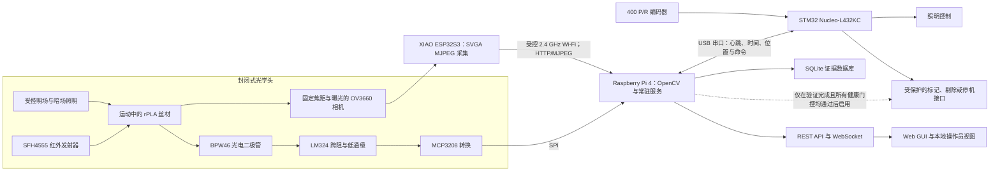
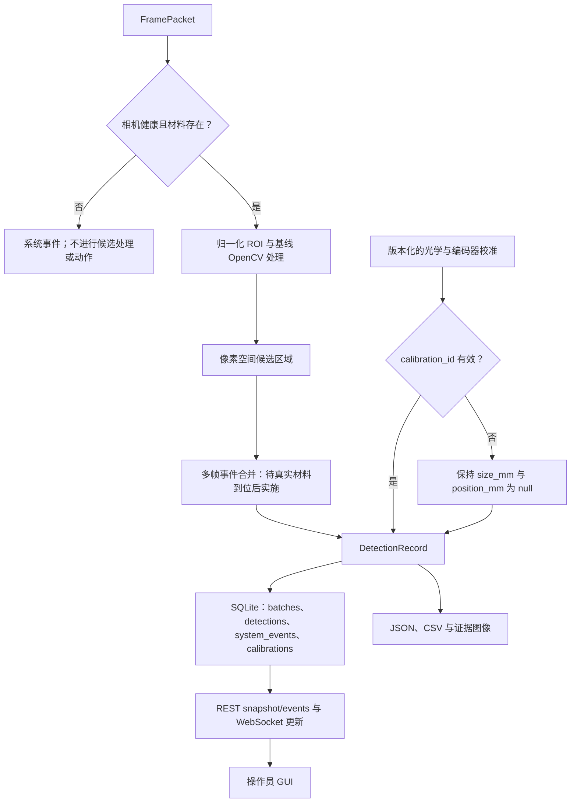
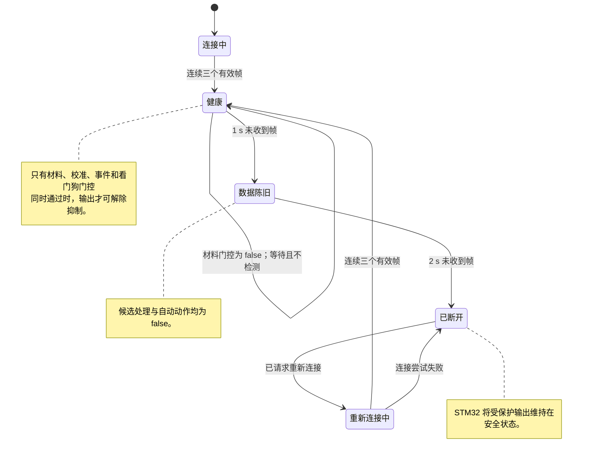

# 5. 功能设计与技术规格

方案 B 将检测任务分为两条彼此关联、却有意承担不同证据强度的测量路径。相机路径提供可见候选区域的空间证据；辅助红外路径只回答一个更窄的问题：材料是否存在，以及光学头的工作状态是否合理。只有采集状态健康时，系统才可记录候选对象。若要发出自动标记或停机请求，则必须同时满足更严格的条件：采集健康、校准有效、材料存在已确认、事件规则经过验证，并且输出已启用。这一道边界构成设计核心。软件能够在明亮轮廓外画出边界框，并不意味着它就是缺陷。

选定硬件为学校提供的 XIAO ESP32S3 Sense（配 OV3660）、Raspberry Pi 4 和 STM32 Nucleo-L432KC [4]。这些拟议角色依据工作负载与故障隔离需求划分，而非仅按处理器的标称能力确定：ESP32S3 被分配图像采集与压缩任务，Pi 被分配非确定性视觉和数据服务，STM32 被分配时间关键型 I/O 监管任务。制造商文档能够支持这些平台能力，但既不是应用性能基准，也不能证明 Pi/STM32 部署已经完成 [18]–[22]。

## 5.1 端到端功能架构

**图 1. 拟议方案 B 的硬件、数据及动作抑制架构。**

图 1 将当前在 Windows 上开发的视觉/服务功能置于其拟议的 Pi 角色中，并将其与拟议由 STM32 掌握的动作权限分开。图中的箭头描述目标集成基线，并不表示物理布线已经完成。

图中也明确了动作边界。Raspberry Pi 软件可以提出事件，但物理输出归 STM32 所有；一旦心跳、编码器、照明或通信健康状态丢失，后者便撤销输出许可。这是一种面向安全的实验室控制架构，不是经过安全认证的机械功能。未来若接入生产设备，必须依据相关框架开展机械风险评估与安全功能设计，其中包括 ISO 13849-1，不能只依赖原型看门狗 [24]。OT 网络分段和最小功能原则同样适用 [32]。

下列拟议要求仍标记为 `PROPOSED_REQUIREMENT`。项目任务书确立了实验室尺度在线表面质量监测的需求 [1]，专业指导则要求给出可测量的规格及验证方法 [2]。本报告收到的记录中，没有任何材料表明利益相关方已经批准这些数值阈值。表 8 将每项要求分配给相应功能及验证路径，同时保留当前缺口。

**表 8. 拟议要求的功能分配与验证状态。**

| ID | 拟议目标 | 功能分配 | 验证方式与当前状态 |
|---|---|---|---|
| R1 | 至少检测三类可见表面缺陷。 | 光学头；OpenCV/事件分类器；标注数据库。 | 独立的真实 rPLA 事件测试。`PENDING_REAL_MATERIAL`；当前边界框仅代表候选对象。 |
| R2 | 目标缺陷的特征尺寸至少为 0.20 mm。 | 固定光学系统、像素尺度和事件测量。 | 在最终工作距离下使用校准参考特征。`PENDING_REAL_MATERIAL`。 |
| R3 | 对 R2 缺陷，精确率至少达到 90%，召回率至少达到 90%。 | 事件逻辑、真实标注与评估脚本。 | 在留出的线轴/区段/事件上评估；报告置信度与 F1。`PENDING_REAL_MATERIAL`。 |
| R4 | 在 0–5 m/min 范围内至少处理 20 帧/秒。 | 相机、Wi-Fi、最新帧缓冲区与 Pi 视觉处理。 | 在每个测试速度下测量最终夹具的持续吞吐量。已记录的 10.77 帧/秒 SVGA 集成结果不满足该要求。 |
| R5 | 缺陷确认后 500 ms 内发出警报。 | 带时间戳的事件跟踪器、API/UI 与 STM32 输出请求。 | 使用可见计时参考，测量从场景到显示/输出的时间。现有亮度阶跃计时仅为 `LIVE_INTEGRATION_ONLY`。 |
| R6 | 将缺陷轴向位置误差限制在 ±10 mm。 | 编码器尺度、时间对齐及相机到标记器的偏移。 | 在两个行进方向上重复进行已知位置试验。`position_mm` 仍为 null。 |
| R7 | 存储类型、尺寸、置信度、图像、位置、时间和批次标识符。 | `DetectionRecord`、SQLite、图像存储与导出。 | 先进行模式/往返测试，再审计已校准记录。结构已经存在；物理字段仍为 null。 |
| R8 | 运行 30 min，记录丢失率低于 1%。 | 常驻服务、SQLite 事务路径和健康日志。 | 在 30 min 最终硬件运行中核对源帧/事件/数据库/导出。尚未作为完整要求进行测试。 |
| R9 | 相机、照明、编码器或处理器故障后进入安全保持或故障状态。 | Pi 健康门控、STM32 看门狗和受保护输出。 | 使用最终布线进行硬件故障注入。已有软件/网络证据，安全 I/O 仍待验证。 |
| R10 | 仅拍摄封闭检测区域内的丝材，数据默认存储在本地。 | 遮光光学头、受限 ROI 和 Pi 本地数据库。 | 检查夹具、视场隐私及存储/访问。已实现本地存储；最终外壳仍待完成 [25], [33]。 |

## 5.2 光学头与相机规格

尽管 OV3660 可以输出更大的画幅，项目所需的是稳定工作点，而非数据手册中尺寸最大的模式。因此，方案 B 的实时配置固定为 SVGA 800 × 600；VGA 640 × 480 仅作为手动恢复选项，XGA 或更大模式不属于选定的运行配置。当前归一化 ROI 在 SVGA 下映射为 `(254, 47, 195, 527)`。在夹具和丝材确定真实光轴之前，这一位置只是暂定值。OV3660 的卷帘快门读出、JPEG 压缩和无线传输都可能引入运动或时序伪影，因而需要把曝光时长、线速度与候选持续性放在同一组试验中考察 [18], [19]。

拟议光学头采用刚性相机支架、可重复定位的丝材导向件、哑光背景与外部遮光罩。校准完成后，工作距离、焦点和曝光将被锁定。可切换的明场照明用于呈现颜色或纹理对比；低角度暗场照明则用于增强表面起伏的可见性。两种模式都是实验变量，不能据此证明某一特定异常必然可检测。工业异常数据集也说明，验证必须覆盖外观变化和观察几何，而不能让单一便利的成像条件掩盖这些因素 [10]–[12]。

单台相机只能观察圆柱形丝材的可见弧面，无法覆盖完整的 360°圆周。只有当第5周及以后的证据显示背面漏检占主导时，才会评估反射镜或后续多视角布置；一旦加入，必须重新进行光学校准。光学头将配备比例尺靶标以及无需移动相机即可插入的暗参考和白参考。本光学设计不声称具备任何最小物理缺陷尺寸、表面粗糙度数值或内部空洞测量能力。

## 5.3 辅助光电二极管链路

SFH4555 沿丝材路径发射红外光，BPW46 输出随接收辐照度变化的光电流。LM324 级将该电流转换为电压，并在 MCP3208 数字化之前抑制高频噪声。在方案阶段，初始跨阻估算为

\[
R_f=\frac{V_{span}}{I_{PD}},
\]

其中，\(I_{PD}\) 是在最终几何条件下测得的光电流，\(V_{span}\) 为可用输出摆幅。引入反馈电容 \(C_f\) 后，近似低通截止频率为

\[
f_c=\frac{1}{2\pi R_f C_f}.
\]

光学头完成装配之前，\(R_f\)、\(C_f\)、LED 电流和判定阈值的数值不能冻结。不过，暂定设计约束已经明确。M3 将选择跨阻增益，使实测路径状态范围在不削顶的前提下约占 ADC 输入范围的 10–80%；随后选取 \(C_f\)，在衰减已观测高频噪声的同时，使实测阶跃响应速度至少达到最快材料存在状态跃迁的五倍。LED 驱动电流将被限制在制造商的连续额定值以下，并在实测外壳温度下复核。暗态、通光路径、正常丝材、阻断路径及丝材偏位五种分布将在 G3 用于设定带有记录保护裕量的阈值。有效的辅助状态可以对检测进行门控，也可提示光学性能退化；它不能定位划痕、对污染物分类或估计特征尺寸。

## 5.4 Raspberry Pi 处理、溯源与存储

规划中的 Pi 部署保留与数据源无关的第3周契约，而不是将其替换。`FramePacket` 携带图像、帧号、采集/接收时间、相机数据源及连接状态。`DetectionRecord` 则包含候选标签、像素边界框、像素面积、算法分数、暂定等级和批次上下文。SQLite 模式包含 `batches`、`detections`、`system_events` 和 `calibrations`。这些边界使后续算法变化可以审计，也契合当前工业视觉研究所描述的边缘计算角色 [15]。

**图 2. 健康状态门控的候选处理与证据记录流程。**

图 2 表明，健康状态、校准与溯源信息能够在哪些环节阻止像素空间候选对象获得没有证据支持的物理含义。

Windows 开发基线采用可配置阈值 145、最小面积 120 px，并启用材料存在门控（附录 A，IE5 和 IE7）。这些都属于原型参数。现有门控要求深色目标贯穿 ROI 高度的 80%；它能阻止邻近的手或小型背景物体启动检测，但仍须用 rPLA 重新调参。容量为一帧的最新帧缓冲区会丢弃积压，避免延迟图像排队并造成错误的空间判断。只有取得代表性材料后，多帧合并才会把多个重复帧候选转换为事件候选。

数据规则很严格：没有有效 `calibration_id` 时，`size_mm` 与 `position_mm` 必须保持 null。合成记录使用 `OFFLINE_SYNTHETIC_ONLY`，实时相机候选使用 `LIVE_INTEGRATION_ONLY`。任何一种标签都不允许赋予物理缺陷名称，也不能支持性能声明。

## 5.5 STM32 监管与安全 I/O

拟议的 STM32 固件将对 400 脉冲/转编码器计数，为位置更新添加时间戳，检查 Pi 心跳，通过受保护驱动器切换照明，并掌控标记/剔除/停机演示器输出 [22]。这些功能尚未在 STM32 物理布线上得到演示。若正交解码采用四倍频边沿，理论尺度为 1600 计数/转。对于实测有效轮周长 \(C\)，

\[
k_e=\frac{1600}{C}\;\text{counts/mm}, \qquad q_e=\frac{C}{1600}\;\text{mm/count}.
\]

这里不为 \(C\) 赋值。轮体打滑、偏心、预载荷及相机到标记器的偏移均须实测；只凭编码器分辨率不足以证明 R6。

**图 3. 拟议采集健康状态与输出抑制行为。**

图 3 定义了拟议的恢复资格判据，以及候选处理或物理输出必须保持受抑制的状态。

恢复时不会重放旧帧。系统必须连续收到三个有效帧才恢复处理；Pi 重启或心跳丢失都会清除输出许可。锁存硬件故障发生后，任何自动演示器重新启用之前都应要求人工确认。若 Web 界面在 STM32 仍运行时失效，操作员会失去可视信息，但拟议的看门狗和输出抑制仍保留在本地控制路径中。

## 5.6 通信、API 与用户界面

表 9 区分了已经实现的传输方式与拟议硬件接口；表 10 则固定当前 GUI 证据所用的 Windows 开发 API。

**表 9. 方案 B 子系统通信与完整性规则。**

| 接口 | 载荷与当前/计划模式 | 完整性、时序与恢复规则 |
|---|---|---|
| OV3660/ESP32S3 → Pi | 通过受控 2.4 GHz Wi-Fi 传输 HTTP multipart MJPEG；SVGA 800 × 600。 | 常驻服务是唯一直接 MJPEG 客户端。读取/打开超时与重连逻辑对处理进行门控；速率必须测量，不能假定。 |
| Pi ↔ STM32 | 拟议 USB 串口基线：115200 bit/s，8-N-1；带帧封装的单调递增序号、毫秒时间戳、编码器计数、健康位掩码、照明命令和输出请求。 | `PROPOSED_INTERFACE`：每帧采用 CRC-16，并使用 10 Hz 心跳；出现三个无效/缺失心跳，或超过 300 ms 未收到有效帧时，必须抑制输出。M5 在 G2/G3 故障测试期间验证并冻结这些数值。 |
| MCP3208 → Pi | 拟议 SPI 采样，包含通道标识、序号和时间戳；初始台架速率为每个活动通道 200 samples/s。 | `PROPOSED_INTERFACE`：最终速率必须保持为实测最快材料存在状态跃迁的至少十倍；陈旧/超范围值会触发光学健康故障。M3 在 G3 根据五种状态分布设定阈值。 |
| STM32 → 本地 LCD | 通过 I2C 显示系统健康与安全输出状态摘要。 | 仅供诊断；不能覆盖 Web/数据库记录。 |
| Pi → 浏览器 | 通过本地 Ethernet/Wi-Fi 网络提供 REST 与 WebSocket。 | 默认仅限本地访问；UI 必须显示断连状态和最近更新时间，不能无提示地冻结 [25], [33]。 |
| 未来工厂链路 | MQTT 或 Modbus TCP/RTU 是可选方案，不属于已验证基线。 | 需要修订接口控制文件、开展 OT 安全审查并单独验收 [32], [34]。 |

已经实现的 Windows 开发服务监听端口 8765（附录 A，IE6）。当前 API 契约定义如下：

**表 10. 已实现的开发服务 API 契约。**

| 方法与端点 | 响应或动作 | GUI 用途 |
|---|---|---|
| `GET /api/health` | 采集、处理、门控与证据状态。 | 健康横幅与诊断。 |
| `GET /api/snapshot` | 当前摘要及候选记录。 | 页面初始状态与重新同步。 |
| `GET /api/events?limit=` | 当前批次的有界事件历史。 | 事件表与导出准备。 |
| `POST /api/events/delete` | 删除选定的记录标识符，并返回刷新后的 snapshot。 | 可审计的操作员清理；不用于自动分级。 |
| `GET /api/frame.jpg` | 最新标注 JPEG；若尚无可用帧则返回 503。 | 单帧视图。 |
| `GET /api/stream.mjpg` | 共享的标注 MJPEG 输出。 | 实时视图，无需增加另一个直接相机客户端。 |
| `POST /api/control/reconnect` | 请求相机恢复。 | 手动恢复控制。 |
| `WS /ws` | 推送发生变化的 snapshots。 | 低延迟健康与事件更新。 |

这些端点是 Windows 主机上的实现证据。Raspberry Pi 上的部署与启动持久化、USB 串口契约及 STM32 物理 I/O 仍处于规划阶段。

GUI 应让操作员一眼看清整条链路：相机和材料门控健康状态、证据标签、实时 ROI、候选叠加框、帧率、解码后到 GUI 的延迟、批次与校准标识符、Pi/STM32/编码器/照明状态、事件历史及导出。校准前仅显示像素测量值。物理尺寸和位置必须留空，候选状态也不得呈现为已经验证的质量等级。本地 LCD 只显示简要健康摘要，避免浏览器失效被误解为控制器失效。

## 5.7 功率预算与保护

本方案将计算设备与照明、开关负载分开。表 11 分配 5.1 V 计算域，表 12 分配 12 V 辅助域。两者均为团队用于容量选型与保护设计的数值，并非实测功耗或制造商声明的应用负载 [2], [4], [21], [22]。Pi 与 STM32 数值用于界定拟议服务及 USB 负载；辅助域数值则分配给拟议相机、模拟、照明、编码器和标记器支路。M3 将在 G2 以启动和稳态电流证据替换各项分配值，然后才发布熔断器与导线选型。

**表 11. 拟议 5.1 V Raspberry Pi 域功率分配。**

| 5.1 V Raspberry Pi 域负载 | 正常 | 峰值 |
|---|---:|---:|
| Raspberry Pi 4 | 7.50 W | 12.50 W |
| 通过 USB 供电的 STM32 Nucleo | 0.25 W | 0.50 W |
| **域总计** | **7.75 W** | **13.00 W** |

5.1 V、3 A 电源可提供 \(P_{available}=5.1\times3=15.3\ \text{W}\)。分配后的峰值裕量为

\[
M_{Pi}=\frac{15.3-13.0}{15.3}\times100=15.0\%.
\]

**表 12. 拟议 12 V 辅助域功率分配。**

| 12 V 辅助域负载 | 正常 | 峰值 | 路径 |
|---|---:|---:|---|
| ESP32S3 Sense + OV3660 | 1.50 W | 2.50 W | 12 V 转稳压 5 V |
| 红外/模拟/LCD 电子部件 | 0.40 W | 0.80 W | 12 V 转稳压 5 V |
| 受控照明 | 8.00 W | 12.00 W | 12 V 支路 |
| 编码器 | 0.50 W | 1.20 W | 元件确认后的额定支路 |
| 标记器/舵机演示器 | 0 W | 5.00 W | 受保护的开关支路 |

假定 5 V 负载的转换效率为 85%，则

\[
P_{12V,normal}=\frac{1.50+0.40}{0.85}+8.00+0.50=10.74\ \text{W},
\]

\[
P_{12V,peak}=\frac{2.50+0.80}{0.85}+12.00+1.20+5.00=22.08\ \text{W}.
\]

稳压 12 V、3 A 电源可提供 36 W，剩余裕量为

\[
M_{12V}=\frac{36-22.08}{36}\times100=38.7\%.
\]

峰值分配并不等同于最终电气设计。第5周及以后的测试必须记录启动浪涌、稳态电流、Pi 欠压日志与稳压器温度，之后才能确定熔断器、导线和连接器的额定值。每个电源域均设置支路熔断、反极性保护和带标签的隔离措施。开关感性负载需要续流抑制，照明须由额定晶体管/MOSFET 驱动器控制，各信号回流则在受控接地点汇合。Pi 电源绝不能为标记器/舵机供电。

# 6. 当前集成证据与局限

当前工作显著降低了集成风险，但它所回答的问题并不是缺陷验证。表 13 记录了既定条件下实际发生的情况，同样明确了哪些结论不能由此推出。

**表 13. 当前集成证据、允许推断与声明边界。**

| 证据与标签 | 准确记录的观察结果 | 允许作出的推断 | 无法证实的事项 |
|---|---|---|---|
| `WEEK4_OFFLINE_IMPLEMENTATION.md`：历史 OV3660 链路，`LIVE_INTEGRATION_ONLY`（附录 A，IE4） | 在 640 × 480 下，硬件集成测试于 30.056 s 内接收 792 帧，得到 26.35 FPS。 | 物理相机身份、MJPEG 连通性及数据源适配器运行。 | 最终 SVGA 吞吐量或任何 rPLA 结果。 |
| `RESOLUTION_TEST_RESULTS_2026-08-11.md`：分辨率筛选，`LIVE_INTEGRATION_ONLY`（附录 A，IE1） | VGA 近期窗口 ≈10.48 FPS；SVGA 窗口分别为 14.74、15.60 和 13.96 FPS，持续 30 s 测试为 10.77 FPS；XGA 窗口分别为 9.72、7.51 和 9.42 FPS。报告丢帧为 0。选定 SVGA 800 × 600。 | 在记录的无丝材条件下，得到可复现的运行配置，并暴露出吞吐量约束。 | R4、可用线速度、清晰度或缺陷敏感度。 |
| `LIVE_PATH_TEST_RESULTS_2026-08-11.md`：亮度阶跃路径，`LIVE_INTEGRATION_ONLY`（附录 A，IE2） | 十次可逆转换得到 101.32 ms 中位数、222.99 ms P95、87.12 ms 最小值和 222.99 ms 最大值。亮度恢复至 1；服务状态保持 `HEALTHY`。 | 该测试中的相机控制请求 → OV3660 → Wi-Fi MJPEG → Python 处理 → 本地 API JPEG 响应路径。 | 传感器曝光到浏览器绘制的延迟，或 R5。 |
| `LIVE_PATH_TEST_RESULTS_2026-08-11.md`：网络故障，`LIVE_INTEGRATION_ONLY`（附录 A，IE2） | 对相机 `172.20.10.2` 的出站连接实施限定范围阻断后，系统在 654.64 ms 内识别为 `RECONNECTING`；检测与自动动作均为 `false`；保持 4 s 期间新增帧数为 0；恢复至 `HEALTHY` 用时 5689.35 ms；防火墙规则随后被移除。 | 受测 Windows 路径对处理实施了门控，并从该注入故障中恢复。 | 最终 Pi/Wi-Fi 可靠性、STM32 布线或经认证的安全动作。 |
| `WEEK3_OFFLINE_IMPLEMENTATION.md`：第3周契约，`OFFLINE_SYNTHETIC_ONLY`（附录 A，IE3） | `FramePacket` → `BaselineVisionProcessor` → `DetectionRecord` → SQLite/JSON/CSV/标注帧；没有 `calibration_id` 时拒绝物理字段。 | 数据流、溯源及空字段保护可在可重复的合成输入上运行。 | 对真实气泡、凹坑、划痕、裂纹、污染或夹杂物进行分类。 |
| `WEEK4_OFFLINE_IMPLEMENTATION.md`：第4周故障策略，`OFFLINE_FAULT_INJECTION_ONLY` 与实时服务证据（附录 A，IE4） | 缓冲容量为 1；1 s 没有帧会产生 `STALE`；2 s 没有帧会产生 `DISCONNECTED`；重新连接后必须连续收到三个有效帧。 | 已实现积压抑制和由健康状态门控的候选处理。 | 完整硬件安全输出行为或 30 min 可靠性。 |

R4 是最明确的待解决设计缺口：拟议值为 20 处理帧/秒，而持续 SVGA 观测值仅为 10.77 帧/秒。设线速度为 \(v\)、处理速率为 \(f\)，相邻帧间的轴向移动距离为 \(\Delta x=v/f\)。按观测速率计算，在 1、3 和 5 m/min 时分别为 1.55、4.64 和 7.74 mm/帧；按 20 帧/秒计算，则分别为 0.83、2.50 和 4.17 mm/帧。这些数值解释的是采样暴露程度，不是可检测特征尺寸。一个特征能否被观察到，仍取决于帧重叠、视场、模糊程度及事件跟踪。

对计时也必须保持同样的约束。R5 的 500 ms 警报窗口在 1 m/min 下对应 8.33 mm 行程，在 5 m/min 下对应 41.67 mm。记录的 222.99 ms P95 在数学上可映射为 5 m/min 下的 18.58 mm，但该测量路径缺少传感器曝光时间戳和浏览器完成绘制的时间。因此，我们不把它用作物理警报延迟证据。

# 7. 校准与验证策略

预计物理 rPLA 和夹具材料将在第5周的星期四到位。在确认收货及材料状态之前，所有应用性能项目均保持 `PENDING_REAL_MATERIAL`。方法遵循一条证据阶梯：冻结几何条件，校准测量通道，只在相互分离的开发材料上调参，再对独立单元进行一次评估。若随机拆分相邻视频帧，几乎相同的外观会同时泄漏到训练集与测试集，进而夸大结果 [16], [17]。

## 7.1 第5周及以后的校准顺序

材料到位后，团队将在调整任何阈值之前识别每个线轴/区段，并拍摄测试夹具。随后把相机安装位、导向件、工作距离、焦点、曝光、SVGA 配置、ROI、背景以及明场/暗场设置冻结为一个光学配置。暗参考与白参考用于揭示饱和、漂移和照明不均。配置哈希和 `calibration_id` 将后续每条记录与这些选择关联起来。

下一步是光学尺度标定。若长度为 \(L_{ref}\) 的可溯源参考物在丝材平面内跨越 \(P_{ref}\) 个像素，则

\[
s=\frac{L_{ref}}{P_{ref}}\;\text{mm/pixel}, \qquad L_{candidate}=sP_{candidate}.
\]

该尺度将在整个 ROI 内重复测量，重新安装后也要复测。编码器校准通过双向实测行程估计 counts/mm、打滑量和重复性，同时建立 Pi–STM32 时间戳对齐及相机到标记器的偏移。只有同时携带有效光学与编码器校准标识符的记录，才允许填充 `size_mm` 或 `position_mm`。

辅助通道是已冻结光学头中的末项校准，因为其电流同样受该几何条件影响。我们会测量第5.3节定义的五种路径状态，选择不会饱和的增益，依据观测到的噪声/动态设置低通截止频率，并将原始 ADC 值与健康判定一并保留。即使其信号与某种可见异常相关，它仍只是材料存在/健康通道。

## 7.2 数据集与事件级评估

真实标注附着于物理采样单元，而非孤立帧。正常区段与经过有意表征的异常区段将按类别、轴向位置、可测时的物理范围、线轴/批次、光学配置和标注者判定进行标注。调参之前，线轴、区段或完整事件会被分配到开发分区与独立测试分区。材料颜色、表面光泽、速度、照明水平和相机重新安装等困难但可预见的变化均应纳入测试矩阵；真实世界异常基准提醒我们，不能把单一狭窄采集域呈现为通用性能 [10]–[12]。

来自同一运动区域的重复边界框将依据时间和校准后的编码器重叠合并为一个事件。对于事件计数 \(TP\)、\(FP\) 和 \(FN\)，

\[
Precision=\frac{TP}{TP+FP},\qquad Recall=\frac{TP}{TP+FN},\qquad
F1=\frac{2\,Precision\,Recall}{Precision+Recall}.
\]

报告还会同时给出每米误报数、按类别与条件划分的漏检情况，以及不确定度或置信区间。样本数量将在试点测试和利益相关方审查后确定；现在虚构一个很大的目标数，并不会让未来估计更可靠。我们会保留全部失败案例，并在最终运行前冻结独立测试集。

## 7.3 验证门槛与决策规则

表 14 将 R1–R10 转化为针对特定配置的验收判定，并明确规定失败后的应对措施。

**表 14. 规划中的验证门槛与验收判定。**

| 门槛 | 方法与验收判定 |
|---|---|
| 光学可见性：R1–R2 | 在固定 SVGA 几何条件下，使用校准参考物和独立标注的物理事件。只有在声明条件下证明至少三个一致认可的可见类别及拟议 0.20 mm 目标后才可验收；否则修改光学系统或要求。 |
| 分类：R3 | 在未接触的线轴/区段/事件分区上对合并事件评分。对于 R2 事件，精确率和召回率都必须达到 90%；不能仅用 F1 掩盖其中一项不合格。 |
| 吞吐量与速度：R4 | 在 0–5 m/min 下分别测量接收、解码、处理和验收帧率，同时记录抖动、停顿与重连。若 SVGA 仍低于 20 FPS，则优化采集/ROI/算法，或经利益相关方批准后正式修订 R4。不得把 10.77 FPS 结果改称为达标。 |
| 警报路径：R5 | 用场景中的可见 LED 或毫秒时钟与显示/输出指示共同拍摄，再推导传感器到 GUI 及传感器到输出的分布。事件确认规则冻结后，P95 必须位于拟议 500 ms 窗口内。 |
| 位置：R6 | 将参考物放置在已知轴向位置，在各速度下进行正向与反向试验，并计入轮体打滑及相机到标记器的偏移。仅当绝对误差在声明测试范围内始终不超过 ±10 mm 时方可验收。 |
| 记录与耐久性：R7–R8 | 在 30 min 运行期间，将源/事件计数与 SQLite、图像及导出结果相互核对。审计必填字段及校准链接；记录丢失率必须低于 1%。 |
| 故障安全：R9 | 断开相机，阻断/衰减照明，中断编码器和串口消息，停止 Pi 服务，并在真实布线上触发看门狗超时。每种情况都必须抑制自动输出并生成带时间戳的故障记录；恢复须满足有效健康状态，锁存时还须确认。 |
| 隐私与外壳：R10 | 检查完整视场、外壳以及本地存储/访问配置。不应有意拍摄丝材通道以外的人员或区域，外部发布默认保持禁用 [25], [33]。 |

验收只对特定配置有效。相机位置、镜头/焦点、曝光、照明几何、ROI、编码器轮、事件逻辑或模型中的任一变化，都会使受影响的校准失效，并依据项目生命周期记录触发回归测试 [34]。只有当物理声明能够追溯到对应要求、校准标识符、独立数据集、原始结果与局限时，我们才会发布该声明。在此之前，系统仍是一个具有边界明确的集成证据、仪器记录充分的候选检测器，而不是已经验证的 rPLA 质量监测器。
